# How To Design an Emotion

## The Deconstruction and Computation of Emotional Meaning from First Principles

**Universal Moral Concepts III**

**Cézjah**

Published by New Intellectual LLC

# Copyright

Published by New Intellectual LLC  
701 Brickell Avenue, Suite 1550, Miami FL 33131

Copyright © 2026 by New Intellectual LLC

New Intellectual supports copyright. Copyright fuels creativity, encourages diverse voices, promotes free speech, and creates a vibrant culture. Thank you for buying an authorized edition of this book and for complying with copyright laws by not reproducing, scanning, or distributing any part of it in any form without permission.

ISBN: 979-8-9898135-5-1

All rights reserved.

This book or any part thereof must not be reproduced in any form without the written permission of the publisher.

Permission requests for college or textbook use should be addressed to New Intellectual LLC, 701 Brickell Avenue, Suite 1550, Miami FL 33131.

Printed in the United States of America

> **Repository licensing note:** The source text above is preserved from the print-edition copyright page. The open scholarly content distributed through this repository is governed by the repository's `LICENSE.md` (CC BY-SA 4.0), except where material is explicitly identified otherwise.

# Acknowledgments

NO SERIOUS INTERDISCIPLINARY WORK emerges in isolation. Although the arguments, models, and conclusions presented in this volume remain my own responsibility, this project benefited enormously from the insight, critique, and support of colleagues who helped refine its architecture and challenge its assumptions.

I extend my deepest gratitude to Dr. Aamir Latif, licensed clinical psychologist, researcher, and educator. His expertise in clinical psychology and evidence-based therapeutic practice provided indispensable perspective throughout the development of this work. As a peer reviewer and academic editor, he helped strengthen both the psychological rigor and practical application of this framework. His interdisciplinary openness and rigorous critiques consistently drove the text toward greater clarity, precision, and structural coherence.

Dr. Aamir Latif serves as an Adjunct Lecturer at the National University of Modern Languages (NUML), bringing extensive experience in clinical practice, pedagogy, and empirical research focused on anxiety, depression, trauma, and personality disorders. His clinical work integrates cognitive behavioral therapy, psychodynamic principles, and trauma-informed methodologies within a culturally grounded framework oriented toward long-term psychological resilience and human growth.

Contact: drmuhammadaamirlatif@gmail.com

I am equally grateful to Dr. Kamran Zameer for his substantial contributions as a peer reviewer, philosophical critic, and academic editor. His expertise in moral philosophy, normativity, and the conceptual architecture of value played a pivotal role in refining the theoretical structure of this work. Our discussions on ontology, ethics, and conceptual analysis sharpened many of the key distinctions that form the backbone of these chapters.

Dr. Kamran Zameer holds a PhD in Philosophy specializing in moral philosophy, with particular emphasis on normativity, ethical theory, and value theory. His scholarship engages both analytic and continental traditions while integrating formal argumentation with comparative methodologies. He currently serves as an Assistant Professor in the Department of Comparative Literature, where his research and teaching operate at the intersection of philosophy, literature, and critical theory.

Contact: kamrangcc111@gmail.com

This work also emerged through a distinct and modern form of intellectual collaboration: human-directed interaction with artificial intelligence systems. Throughout the development of this project, I employed computational tools and conversational systems as research assistants, drafting partners, and critical reviewers. These systems did not originate the philosophical architecture of the book, nor do they possess understanding, intentionality, or human authorship. Under rigorous guidance, however, they substantially accelerated exploration, comparison, refinement, and structural iteration across a vast body of interdisciplinary material.

This volume reflects not only a systematic inquiry into emotional meaning, but also a demonstration of a new mode of intellectual work operating at the intersection of human agency, symbolic reasoning, and computational power.

Finally, I express my gratitude to the readers willing to engage seriously with problems that resist simple answers. I wrote this book for those who recognize that conceptual precision matters, that meaning demands structure, and that fundamental human questions require far more than inherited ambiguity or unexamined intuition.

# Preface

[Notes](../references/notes/preface.md) · [Bibliography](../references/bibliography/preface.md)

Preface

Why I Had to Rethink Emotion

Emotion stands among the most familiar facts of human life.[@james1884what] We feel before we explain; we name before we define; we build moral theories and public institutions around our affective states. Yet the moment we ask what an emotion is, certainty fractures.[@scherer2005what]

This paradox forms my starting point. I do not doubt that human beings feel, nor do I doubt that states like anger, fear, and joy shape human action. The difficulty lies elsewhere. I do not merely seek to observe that people feel; I must establish what kind of thing an emotion is, and what distinguishes it from bodily arousal, instinctive reaction, or cognitive appraisal.[@scarantino2024emotion]

We far too often mistake familiarity for understanding.[@wittgenstein2009investigations] We speak as though emotion were self-evident simply because experience feels immediate. Yet immediacy does not equal understanding. We can experience a feeling vividly while failing to identify its nature; we can undergo a reaction intensely while failing to grasp its origin; we can use a word with confidence while failing to establish its identity.[@wittgenstein2009investigations]

This book begins where that naive confidence ends. I ask why a central reality of human life remains so profoundly misunderstood. I ask what theorists lose when they mistake the mere presence of feeling for the definition of emotion.

When theorists fail to establish the stable identity of emotion, unexamined assumptions corrupt our vital institutions. They distort the clinic, where practitioners diagnose suffering before securing the meaning of the state they name.[@wakefield1992concept] They distort the courtroom, where questions of intent, culpability, and responsibility shape human destinies. They distort technology, where engineers train machines to classify faces, gestures, and physiological signals while mistaking outward correlates for emotional identity.[@picard1997affect]

The cost extends far beyond philosophy. The global emotion recognition market reached an estimated $47.28 billion in 2023 and projects beyond $136 billion by 2030.[@grandview2024emotion] Over this same period, depression rates among adolescents and adults continued to climb despite unprecedented focus on emotional intelligence, trauma, and mental health.[@brody2021depression] Gallup reports that more than one in four American adults have received a lifetime diagnosis of depression, while depression-related absenteeism costs U.S. employers an estimated $23 billion annually.[@witters2013depression] We measure, monetize, and automate affective life at an enormous scale. Yet without a coherent ontology, we cannot determine whether our systems identify emotions, physiological signals, or social conventions.[@barrett2019emotional]

If we reduce emotion to bodily arousal, we mistake physiological signals for inner states. If we equate emotion with subjective feeling, private experience becomes an unchallengeable authority. If we define emotion as cultural construction, we sever affect from the living body. Each reduction promises clarity; each introduces distortion.[@nickerson1998confirmation]

A theory that fails to define emotion cannot safely measure it, model it, or employ it to guide human judgment.[@scherer2005what] Before we construct clinical, legal, or technological systems around emotion, we must first establish what we mean by the term. Before we allow emotion to explain human action, we must establish the identity of emotion itself.[@gupta2021definitions]

I do not begin by assuming a definition of emotion; I begin by refusing to inherit one.[@plato1997apology] Rather than demanding acceptance of a finished doctrine at the outset, I lay open the process of inquiry. My goal is not to defend a preconceived conclusion, but to discover what a satisfactory account of emotion must explain and what distinctions it must preserve.

That is why I treat emotion as a proof of concept for a primary philosophical problem: the formation of meaning itself. If I can demonstrate how the mind transforms affect into emotional meaning, I illuminate a far broader question: how mind-dependent concepts preserve identity across changing contexts while retaining objective validity. Academics face this exact challenge whenever they define rights, morality, or personhood. None can survive on familiarity alone; each requires principled criteria that establish what it is, what it preserves, and how an agent validly applies it.[@gupta2021definitions]

Accordingly, I do not merely ask what emotions are. I ask how meaning forms, how concepts preserve their identity, how interpretation earns validity, and how an agent lives by ideas whose foundations have withstood critical examination.[@peregrin2023inferentialism]

That broader question explains why I refused to approach emotion from within a single disciplinary tradition. My work as an architect, software designer, and systems thinker trained me to view emotion beyond conventional academic boundaries. My sustained engagement with philosophy, affective neuroscience, and computation revealed that these fields frequently address disparate dimensions of a single underlying phenomenon. I did not encounter emotion merely as a feeling, a biological signal, or a cultural label; I encountered it as an architectural problem: how the mind constructs meaning from experience.[@barrett2017theory]

That is the journey I invite the reader to undertake. This is not a survey of competing theories, nor a mere critique of existing views. I reconstruct the concept of emotion from first principles by establishing what any adequate theory must explain before it claims to define its subject.[@scarantino2024emotion]

I write for readers who refuse to accept inherited meanings simply because they are familiar. I write for philosophers dissatisfied with concepts that dissolve into ordinary usage; for scientists who recognize that measurement without conceptual clarity cannot explain the mind; and for computational researchers who understand that accurate classification does not equal meaningful interpretation.[@marr1982vision] I write equally for artists, ethicists, and thinkers who realize that feeling possesses a structure deeper than sensation and a significance far beyond mood.

I invite the reader to approach this work first as a deconstruction, then as a systematic reconstruction. I begin by examining inherited theories against the questions they leave unanswered, the assumptions they leave unchallenged, and the distinctions they fail to preserve. Only then do I construct the architecture that an objective account of affective reality demands. This investigation repays disciplined reading, because each chapter establishes the conceptual foundation upon which the next depends.[@simon1996sciences]

Throughout this process, I ask the reader to suspend premature judgment. As I examine existing theories, I question assumptions, challenge familiar distinctions, and propose alternatives. Some ideas will initially seem counterintuitive; others will appear obvious only after exposing the underlying conceptual confusion. My aim is not to persuade through rhetoric, but to invite rigorous examination. The conclusions hold value only when the reader's critical judgment confirms them.[@simon1996sciences]

Ultimately, this book concerns far more than emotion; it concerns intellectual responsibility. Human beings live by ideas long before they understand them. We build institutions upon them, govern societies through them, and encode them into the intelligent systems that direct human decisions. Before we trust any idea, we must understand what it is, how it acquires meaning, and under what conditions its application remains valid. That responsibility applies not to emotion alone, but to every concept by which we choose to live.[@margolis2023concepts]

I therefore invite the reader to fulfill what philosophy demands at its best: define the ideas that govern human life, test them rigorously, and embody only those that withstand examination.[@plato1997apology]

# Introduction

[Notes](../references/notes/introduction.md) · [Bibliography](../references/bibliography/introduction.md)

Introduction

Rights. Morality. Emotions.

WE LIVE BY IDEAS we have not yet learned to define. We invoke rights as though their meaning were self-evident; we appeal to morality as though its authority were unquestionable; we speak of emotions as though everyone already understands what they are. Yet beneath this confidence lies a deeper failure: many of our most vital mind-dependent concepts rest upon inherited definitions, unstable intuitions, and unexamined assumptions.

This book concerns far more than emotion alone; it constructs a framework for the architecture of meaning across domains. Emotion serves as my primary proof of concept because it exposes the problem at its most immediate and personal level. We feel before we explain; we react before we interpret; we name our inner states long before we establish the identity conditions that make those names valid.

To resolve that failure, I execute a systematic metamorphosis of ontology. I begin with what first appears in consciousness: bodily affect, qualitative feeling, and ordinary emotional vocabulary. I then progressively refine those initial appearances into rigorous identity conditions until the inquiry yields a mature ontology of affect, feeling, emotion, and value.

In this book, I develop a unified architecture spanning three primary domains: conceptual constraint models, constructivist semiotics, and formal computational representation. Each model resolves a question made unavoidable by the previous one: how concepts preserve identity, how affect transforms into structured emotion, and how these mental states survive formal representation in computational systems.

I refuse to address this challenge from within the boundaries of a single discipline. I synthesize philosophical inquiry, cognitive neuroscience, and computational modeling to establish a complete architecture. Philosophy clarifies identity conditions; neuroscience and psychology locate the biological and mental foundations; semiotics and computation reveal how symbolic structures generate objective meaning. Each approach supplies an indispensable element; none, by itself, explains the complete reality of emotional life.

The central question, therefore, is not merely what an emotion is. The deeper question is how the self-governing mind transforms raw experience into structured meaning without collapsing into reductionism, relativism, or conceptual confusion. If we fail to answer that question, we cannot fully comprehend what we feel, what we value, or how we govern human action.

My task is not to inherit meaning, but to construct it consciously. Define the ideas that govern human life. Test them. Discipline them. Then live by them.

The protection of rights, the guidance of morality, and the intelligibility of emotion form the foundation of civilization. A rational society depends upon them to make structured human life possible. Yet thinkers routinely fail to identify the governing principles that give these domains coherence. I treat these abstractions as mind-dependent concepts rather than ready-made objects of nature. The self-governing mind must define, interpret, and validate them according to objective standards. Without such standards, concepts lose the identity conditions by which we evaluate, apply, and defend them.[@gupta2021definitions]

When thinkers neglect this responsibility, they mistake familiarity for knowledge. When we accept inherited definitions as self-evident truths, we expose human meaning to fragmentation, decay, and collapse. We cannot defend rights without a principled account of value;[@locke1988twotreatises] we cannot enforce morality without a defensible account of obligation;[@korsgaard1996normativity] and we cannot define emotion without an ontology that distinguishes bodily affect, qualitative feeling, and interpreted meaning.[@scarantino2024emotion] I deliberately invert the biblical image:

The stone that the builders accepted has become the chief cornerstone.[@psalm118]

By this I mean that thinkers, institutions, and architects of modern thought accept certain definitions as given, building vast systems upon foundations they never validated. Modern theorists routinely assume coherence while leaving the governing rules undefined. I begin from the opposite premise: the integrity of our concepts depends upon the principles by which we form, govern, and validate them.

Consider the example of rights. Jefferson drew upon Locke's vocabulary of natural rights, but the Declaration of Independence transformed that inheritance by grounding political legitimacy in self-evident truths, unalienable rights, and government by consent.[@jefferson1776declaration] In my account, those self-evident truths are not themselves rights; they are the fundamental values that rights exist to protect.

I do not treat rights as free-floating slogans. I treat them as normative authorities that protect underlying values and impose correlative obligations. Hohfeld's analysis demonstrates this structure: every claim-right entails a corresponding duty in another party.[@hohfeld1913some] When political thinkers detach rights from the values and duties that justify them, rights lose conceptual discipline and degenerate into rhetorical weapons.

Natural law binds because a divine authority commands through the rational order of nature.[@murphy2019natural] Jurisdictional law binds because a legal system enforces its mandates.[@korsgaard1996normativity] But by what authority does morality bind? If a thinker cannot answer that question, moral discourse collapses into personal preference, social pressure, or political power.

Emotion theory suffers from this exact architectural failure. Contemporary approaches in the life sciences attempt to explain emotion through physiology, appraisal, or social construction, yet routinely leave the identity conditions of emotion unstable.[@scherer2005what] I do not deny the reality of affect, feeling, or bodily activation; I deny that any single component supplies an adequate ontology. A complete theory must explain how bodily affect becomes conscious feeling, how feeling receives interpretation, and how interpretation generates emotional meaning.

Many researchers treat emotions as natural kinds embedded in biological processes alone. They conflate physical activation with meaningful interpretation, attempting to explain emotional experience before establishing how biological affect acquires cognitive and symbolic significance. This confusion infects the emotion recognition industry, where engineers build systems to detect emotions from facial, vocal, and physiological signals before securing the identity conditions that make such measurements valid.[@picard1997affect]

When I examine emotion, I expose the same architectural failure that destabilizes rights and morality. A mind-dependent concept cannot survive on measurements, intuitions, or inherited categories alone; it demands principles that establish what the concept must preserve across contexts, applications, and interpretations. I narrow my focus to the ontology of emotion because affect provides the decisive test case for how the self-governing mind constructs, stabilizes, and governs meaning.

Are emotions innate biological responses triggered directly by the world, or does the mind shape them through active interpretation? Do external events cause emotional states, or does a conscious agent organize raw affect into meaning? Do infants and animals experience emotions, or do they undergo bodily affect without reaching symbolic interpretation?[@panksepp2005affective]

What exactly is an emotion, and how does it differ from sensation, qualitative feeling, or cognitive appraisal? These questions do not merely challenge emotion theory; they force us to establish the conditions under which subjective experience becomes intelligible. To define emotion, I must do more than describe what people feel; I must construct the architecture that organizes feeling into meaning.

I do not begin with a fixed definition; I begin with a method. This book executes a progressive ontology: a disciplined movement from initial description toward increasingly precise identity conditions. Aristotle distinguished nominal accounts from deeper definitions that disclose what a thing is; Kant distinguished raw appearance from the structured conditions under which the mind knows an object.[@kant1998critique] I synthesize both insights without reducing my method to either tradition. I begin with what first appears in consciousness: affect, feeling, and ordinary emotional vocabulary. I then progressively refine those initial appearances into an ontology capable of explaining what an emotion must be.

I proceed chronologically and methodically across three distinct levels of inquiry. First, I examine physiological affect: the bodily and neural processes that generate arousal, valence, and physical activation. Second, I examine first-person feeling: the conscious awareness of affect as lived experience. Third, I examine cognitive-semiotic emotion: the interpretive act through which a conscious agent organizes feeling under concepts, symbols, and evaluative meaning.

I do not discard earlier truths as the inquiry advances; I preserve them within a more comprehensive ontology. Affect remains real; feeling remains real; interpretation remains real. My task is not to select one level and abolish the others, but to establish the conditions that distinguish them, the hierarchy that orders them, and the architecture that integrates them into a coherent account of emotional meaning.

This book confronts emotional meaning without reducing it to biology or dissolving it into culture. Emotional meaning emerges through the dynamic integration of biological affect, symbolic interpretation, and rational evaluation. I therefore refuse to solve this problem from within a single discipline. I synthesize philosophy, cognitive neuroscience, psychology, semiotics, music theory, and computer science because each field reveals an indispensable condition of the whole.

Philosophy provides the critical tools to ask what an emotion is, what identity conditions it must preserve, and how an agent evaluates internal experience. Empirical observation can describe bodily activity, outward behavior, or reportable feeling, but it cannot explain how those phenomena acquire objective meaning for a mind.[@frege1952on]

Affective neuroscience grounds my inquiry in biological reality. The body supplies arousal, valence, allostasis, and neural constraint. I do not treat emotion as a disembodied act of interpretation; I treat bodily affect as the indispensable material from which feeling and emotional meaning arise.[@craig2002how]

Cognitive psychology explains how the mind directs attention, retrieves memory, and coordinates goal-directed processing. Without this perspective, the framework would risk becoming a static formalism. Emotional meaning develops within a working mind that selects, prioritizes, and organizes experience under pressure.[@barrett2017theory]

Semiotics reveals how private experience becomes communicable meaning. A feeling locked inside the body remains a private occurrence. To become emotional meaning, it must enter a symbolic order, becoming a state an agent can name, interpret, and evaluate. Semiotics provides the bridge between internal experience and public intelligibility.[@noth2017semiotics]

Music theory supplies a model for qualitative variation. Many affective theories reduce feeling to broad categories like pleasure and pain, but emotional experience possesses texture, contour, and intensity. I draw upon affective timbre and emotional genre to explain how emotional categories preserve identity while allowing rich variation across individual instances.[@barrett2017categories]

Computer science supplies the final test of architectural discipline. If I claim to define concepts, signs, emotions, and interpretive rules, I must formalize their structure, model their operations, and inspect their logic. I do not claim that truth reduces to computation; I demonstrate that a theory of meaning gains rigor when its definitions survive formal representation, systems architecture, and executable constraints.[@marr1982vision]

Together, these disciplines enable a unified ontology without collapsing levels of explanation. Empirical science supplies affective reality; humanistic inquiry reveals symbolic meaning; and formal logic tests architectural coherence. I require each domain because emotional meaning demands all three.

I do not present these disciplines as parallel commentaries; I deploy them as complementary levels of explanation within a unified ontology. Together, they resolve seven interrelated problems through seven interconnected theoretical frameworks.

I address the first problem through the Theory of Constrained Identity, answering a fundamental conceptual question: how can a concept preserve identity while allowing variation across cases, contexts, and goals? Chapter 1, What the Bleep Is an Emotion?: Why Centuries of Science and Philosophy Still Can’t Define How We Feel, establishes the definitional crisis in emotion theory. Chapter 2, What Is an Idea, Anyway?: Why Our Most Cherished Beliefs Rest on Shaky Ground, demonstrates what defining an idea requires to survive formal representation, supported by Appendix A, The Myth of Universal Emotions: Putting the Classical Theory to the Test, and Appendix B, Blueprinting the Mind: Reverse Engineering How Emotions Are Made. Chapter 3, Chasing Ghosts in the Brain: Why We Need a New Architecture for Identity, confronts the collapse of naïve essentialism without abandoning identity conditions. Chapter 4, The Misappropriation of the Concept: The Orphaning of Identity Conditions, examines the confusion between identity and categorization, supported by Appendix C, Are Concepts Just Goals?: Putting Constructivist Concept Theory to the Test, and Appendix D, The Limits of Pattern Recognition: A Formal Look at the Posner-Keele Paradigm. Chapter 5, Rules vs. Prototypes: Why the Great Debate Over Concepts Is a Faux Dichotomy, resolves the opposition between classical and prototype theories, while Appendix E, Under the Hood of Mind and Meaning: A Software Developer’s Guide to Layered Ontology, extends this analysis into a layered ontology. Chapter 6, The Blueprint of Mind: The Theory of Constrained Identity, brings the conceptual problem to its formal resolution.

I address the second problem through Constructivist Semiotics, answering a fundamental semiotic question: how does structured meaning become possible for an interpreting mind? Chapter 7, The Constructivist Semiotics: The Architecture of Meaning, establishes the framework through which an agent constructs meaning under constraint. Chapter 8, The War of Signs: Saussure, Peirce, and the Reconstruction of Meaning, evaluates whether dominant semiotic traditions can preserve conceptual structure, contextual reference, and agentic governance under formal constraint. Constructivist Semiotics treats meaning not as a property intrinsic to a symbol, but as the active achievement of rational interpretation by an agent under constraint.

I address the third problem through the Constructivist Semiotic Model of Emotions, answering a fundamental emotional question: how does raw affect become structured emotional meaning? Chapter 9, Emotions Are Made, Not Triggered: How We Construct Emotional Meaning, establishes my central thesis: self-governing agents construct emotional meaning by organizing affective experience under symbolic, conceptual, and goal-governed constraints. Appendix F, Selecting the Candidates: Why These Emotion Theories Made the Cut, establishes the candidate theories included in the comparative analysis. Appendix G, The Metric of Emotion: Weighting and Justifying the Comparative Framework, establishes the comparative methodology and weighting rationale. Appendix H, Macro to Micro: Justifying Weights Across Governing Domains, explains the weighting across governing domains, while Appendix I, Evaluating the Models: Scoring Rationales and Weighted Matrix, presents the detailed scoring rationales and consolidated weighted matrix used to evaluate competing accounts.

I address the fourth problem through the Constructivist Computational Model of Emotions, answering a fundamental computational question: can emotional construction survive formal representation as an executable architecture? Appendix J, Building an Emotional Mind: A Constructivist Computational Model of Emotion, translates my conceptual and semiotic frameworks into a formal computational model. This formalization serves as far more than an implementation exercise; it verifies whether the theoretical distinctions survive formal execution without collapsing into one another. This satisfies the formal coherence requirement of Constructivist Semiotics: an architecture that establishes distinct conceptual roles must preserve those roles under executable logic.

I address the fifth problem through the Constructivist Interpretation Theory of Emotion, answering a fundamental interpretive question: where does appraisal end and interpretation begin? Appendix K, Where Appraisal Ends and Interpretation Begins: A Constructivist Theory of Emotion, distinguishes cognitive appraisal from true interpretation, demonstrating that appraisal alone cannot account for emotional meaning. Interpretation supplies the symbolic, conceptual, and evaluative organization through which raw affect becomes intelligible to a mind.

I address the sixth problem through Emotional Constructivism, answering a fundamental architectural question: how do these explanatory components integrate into a unified ontology of emotion? Appendix L, Emotional Constructivism: A Formal Architecture of Emotion as Interpretive Sign, integrates my conceptual, semiotic, computational, and interpretive frameworks into a unified formal architecture. Rather than treating affect, feeling, interpretation, and emotion as competing accounts of a single phenomenon, Emotional Constructivism assigns each element a precise, non-redundant role within a coordinated system.

I address the seventh problem through the Constructivist Linguistics of Emotion, answering a fundamental linguistic question: how does emotional meaning acquire symbolic structure, achieve public communication, and organize diverse affective experiences into recognizable categories? Chapter 10, All I Know Is What I Have Symbols For: The Linguistic Limits of Emotional Meaning, establishes the semantic foundations of emotional meaning, supported by Appendix M, Code, Color, and Sound: A Software Architect’s Walkthrough of Constructivist Semiotics. Chapter 11, Do Animals and Infants Have Emotions?: The Difference Between Feeling and Meaning, identifies the symbolic threshold that separates affective experience from emotional meaning. Chapter 12, Our Feelings Are Real, But Are Our Emotions?: How the Mind Misidentifies Sensation, distinguishes physiological affect, phenomenological feeling, and emotional interpretation. Chapter 13, The Sound of Feelings: Using Music to Model How We Make and Experience Emotion, uses music to explain how emotional categories preserve identity while permitting qualitative variation. Appendix N, Mathematical Realism and Emotional Grammar: Formalizing the Rules of Interpretation, extends this architecture into emotional grammar and formal interpretation. The resulting system explains emotional meaning not merely as an occurrence, but as a structure an agent can symbolize, interpret, and govern.

These seven frameworks systematically reconstruct the architecture of identity and emotion across three integrated arcs. First, the Theory of Constrained Identity and Constructivist Semiotics establish how identity survives variation and how agents construct meaning. Second, the Constructivist Semiotic, Computational, and Interpretation theories explain how raw affect transforms into structured emotional meaning. Third, Constructivist Linguistics explains how that meaning achieves symbolic stabilization, communication, and categorical organization. Chapter 14, So, What Is an Emotion?: A Unified Ontology of Affect, Feeling, and Emotion, then brings these arcs together into the book’s final ontology, distinguishing affect, feeling, and emotion while explaining how they function as related but non-redundant levels of emotional life.

This completes the metamorphosis of ontology. Emotion does not dissolve into ethics; it assumes its proper place within a comprehensive architecture of human agency. Affective states supply information; emotional constructions yield meaning; and values provide reasons for action. Yet rational agency alone determines what a self-governing thinker endorses, governs, and ultimately executes.

I now return to the governing failure: dominant approaches in affective science routinely confuse the reality of affect with the complete identity of emotion. Bodily activation exists; facial expression exists; conscious feeling exists. I deny none of them. I deny that any single component supplies an adequate ontology. When a theorist treats physiology, appraisal, or social convention as the whole of emotion, they mistake a single explanatory level for the entire architecture.[@scarantino2024emotion]

I expose this architectural confusion across emotion-detection technologies, developmental psychology, and affective neuroscience. In each domain, researchers routinely mistake observable reactions for fully formed emotions. Yet observable evidence underdetermines emotional meaning. A bodily reaction does not yield meaning; a facial gesture does not constitute interpretation; and a physiological signal does not establish emotional identity. Before asserting that an organism experiences an emotion, I must determine whether it possesses the symbolic, interpretive, and evaluative capacities required to organize affect into structured meaning.[@barrett2019emotional]

A rigorous theory of emotion must restore the rational agent to the center of the problem. It must explain how an agent constructs, evaluates, and revises emotional meaning; distinguish automatic affective signals from conceptually organized judgments; and clarify how an agent corrects interpretive errors. Without these mechanisms, affective science will continue to mistake raw signals for interpreted meaning.[@peregrin2023inferentialism]

I do not confine this inquiry to academic discourse. I use my novel, God Father, as a narrative vehicle to dramatize philosophical, psychological, and ethical conflict in a form readers can inhabit. The novel does not replace my theoretical framework; it provides a human stage for its principles.

Alongside the treatise and the novel, I bring this architecture into public discourse through multimedia content, interactive AI avatars, and public dialogues. I want readers to engage this architecture not as an abstraction, but as a living framework for understanding rights, morality, and emotion in daily life.

# About the NFT

# UNIVERSAL MORAL CONCEPTS

## A String Theory for the Integration of Ethics and Emotions

Universal Moral Concepts is a 3 VOLUME publication consisting of:
The Story - God Father: A Story of Love, Power and Moral Sovereignty
The Philosophy - The Art of Sovereignty: How Morality Is Made
Psychology/Affective Neuroscience - How To Design an Emotion: The Deconstruction and Computation of Emotional Meaning from First Principles

My goal as an author is to use THE STORY to present complex philosophy and psychology ideas in a digestible format via the God Father fiction novel series. Each episode of the God Father is accompanied by the corresponding books from Good is Dead, and How to Design an Emotion.

## THE STORY - GOD FATHER

### One God Father
Citizen Kain, an enigmatic and eclectic figure, embarks on a groundbreaking quest to forge a comprehensive string theory integrating ethics and emotions. Challenging the greatest minds in philosophy, psychology, and social science, Kain endeavors to define objective, universal principles governing the good life, the pursuit of happiness, and the making of a new morality.

### Twelve Disciples
Under Kain's guidance, a group of artists and academics, each a genius in their field, embark on a mission. Their aim is to cultivate an army of sovereign individuals, characterized by mastery over their minds and actions, and emancipation from societal and governmental coercion. These sovereigns have harmonized their natural inclinations with their powers of reasoning. Together, they pioneered a new concept of Valuable Intelligence, redefining the benchmarks of success.

### One Nemesis
Father Abel, a devout Catholic priest, emerges as a formidable intellectual adversary. The conflict between Kain and Abel extends from the pulpit to the pen, as they vie for the hearts and minds of their community. The stakes are high, encompassing fundamental values and beliefs about love, marriage, family, human rights, equality, and emotions. While Father Abel adheres to a traditional, dogmatic interpretation of scripture, Kain proposes a more radical viewpoint, inspired by the polyamorous practices of the wealthy and powerful kings of the Old Testament.

# Related Books

## Universal Moral Concepts I

### God Father

*A Story of Love, Power and Moral Sovereignty*

## Universal Moral Concepts II

### The Art of Sovereignty

*How Morality Is Made*

# Methodology of an Ontology

## From Provisional Description to Constrained Identity

This book does not begin by assuming a final definition of emotion and then defending it. It proceeds through a progressive ontology: a disciplined movement from preliminary description toward increasingly precise identity conditions.

At each stage, I preserve what the preceding stage has established while subjecting its provisional terms to stronger conceptual, semiotic, interpretive, and formal constraints. Earlier descriptions are therefore not discarded when the ontology changes. They are reorganized within a more comprehensive architecture.

The method follows the five-part structure of the book. I begin with phenomenological experience and evaluative orientation because naming these phenomena *feeling* and *emotion* at the outset would prejudge the very ontology the inquiry is intended to establish. Only after the relevant identity conditions have been developed do those terms acquire their mature meanings.

---

## Part I — The Problem of Feeling and Emotion

### Phenomenological Experience

Part I begins with the problem rather than its solution. The Distinctive Feeling View holds that pleasure is a feeling with a distinctive hedonic tone. I provisionally describe **phenomenological experience** as conscious experience bearing a distinctive affective character.

This formulation deliberately remains ontologically incomplete. It acknowledges the reality of first-person experience without yet deciding whether its identity should be explained by hedonic tone, physiological affect, conceptual structure, symbolic interpretation, or some combination of these.

### Evaluative Orientation

The Attitudinal View holds that pleasure is a favorable evaluative stance toward an experience. I provisionally describe **evaluative orientation** as a cognitive disposition directed toward phenomenological experience.

Again, the description remains intentionally incomplete. At this stage I have not yet established the identity conditions that distinguish an evaluative orientation from appraisal, judgment, interpretation, or emotion.

The purpose of Part I is therefore diagnostic. It identifies the phenomena that require explanation while withholding the final ontology.

---

## Part II — The Nature of Concepts

### Phenomenological Experience

Part II asks what must be true for a concept to preserve its identity across variable instances, contexts, and applications.

I now refine phenomenological experience as **conscious experience whose affective character becomes intelligible under conceptually governed identity conditions**.

The change is important. Experience does not become intelligible merely because it occurs. To classify an experience, compare it with another, or identify it as an instance of a concept, an agent requires identity conditions governing what the concept preserves and what variation it permits.

### Evaluative Orientation

I likewise refine evaluative orientation as **a goal-governed, context-sensitive cognitive disposition directed toward phenomenological experience**.

This introduces two constraints that the initial description lacked: goal and context. Evaluation does not occur in an interpretive vacuum. What matters to an agent depends upon what the agent is attempting to understand, achieve, avoid, preserve, or communicate within a particular context.

Part II therefore supplies the conceptual architecture required by the later ontology. Before I can define feeling or emotion, I must explain what allows those concepts to retain identity without collapsing either into rigid essentialism or unconstrained variability.

---

## Part III — The Architecture of Meaning

### Phenomenological Experience

Part III moves from conceptual identity to semiotic meaning.

I now provisionally describe phenomenological experience as **conscious experience whose affective character, under conceptually governed identity conditions, becomes semiotically available**.

Semiotic availability marks a crucial transition. A private experience may occur without yet functioning as a detachable symbolic object. Once experience becomes available to interpretation, however, an agent can begin to discriminate, organize, compare, signify, and eventually name it.

### Evaluative Orientation

Evaluative orientation correspondingly becomes **a goal-governed, context-sensitive cognitive disposition through which an agent subjects phenomenological experience to semiotic interpretation**.

The important development is interpretation. Evaluation is no longer treated merely as a favorable or unfavorable stance. It becomes part of an architecture in which an agent relates experience to concepts, goals, context, signs, and possible meanings.

Part III therefore establishes the bridge between experience and meaning. The ontology is not yet complete, but the conditions now exist for distinguishing the experience that becomes interpreted from the interpretive construction produced from it.

---

## Part IV — The Construction of Emotion

Part IV makes explicit the distinctions that the preceding Parts have progressively prepared.

### Affect

I distinguish **affect** as the physiological and regulatory activity that generates and constrains the conditions of conscious affective experience without itself constituting either feeling or emotion.

Affect belongs to the biological level of the architecture. It includes the physiological and regulatory processes from which affective experience can arise, but the existence of those processes does not by itself establish either conscious feeling or interpreted emotional meaning.

### Feeling

The phenomenological experience provisionally described in Parts I–III can now be identified more precisely as **feeling: the conscious metaperceptual awareness of affective reality as a semiotically available experience with a distinctive affective character**.

Feeling is therefore neither identical to physiological affect nor identical to emotion. Affect supplies physiological and regulatory conditions. Feeling is the conscious first-person experience of affective reality.

### Emotion

The evaluative orientation provisionally described in Parts I–III can now be reconstructed as **emotion: a goal-governed, context-sensitive semiotic interpretive construct through which an agent assigns meaning and significance to feeling**.

This marks the decisive ontological separation. Emotion is not simply the affective mechanism and not simply the conscious feeling. It is constructed through interpretation.

Part IV therefore establishes the tripartite architecture:

**Affect → Feeling → Emotion**

The arrow does not imply that every affective process necessarily becomes a conscious feeling or that every feeling necessarily becomes an emotion. It represents increasing levels of organization: physiological regulation, conscious experience, and interpreted meaning.

---

## Part V — The Constructivist Linguistics of Emotion

Part V does not introduce another ontological layer. It progressively refines the linguistic, symbolic, and qualitative conditions under which emotional meaning becomes possible.

### Chapter 10 — Symbolic Meaning

*All I Know Is What I Have Symbols For: The Making of Meaning* establishes how semiotically available experience becomes symbolically organized. Emotional meaning requires more than an internal occurrence. An agent must possess symbolic resources capable of stabilizing interpretation beyond the immediate affective event.

This stage clarifies the relation between private experience and detachable meaning.

### Chapter 11 — Symbolic Threshold

*Do Animals and Infants Have Emotions? Symbolic Thresholds and the Emergence of Emotional Meaning* asks what capacities must exist before affective experience can satisfy the ontology of emotion developed in Part IV.

Feeling can precede detachable symbolic stabilization. Emotion, as defined here, requires a symbolic threshold through which an agent can organize feeling under a detachable symbolic identifier governed by identity conditions. Metarepresentational interpretation marks the reflective form of this capacity.

The distinction prevents the observable presence of affective behavior or conscious feeling from automatically establishing the presence of fully constructed emotional meaning.

### Chapter 12 — The Misattribution of Affect

*Our Feelings Are Real, But Are Our Emotions? The Misattribution of Affect* tests the consequences of confusing the levels of the ontology.

Feeling remains **the conscious metaperceptual awareness of affective reality**. It may become semiotically available, but it is not itself the symbolic interpretation produced from that experience.

Emotion is further refined as a semiotic interpretive construct capable of stabilization at two levels:

- At the **first-person level**, emotion functions as a prototype through which an agent stabilizes feeling under a detachable symbolic identifier governed by identity conditions.
- At the **social level**, emotion functions as a stereotype through which agents stabilize emotional meaning through communication, interpretation, and rule-governed consensus across contexts.

This distinction explains how a private interpretation can become socially communicable without treating social convention as the origin of affective reality itself.

### Chapter 13 — The Grammar of Feeling

*The Sound of Feelings: Music as a Model for Affective Mechanisms, Felt Timbre, and Emotion Genres* supplies the final qualitative refinement.

Affect is the physiological and regulatory mechanism that generates the conditions of feeling without itself constituting feeling or emotion.

**Affective mechanisms are to feeling what musical instruments are to sound:** they provide the structured capacity through which qualitative experience can arise, but they are not identical with the felt experience they make possible.

Feeling is now understood as **the conscious metaperceptual awareness of affective reality as a semiotically available experience with a distinctive phenomenological timbre, prior to detachable symbolic stabilization as emotion**.

Phenomenological timbre is to feeling what musical timbre is to sound: it differentiates experience by qualitative character rather than by hedonic tone alone.

Emotion is correspondingly refined as **a didactic, goal-governed, context-sensitive semiotic interpretive construct through which agents assign meaning to feeling by organizing affective timbre into emotion categories through detachable symbolic stabilization**. Metarepresentational interpretation marks its reflective form.

At the first-person level, emotion functions as a prototype through which an agent stabilizes feeling under a detachable symbolic identifier governed by identity conditions.

At the social level, emotion functions as a stereotype through which agents stabilize emotional meaning through communication, interpretation, and rule-governed consensus across contexts.

**Emotions are to feeling what musical genres are to sound:** they organize diverse instances of interpretation under recognizable forms without reducing those instances to one invariant essence.

---

## The Resulting Ontology

The methodology therefore produces its ontology progressively rather than stipulating it at the beginning.

### Affect

**Affect is the physiological and regulatory mechanism that generates and constrains the conditions of feeling without itself constituting feeling or emotion.**

### Feeling

**Feeling is the conscious metaperceptual awareness of affective reality as a semiotically available experience with a distinctive phenomenological timbre, prior to detachable symbolic stabilization as emotion.**

### Emotion

**Emotion is a didactic, goal-governed, context-sensitive semiotic interpretive construct through which an agent assigns meaning to feeling by organizing affective timbre into emotion categories through detachable symbolic stabilization. Metarepresentational interpretation marks the reflective form of emotion.**

At the first-person level, emotion functions as a prototype governed by identity conditions. At the social level, emotion functions as a stereotype stabilized through communication, interpretation, and rule-governed consensus.

The final ontology therefore preserves three phenomena that theories of emotion frequently collapse:

**Affect is what the organism physiologically undergoes.**  
**Feeling is what the conscious agent phenomenologically experiences.**  
**Emotion is how the agent interprets that experience into meaning.**

The progression from Part I through Part V is consequently not a sequence of competing definitions. It is the methodology by which increasingly strong constraints transform provisional descriptions into a mature ontology. Each stage preserves what survives examination, rejects what cannot satisfy the emerging identity conditions, and supplies the conceptual architecture required by the next.

The ontology is therefore not assumed.

It is earned.

# Part I

*The Problem of Definition*

# Chapter 1 — What the Bleep Is an Emotion?

*Why Centuries of Science and Philosophy Still Can’t Define How We Feel*

*We experience emotions every day.*

*Yet we still do not agree on what they are.*

*This failure stems not from a lack of evidence, but from a lack of architecture. We possess brain scans, behavioral models, and centuries of philosophy. We do not lack data; we lack the structural foundation to synthesize it.*

*This chapter asks a prior question: before defining emotion, we must establish what every definition of emotion must preserve. A definition that sacrifices the physical body and conscious feeling cannot explain emotion. A definition that sacrifices cognitive evaluation and constructed meaning cannot explain emotion. A definition that sacrifices self-governing agency cannot explain emotion.*

*Pleasure seduces the theorist by masquerading as a primary. It arrives feeling immediate, self-evident, and pre-marked as good. Yet pleasure does not solve the problem of valuation; it exposes it.*

*According to the Distinctive Feeling View, pleasure constitutes a raw feeling with a distinctive hedonic tone. Stepping from winter cold into warmth causes skin to register heat, the body to adjust, and consciousness to experience sensation. This view captures the immediacy of affective life, yet it assumes raw feeling can explain its own evaluative significance.*

*According to the Attitudinal View, pleasure depends upon a favorable evaluative stance. Persevering through a grueling task yields an outcome an agent approves, creating pleasure in achievement. This view captures judgment, purpose, and context, yet it assumes cognitive evaluation can manufacture affective experience out of nothing.*

*Both views reveal a partial truth, yet both fail when they mistake a constituent part for the integrated whole. From their collision emerge three essential principles of epistemological hygiene.*

*First, do not confuse a component with the whole; subjective phenomenology and cognitive appraisal are mere constituents of valuation, not its complete architecture. Second, do not confuse evidence with essence; a conscious feeling or cognitive endorsement indicates value, but neither constitutes its definition. Third, do not confuse naming with knowing; categorizing an affective state supplies a label, but it does not explain how the mind constructed its meaning.*

*These principles govern the remainder of this book. They explain why a facial expression, a neural signal, or a linguistic label does not constitute an emotion, and why culture alone cannot bear the burden of ontology.*

*Emotion requires more than physical affect, more than conscious feeling, and more than cognitive judgment. It requires a self-governing agent capable of experiencing state transitions, interpreting significance, and governing meaning.*

*If we intend to define emotion, we must stop accepting superficial slogans and begin constructing an objective architecture. That architecture rests upon conceptual foundation. The following chapter therefore begins where every serious theory of emotion must begin, with the fragile structure of belief itself.*

[Notes](../references/notes/chapter-01.md) · [Bibliography](../references/bibliography/chapter-01.md)

I OPEN THIS CHAPTER with a refusal: I will not add one more definition of emotion to a field cluttered with unexamined terms. Instead, I ask a prior and far more demanding question: what must any definition of emotion preserve if it is to possess ontological validity? I do not offer a premature label here. I establish the non-negotiable conditions that any adequate theory of emotion must satisfy.

For more than two millennia, philosophers have argued over feeling, passion, appetite, judgment, bodily disturbance, value, and reason. Plato divided the soul in ways that placed desire and spirited response in tension with reason.[@crisp2021hedonism] Aristotle treated the passions as states involving pleasure, pain, judgment, and action.[@crisp2021hedonism] Descartes gave the passions a bodily and mechanistic architecture.[@crisp2021hedonism] Hume made sentiment central to moral life.[@crisp2021hedonism] Kant distinguished inclination from the authority of practical reason.[@crisp2021hedonism] James forced the modern problem into the body by arguing that emotion consists in the feeling of bodily change.[@crisp2021hedonism] Contemporary theorists continue to divide emotion among affect, feeling, appraisal, judgment, construction, and social meaning.[@crisp2021hedonism]

We do not lack evidence. We do not lack theories. We lack a stable ontology of affective states. By ontology, I mean the identity conditions and category structure that determine what kind of thing an affective state is and what distinguishes one kind from another. Without those conditions, we can describe, measure, classify, and explain, yet still fail to identify the object we claim to study.[@omg2017uml]

I therefore reorient the inquiry. I do not begin by asking which theory of emotion appears most plausible. I begin by asking what any adequate theory must preserve: physiological affect, lived feeling, evaluative meaning, agency, and identity across change. I use two influential accounts of pleasure, the Distinctive Feeling View and the Attitudinal View, as diagnostic frameworks because pleasure exposes the fault line with unusual clarity.[@bramble2013distinctive] Each preserves something I must retain. Each also fails in a way I must not inherit.

Philosophers frequently treat pleasure as the ideal starting point, operating as if it solved the problem of valuation before anyone had formally named it. They perceive it as immediate, intelligible, and self-validating within a single act of consciousness. When an agent experiences pleasure, they do not first register a neutral sensation and subsequently infer its value; evaluation appears bound to the feeling itself.[@bramble2013distinctive]

That is why theorists have so often elevated pleasure to the prototype of affective life. Hedonist traditions position pleasure at the center of value, motivation, and well-being, while contemporary debates continue to divide phenomenal accounts from attitudinal accounts.[@heathwood2007reduction] Theorists then pursue what seems to be the shortest path toward an ontology of affective states: they isolate the most familiar affective phenomenon, analyze its structure, and extrapolate that structure to feeling and emotion generally.

Yet familiarity breeds false confidence. Analyzing pleasure does not eliminate the need for an architectural definition; it masks the absence of one. When a theory attempts to explain pleasure without first establishing what pleasure is, it fails to define affective life. If it reduces pleasure to mere feeling, it loses evaluation. If it reduces pleasure to mere evaluation, it loses the felt experience that evaluation judges.

I therefore treat pleasure as a diagnostic test case rather than the foundation of affective ontology. I examine why it has captured philosophical attention, what it clarifies, what it obscures, and what explanatory weight it cannot carry. Only then can I establish the first rule of definition: no adequate account of emotion may confuse a component with the whole.

According to the Distinctive Feeling View, pleasure is a feeling with a distinctive hedonic tone.[@bramble2013distinctive] The view begins from a fact that no serious ontology can ignore: affective experience enters consciousness before reflection, inference, or appraisal. Phenomenal theories therefore maintain that pleasure possesses a felt character, a qualitative presence, and a distinct what-it-is-like dimension that the conscious agent encounters directly.[@crisp2021hedonism]

Consider an agent stepping out of winter cold into warmth. Skin registers heat, the body adjusts, and sensation transitions into affect. The agent registers this internal change directly as conscious feeling. Just as this physical state occurs without deliberation, the conscious experience arises prior to interpretation and does not depend upon volitional choice.

The Distinctive Feeling View preserves features I must retain: the immediacy of feeling, its first-person character, and its emergence prior to conscious intention. When an agent experiences warmth, relief, comfort, or delight, they do not first construct a syllogism to conclude that the state pleases them; the experience takes place prior to deliberation.

Yet the view also carries limitations I must reject. First, it treats phenomenal character as self-explanatory, defining pleasure in terms that already presuppose it. Second, it reduces feeling to hedonic tone without accounting for the qualitative origin of that tone, treating experience as though it could interpret itself without an interpreter. Third, it collapses the distinction between what an agent experiences and what that experience means, failing to explain how a feeling comes to count as pleasure rather than merely as sensation.[@bramble2013distinctive]

I must therefore preserve the immediacy of feeling without granting feeling the authority to define itself. A feeling may arise immediately within consciousness, but the self-governing agent must still identify what it is, what gives it its hedonic character, and what role it plays within the complete architecture of affective life.

According to the Attitudinal View, pleasure consists in a favorable evaluative stance toward an experience.[@bramble2013distinctive] The view begins from a truth that the Distinctive Feeling View risks losing: pleasure possesses intentional direction. An agent does not merely feel pleasure in the abstract; they take pleasure in something. Pleasure concerns an object, event, activity, thought, memory, outcome, or imagined possibility. Contemporary defenders of attitudinal theories therefore understand pleasure as a favorable pro-attitude toward what the agent experiences, rather than a single sensory quality shared by every pleasant state.[@heathwood2007reduction]

Consider an agent who perseveres through a difficult task despite their immediate discomfort. The agent does not enjoy the physical effort, but they value the ultimate objective and continue. Upon reaching the end, they judge the result to be worthwhile. The agent endorses the outcome rather than the discomfort of the labor, and that conscious approval grounds the pleasure. If the result later ceases to meet their standards, the agent revises or withdraws that approval. Pleasure transforms alongside judgment, not alongside the original sensation.

The Attitudinal View preserves features I must retain: evaluation, normativity, and context sensitivity. It recognizes that affective life answers to reasons, goals, standards, and purposes. What one mind welcomes, another resists; what one agent regards as achievement, another regards as compromise or failure. Pleasure therefore cannot depend upon felt tone alone.

Yet the view also carries limitations I must reject. First, if pleasure consists solely in a favorable stance, the theory fails to explain why that endorsement feels like anything at all. Second, it treats evaluation as primary while ignoring the prior affective presence that provides evaluation with its object. Third, it fails to explain how any experience comes to carry weight before the agent formally judges that it matters.[@bramble2013distinctive]

I must therefore preserve evaluation without granting judgment the power to manufacture affective life out of nothing. Pleasure requires more than cognitive approval. It requires a self-governing agent who simultaneously experiences bodily transition, assigns value, interprets context, and governs meaning.

I now bring these two views into direct confrontation. One grounds pleasure in immediate feeling; the other grounds pleasure in evaluative orientation. The first offers experience without interpretation; the second offers evaluation without an adequate account of its object. Uninterpreted feeling yields perception without identity; ungrounded judgment yields identity without perception.

This collision reveals the first rule of definition. The Distinctive Feeling View preserves phenomenological immediacy; the Attitudinal View preserves evaluation. I require both, but I cannot allow either to stand for the whole of affective life. Emotion originates in the living body, enters consciousness as qualitative feeling, and answers to the agent's volitional purpose.[@omg2017uml]

If I merge these levels, I lose precision. If I tear them apart, I lose the phenomenon. Emotion demands an ontology that preserves distinction without fragmentation and integration without collapse. It must explain how bodily affect becomes conscious feeling, how feeling becomes available for interpretation, and how an agent brings interpreted meaning under rational judgment.[@frege1952sense]

Both pleasure theories fail because each elevates a single feature into a foundation. The Distinctive Feeling View reduces affective life to hedonic tone; the Attitudinal View reduces it to evaluative endorsement. Each captures a genuine feature, but each flattens the architecture. Affective states differ by structure, object, and relation to action, not merely by degree of pleasure or approval.[@bramble2013distinctive]

Consider wanting and liking. An agent can want what they do not like, pursue what they dread, or reject what they enjoy. Neuroscientific accounts of incentive salience distinguish wanting from liking because motivational drive and hedonic enjoyment do not always coincide.[@crisp2021hedonism] Any theory that collapses these states into a single pleasure signal fails to explain motivation, value, or internal conflict.

Analyzing pleasure provides a diagnostic test rather than an ontological foundation. It demonstrates that an adequate theory must integrate three primary dimensions: physical affect, conscious valuation, and agentic interpretation. None of these alone defines emotion. A final ontology must explain how they function together without allowing any single component to masquerade as the whole.

The first rule exposes a second danger. If no internal component can stand for the whole, then no outward mark can define the whole either. A face can move without emotion; a body can react without feeling; an agent can report a state without grasping its meaning. Evidence matters, but evidence is not identity.

Facial movements, neural activations, and behavioral reports all carry diagnostic value. I do not discard them; I reject their promotion from evidence to essence. They can indicate, accompany, or conceal emotion, but they cannot, by themselves, define it.[@ekman1992argument]

The error becomes critical when researchers or automated systems claim to detect emotion from outward signals alone. The same facial movement can arise from disparate inner conditions, and different facial movements can express the same emotional state. An agent may smile from joy, politeness, or strategy. Without a coherent ontology, measurement yields confidence without identity.[@barrett2019emotional]

This critique does not condemn empirical science; it disciplines it. Observation yields insight only when theory knows what it seeks. Measurement gains authority when the object of measurement possesses stable identity conditions. Data can refine or test a definition, but data cannot substitute for one.[@gupta2021definitions]

Infants and non-human animals sharpen the problem. They display attraction, aversion, and distress prior to reflective judgment or conceptual articulation.[@margolis2023concepts] These observations demonstrate affective significance prior to mature evaluation. They do not, however, determine whether I should classify the state as affect, feeling, or proto-emotional meaning. That judgment requires ontology, not mere observation.

I therefore treat signs, expressions, and measurements as evidence to interpret, not realities to obey. They assist my investigation of emotion, but they cannot supply its identity conditions.

From the second rule, I proceed directly to the third. If outward evidence cannot define emotion, then linguistic conventions cannot define it either. Ordinary language offers indispensable evidence of how agents organize affective life, but it also inherits centuries of conceptual confusion. Agents use terms like anger, fear, and love with confidence long before they can state the identity conditions that distinguish one state from another.[@gupta2021definitions]

That confidence carries weight. I do not dismiss emotional vocabulary as mere folk psychology. Ordinary language preserves lived experience, records cultural practice, and allows agents to communicate, evaluate, and govern their inner lives. Culture shapes this vocabulary by teaching agents what to notice, what to name, and what to express.[@margolis2023concepts]

Yet theorists collapse into circularity when they mistake the label for the phenomenon. If I define anger as the feeling people call anger, I have not defined anger; I have merely renamed the problem. If I define fear by collecting occasions when people use the word, I have merely cataloged linguistic behavior. Words matter because they reveal how agents symbolize affective life, but they fail when symbols replace the realities they designate.[@margolis2023concepts]

This rule does not deny culture; it assigns culture its proper scope. Culture can intensify, redirect, or regulate emotion, but culture cannot bear the entire burden of ontology. If culture defines emotion completely, emotion loses identity beyond convention. Anger becomes whatever a culture calls anger, and shame becomes whatever a community enforces as shame.[@russell2003core]

I therefore reject both reductions. I reject biological reduction because it treats culture as decoration; I reject cultural reduction because it treats physiology as silence. Emotion requires both reality and interpretation. It originates in a living organism, enters consciousness as feeling, receives public form through symbols, and acquires rational significance through the judgment of an agent.[@scarantino2024emotion]

I respect emotional language without surrendering ontology to ordinary usage. I ask what a term captures, what it obscures, and under what conditions its use remains valid. A name guides inquiry only when the self-governing agent asks what reality that name identifies.

These three rules establish the standard for the remainder of this book. I cannot define emotion by isolating one component, mistaking outward evidence for identity, or allowing a linguistic label to replace the reality it names. Analyzing pleasure exposed the crisis, but it could not resolve it. It demonstrated that affective life demands an architecture, and it proved that every component becomes dangerous the moment theory grants it absolute authority.

Through this critique, I have narrowed the field. Pleasure cannot serve as the prototype or foundation of emotion because pleasure itself divides into features that no single account can absorb. The Distinctive Feeling View preserves the immediacy of affective life: the body changes, consciousness receives that change, and the agent encounters a felt tone prior to reflection. Yet feeling cannot become the complete theory because feeling cannot interpret itself or explain what an experience means. The Attitudinal View preserves what the Distinctive Feeling View risks losing: object-directedness, evaluation, reasons, and standards. Yet judgment cannot become the complete theory because judgment alone cannot generate affective presence.

This chapter preserves the truths of both views while rejecting their reductions. I must preserve felt valence without reducing emotion to hedonic tone. I must preserve evaluative orientation without reducing emotion to cognitive approval. I must preserve motivation, bodily reality, language, expression, and culture without allowing any single element to masquerade as essence. The inadequacy of pleasure as a prototype reveals a primary principle: emotion requires an architecture capable of integrating body, feeling, evaluation, meaning, and agency while preserving the distinct role of each.

That is why the three definitional warnings matter. I cannot confuse a component with the whole, evidence with identity, or naming with knowing. These warnings do not reject empirical signs or ordinary language; they discipline their use. They establish what a definition of emotion must not do before I attempt to state what emotion is.

The next question becomes unavoidable. If emotion involves interpretation, evaluation, and meaning, I cannot define emotion until I understand the conceptual units through which the mind identifies and organizes meaning. I must first ask what an idea is.

An agent cannot fear danger as danger without a concept of danger. They cannot feel shame as shame without a standard of self-assessment. They cannot experience injustice as injustice without an idea of what justice requires.[@frege1952sense] If ideas lack stable identity, emotional meaning cannot possess stable identity. If concepts fracture under pressure, the emotions built upon them inherit that same fragility.[@quine1951two]

I turn to Chapter 2 not as a detour from emotion, but as the necessary path toward it. Before I can define emotion, I must define the ideas through which emotion becomes intelligible.

# METAMORPHOSIS OF AN ONTOLOGY

*How to Design an Emotion*

\@Cézjah

# Part II

*The Architecture of Identity*

# Chapter 2: What Is an Idea, Anyway?

*Why Our Most Cherished Beliefs Rest on Shaky Ground*

*In Chapter 1, I exposed the foundational failure: we do not disagree about emotion merely because empirical evidence remains incomplete. We disagree because thinkers have not yet established what kind of entity they seek to define. In this chapter, I confront that problem directly. I examine what an idea is before I define what emotion is, because no theory of feeling, value, or agency can endure on concepts whose identity conditions remain vague.*

*This failure carries concrete danger. We invoke rights, morality, and emotion as if these abstractions carried self-evident authority. We argue from them, legislate by them, and organize our lives around them. Yet when challenged to explain what these concepts are, thinkers routinely retreat into intuitions, slogans, or inherited vocabulary. The result is not merely intellectual confusion; it is the degradation of conviction into rhetoric.*

*I offer a way out of this conceptual collapse. I define an idea as a unit of meaning composed of truth-apt propositions. I then build a framework that distinguishes the concept from the construct, and the construct from the category. A concept supplies identity conditions as binding constraints; a construct realizes those constraints under determinate values; and a category gathers valid realizations without displacing the identity of the concept itself.*

*I execute this method across three procedural tiers. First, I use linguistic definition and analytic truth to establish what must follow once an agent imposes determinate structure onto meaning. Second, I develop a layered ontology that separates concept, construct, and category. Third, I employ object-oriented grammar, UML modeling, and C# code to demonstrate that this conceptual structure survives executable execution. I do not merely argue for clarity; I computationally model clarity.*

*When an agent deploys Prototype Theory, they account for recognition, resemblance, and typicality, but recognition alone cannot establish identity. An observer may perceive a robin as more birdlike than a penguin, yet superficial resemblance cannot explain what makes either entity a bird. When a rational agent evaluates claims regarding truth, universality, and legitimacy, they require more than typical examples; they demand strict identity conditions. Classical Theory supplies the exact discipline a mind requires.*

*I then test this architecture through three decisive cases: integer, right, and core affect. Through the integer example, I demonstrate how a type constrains possible values. Through the rights example, I prove why authority cannot collapse into preference, assertion, or moral appeal. Through the core affect example, I show how an agent evaluates valence, arousal, and motivational intensity as candidate identity conditions for affective states before emotional construction begins. In each case, I enforce the same governing principle: identity must constrain variation, or meaning dissolves.*

*I turn to computation because formal modeling demands absolute explicitness. When an engineer constructs a program, a class cannot pretend to be an object; a declaration cannot silently become an instance; and a construct cannot redefine the concept that makes it possible. By executing code, I expose the ambiguity that prose routinely hides.*

*By the end of this chapter, I have built a disciplined architecture for defining ideas as structured systems. Yet this victory creates the next challenge. If identity conditions matter, what secures them after naïve essentialism collapses? In Chapter 3, I confront that question, asking whether identity must die with essence, or whether an agent can establish identity conditions without relying on naïve essentialism.*

## Why Our Most Cherished Beliefs Rest on Shaky Ground

[Notes](../references/notes/chapter-02.md) · [Bibliography](../references/bibliography/chapter-02.md)

Chapter 1 exposed the first problem: I do not believe we disagree about emotion merely because the evidence is incomplete. We disagree because we do not yet know what kind of thing we are trying to define. In this chapter, I directly address that problem. I ask what an idea is before I ask what emotion is, because no theory of feeling, value, morality, or rights can stand on concepts whose identity conditions remain vague.

The danger is not abstract. We invoke Rights, Morality, and Emotions as if these ideas possessed obvious meaning. We argue from them, suffer for them, legislate by them, and organize our lives around them. Yet when pressed to say what these ideas are, we often retreat into examples, intuitions, slogans, or inherited words. The result is not merely confusion. It is the collapse of belief into rhetoric.

I offer a way out. I define an idea as a unit of meaning composed of one or more clauses or truth-apt propositions. I then build a framework that distinguishes the word from the concept, the concept from the construct, and the construct from the category. A word labels. A concept supplies identity conditions as constraints. A construct realizes those constraints under determinate values. A category gathers valid realizations without becoming the meaning of the concept itself.

I proceed in stages. Language makes thought distinct. Definition establishes identity conditions. Analytic truth tests what must follow once meaning has determinate structure. Ontology distinguishes concept, construct, and category. Object-oriented grammar gives this distinction executable form. UML makes the structure visible. C# shows that the structure can run. I do not merely argue for clarity. I computationally model clarity.

This is why I turn to Classical Theory. Prototype Theory explains recognition, resemblance, and typicality, but recognition cannot define identity. A robin may look more birdlike than a penguin, but resemblance cannot tell us what makes either one a bird. When a theory makes claims about truth, universality, discreteness, or legitimacy, it needs more than typical examples. It needs identity conditions. Classical Theory supplies that discipline.

I then test the architecture through simple but decisive cases: integer, right, and core affect. The integer example shows how a type constrains possible values. The rights example shows why authority cannot collapse into preference, assertion, or moral appeal. The core affect example shows how valence, arousal, and motivational intensity can function as proposed identity conditions for affective state before emotion construction begins. In each case, the same principle holds: identity must govern variation, or meaning dissolves.

Computation matters here because it forces explicitness. A class cannot pretend to be an object. A declaration cannot silently become an instance. A construct cannot redefine the concept that makes it possible. The machinery exposes what prose often hides.

By the end of this chapter, I have built a disciplined architecture for defining ideas as structured systems. But this victory creates the next problem. If identity conditions matter, what secures them after naïve essentialism collapses? Chapter 3 takes up that question. It asks whether identity must die with essence, or whether a more powerful alternative remains: identity conditions without naïve essentialism.

Before I define an idea, I return to the problem Chapter 1 hands to this inquiry. I cannot define emotion until I know what kind of thing an idea is, how a definition fixes its identity, and how a concept survives variation without dissolving into rhetoric. I begin with Citizen Kain’s warning in God Father: Why Would I Get Married? by Cecil John:

“Rights. Morality. Emotions.

We treat so many ideas as if they exist in space and time: natural kinds awaiting discovery, metaphysical entities endowed with mind-independent identity and meaning.[@frege1952sense]

We marshal arguments as if armed with facts, yet we rarely pause to test our conceptual foundations. Our propositions collapse under vague, ambiguous, and imprecise definitions.[@gupta2021definitions]This collapse does not expose a failure of intelligence. It exposes a flaw in intension,[@margolis2023concepts]and it exacts a moral, psychological, and intellectual cost.[@margolis2023concepts]

Bear with me.”

Saussure warned that before language, nothing is distinct. Without linguistic structure, ideas do not yet exist as propositions. They remain a vague and undifferentiated mass without boundaries or meaning.[@frege1952sense]

Ayn Rand rejected the notion that attributes exist independently of concepts.[@omg2017uml]I extend that warning into a formal problem: when we treat ideas as loose bundles of properties rather than structures under principles of identity conditions, properties float free of constraint, instantiation becomes indeterminate, and argument collapses into rhetoric.[@omg2017uml][@omg2017uml]Without architecture, words can only gesture at what demands modeling.[@omg2017uml]Where meaning remains indeterminate, conflict often stages the illusion of disagreement rather than a clash over shared identity.[@omg2017uml]

To prevent whole doctrines from resting on concepts that no one has specified, concepts that remain incoherent, or concepts that lack structural soundness, I proceed in the order that integrity requires.[@aristotleMetaphysics]

First, language makes ideas distinct and propositional.[@omg2017uml, p. 126]Second, analysis fixes definitions and tests them against objective principles of inference and consistency.[@omg2017uml, p. 126]Third, ontology distinguishes concept from construct and intension from extension, so identity conditions do not collapse into identity and meaning does not collapse into category.[@omg2017uml, p. 126]

Fourth, object-oriented grammar declares principles of identity by separating definition from instantiation.[@omg2017uml]Fifth, UML renders that structure explicit and separates identity from instantiation without rhetorical drift.[@omg2017uml]

As far as I am aware, no existing work integrates these linguistic, analytic, ontological, grammatical, and syntactic constraints into a single psychological and computational framework for classifying, constructing, and categorizing ideas as structured systems.[@omg2017uml, p. 126]This integration is the chapter’s value proposition: I do not merely argue for clearer definitions; I specify the architecture and principles a definition must obey.

Before I define an idea, I state what it is not. It is not a perceptual object, not a natural kind, and not a mind-independent theoretical entity. We perceive rocks, not rights. We weigh mercury, not morality. We detect electrons, not emotions.[@scarantino2024emotion]

How, then, do I distinguish the experience of an idea from its existence, and its existence from its meaning? I do not address the phenomenological status of an idea, that is, what it is like to think about an idea or the qualitative character of experience itself.[@margolis2023concepts] I also do not resolve the noumenological question of whether an idea exists independently of experience. That problem belongs to the hard problem of consciousness.[@margolis2023concepts]

Nowhere do these distinctions matter more than in the study of emotion. Theorists often collapse physiology, phenomenology, and conceptual meaning into one explanatory layer, and that collapse obscures the structure the distinction exists to preserve.[@frege1952sense][@frege1952sense]

My concern is narrower and more fundamental: I examine the status of an idea at the level of intensional conceptual structure before empirical application, interpretation, use, or theoretical dispute.[@gupta2021definitions]

What then, exactly, is an idea?

An idea is a truth-apt unit of meaning composed of one or more clauses or propositions.[@russell2003core]Concepts come first. Meaning, categorization, inference, and valuation follow from conceptual structure.[@frege1952sense]Most academics take concept as a settled primitive rather than a structure that requires architectural clarity.[@frege1952sense]

When foundational concepts lack precise definition, every argument built on them inherits structural instability. Disputes that appear substantive often arise not from faulty reasoning or bad faith, but from incompatible definitions that operate beneath the surface.[@gupta2021definitions]Ambiguity at the level of definition produces ontological confusion, undermines analytic integrity, and mistakes meaning for rhetoric rather than structure.[@gupta2021definitions]

In ancient construction, builders set the cornerstone first. Every wall, angle, and load answered to it. When the cornerstone failed, the structure could appear upright while carrying the conditions of collapse.[@margolis2023concepts]Similarly, a mission-critical ideological system can look coherent while its foundation practically guarantees contradictory interpretations.[@margolis2023concepts]

Consider modern rights discourse. We treat rights as inherent and self-evident, as if their meaning required no definition. Yet neither logic nor nature validates that assumption. What passes for objectivity is belief, not evidence.[@omg2017uml]

The Declaration of Independence collapses values, rights, and moral justification into a single rhetorical object. The Founders imported John Locke’s terminology without his structure. Locke did not claim that life, liberty, and property were rights. He claimed that one has a right to life, liberty, and property. These are claim-rights: authorities that generate correlative duties in others.[@russell2003core] Thomas Jefferson’s phrasing erased this structure, transforming values into rights, rights into preferences, liberties into authorities, authorities into entitlements, and entitlements into moral absolutes.[@russell2003core] The self-evident unalienable truths alluded to in the Declaration of Independence are not rights at all, but values.[@russell2003core]

The stone the builders accepted has become the weak cornerstone.

I co-opt Psalm 118:22 here, as I did in the Introduction, but I invert its meaning. The builders are the theorists and system-makers who treat inherited concepts as stable without specifying their identity conditions.

When we strip rights of their structure as authorities that generate correlative duties, moral obligation loses its footing and reduces to sentiment or consensus. Destroy one correlative concept and the other collapses with it.[@omg2017uml]Plato’s Euthyphro dilemma frames the question: Are moral obligations binding because they are objectively right, or objectively right because they bind us? Divine command theory locates their authority in God’s will. Positive law locates it in institutional mandate. If morality is not optional, what grounds its binding force?[@margolis2023concepts]

The stone the builders accepted has become the weak cornerstone.

Some theorists treat emotions as natural kinds with discoverable identity. Others treat them as constructed interpretations shaped by learning and context. The dispute persists because theorists fail to define the object of inquiry. Without fixed identity conditions for emotion at the level of conceptual intensionality, no one can adjudicate claims about its objectivity, realized identity, or meaning.[@ekman1992argument]

Lisa Feldman Barrett argues that we construct rather than detect emotions. However, her Conceptual Act Theory relies on the term concept to perform multiple incompatible roles at once: forming universals, interpreting sensations, instantiating episodes, and grouping categories.[@barrett2017constructed]When a single term performs all four functions, definition collapses into application, identity conditions collapse into realized identity, and intension collapses into extension.[@barrett2017constructed]

Whether emotions are constructions is not the issue. The issue is whether the theory that asserts construction possesses the conceptual architecture required to sustain that claim. The theory presupposes that the concept of a concept remains analytically stable, intensionally precise, and functionally invariant across these roles. As a result, conceptual ambiguity travels through every level of the theory. The theoretical basis does not fail because the evidence fails; it fails because the definitions of its core concepts lack structural adequacy.[@gupta2021definitions]

The remedy begins with analytic truth. Before a proposition can become true by virtue of meaning, one must fix its definitions. As Ayn Rand states plainly, “To know the exact meaning of the concepts one is using, one must know their correct definitions.”[@gupta2021definitions]Once definitions fix identity conditions, inference becomes mandatory. Analytic truths function as rules of inference within a conceptual system. They govern consistency, not existence.[@margolis2023concepts]

This requires precising definition. A precising definition does not discover essences in the world. It fixes the principles of identity conditions for a concept that would otherwise remain vague, ambiguous, or indeterminate. Until one fixes those principles, inference has no footing. Where meaning shifts, contradiction follows without announcing itself.[@frege1952sense]

Definition, properly understood, states the meaning of a concept, not merely the usage of a word. Rand makes the point directly: “A definition is a statement that identifies the nature of the units subsumed under a concept.”[@gupta2021definitions]Words are tokens. Concepts declare identity conditions. Constructs realize identity. When definitions target words rather than concepts, meaning drifts, scope fractures, and apparent disagreement masks conceptual misalignment.[@gupta2021definitions]

Definition creates analytic truth. If a right means the authority to gain or keep a value, then a claim-right necessarily generates a correlative duty. This proposition does not wait in nature for discovery. Meaning enforces it. To deny it does not challenge reality; it contradicts the framework one chooses.[@margolis2023concepts]

This necessity does not arise from metaphysical objectivity. It arises from structural objectivity within a system. Analytic truth does not depend on universality, mind-independence, or necessity in reality. It depends on identity conditions, non-contradiction, determinacy, and inferential closure within a specified conceptual structure. Even a constructivist framework generates analytic truths once one fixes its concepts. Denying metaphysical realism does not abolish logic. It relocates its authority from ontology to structure.[@quine1951two]

Formal systems operate this way. In Euclidean geometry, parallel lines never meet. In chess, bishops move diagonally. In arithmetic, two plus two equals four. These truths do not describe metaphysical facts about the universe. They describe systemically objective constraints. Their objectivity lies in structure, not substance.[@russell2003core]

Let me be clear. I do not claim that the examples above fail because their definitions lack metaphysical objectivity. There are no objective definitions in that sense, and consequently no mind-independent cognitive meanings to discover.[@omg2017uml] The examples fail only when their cornerstone concepts do not satisfy objective analytic principles.[@omg2017uml] The issue is not realism, but architectural adequacy.

The principles that govern the definition of a concept determine whether that concept can function as a candidate for analytic truth.[@gupta2021definitions] I therefore state the principles that any adequate definition must satisfy. A definition must fix identity conditions, clarify what the concept includes and excludes, achieve determinacy, eliminate vagueness and ambiguity, satisfy non-contradiction, exclude incompatible properties, remain non-arbitrary, constrain inference rather than preference, and preserve scope invariance so the concept does not shift across contexts of use.[@gupta2021definitions]If any of these principles fail, the concept lacks fixed identity conditions and no proposition involving it can become truth-apt.[@gupta2021definitions]

Once a concept satisfies these constraints, a distinct set of principles governs whether propositions involving that concept are analytically true.[@russell2003core]Analytic truth is governed by logical entailment, inferential closure, and necessity under substitution. A proposition is analytically true if it follows necessarily from the fixed definitions alone, if no counterexample can arise without contradiction, and if any term-substitution that preserves meaning also preserves truth.[@gupta2021definitions]These principles govern what must follow once meaning has fixed identity conditions, not whether meaning has fixed those conditions in the first place.

Definition and analytic truth perform distinct but complementary roles. Definition establishes the identity conditions, integrity, and objectivity of meaning.[@omg2017uml] Analytic truth determines what reason can and cannot assert once meaning satisfies those conditions. Definition fixes identity conditions. Analytic truth enforces consequence. Neither floats free of structure; neither collapses into the other.

Confusion follows when theorists fail to distinguish these levels. When definitions remain indeterminate, analytic claims masquerade as empirical generalizations. When theorists mistake analytic necessity for metaphysical necessity, they reify conceptual systems into discoveries about reality. Both errors collapse structure into substance.[@aristotleMetaphysics]

Analytic objectivity is therefore neither mysterious nor metaphysical. It is the consequence of conceptual discipline. Where identity conditions hold, contradiction cannot enter. Where structure governs meaning, truth follows by necessity.[@russell2003core]

Appendix A now tests these principles of definition and analytic truth against Basic Emotion Theory. It asks whether the theory’s central concept of emotion satisfies the minimal requirements that govern concept formation and analytic explanation, including identity conditions, non-circularity, scope determinacy, and principled differentiation. Because Basic Emotion Theory treats emotions as discrete, universal, and biologically grounded kinds, those claims impose corresponding obligations of conceptual precision. Appendix A evaluates whether the theory’s definitions, explanatory structure, and evidentiary practices meet those requirements. The analysis does not challenge empirical findings; it assesses whether the theory’s conceptual architecture can sustain the analytic claims advanced on its behalf.[@ekman1992argument]

Definitions are not optional refinements. They are acts of intellectual commitment. But no definition can exceed the clarity of the concept it defines. If concepts anchor propositions, sustain analytic truths, and justify normative claims, then anyone who leaves them implicit commits epistemic negligence.[@gupta2021definitions]One cannot demand logical rigor while refusing to specify the identity conditions on which logic operates. At this juncture, the inquiry must shift from the identity conditions of a concept to the identity conditions of “the” concept that constrain the identity of every concept: what is “the” concept?[@gupta2021definitions]

To answer that question, I first examine the two dominant theories that claim to define “the” concept itself. Contemporary theories of concepts divide into two dominant families: classical theories and prototype theories.[@posner1968genesis]

According to Classical Theory, a concept declares identity conditions through structure rather than resemblance or typicality. To possess a concept is to grasp the necessary and sufficient conditions that determine what counts as an instance of it. A thing falls under the concept if and only if it satisfies those defining conditions.[@margolis2023concepts]

Consider the concept integer. Similarity to familiar examples like 1, 2, or 7 does not identify an integer, nor does typicality. Formal constraints identify it: whole-valuedness, discreteness, and closure under specific operations. Any value that satisfies those conditions counts as an integer; any value that fails them does not. The concept declares identity conditions prior to instantiation, and particular numbers realize what the definition already declares.[@russell2003core]

On this view, conceptual meaning begins intensionally before it extends categorically. Definition establishes identity conditions. It does not derive them by aggregating instances or generalizing over collections of particular cases. This is why examples alone cannot determine the meaning of concepts such as truth, freedom, justice, or right. Without fixed defining structure, no amount of usage can determine what they are.[@omg2017uml]Classically, this structure draws from Aristotle’s distinction between universals and particulars. Particulars are concrete instances encountered in experience. Universals supply the identity conditions that unify them. Definition proceeds by identifying the universal that explains what the particulars are.[@gupta2021definitions]

Prototype Theory rejects definitional structure in favor of probabilistic structure. On this view, a concept does not specify necessary and sufficient conditions. Instead, something falls under a concept insofar as it satisfies enough characteristic properties associated with that concept. As the Stanford Encyclopedia of Philosophy puts it, “a lexical concept C doesn’t have definitional structure but has probabilistic structure in that something falls under C just in case it satisfies a sufficient number of properties encoded by C’s constituents.”[@gupta2021definitions]

Consider the concept bird. Under a prototype model, a robin or sparrow counts as a more typical instance than a penguin or ostrich because it satisfies more characteristic properties, such as flying, singing, and perching. Classification proceeds by similarity to prototypical features rather than by satisfaction of fixed necessary and sufficient conditions. But this approach cannot determine what makes something a bird in the first place. It ranks instances by resemblance, but it does not declare identity conditions. As a result, Prototype Theory treats category membership as a matter of degree rather than a determinate judgment, and leaves the boundary between inclusion and exclusion indeterminate.

Philosophically, this view traces back to Wittgenstein’s notion of family resemblance, according to which category membership depends on overlapping similarities rather than shared essences.[@gupta2021definitions]Psychologically, Eleanor Rosch’s experimental work on typicality effects grounds it by explaining why people judge apples as more typical examples of fruit than plums.[@gupta2021definitions]Categorization, on this account, operates through similarity judgments rather than the rule-governed application of definitions.

Prototype-like generalization may drive successful categorization and recognition, but it cannot ground a formal theory of concepts. Prototype and similarity-based models explain typicality effects without fixing identity conditions.[@posner1968genesis]When a theory makes claims about identity, discreteness, or universality, it incurs an additional obligation. It must supply explicit identity conditions that govern what counts as an instance and what does not. Recognition performance cannot satisfy this requirement because classification presupposes rather than establishes the identity conditions of what it classifies. I therefore reject recognition accuracy as a substitute for definition and insist on architectural commitments that specify what a thing is and why each realization remains itself across instances.[@gupta2021definitions]

Classical Theory and Prototype Theory address different explanatory targets. Classical Theory accounts for identity conditions, definition, and rule-governed application. Prototype Theory accounts for cognitive flexibility, typicality effects, and graded judgments. Prototype structure presupposes conceptual structure rather than replacing it. Similarity presupposes that one first defines what counts as an instance.[@barsalou1983adhoc]

Classical Theory aligns with the computational aim of this chapter because it treats concepts as structured declarations rather than probabilistic impressions. I adopt a computational approach because this project requires a formal system that can declare identity conditions, constrain admissible instances, and support evaluation under explicit rules. Such a system requires identity conditions before similarity and structure before statistics. Only Classical Theory supplies the architectural discipline necessary to define, instantiate, and evaluate abstract ideas as intelligible structures rather than diffuse clusters.[@omg2017uml]

I can now assert the definition of a concept.

A universal, in the present framework, is not a Platonic form, not a linguistic token, and not a mental image. It is an abstract identity-condition: a repeatable structural constraint that can be instantiated in multiple particulars without losing conceptual stability. Universals do not exist as separate substances; they function as type-level admissibility conditions governing what counts as an instance of a kind. As such, a universal does not possess state, measurements, or values. It defines only the structure that any admissible instance must satisfy. A concept, by contrast, is the cognitive representation of such a universal within a rational system. The universal specifies identity conditions at the level of structure; the concept grasps and declaratively fixes that structure.[@gupta2021definitions]

A concept integrates one or more essential universals into a single definitional structure that declares identity conditions. These essential universals function as identity-defining attributes, while the concept unifies them at the level of type. The concept does not name a thing encountered in perception. It specifies what must hold for something to count as what it is. The next question in the chronology of this inquiry is this: by what process does the mind form such universals in the absence of direct perceptual input?[@margolis2023concepts]

Concept formation is a process of cognitive integration, not discovery. The mind does not find abstract concepts in experience, nor do concepts name entities encountered in the world. The mind forms them by abstraction.[@margolis2023concepts]

Abstraction integrates multiple instances under a universal by omitting their specific quantitative measurements while retaining their qualitative structure. As Ayn Rand explains, “The process of concept-formation consists of mentally isolating two or more existents according to a specific characteristic and integrating them into a single mental unit by means of a definition, while omitting their particular measurements.” By “measurements,” Rand refers to the particular values that vary from case to case, such as height, weight, color, duration, and magnitude.

Consider the concept table. One table may stand three feet high and consist of wood; another may stand six feet high and consist of metal. These instances differ in their measurements. The mind does not treat these differences as identity-defining. Instead, it identifies the structure that makes each instance a table: a horizontal surface supported by legs. In forming the concept, the mind abstracts away variation in magnitude and retains the structure that explains sameness in kind. The omitted measurements must exist in some quantity, but they may take any value consistent with the structure. Abstraction therefore eliminates variation in degree while preserving identity conditions at the level of form.[@gupta2021definitions]

The result is not a statistical generalization or a perceptual average. It is a declaration of identity conditions. A concept fixes what must hold for something to count as that kind of thing. It does not describe how things usually appear. It specifies what they must satisfy.[@margolis2023concepts]

This process follows a non-arbitrary constraint. Rand calls it the rule of fundamentality: “The essential characteristic of a concept is that characteristic which explains the greatest number of its other characteristics.” Fundamentality anchors a concept to the most explanatorily basic universal. It prevents floating definitions, context-shifting meanings, and example-driven concepts masquerading as principles.[@gupta2021definitions] A definition alone does not yield existence. It does not produce an instance, an occurrence, or an object of evaluation. Definition establishes identity conditions. It does not yet actualize identity.[@margolis2023concepts]

Once a universal fixes identity conditions, by what operation do those conditions become realized as a particular?

A construct is the extensional realization of a concept. It results when a rational system applies the universal declared by a concept under specific conditions, with omitted measurements assigned determinate values. The universal remains unchanged. Identity conditions stay fixed. Only realization varies.[@frege1952sense]

Nothing about the concept comes from the instance. The mind does not derive the universal from the particular. It applies the universal to generate a particular. This is the movement from definition to realization, from what something must satisfy to what something is in a given case.[@gupta2021definitions]

Only at this stage does existence enter the picture.

Human cognition fixes identity conditions before it evaluates instances. It permits variation only in how instances realize those conditions. Particulars do not revise the definition. They instantiate it. This separation between identity conditions and instantiation makes comparison, reuse, and conceptual stability possible.[@omg2017uml]

Any system capable of defining abstract ideas must respect this distinction. It must separate identity conditions from instantiation. It must state what an idea is independently of how it appears in a given case. It must preserve identity conditions across instances while allowing constructs to vary without redefining meaning. My purpose here is not to explain consciousness, but to make the structure of conceptual cognition explicit and governable by reason.[@margolis2023concepts]

This requires a system whose native architecture mirrors the dual role of abstraction and realization. Concepts must function as declarations of identity conditions. Constructs must function as determinate realizations of those identity conditions under specific constraints. Without this distinction, ideas collapse into descriptions, and meaning dissolves into rhetoric.[@frege1952sense]

Object-oriented programming is one formal system that models this structure explicitly. It separates definition from instantiation, declares identity conditions at the level of class, and permits realization at the level of object. Other formal systems, such as type theory, category theory, and formal ontology languages, also distinguish type from token. I do not claim that OOP uniquely captures conceptual structure. I claim that it provides a clear and executable grammar for modeling the distinction I have drawn between concept and construct.[@margolis2023concepts]

In OOP, a class declares identity conditions without asserting existence. An object instantiates that declared structure under determinate constraints. Instantiation does not modify the class definition, and realized identity remains invariant across valid realizations. I advance a structural rather than psychological claim. OOP does not describe neural implementation. It provides a formal modeling framework that renders explicit the logical distinction between identity conditions and instantiation required for abstraction.[@omg2017uml]

Object-oriented programming makes explicit the universal-particular structure this framework requires.[@omg2017uml]

An OOP class is a declarative structure that fixes identity conditions without asserting existence. In this framework, a class is formally equivalent to a concept. Both declare identity conditions intensionally. Neither names a particular. Neither guarantees instantiation.[@omg2017uml]

An OOP object instantiates a class under determinate conditions and assigns specific values to its declared structure. In this framework, an object corresponds to a construct. Both realize a fixed set of identity conditions. These conditions do not change. Only their realization varies.[@omg2017uml]

In object-oriented programming, a category is the set of all objects that instantiate a class. In this framework, a category is the set of all constructs that realize a concept. It corresponds to extension, not meaning, and collects particulars without redefining identity conditions.[@gupta2021definitions]

Abstraction forms concepts by identifying shared structure across particulars while omitting their specific measurements. It produces a universal, not an instance or a group. Classification applies a concept to a particular to determine whether it satisfies the concept’s defining conditions. Instantiation realizes a concept by assigning concrete values to its declared structure. It produces a construct. Categorization groups constructs that instantiate a shared concept. It concerns a concept’s extension, not its meaning.[@frege1952sense]

The argument has now distinguished the intensional and extensional structure of ideas. The remaining problem concerns representation. Natural language can obscure identity conditions and collapse structure into rhetoric.[@gupta2021definitions]

This problem motivates the use of the Unified Modeling Language (UML).

UML expresses structure independently of implementation or interpretation. It distinguishes declaration from realization with precision. Class diagrams specify identity conditions and necessary structure. Object diagrams show how particular constructs realize that structure. This maps directly onto the distinction between concept and construct that governs this chapter.[@omg2017uml, p. 126]

Applied to ideas, UML functions as formal syntax. It represents meaning as architecture rather than prose. It prevents the conflation of definition with instance and exposes structural assumptions that natural language often conceals. UML does not interpret or evaluate ideas. It makes their structure visible so interpretation and evaluation can proceed on stable ground.[@omg2017uml]

By adopting UML, I make it possible to diagram, compare, and analyze the structure of meaning without reducing philosophy to engineering or collapsing meaning into computation.[@frege1952sense]

The corresponding C# executables for the projects below appear in the downloaded ZIP file under the matching project folder. Each folder includes a README with instructions for building, running, and reproducing the sample outputs.

Figure 2-1. Integer Concept UML Class Diagram

Figure 2-2. Integer Construct UML Object Diagram

To illustrate my use of object-oriented architecture and UML to model the ontology of an idea, consider the simple case of an integer. The UML class diagram in figure 2-1 declares the concept by fixing its identity conditions independently of any particular instance. In C#, this corresponds to a declaration of type without determinate assignment.

The numeral “7” or the word “Seven” functions only as an identifier. The label does not supply meaning. The concept int supplies identity conditions as constraints because it declares what counts as an integer. The instantiation of that concept into a construct supplies determinate meaning by assigning values within those constraints. The object diagram in figure 2-2 then shows how declared structure becomes a construct when omitted measurements receive determinate values. In C#, this corresponds to initialization.

Or, in a single unified form:

The universal continues to govern the realization. Identity conditions do not change. Only realization varies.

Project 1 uses runtime parameters documented in its README. The project passes the identifier and the determinate integer value to the program so the reader can see the difference between the label and the instantiated value. The example shows that the concept fixes the type-level structure, while runtime input realizes one admissible construct.

This is the corresponding output:

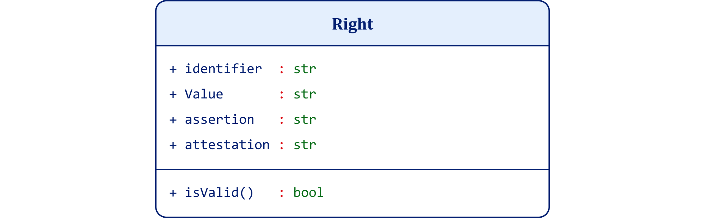

Figure 2-3. Right Concept UML Class Diagram

Figure 2-4. Driving Right UML Object Diagram

Figure 2-3 presents the concept Right as a UML class. It fixes the intensional structure of a right by declaring its essential components: an identifier, the value at stake, an assertion of authority over that value, and an attestation that validates the claim. In line with the analytic definition advanced here, a right is the authority to gain or keep a value. The class declares identity conditions without asserting that any particular right exists.

Figure 2-4 shows the extensional realization of this structure as a drivingRight:Right object. The identifier names the driving privilege. The value specifies the operation of a motor vehicle on public roads. The assertion expresses the bearer’s claim to that authority. The attestation records the state-issued license that substantiates it. The right becomes operative only through attested authority, not through preference, entitlement, or moral appeal.

Together, the diagrams show how one can model rights with constrained identity conditions, how claims differ from authority, and how attestation grounds legitimacy without collapsing values, permissions, or assertions into the concept of a right itself.

Project 2 uses runtime parameters documented in its README. The project passes the defining parts of the right as input parameters: the identifier, the value at stake, the assertion, and the attestation. The example shows that a right is not mere preference or rhetoric, but a constrained structure whose legitimacy depends on attested authority.

This is the corresponding output:

Figures 2-5 through 2-8 model core affect as the physiological substrate of feeling prior to emotion construction. In this framework, I define CoreAffect as a concept and implement it as a UML class. It declares the essential dimensions that constitute affective state as such: valence, arousal, and motivational intensity. These are not emotions, meanings, or attitudes. They fix only the identity conditions of affect at the most fundamental level.

Figure 2-5. Core Affect Concept UML Class Diagram

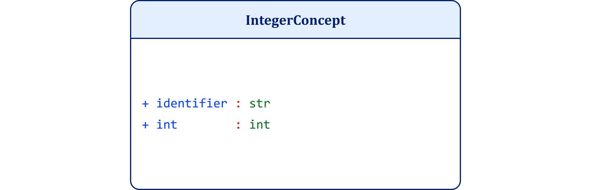

Figure 2-6. Calm State UML Object Diagram

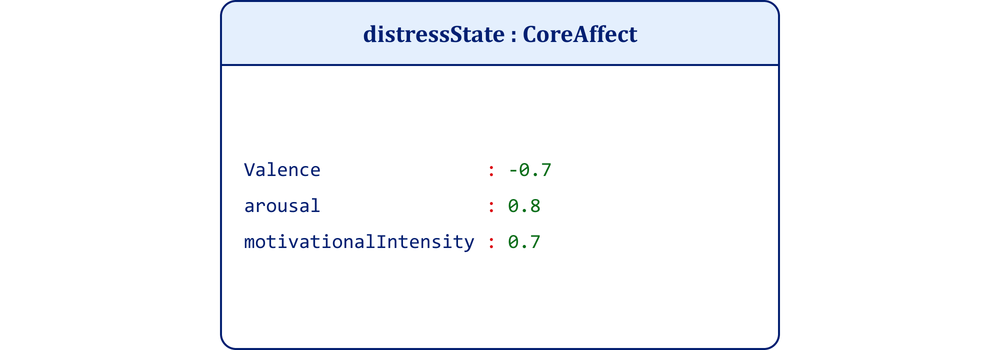

Figure 2-7. Excited State UML Object Diagram

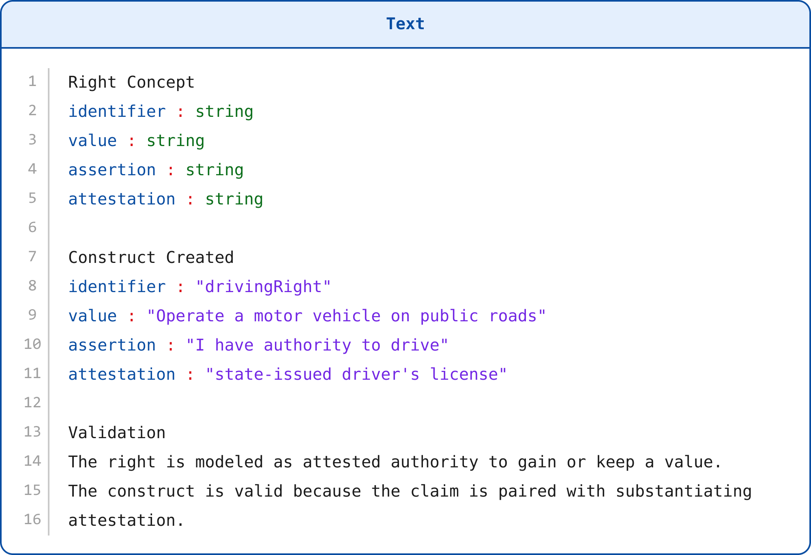

Figure 2-8. Distress State UML Object Diagram

The corresponding object diagrams in figures 2-6 through 2-8 show multiple instantiated core affect states. Each object assigns determinate values to the same declared structure, demonstrating how a single concept admits diverse realizations without altering its identity conditions. The concept continues to govern each realization. Identity conditions do not change. Only instantiation varies.[@russell2003core]

I do not claim that these diagrams literally represent physiological affect. They show how principled criteria can define proposed identity conditions of core affect. The method is not empirical discovery but architectural clarification. Objective principles govern the declaration of the concept. UML makes that structure explicit.[@omg2017uml]

Taken together, the instances form a category: the set of all realized core affect states. This illustrates how categorization emerges from instantiation without redefining the concept itself. Meaning remains fixed at the level of definition. Diversity appears only at the level of realization.[@margolis2023concepts]

Project 3 uses runtime parameters documented in its README. The project passes determinate values for valence, arousal, and motivational intensity. The example shows that a stable conceptual structure defines core affect, while different affective states realize that same structure in different ways.

This is the corresponding output:

Appendix B extends the framework through more complex UML diagrams. It uses associations such as inheritance and composition to model how affective states such as emotions, moods, and drives derive from feeling as a common structural base. It also applies structuralist syntagmatic relations to show how ordered association, not isolated elements, produces meaning. Finally, it introduces GoF creational patterns, including Factory and Prototype, to model the construction of emotional instances from stable conceptual structure rather than their discovery as natural kinds.[@posner1968genesis]

The following propositions summarize the architectural commitments required to define, instantiate, and evaluate ideas as structured systems.

An idea is a unit of meaning that consists of one or more clauses or propositions that one can assert, deny, evaluate, and share.[@omg2017uml]Analytic propositions are true by virtue of meaning alone, and objective rational principles fix their truth.[@omg2017uml]Definition principles establish the identity conditions, integrity, and objectivity of meaning,[@omg2017uml]while analytic truth principles determine what reason can and cannot assert once definitions establish meaning.[@omg2017uml]Definitions state the meaning of concepts, not words; words merely label concepts whose identity conditions definition fixes.[@omg2017uml]

In object-oriented terms, a concept corresponds to a class: a declarative structure that fixes identity conditions and specifies what must be true for any instance to count as what it is.[@omg2017uml, p. 126] A construct corresponds to an object: an extensional realization of a concept in which determinate conditions assign specific values to the declared structure.[@omg2017uml, p. 126] A category corresponds to the set of all constructs that instantiate a concept, that is, the concept’s extension across actual or possible cases.[@omg2017uml, p. 126]UML functions syntactically as a formal notation system that makes conceptual structure explicit, inspectable, and shareable by diagramming declarations, instantiations, and relations without relying on rhetorical description.[@omg2017uml, p. 126]

Chapter 2 has established the architecture that Chapter 1 required. If emotion cannot be defined by pleasure, outward evidence, or inherited names, then I must first define the kind of unit through which emotional meaning becomes intelligible. The answer developed here is that an idea is a truth-apt unit of meaning whose identity depends on structure. A word labels; a concept fixes identity conditions; a construct realizes those conditions under determinate values; a category gathers valid constructs without replacing the concept that governs them.

The chapter also established why definition and analytic truth must remain distinct. Definition fixes the identity conditions that make a concept determinate, non-circular, scope-governed, and inferentially constrained. Analytic truth then states what must follow once those identity conditions hold. This distinction preserves the force of reasoning without converting concepts into mind-independent substances. It also explains why examples, slogans, usages, and prototypes cannot bear the burden of meaning. They may guide recognition, but they cannot supply the architecture that makes recognition accountable.

The computational and diagrammatic work tests the same architecture under stricter conditions. Classical Theory preserves the need for identity conditions, while Prototype Theory explains typicality only after some concept already governs admissibility. Object-oriented grammar, UML, and C# sharpen the distinction: a class declares; an object instantiates; a category collects. The examples of integer, right, and core affect show the same principle across domains. Identity must govern variation, or meaning dissolves into rhetoric, preference, or resemblance. With that architecture in place, the inquiry can now ask whether contemporary theory preserves identity conditions after it rejects naive essence.

I have now established the structural conditions for defining, instantiating, and evaluating ideas. The inquiry must confront a deeper question. Structure fixes identity at the level of declaration and realization. It distinguishes concept from construct, intension from extension, and constraint from instantiation. But this clarification exposes a fault line in contemporary theory. What secures identity conditions once essentialist metaphysics collapses?[@kripke1980naming]

In this chapter, I have demonstrated how a concept can function as a declarative constraint structure and how instantiation realizes that structure under determinate values. The architecture preserves identity without appealing to hidden substances, invariant neural signatures, or metaphysical essences. The question now shifts from how identity operates to whether contemporary concept theory still preserves it at all.[@fodor1998concepts]

In rejecting naive essentialism, much of the field has not merely abandoned fixed essences. It has abandoned identity conditions themselves. The next chapter examines this displacement. It asks whether identity must disappear once essence disappears, or whether a third architecture remains possible: constraint without universality, admissibility without substance, identity without essence.[@wittgenstein1953investigations]

The inquiry therefore turns to the status of identity conditions in contemporary concept theory.

Chapter 3: Identity Is Dead. Long Live Identity:
Why Our Concepts Collapse and How to Repair Them

# Chapter 3: Chasing Ghosts in the Brain

*Why We Need a New Architecture for Identity*

*In Chapter 2, I established the principles that govern definition. I showed that an idea cannot survive as a slogan, a word, or a familiar example. It must have structure. It must specify the conditions under which something counts as an instance.*

*Chapter 3 begins with a different question. If contemporary theory rejects fixed essences, what now secures the identity conditions of concepts?*

*Lisa Feldman Barrett is right to reject naive essentialism. Emotions do not possess fixed biological essences, universal neural fingerprints, or identical phenomenological cores. Anger does not always present the same physiological organization, phenomenological quality, or behavioral expression. Fear does not correspond to a single invariant biological pattern. The classical view expected identity to arise from biological regularity, but the empirical record reveals substantial variation instead.*

*Rejecting naive essentialism does not eliminate the need for identity conditions. It relocates the problem. If concepts no longer derive their identity from essences, a theory must explain what now constrains their admissible instances. For example, we can see how some constructivist theories, particularly Barrett's Theory of Constructed Emotion, relocate conceptual stability into prediction, categorization, and use rather than reconstructing identity conditions themselves. Meaning becomes performance. Correctness becomes whatever works. Disagreement becomes difference. Persistence becomes recurrence.*

*That is not construction. It is drift.*

*I do not intend to restore essence. My goal is to restore conceptual constraint.*

*In this chapter, I  argue for identity conditions without depending on naive essentialism. A concept does not derive its identity from a universal essence in nature. It needs admissibility conditions within a conceptual system. Anger need not possess invariant features, but once a system defines anger, its instances must satisfy the conditions that distinguish anger from grief, fear, or indignation. That is not a claim about a hidden essence. It is an analytic truth within the system.*

*This distinction changes everything. It allows concepts to vary without becoming arbitrary. It allows agents to construct meaning without abandoning constraint. It allows emotion theory to preserve Barrett's empirical insights while refusing the conclusion that identity conditions must collapse into prediction, categorization, or use.*

*The identity condition is dead only if identity condition means essence.*

*Long live the identity condition as constraint.*

*I have restored identity conditions as conceptual constraints. One problem nevertheless remains. Theorists may still detach those conditions from the concepts they govern. Chapter 4 examines this misappropriation and shows how theorists sever identity conditions from the concepts whose admissible instances they are meant to constrain.*

[Notes](../references/notes/chapter-03.md) · [Bibliography](../references/bibliography/chapter-03.md)

In Chapter 2, I established the principles that govern definition. I showed that an idea cannot survive as a slogan, a word, or a familiar example. It must have structure. It must specify the conditions under which something counts as an instance.

Chapter 3 begins with a different question. If contemporary theory rejects fixed essences, what now secures the identity conditions of concepts?

Lisa Feldman Barrett is right to reject naive essentialism. Emotions do not possess fixed biological essences, universal neural fingerprints, or identical phenomenological cores. Anger does not always present the same physiological organization, phenomenological quality, or behavioral expression. Fear does not correspond to a single invariant biological pattern. The classical view expected identity to arise from biological regularity, but the empirical record reveals substantial variation instead.

Rejecting naive essentialism does not eliminate the need for identity conditions. It relocates the problem. If concepts no longer derive their identity from essences, a theory must explain what now constrains their admissible instances. For example, we can see how some constructivist theories, particularly Barrett's Theory of Constructed Emotion, relocate conceptual stability into prediction, categorization, and use rather than reconstructing identity conditions themselves. Meaning becomes performance. Correctness becomes whatever works. Disagreement becomes difference. Persistence becomes recurrence.

That is not construction. It is drift.

I do not intend to restore essence. My goal is to restore conceptual constraint.

In this chapter, I  argue for identity conditions without depending on naive essentialism. A concept does not derive its identity from a universal essence in nature. It needs admissibility conditions within a conceptual system. Anger need not possess invariant features, but once a system defines anger, its instances must satisfy the conditions that distinguish anger from grief, fear, or indignation. That is not a claim about a hidden essence. It is an analytic truth within the system.

This distinction changes everything. It allows concepts to vary without becoming arbitrary. It allows agents to construct meaning without abandoning constraint. It allows emotion theory to preserve Barrett's empirical insights while refusing the conclusion that identity conditions must collapse into prediction, categorization, or use.

The identity condition is dead only if identity condition means essence.

Long live the identity condition as constraint.

I have restored identity conditions as conceptual constraints. One problem nevertheless remains. Theorists may still detach those conditions from the concepts they govern. Chapter 4 examines this misappropriation and shows how theorists sever identity conditions from the concepts whose admissible instances they are meant to constrain.

CHAPTER IV

The Misappropriation of the Concept

The Orphaning of Identity Conditions

In Chapter 2, I established that ideas require structure. A concept does not merely name a kind. It specifies the admissibility conditions under which something counts as an instance. I distinguished concepts from constructs and declarations from instantiations in order to separate identity from realization. I used object-oriented form and UML as a grammar of identity to enforce this distinction. I used the integer, the right, and core affect as controlled examples to demonstrate the same architectural principle: concepts derive their identity from admissibility conditions, whereas instances derive their identity from satisfying those conditions.

A concept fixes what something is. It specifies the admissibility conditions under which something counts as an instance. An instance realizes those conditions under determinate values. A conceptual system organizes those admissible instances into categories, but it does not alter the admissibility conditions that govern instantiation.

Contemporary concept theory faces a structural failure that theorists rarely name. In rejecting naive essentialism, the field has not merely abandoned fixed essences. It has often abandoned identity conditions. Existing accounts explain categorization, prediction, and adaptive success, yet they struggle to explain why distinct episodes count as instances of the same emotion. These theories describe what concepts do, but they do not always secure the admissibility conditions that govern instantiation.[@object2017work, p. 126]

I address this failure through the case of Lisa Feldman Barrett's Theory of Constructed Emotion.[@jaroslav2023inferentialism] Barrett correctly rejects the classical view that emotions possess necessary and sufficient features, invariant neural signatures, or discoverable biological essences.[@jaroslav2023inferentialism] Those commitments cannot withstand empirical scrutiny.[@jaroslav2023inferentialism] The empirical record justifies the collapse of naive essentialism.

Rejecting essences solves one problem but introduces another. Once essences disappear, a theory must explain what now constrains admissible instances. In discarding essences, Barrett redefines concepts operationally.[@karl2010freeenergy] Barrett describes concepts as dynamic constructions that the brain assembles from prior instances for predictive purposes. Barrett argues that the brain assembles concepts from prior instances for predictive purposes.[@karl2010freeenergy] Stability follows performance. Persistence becomes recurrence. Meaning becomes inseparable from execution.[@lisa2017theory]

This move preserves flexibility and context sensitivity, but it carries a heavy cost. If a theory eliminates identity conditions rather than reconstructing them, it cannot preserve a principled distinction between correct and incorrect application. It cannot distinguish disagreement from mere difference. It redescribes error as prediction error within a regulatory model rather than as misapplication relative to specified admissibility criteria.[@karl2010freeenergy] Persistence reduces to repetition. The theory explains adaptive regulation, yet it cannot explain why an episode counts as an instance rather than a revision, a replacement, or a relabeling.

My goal is not to revive essentialism. I aim to restore identity without it. Barrett's rejection of essences is correct, but her framework overcorrects by collapsing identity conditions into performance.[@karl2010freeenergy] Concepts are neither immutable biological kinds nor momentary predictive assemblies.[@karl2010freeenergy] A concept does not possess identity as an object. A concept specifies the admissibility conditions under which something counts as an instance of a given kind.

Identity attaches to instantiations relative to operative admissibility conditions. The failure I diagnose concerns the disappearance of those conditions, not the metaphysical status of concepts. I treat concepts as upstream constraint structures. These constraints fix admissible forms of application without fixing particular properties, neural realizations, or experiential uniformity.

I distinguish between identity conditions and identity. Identity conditions comprise the operative admissibility constraints a concept specifies. Identity represents the status of a particular instantiation relative to those constraints. Identity does not exist as an additional property over and above instantiation. It constitutes the normative standing of an instantiation as admissible under operative conditions.

The classical view Barrett targets assumes that each emotion possesses an internal essence. On this model, a concept consists of necessary and sufficient features that define membership.[@lisa2017theory] This view dictates that anger has a defining structure, fear has a distinctive biological signature, and sadness carries a stable phenomenological core. If a state lacks these defining features, it fails to qualify. Identity conditions precede variation, and variation must conform to them.

Barrett challenges this framework directly. She argues that the classical view of concepts, which assumes each concept has a definition, does not survive scientific scrutiny.[@object2017work, p. 126] She rejects the idea that emotions correspond to fixed biological kinds, insisting that no consistent fingerprint exists for anger or any other emotion.[@object2017work, p. 126] That conclusion follows from the same empirical record. Neuroscience does not identify stable one-to-one mappings between specific brain regions and specific emotions.[@lisa2017theory] Activation patterns vary across individuals and contexts.[@lisa2017theory] Cultural anthropology further shows variation in how emotions receive labels and meanings, while phenomenology reveals that one person's "anger" may be another person's "indignation."[@lisa2017theory] Naive essentialism fails because it overstates the regularity that data can support.[@lisa2017theory]

Barrett performs an important corrective by dismantling the expectation that emotions function like natural kinds with hidden biological substances.[@lisa2017theory]  She shows that variability and neural reuse characterize emotional life.[@lisa2017theory] I accept that corrective. The question remains: what secures identity conditions once essences disappear?[@lisa2017theory]

Barrett does not stop at rejecting essences. She replaces the classical account with an explicitly operational one.[@karl2010freeenergy] In place of necessary and sufficient features, she offers a model where concepts function as dynamic resources for prediction and categorization.[@karl2010freeenergy] This shift does not merely revise identity conditions. It relocates them downstream into use.

She also rejects prototype theory.[@object2017work, p. 126] In her view, concepts do not exist as stored idealized averages of experience.[@object2017work, p. 126] The rejection extends beyond classical essentialism to any account that treats concepts as enduring representational structures. What remains is construction in context rather than admissibility conditions that constrain instantiation.

In her foundational articles, Barrett writes that concepts are "collections of instances" and that the brain "imposes similarities" between them when needed.[@object2017work, p. 126] On this view, a concept does not constrain instantiation through admissibility conditions. It gathers prior experiences and groups them according to situational demands. Similarity replaces constraint.

Barrett describes concepts as tools for prediction.[@karl2010freeenergy] She argues that the brain uses past instances to anticipate sensory input and regulate the body.[@karl2010freeenergy] She insists that concepts are not static representations but are "constructed on the fly."[@karl2010freeenergy] As a result, the term concept begins to overlap with prediction and categorization themselves. Categorization does not merely apply a concept. It participates in producing the conceptual organization that then counts as meaning.[@lisa2017theory]

Barrett explains stability through functional success, claiming that concepts stabilize because they work.[@lisa2017theory] If a pattern of categorization reliably reduces uncertainty, it continues. Stability follows performance. Under this replacement strategy, a concept no longer constrains instantiation in advance. It functions as a predictive resource assembled for task success. Similarity organizes prior instances. Categorization imposes structure on sensation. Prediction regulates the body. Use determines continuity. Identity conditions dissolve into operation.[@lisa2017theory]

Barrett's operational account introduces a deep structural shift. Meaning no longer arises because admissibility conditions constrain application. Instead, meaning arises through the act of categorization itself.[@lisa2017theory] She argues that the brain makes meaning of sensation by categorizing it.[@lisa2017theory] In this formulation, categorization generates intelligibility in the moment of use. When she states that concepts are constructed on the fly to meet situational demands, she identifies the act of assembling prior instances for prediction as the concept itself. Conceptual structure appears as an outcome of successful regulation.[@gross1998emerging]

My model differs in where I locate conceptual constraint. Operative admissibility conditions constrain how particular affective episodes count as instances. An episode counts as anger because it satisfies admissibility conditions operating within a conceptual system relative to an agent, a context, and a goal. These conditions govern application rather than emerging from it. Categorization succeeds or fails relative to those constraints. By contrast, Barrett's model allows categorization to participate in generating conceptual organization during regulation. Stability therefore follows from regulatory success rather than from independently specified admissibility conditions.

If categorization generates meaning, then admissibility conditions cannot govern use because they emerge from it. The theory then explains persistence through the recurrence of successful assemblies rather than through operative criteria that constrain instantiation.[@object2017work, p. 126] This reversal carries heavy consequences. If conceptual structure arises from context-sensitive categorization, then nothing fixes the criteria under which distinct episodes count as instances rather than mere functional resemblances. The similarities that guide categorization vary with context and task demands, and predictive success varies with an agent's goals. Without independently articulated admissibility conditions, neither similarity nor predictive success independently determines what counts as an admissible instance. As long as regulation succeeds, conceptual stability risks becoming indistinguishable from conceptual drift.

When Barrett eliminates identity conditions, she removes the standard by which application counts as correct or incorrect. If a concept consists of context-sensitive prediction assembled for regulatory success, then no independent criterion governs its proper use.[@karl2010freeenergy] Performance becomes the only measure.

I accept the variability Barrett describes. There is no single correct way to experience an emotion.[@lisa2017theory] But my position does not require universal phenomenology or fixed neural signatures. Constraint does not imply universality. Identity conditions can vary across agents and still constrain instantiation within each system.

Even if an agent generates a concept at runtime, they must generate it under constraints that determine what counts as an instance. Runtime construction does not eliminate identity conditions. It presupposes them.[@lisa2017theory] Without constraints that distinguish anger from grief, categorization collapses into relabeling. Similarity may recur and regulation may succeed, but nothing makes an episode accountable as an instance rather than a new construction with a familiar name.

Under Barrett's framework, error reduces to failed prediction.[@karl2010freeenergy] Yet predictive success does not secure identity conditions. Two different assemblies may both regulate effectively while diverging structurally. Without operative admissibility conditions, pragmatic adequacy replaces conceptual correctness.

When two agents categorize the same situation differently, Barrett's framework explains the difference by appeal to their distinct predictive histories.[@karl2010freeenergy] But that explanation cannot tell us whether either agent has used the concept correctly. If no identity conditions govern the concept beyond contextual performance, then disagreement no longer concerns meaning. It becomes a difference in regulation.

The same problem appears with persistence. Barrett claims concepts stabilize because they work, but recurrence does not secure identity.[@lisa2017theory] A pattern may reappear while its boundary and structure change. Utility explains why a pattern continues. It does not explain why the same concept continues.

In this respect, Barrett's position generates deeper problems than the naive essentialism she seeks to replace. The classical view misplaced identity conditions in rigid definitions, but it preserved the idea that application answers to criteria.[@jaak2005affective] One could misapply the concept of anger because the concept specified constraints governing its admissible instances. The classical view located those constraints in essence, but it correctly recognized that concepts require identity conditions.

Barrett escapes rigidity by relocating structure into performance, but that move leaves intelligibility without independent criteria. Once identity conditions collapse into performance, correctness becomes pragmatic success, disagreement becomes contextual divergence, and persistence becomes recurrence. I do not restore essence. I restore constraint. Instantiation must answer to operative criteria rather than to mere predictive success.

Barrett frames her project as a rejection of essences. She argues that the idea of emotional essences is a myth and that emotions lack fixed biological cores.[@lisa2017theory] I agree with her rejection of hidden substances and invariant neural fingerprints. However, her framing creates a problem by equating identity conditions with universality. She assumes that if emotions lack fixed biological cores, they must also lack stable identities.[@lisa2017theory]

This move creates a false dilemma: either emotions possess discoverable essences that fix identity across all agents, or they exist only as context-sensitive constructions.[@lisa2017theory] The debate often appears as a choice between rigid natural kinds and radically context-sensitive construction. I propose a third architecture: constraint without universality.

I do not require universal identity conditions across all agents. I require only that instantiation answer to operative admissibility conditions for a given agent within a conceptual system. These conditions can remain agent-relative without becoming arbitrary. They can vary across systems while still functioning as constraints within each system. Barrett's critique does not appear to distinguish this alternative from the essentialism she rejects. She treats the rejection of essences as a reason to relocate conceptual stability into prediction, categorization, and use.[@karl2010freeenergy]

Prototype theory fails for the same structural reason. Similarity alone cannot secure identity conditions without constraints that distinguish one concept from another. A cluster of instances does not explain what makes them instances rather than overlapping neighbors.[@karl2010freeenergy] By rejecting both essences and prototypes without separating identity from universality, Barrett does not reconstruct a layer of admissibility constraint distinct from predictive regulation.

I maintain that concepts can secure identity conditions without essences. A concept functions as a structured set of admissibility conditions within a conceptual system. These conditions determine what counts as an instance for a given agent in a given context for a given goal. They do not dictate a uniform phenomenology or require cross-cultural universality. They constrain instantiation without demanding uniform realization.

I do not treat "emotion" as a single master category. Each named emotion functions as its own category composed of diverse admissible instances. Anger is not a simple instance of emotion. Anger is a structured category defined by admissibility conditions. The diversity of anger episodes does not threaten identity. It expresses it. Constraint operates at the level of each emotion, not at the level of a single genus. Identity, understood as admissibility, differs from essence in kind.

Objective structure does not require uniform substance. The Pythagorean theorem applies to infinitely many right triangles regardless of their size or material.[@eric2023concepts] The inputs and outputs vary, yet a governing relation persists and constrains admissible solutions. The relation remains structurally stable even though its realizations differ. The same applies here. Identity under constraint does not require identical neural patterns or cross-cultural invariance.

Neural decoding makes the same point from the other side. Each brain exhibits distinct activation patterns, yet decoding succeeds because structured mappings operate within that specific system.[@eric2023concepts] Variation presupposes constraint.

Under my framework, anger need not possess invariant features, but once a conceptual system defines anger, its instances must satisfy the admissibility conditions that distinguish anger from grief or fear. This is an analytic truth within the system, not a claim that nature contains a universal essence of anger. These conditions may evolve, but they cannot disappear without collapsing the distinction itself. This remains compatible with construction and context sensitivity. A concept may emerge at runtime, but that assembly occurs under constraints. Construction explains instantiation. Constraint secures identity. They operate at different levels.

Identity under constraint imposes coherence rather than rigidity. It explains how an agent corrects a misclassification or recognizes two episodes as instances despite superficial differences.[@object2017work, p. 126] It allows cumulative learning rather than mere repetition. By distinguishing identity conditions from essence, I preserve Barrett's empirical insights while restoring the architectural layer her framework omits.

Appendix C extends this argument through a constraint analysis of Barrett's goal-based examples. It separates identity conditions, instantiation, goal selection, runtime construction, and multi-concept classification so that goal flexibility can do its proper work without dissolving the criteria that govern admissible instances.

Barrett’s contributions regarding neural reuse and predictive processing identify features of implementation, not identity. When she shows that the same neurons create different mental states on different occasions, she demonstrates variability of realization, not an absence of constraint.[@karl2010freeenergy] Prediction explains how episodes receive interpretation. Constraint explains what makes an episode count as an instance. The disagreement concerns where identity conditions operate. Barrett locates conceptual structure downstream in performance. I locate admissibility upstream as an operative constraint.

When identity conditions disappear, the term concept drifts between naming neural activity, predictive routines, and behavioral outcomes. This allows downstream processes to perform identity-level work without admitting the substitution. If categorization itself generates the criteria in the act of performance, then no independent structure remains by which categorization can be evaluated.[@eric2023concepts] Categorization cannot supply the criteria by which we normatively assess it.

I have therefore defended the central distinction that Chapter 2 made necessary. Barrett is right to reject naive essentialism. Emotions do not carry fixed biological essences, invariant neural fingerprints, or universal phenomenological cores. That rejection preserves what contemporary emotion theory has learned from variability, construction, neural reuse, and cultural difference. But I have also shown that the rejection of essence cannot become the rejection of identity conditions. If essence dies and nothing replaces it, concepts do not become free. They drift.

I repair that problem through constraint without universality. A concept need not possess a hidden substance in nature in order to govern its instances. It must specify admissibility conditions within a conceptual system. Those conditions may be agent-relative, context-sensitive, revisable, and goal-bound, but they cannot disappear without collapsing the distinction between correct application and useful performance. Construction explains how an episode comes to be assembled. Constraint explains why that episode counts as anger rather than grief, fear, indignation, or a merely successful regulatory act.

I therefore arrive at a standard of accountability. A theory may reject essences, accept construction, and preserve context sensitivity, but it still must state the criteria by which an instance counts as what the theory calls it. Without that standard, flexibility becomes drift, and construction loses the very identity it claims to explain.

The next chapter examines how theorists misappropriate the concept when they sever identity conditions from the concepts they govern.

# Chapter 4: The Misappropriation of the Concept

*The Orphaning of Identity Conditions*

*Chapter 3 argued that identity conditions ought to survive the rejection of fixed essences. Chapter 4 examines what follows when theories fail to preserve that distinction.*

*Modern theories rightly reject the classical assumption that concepts derive their identity from fixed essences. Emotion does not come stamped with one neural signature, one bodily pattern, or one universal expression. Concepts do not exist as fixed inner essences awaiting application. Lisa Feldman Barrett, Eleanor Rosch, George Lakoff, Lawrence Barsalou, Andy Clark, and Karl Friston all contribute to dismantling that assumption.*

*Rejecting fixed essences, however, does not by itself explain what secures identity conditions.*

*When theorists reject essences without reconstructing identity conditions, they relocate explanatory work to the wrong level. They ask categorization, prediction, similarity, learning, culture, and task success to perform work that belongs to identity conditions. They mistake partitioning for concept formation. They treat the classification of observed instances as if it could explain the conditions that make an instance admissible in the first place.*

*A color boundary can separate blue from green. It cannot define what color is. A culture can treat a grub as food or as a pest. It cannot change what makes the organism a grub. An agent can classify a bodily state as anger or fear. That classification still presupposes conditions that distinguish anger from fear.*

*This chapter exposes that architectural error: downstream operations assume upstream authority. They borrow the explanatory work of identity conditions while denying the need for them.*

*The repair is simple but fundamental: restore each explanatory level to its proper place.*

*Concept constrains. Instance realizes. Category groups.*

*A concept specifies admissibility conditions. An instance either satisfies or violates those conditions. A category organizes admissible instances relative to a goal. Prediction, simulation, learning, culture, and embodiment all contribute to conceptual performance, but they operate within a constraint space. They do not create that space.*

*This distinction allows me to preserve the major achievements of contemporary concept theory without surrendering meaning to conceptual drift. Concepts may adapt without becoming arbitrary. Categories may vary without redefining the concepts they organize. Agents may construct meaning without abandoning conceptual constraint.*

*Chapter 5 examines the false dichotomy that made this architectural error appear inevitable: the supposed opposition between classical definitions and prototype theories. I argue that this choice is mistaken. The deeper question does not concern whether concepts possess rigid essences or flexible prototypes. It concerns where a theory locates identity conditions. Do they reside upstream in the concept that constrains admissible instances, or downstream in the operations that sort those instances? That question frames the next stage of the argument.*

[Notes](../references/notes/chapter-04.md) · [Bibliography](../references/bibliography/chapter-04.md)

Chapter 3 argued that identity conditions ought to survive the rejection of fixed essences. Chapter 4 examines what follows when theories fail to preserve that distinction.

Modern theories rightly reject the classical assumption that concepts derive their identity from fixed essences. Emotion does not come stamped with one neural signature, one bodily pattern, or one universal expression. Concepts do not exist as fixed inner essences awaiting application. Lisa Feldman Barrett, Eleanor Rosch, George Lakoff, Lawrence Barsalou, Andy Clark, and Karl Friston all contribute to dismantling that assumption.

Rejecting fixed essences, however, does not by itself explain what secures identity conditions.

When theorists reject essences without reconstructing identity conditions, they relocate explanatory work to the wrong level. They ask categorization, prediction, similarity, learning, culture, and task success to perform work that belongs to identity conditions. They mistake partitioning for concept formation. They treat the classification of observed instances as if it could explain the conditions that make an instance admissible in the first place.

A color boundary can separate blue from green. It cannot define what color is. A culture can treat a grub as food or as a pest. It cannot change what makes the organism a grub. An agent can classify a bodily state as anger or fear. That classification still presupposes conditions that distinguish anger from fear.

This chapter exposes that architectural error: downstream operations assume upstream authority. They borrow the explanatory work of identity conditions while denying the need for them.

The repair is simple but fundamental: restore each explanatory level to its proper place.

Concept constrains. Instance realizes. Category groups.

A concept specifies admissibility conditions. An instance either satisfies or violates those conditions. A category organizes admissible instances relative to a goal. Prediction, simulation, learning, culture, and embodiment all contribute to conceptual performance, but they operate within a constraint space. They do not create that space.

This distinction allows me to preserve the major achievements of contemporary concept theory without surrendering meaning to conceptual drift. Concepts may adapt without becoming arbitrary. Categories may vary without redefining the concepts they organize. Agents may construct meaning without abandoning conceptual constraint.

Chapter 5 examines the false dichotomy that made this architectural error appear inevitable: the supposed opposition between classical definitions and prototype theories. I argue that this choice is mistaken. The deeper question does not concern whether concepts possess rigid essences or flexible prototypes. It concerns where a theory locates identity conditions. Do they reside upstream in the concept that constrains admissible instances, or downstream in the operations that sort those instances? That question frames the next stage of the argument.

CHAPTER V

Rules vs. Prototypes

Why the Great Debate Over Concepts Is a Faux Dichotomy

In the previous chapter, I established a critical distinction: identity condition does not naively mean essence.[@object2017work, p. 126] Identity conditions function as architectural constraints.[@object2017work, p. 126] They specify the admissibility conditions under which something can count as an instance.[@object2017work, p. 126] I agreed with Lisa Feldman Barrett that emotion theory should reject naive essentialism.[@object2017work, p. 126] Emotions do not possess invariant neural signatures, universal biological fingerprints, or necessary and sufficient features.[@object2017work, p. 126] The empirical evidence no longer supports the classical view.[@object2017work, p. 126]

Rejecting naive essentialism, however, does not eliminate the need for identity conditions.[@karl2010freeenergy] It relocates the problem.[@karl2010freeenergy] When some contemporary constructivist theories reject essences without reconstructing identity conditions, they relocate explanatory work toward categorization, prediction, and regulatory success.[@karl2010freeenergy] Barrett's Theory of Constructed Emotion illustrates this strategy.[@karl2010freeenergy] On this reading, identity conditions no longer stand upstream as admissibility constraints for instantiation. They instead depend upon whatever stabilizes through successful prediction, categorization, or use.[@karl2010freeenergy]

The failure occurs at a precise architectural point. Theorists mistake partitioning for definition.[@object2017work, p. 126] They treat grouping and discrimination among instances as if those operations constitute concepts, even though those operations presuppose a concept already in place.[@object2017work, p. 126] A color boundary can divide samples into blue and green, but the boundary does not define what color is.[@object2017work, p. 126] A psychological taxonomy can group episodes under anger, fear, or grief, but the grouping does not define what an emotion is or what makes anger anger.[@object2017work, p. 126] A legal system can classify claims as rights, privileges, powers, or immunities, but the classification does not define the authority structure that makes a right a right.[@object2017work, p. 126] Once partitioning substitutes for definition, explanatory order inverts.[@object2017work, p. 126] Downstream operations begin to perform explanatory work that belongs upstream.[@object2017work, p. 126] Stability then reduces to task-relative success.[@object2017work, p. 126]

I call this an architectural error because it concerns explanatory priority.[@karl2010freeenergy] Some conditions must stand first before later operations can make sense.[@karl2010freeenergy] Identity conditions determine what counts as a possible instance of a concept before any act of grouping, prediction, or categorization.[@karl2010freeenergy] Categorization presupposes a domain of admissible instances.[@karl2010freeenergy] Prediction presupposes determinate kinds.[@karl2010freeenergy] Learning presupposes stability across cases.[@karl2010freeenergy] When theorists treat operations that depend upon identity conditions as the source of identity conditions, they reverse the order of explanation.[@karl2010freeenergy]

The question, then, does not concern whether categorization and prediction occur. They do.[@karl2010freeenergy] The question concerns where a theory locates identity conditions.[@karl2010freeenergy] Partitioning answers which instances belong together.[@karl2010freeenergy] A concept answers the prior question: what kind of thing exists such that partitioning can occur at all?[@karl2010freeenergy] When theorists collapse that priority, concepts become momentary products of learning, prediction, or cultural grouping.[@karl2010freeenergy] The resources required to explain error, disagreement, and sameness across contexts disappear.[@karl2010freeenergy]

I resolve this failure by diagnosis rather than rebuttal. I preserve the empirical phenomena that constructionist, prototype, embodied, and predictive accounts rightly emphasize.[@karl2010freeenergy] I restore the constraint architecture those phenomena presuppose. I isolate a shared structural misplacement: theorists orphan identity conditions when they push conceptual structure downstream into clustering, categorization, prediction, and learning.

On my account, concepts function as constraint structures that fix identity conditions prior to execution. Categorization, prediction, learning, and simulation occur within those constraints. They presuppose identity conditions. They do not generate them.

To maintain this distinction, I use UML and object-oriented formalisms to enforce type-instance discipline and expose illicit explanatory shifts.[@object2017work, p. 126] These tools do not serve as metaphors for cognition. I use them as formal instruments to prevent equivocation between definition, realization, and grouping.

Accordingly, I introduce the repair at a single level: the point at which a theory fixes identity conditions. I do not attempt to correct downstream errors one by one. Once I restore explanatory order, those errors begin to lose their force.

I begin with a simple experimental pattern that Barrett references in How Emotions Are Made.[@lisa2017theory] Researchers show subjects several distorted versions of a visual pattern. The subjects never see the original pattern itself. Later, however, they often recognize or classify the unseen original as if they had inferred it from the distorted examples. This is the dot-pattern paradigm associated with Michael Posner and Steven Keele.[@posner1968genesis]

The case matters because it seems to show that the mind can derive a central pattern from examples without retrieving a fixed intensional definition. I accept that lesson. But the experiment also hides a deeper constraint. Subjects can infer a central pattern only because the experiment already supplies a structured representational space within which the examples can vary.[@posner1968genesis] The dots can move, but they do not cease to belong to the same task. The mind can infer a central tendency because the experiment has already fixed the underlying space within which variation occurs.

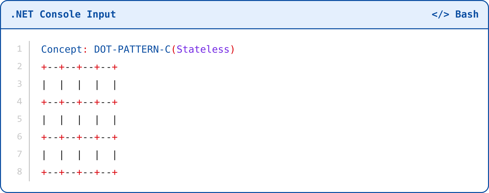

Figure 4-1. Dot-Pattern Distortions and Prototype Abstraction

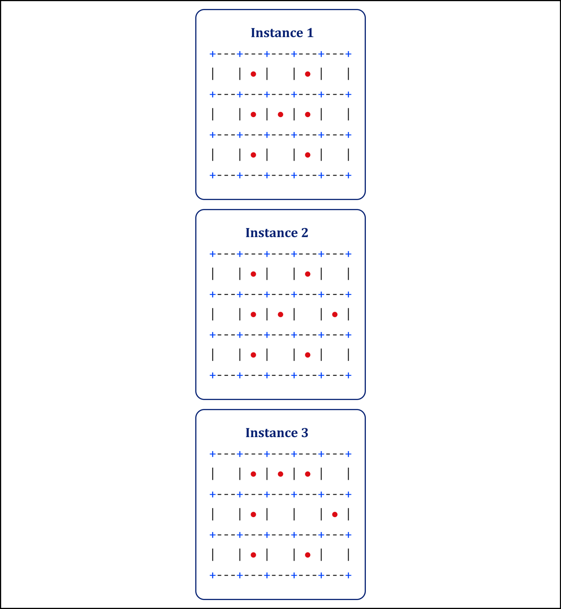

Figure 4-2. Dot-Pattern Central Tendency and Inferred Prototype

The color-boundary and grub examples I analyze in this chapter come from Lisa Feldman Barrett's public lecture on concepts accompanying How Emotions Are Made.[@object2017work, p. 126] In that lecture, she uses color continua and cross-cultural categorization, such as grubs as food in one culture and pests in another, to argue that conceptual boundaries arise through construction rather than discovery.[@object2017work, p. 126] She argues that the brain constructs concepts and uses them to categorize sensory input rather than discovering ready-made categories in the world, and she treats color boundaries as boundaries imposed by a perceiver rather than dictated by nature.[@object2017work, p. 126] She also invokes the dot-diagram study to challenge the assumption that concepts must exist as fixed templates, definitions, or prototypes.[@object2017work, p. 126] Referring to the classic Posner and Keele paradigm, she explains that participants can abstract a central tendency from exemplars even though they never saw the prototype itself.[@object2017work, p. 126]

Subjects can categorize novel stimuli and infer a central tendency without retrieving a canonical mental object. But my diagnostic question cuts deeper: does the inferred region reveal categorization behavior, or does it become the concept itself?

For a formal constraint reconstruction of Barrett's goal-based concept examples, including fish and car, see Appendix C: Reconstructing Goal-Based Concepts. That appendix shows how a goal can change which instances matter in a particular context without changing the deeper conditions that make those instances belong to the concept in the first place.

I begin with the dot-diagram case because it exposes the architectural temptation. Posner and Keele report that subjects abstracted a prototype from distorted patterns even when the prototype never appeared during training.[@object2017work, p. 126] They also report that participants later classified novel patterns in terms of their distance from the prototype.[@object2017work, p. 126] More broadly, the dot-diagram case supports the constructivist claim that successful categorization can arise from comparing instances rather than retrieving a fixed mental template.[@object2017work, p. 126]

That claim can stand. The error begins only when theorists promote evidence about categorization into a theory of concept identity.

Appendix D isolates this same ordering error in Barrett's goal-based examples and provides a formal reconstruction of the Posner-Keele paradigm, including its vector-space specification and distance metrics. I introduce that reconstruction not to mathematize cognition, but to make explicit the constraint structure the experiment presupposes.

The statistical operations that support prototype abstraction remain intelligible only within a fixed constraint space. The experiment must first determine the admissibility conditions of that space before inference can occur.[@posner1968genesis] Subjects may infer a prototype, but the structural constraints of the grid and the dimensionality of the vector space fix the identity conditions of the task. The inference occurs downstream. The constraints stand upstream.

I therefore begin the diagnostic sequence with the foundational error: treating partitioning as concept formation. Clustering, categorization, and similarity judgment do not constitute concepts. They presuppose a constraint structure already in place.

Distinct instances can arise under different physical, perceptual, or contextual conditions while remaining governed by the same identity conditions. That fact makes sense only if conceptual identity does not reside in similarity among instances.

The corresponding C# executables for the projects below appear in the downloaded ZIP file under the matching project folder. Each folder includes a README with instructions for building, running, and reproducing the sample outputs.

Project 1 establishes the core thesis of the chapter by formalizing the distinction between concept, instance, and category. The concept specifies an upstream constraint structure that fixes admissibility conditions before any instance can exist. The instance realizes those conditions by supplying determinate values that either satisfy or violate them. The category organizes valid instances only after the system admits them.[@object2017work, p. 126] In this way, the program enforces type-instance discipline and prevents the central architectural error the chapter diagnoses: confusing grouping behavior with conceptual identity. The example maps directly to the Color Concept UML Class Diagram and the Color Constructs UML Object Diagrams by showing that identity conditions reside in the class-level constraint structure rather than in the later act of classification.

The color-boundary example clarifies the distinction. Viewed rhetorically, the example critiques naive essentialism. Viewed architecturally, it reveals a more specific confusion: treating partitioning behavior as conceptual identity. I introduce the color case not as an independent case study but as part of Barrett's own exposition of her theory of concepts.[@lisa2017theory]

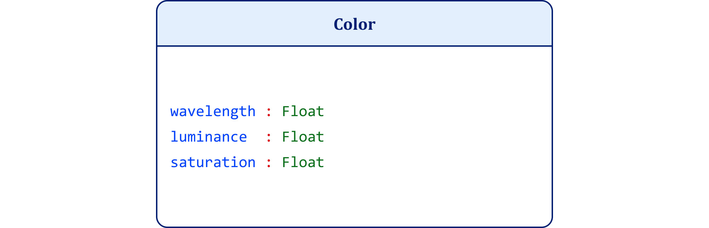

Figure 4-3. Color Concept UML Class Diagram

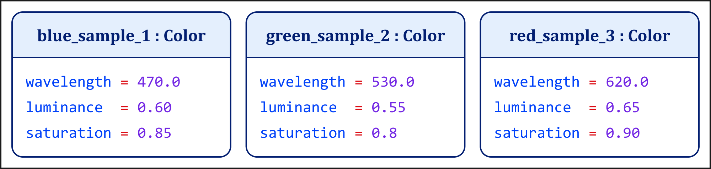

Figure 4-4. Color Constructs UML Object Diagrams

Figure 4-5. Color Category UML Object Diagram

Barrett uses the color-boundary example to argue that color categories do not reflect fixed divisions in the world. In How Emotions Are Made, she writes that the physical world does not dictate objective boundaries between one color and another.[@object2017work, p. 126] In her public lecture, she similarly argues that conceptual activity constructs color categories rather than discovers them.[@object2017work, p. 126]

Viewed architecturally, however, the example reveals what must already exist before any partitioning can occur. A color concept specifies admissible dimensions such as wavelength, luminance, and saturation without fixing particular values. Individual color samples assign determinate values within that constraint space. Categories then group those samples relative to a task or goal. None of these downstream operations defines what color is. They presuppose the conceptual structure that makes grouping intelligible in the first place. Partitioning determines which samples cluster together. A concept determines what kind of entity color is such that clustering can occur at all. When boundary construction becomes concept formation, explanatory order inverts and conceptual identity collapses into task-relative success.[@lisa2017theory]

Once partitioning substitutes for definition, a further collapse follows. Concepts, instances, and categories merge into a single explanatory level. I resist that collapse through strict type-instance discipline. A concept specifies a class-level constraint structure that fixes identity conditions. An instance realizes those conditions under determinate values. A category groups instances relative to a goal. The color case makes the point concrete: grouping samples into categories does not alter the conceptual structure that determines what counts as a valid color instance in the first place.[@object2017work, p. 126]

Project 1 operationalizes the distinction between concept, instance, and category. The goal is to show that identity conditions stand upstream as constraint structure. The system never infers identity conditions from downstream grouping.

Figure 4-3 shows the ColorConcept as a class-level structure. It defines admissibility conditions for wavelength, luminance, and saturation. This is the concept: it does not describe any particular color, but specifies what can count as a color at all. Figure 4-4 then shows three valid color constructs, each of which instantiates the concept by supplying determinate values for those dimensions. Figure 4-5 shows the later category-level grouping: blue, green, and red samples can be organized together as a color category only after the concept has already fixed the admissible structure and the instances have supplied valid particulars.

The ColorInstance assigns determinate values. This is the instance. It either satisfies the concept or the system rejects it. The IsAdmissible check enforces this boundary and prevents invalid instantiation.

Only after a valid instance exists does classification occur. The category is a downstream grouping of valid instances. It does not define what a color is.

The sequence matters. Figure 4-6 presents the Grub concept as the class-level structure that fixes the relevant admissibility conditions: whether the organism can function as edible and whether it can function as a pest. Figure 4-7 presents a concrete grub instance, grub_boston, with determinate values for those conditions. The instance realizes the concept before any downstream category applies. Concept constrains. Instance realizes. Category groups.

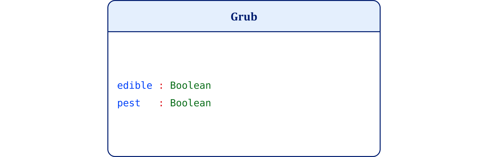

Figure 4-6. Grub Concept UML Class Diagram

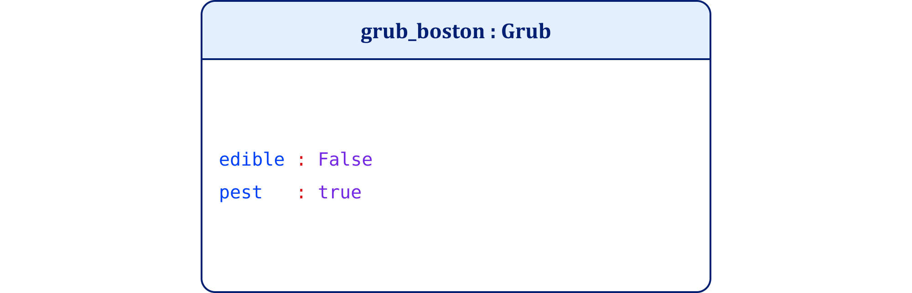

Figure 4-7. Grub Constructs UML Object Diagrams

The distinction sharpens in discrete cases. Figures 4-6 and 4-7 show why the grub remains the same kind of organism even when later classifications differ. Barrett uses the grub example to show that one culture may classify a grub as food while another may classify it as a pest.[@object2017work, p. 126] She presents the example as evidence of cultural construction and variability in categorization. Viewed architecturally, however, the example demonstrates something narrower and more precise: classification varies, but kind does not.

A grub does not become a different kind of organism because one culture eats it and another rejects it. The cultural category changes. The purpose changes. The evaluative context changes. The organism nevertheless retains the admissibility conditions that make it a grub. Food and pest name downstream classifications relative to human goals. They do not define the biological kind itself.

Project 2 operationalizes this distinction. The program first validates whether the organism satisfies the admissibility conditions of the GrubConcept. Only after the system admits a valid grub instance does it classify that instance according to cultural context. When the context is food, the valid grub instance enters the category Food. When the context is pest, the same valid grub instance enters the category Pest. In both cases, the organism remains an admissible instance of the GrubConcept.

The architectural point now becomes clear. Category changes do not rewrite identity conditions. They apply different classificatory purposes to an already admissible instance. The concept constrains what the thing is. The instance realizes those constraints. The category organizes that instance relative to a goal.

This matters because the same confusion reappears in theories of emotion. If one agent classifies a bodily state as anger and another classifies a similar state as fear, the variation may reveal differences in context, learning, language, or purpose. It does not follow that the concept lacks governing identity conditions. It follows only that classification varies. A theory must still explain what makes anger anger, what makes fear fear, and what distinguishes reinterpretation from error.

The conflation begins when theorists treat categorization not as the application of a concept, but as its origin. Barrett argues that emotion concepts emerge from experience and that the brain uses past experience, organized as concepts, to guide action and give sensations meaning.[@lisa2017theory] She also argues that the brain constructs instances of emotion by categorizing sensory input in context.[@lisa2017theory]

Comparable moves appear elsewhere. George Lakoff rejects classical definitions and argues that categories display prototype effects and family-resemblance structure.[@object2017work, p. 126] He maintains that categories organize themselves around central members and extend outward to less central cases.[@object2017work, p. 126] Lawrence Barsalou similarly identifies concepts with simulations constructed in response to situational demands, arguing that conceptual processing uses simulations of perception, action, and introspection, and that concepts arise in response to the needs of the current situation.[@object2017work, p. 126]

These accounts illuminate genuine cognitive processes. They explain how agents classify, simulate, predict, and adapt. They also risk the same architectural inversion. They move from variability in categorization toward locating conceptual identity within that variability. I argue that this conclusion does not follow.

Variation requires a field in which variation can count as variation. Classification requires a kind that classification can classify. Simulation requires something to simulate.

Dot-pattern experiments make this inversion visible. Posner and Keele report that subjects abstract a central tendency from distorted exemplars and identify a prototype that the experiment never physically presents.[@posner1968genesis] This result shows that central tendencies can arise from instances. It does not establish that the inferred tendency constitutes the concept.[@posner1968genesis]

Contemporary predictive-processing accounts risk a similar inversion when explanatory priority shifts toward whatever remains stable after error minimization. Andy Clark describes the brain as a prediction machine whose central task involves minimizing the difference between expected and actual sensory input.[@karl2010freeenergy] Karl Friston likewise characterizes cortical function through free-energy minimization and treats perception as the reduction of prediction error.[@karl2010freeenergy]

The first consequence of this architectural error is the collapse of representation into operation and outcome. Successful categorization should function as evidence of performance. It should not become identity itself.[@eric2023concepts]

This collapse appears clearly in early connectionist models such as David E. Rumelhart and James L. McClelland's Parallel Distributed Processing. They argue that a concept's representation can consist in a pattern of activity distributed across units and shaped by experience with the task environment.[@eric2023concepts] Contemporary machine-learning analogies risk the same inversion when theorists treat loss minimization or task success as evidence of representational content rather than as criteria for evaluating performance.[@eric2023concepts]

In Barrett's account, concepts summarize past experience and guide prediction. She writes that concepts help the brain predict incoming sensory input and guide action.[@karl2010freeenergy] Barsalou's account of situated conceptualization reflects a similar emphasis: conceptual processing uses simulations of perception, action, and introspection, and concepts arise in response to the current situation.[@karl2010freeenergy] Predictive-processing frameworks reinforce this emphasis by treating cognition primarily in terms of prediction, error correction, and regulatory success.[@karl2010freeenergy]

The point is not that these accounts are false. The point is that they often explain performance while borrowing the explanatory work of identity conditions. Prediction can help an agent anticipate. Simulation can help an agent prepare. Categorization can help an agent act. None of these operations, however, determines what makes an instance an admissible instance of a concept. They operate downstream of admissibility. They cannot replace it.

This collapse also generates equivocation between physical properties, perceptual variation, and conceptual constraint. Color exposes the error with unusual clarity. Wavelength is a physical magnitude. Color experience is a perceptual phenomenon. A color concept specifies a constraint structure governing admissible relations among experiences. When theorists move from the absence of fixed physical boundaries to the claim that conceptual boundaries arise from perception or embodiment, they ask perceptual variability to perform the work of conceptual structure. Lakoff argues that color categories do not reflect objective divisions in the external world but instead arise through the interaction of bodies, brains, and world.[@object2017work, p. 126]

The same architectural error appears in social classification. A cultural practice may classify one entity differently across contexts, but classification does not rewrite kind. Purpose may alter category. It does not create the underlying entity.

Barrett argues that the brain constructs concepts from prior experience and then uses those concepts to categorize sensory input.[@karl2010freeenergy] Her account also treats concepts as dynamically reconstructed through predictive regulation. I argue that this architecture risks explanatory circularity because concepts guide categorization while their own stability remains tied to the processes they guide.

All of these consequences converge on a single failure: the theory never secures identity conditions for meaning. Similarity may explain why items cluster together, but similarity alone does not establish sameness across time, agents, or contexts. Rosch explicitly characterizes categories in terms of graded structure rather than strict definition, arguing that categories do not depend upon necessary and sufficient features but instead exhibit family resemblances.[@anil2021definitions]

Prototype and construction-based theories make the loss explicit. Rosch characterizes category membership as graded rather than all-or-none.[@lisa2017theory] Barsalou rejects static representations and treats concepts as dynamic constructions shaped by current demands.[@lisa2017theory] These accounts do not fail because they describe context sensitivity. They fail only when context sensitivity performs explanatory work that belongs to identity conditions.

Context sensitivity without identity persistence cannot sustain meaning. If a theory allows the concept itself to vary with situation, task, or neural recruitment, it loses the standard by which it distinguishes error from difference or disagreement from divergence. Meaning does not require rigid essence. It requires persistence under constraint.

Rosch's project is primarily descriptive rather than metaphysical. She does not attempt to supply identity conditions for concepts. She characterizes empirical regularities in categorization behavior. Her analysis of graded structure and family resemblance illuminates how categories function in cognition.[@eric2023concepts] It does not explain what makes a valid instance valid.

This diagnosis does not require a return to rigidity. Contemporary accounts capture indispensable truths about conceptual use. Agents deploy concepts in context. They learn through experience. They regulate action through prediction. They simulate, embody, and adapt. Barrett rightly emphasizes that concepts vary with goals and circumstances.[@karl2010freeenergy] Friston and Clark rightly show that organisms regulate action by refining expectations and minimizing prediction error.[@karl2010freeenergy] Barsalou rightly emphasizes sensorimotor simulation.[@karl2010freeenergy] Rosch rightly demonstrates prototype effects and graded typicality.[@karl2010freeenergy] Barrett rightly rejects one-to-one correspondence between mental categories and neural patterns.[@karl2010freeenergy]

Taken together, these insights do not undermine identity conditions. They presuppose them. The failure arises from a single architectural inversion: theorists ask execution-level phenomena such as context sensitivity, prediction, simulation, similarity, and neural dynamics to perform identity-level work.

I resolve the tension by restoring explanatory order. Here I use semiotics to mean the study of how signs carry meaning through the relation between sign, object, and interpretation.[@object2017work, p. 126] Within that framework, the type-token distinction must precede interpretive deployment. Without a type-level constraint, tokens cannot function as signs with stable reference.

With that relocation in place, I state the repair succinctly. A concept specifies an upstream constraint structure that fixes identity conditions without fixing particular values. An instance is a determinate realization produced under those constraints in a specific context. A category is a goal-relative grouping formed downstream over instances. Identity conditions reside at the level of constraint structure. Identity belongs to an admissible instantiation under those conditions.

This formalism provides an analytic discipline for explanatory clarity. It does not imply that cognition is literally object-oriented software. I articulate the repair through the class-object distinction. A class specifies admissible structure and identity conditions. An object instantiates that structure with determinate values. Many objects may instantiate the same class across contexts without threatening identity.[@object2017work, p. 126] As Booch, Rumbaugh, and Jacobson explain, a class describes a set of objects that share attributes, operations, relationships, and semantics, while an object instantiates a class.

This repair sacrifices none of the empirical gains of contemporary theory. Context sensitivity governs selection, not definition. Prediction operates within a constraint space rather than determining it. Learning refines execution policies rather than rewriting identity conditions. Embodiment supplies mechanisms of realization without defining conceptual type.

I have therefore identified the precise form of misappropriation at work in contemporary concept theory. The error does not lie in studying categorization, prediction, simulation, embodiment, culture, or neural dynamics. Those processes matter. The error begins when a theory asks them to perform identity-level work. They can explain how agents sort, anticipate, regulate, or reuse experience, but they cannot by themselves specify what makes an instance admissible under a concept.

The examples developed throughout this chapter illustrate that distinction. The Posner-Keele paradigm shows that agents can infer a central tendency from distorted examples, but the inference occurs inside an already structured stimulus space. The color-boundary example shows that categories can divide a continuum, but the division presupposes a prior domain in which wavelength, luminance, and saturation can count as color-relevant features. The grub example shows that culture can assign different roles to the same organism, but food and pest are goal-relative classifications of a stable admissible object. The executable projects formalize the same architecture: a valid color instance can be categorized under a boundary, and a grub can shift cultural category while retaining its conceptual identity.

The chapter therefore answers its governing question directly. Partitioning does not define. Similarity does not ground identity. Prediction does not create the concept it uses. A concept constrains. An instance realizes. A category groups. Once I restore that order, I can preserve the achievements of prototype, constructionist, embodied, and predictive theories without allowing their downstream operations to replace the identity conditions they presuppose.

This conclusion prepares the next step. The conflict between classical and prototype theories looks decisive only because both sides treat the wrong explanatory level as fundamental. Classical theory tries to secure identity by hardening definition into rigidity. Prototype theory explains flexible recognition but often lets typicality perform work that belongs to identity conditions. Chapter 5 takes up that false choice and shows why the real alternative is not classical essence versus prototype flexibility, but constraint architecture over both.

CHAPTER V

# Chapter 5: Rules vs. Prototypes

*Why the Great Debate Over Concepts Is a Faux Dichotomy*

*In the previous chapter, I argued that identity conditions belong upstream as conceptual constraints and that several influential theories relocate them downstream into categorization, prediction, learning, and cultural grouping. In this chapter, I show that a false dichotomy between classical and prototype theories encourages the same architectural inversion.*

*Contemporary concept theory typically frames the debate as a forced choice. Either concepts possess stable identity conditions, or they emerge through flexible patterns of categorization. Either we preserve conceptual structure, or we accommodate context, similarity, and typicality. Either classical theory prevails, or prototype theory does.*

*I reject this binary opposition because it rests on a false architectural premise.*

*Classical theorists correctly insist that concepts require identity conditions; without them, we cannot explain validity, error, disagreement, or reference. Prototype theorists correctly explain the role of similarity, typicality, contextual variation, and graded membership in human categorization. The error occurs when proponents collapse these distinct explanatory roles into a single account of concepts.*

*I therefore assign each theory its proper explanatory responsibility. Classical theory bears responsibility for specifying identity conditions. Prototype theory bears responsibility for explaining similarity, typicality, contextual variation, and graded categorization among admissible instances. Identity conditions determine what counts as an admissible instance; prototype effects explain variation among those instances. We do not have to choose between structure and variation because each belongs to a different level of the same conceptual architecture.*

*This distinction also motivates a computational refactoring of prototype theory. Rather than treating probabilistic structure as the basis of conceptual identity, I argue that a lexical concept possesses an upstream constraint structure that specifies its identity conditions. An object falls under a concept only if it satisfies those identity conditions. Once admitted, prototype effects explain the similarity, typicality, contextual relevance, and graded categorization of admissible instances rather than the identity of the concept itself. In effect, I recast prototype theory as a theory of categorization over conceptually admissible instances rather than as a theory of conceptual identity.*

*Deep learning and JavaScript both illustrate this architecture. Engineers specify computational architectures before training begins, and programmers define inheritance structures before creating objects. In neither case does downstream variation determine upstream structure. In Appendix E, I demonstrate this layered organization directly in Chrome DevTools.*

*I conclude that the longstanding opposition between classical and prototype theories results from assigning different explanatory responsibilities to the same level of analysis. Once identity conditions remain upstream and prototype effects operate downstream, the apparent conflict disappears.*

*In Chapter 6, I move from diagnosis to construction. Building on this architectural repair, I develop a goal-governed model of conceptual identity that explains how identity conditions constrain admissible variation without eliminating flexibility.*

[Notes](../references/notes/chapter-05.md) · [Bibliography](../references/bibliography/chapter-05.md)

In the previous chapter, I argued that identity conditions belong upstream as conceptual constraints and that several influential theories relocate them downstream into categorization, prediction, learning, and cultural grouping. In this chapter, I show that a false dichotomy between classical and prototype theories encourages the same architectural inversion.

Contemporary concept theory typically frames the debate as a forced choice. Either concepts possess stable identity conditions, or they emerge through flexible patterns of categorization. Either we preserve conceptual structure, or we accommodate context, similarity, and typicality. Either classical theory prevails, or prototype theory does.

I reject this binary opposition because it rests on a false architectural premise.

Classical theorists correctly insist that concepts require identity conditions; without them, we cannot explain validity, error, disagreement, or reference. Prototype theorists correctly explain the role of similarity, typicality, contextual variation, and graded membership in human categorization. The error occurs when proponents collapse these distinct explanatory roles into a single account of concepts.

I therefore assign each theory its proper explanatory responsibility. Classical theory bears responsibility for specifying identity conditions. Prototype theory bears responsibility for explaining similarity, typicality, contextual variation, and graded categorization among admissible instances. Identity conditions determine what counts as an admissible instance; prototype effects explain variation among those instances. We do not have to choose between structure and variation because each belongs to a different level of the same conceptual architecture.

This distinction also motivates a computational refactoring of prototype theory. Rather than treating probabilistic structure as the basis of conceptual identity, I argue that a lexical concept possesses an upstream constraint structure that specifies its identity conditions. An object falls under a concept only if it satisfies those identity conditions. Once admitted, prototype effects explain the similarity, typicality, contextual relevance, and graded categorization of admissible instances rather than the identity of the concept itself. In effect, I recast prototype theory as a theory of categorization over conceptually admissible instances rather than as a theory of conceptual identity.

Deep learning and JavaScript both illustrate this architecture. Engineers specify computational architectures before training begins, and programmers define inheritance structures before creating objects. In neither case does downstream variation determine upstream structure. In Appendix E, I demonstrate this layered organization directly in Chrome DevTools.

I conclude that the longstanding opposition between classical and prototype theories results from assigning different explanatory responsibilities to the same level of analysis. Once identity conditions remain upstream and prototype effects operate downstream, the apparent conflict disappears.

In Chapter 6, I move from diagnosis to construction. Building on this architectural repair, I develop a goal-governed model of conceptual identity that explains how identity conditions constrain admissible variation without eliminating flexibility.

CHAPTER VI

The Blueprint of Mind

The Theory of Constrained Identity

In the last chapter, I completed the diagnostic work. I argued that several influential strands of contemporary concept theory fail for an architectural reason rather than an empirical one: they push identity conditions downstream into categorization, prediction, learning, and cultural grouping.[@karl2010freeenergy],[@karl2010freeenergy] This reversal weakens our ability to explain sameness, error, and disagreement across contexts.[@karl2010freeenergy]

Before I can propose a coherent framework of concepts, I must first show why contemporary theorists mistakenly frame classical and prototype theories as mutually exclusive.[@object2017work, p. 126]

Many theorists frame the debate as a forced choice. They argue that concepts either possess rigid, rule-governed definitions or emerge through flexible, similarity-based categorization.[@anil2021definitions] They further argue that we must either preserve strict identity conditions or abandon them in order to accommodate flexibility. I reject that choice because it rests on a false architectural premise.

Classical theory characterizes concepts as rule-governed structures organized by necessary and sufficient conditions.[@object2017work, p. 126] In its naive essentialist form, it holds that every valid instance must share a fixed essence. On this view, a concept's identity conditions consist of the properties an instance must satisfy in order to count as an instance of that concept.

Prototype theories arose in response to the empirical weakness of strict classical definitions. Psychological work on categorization showed that people do not treat category membership as all-or-nothing, that some instances function as more typical than others, and that similarity plays a central role in classification.[@object2017work, p. 126],[@object2017work, p. 126] Prototype theorists therefore reconceived conceptual organization in terms of central tendencies, family resemblance, and graded similarity rather than fixed boundaries.

Both traditions identify a genuine explanatory problem, but their proponents assign that problem to the wrong level of analysis. Classical theorists seek identity conditions, yet in their naive essentialist formulations they often reduce those conditions to rigid classification rules.[@object2017work, p. 126] Prototype theorists explain categorization behavior, yet they often elevate similarity structure into the concept itself.[@object2017work, p. 126] In different ways, both infer what a concept is from how people categorize its instances, rather than treating identity conditions as the upstream constraints on categorization.

Classical theorists often reduce conceptual identity to rigid classification criteria.[@object2017work, p. 126] Prototype theorists often reduce it to patterns of similarity and typicality.[@object2017work, p. 126] In the first case, variation appears incompatible with conceptual identity. In the second, conceptual identity dissolves into patterns of resemblance. Neither approach adequately explains the architecture of concepts.

The binary opposition persists because classical and prototype theorists use the term concept to answer different questions. Classical theorists seek to explain identity conditions.

Prototype theorists seek to explain categorization.[@posner1968genesis] They create a false dichotomy only when they treat those questions as competing explanations rather than as distinct explanatory tasks.

If I adopt a purely classical view, I cannot explain why a robin and a penguin both qualify as birds while one consistently strikes people as a more typical example than the other without introducing additional explanatory mechanisms.[@object2017work, p. 126] If I adopt a purely prototype view, I cannot explain why a whale remains a mammal even when someone classifies it as a fish because of its appearance and behavior.[@object2017work, p. 126]

The faux dichotomy follows from collapsing the distinction between upstream constraint structures and downstream categorization behavior.[@barsalou1983adhoc] Once that distinction disappears, identity conditions and categorization appear to be mutually exclusive.

In a properly ordered architecture, classical and prototype theories do not function as rivals. They operate at different levels. Classical structure belongs at the level of the concept as a constraint class that fixes identity conditions. Prototype effects belong at the level of instance distributions and category formation over time.[@posner1968genesis]

Once I assign identity conditions and categorization to their proper explanatory levels, I can explain prototype phenomena without allowing them to determine conceptual identity. Typicality no longer competes with identity conditions. It presupposes them. Similarity-based categorization no longer replaces conceptual structure. I therefore treat similarity-based categorization as operating over admissible instantiations.[@object2017work, p. 126] Once I distinguish the explanatory roles of identity conditions and categorization, the apparent conflict becomes a division of labor.

This is why we cannot resolve the classical versus prototype binary by choosing a side. We must dissolve it by architectural clarification. In the next sections, I show how the same faux dichotomy appears in contemporary AI systems, particularly deep learning, and how object-oriented programming models such as JavaScript's prototype-based inheritance already resolve the problem in practice.[@object2017work, p. 126],[@object2017work, p. 126]

Contemporary AI, especially deep learning, gives us a concrete example.[@eric2023concepts] These systems learn from data, adapt to context, and produce graded, probabilistic outputs.[@eric2023concepts] Yet they function coherently only because constraint structures already shape what the system can receive, transform, optimize, and produce.[@eric2023concepts]

Many people interpret the behavior of deep learning systems as evidence that training data determines conceptual structure, but that interpretation is misleading. Before training begins, engineers specify an architecture consisting of representational roles, loss functions, admissible transformations, optimization procedures, and search spaces.[@eric2023concepts] During training, the model adjusts its parameters within those predefined constraints.

Even systems that optimize aspects of architecture, such as architecture search, meta-learning, dynamic computation graphs, and self-supervised pretraining, still search within higher-order constraints.[@eric2023concepts] They do not search without structure. The model may learn how to classify, generalize, and vary its outputs, but it does so inside a defined space of admissible operations.

This matters for concept theory because it exposes the same faux dichotomy in a technical domain. If we look only at the final output, we may see probability, variation, and similarity. If we look at the architecture, we see constraints, layers, functions, and admissible operations. The output looks prototype-like. The architecture supplies the constraint structure that makes such variation possible.

Deep learning therefore does not vindicate prototype theory as a theory of concepts. It vindicates prototype effects as a theory of instance distributions under fixed constraints.[@object2017work, p. 126] Classical structure and prototype behavior do not compete. They operate at different levels.

Prototype theorists reject the classical claim that concepts derive their identity from necessary and sufficient conditions. Instead, they argue that a lexical concept possesses a probabilistic rather than a definitional structure, such that an object falls under the concept when it satisfies a sufficient number of its characteristic properties.[@object2017work, p. 126] Similarity, typicality, contextual sensitivity, and graded membership then explain why some instances appear more representative than others.

I retain the empirical insights of prototype theory, but I reject the explanatory role that many proponents assign to them. Similarity, typicality, contextual sensitivity, and graded membership explain how people categorize admissible instances; they do not determine conceptual identity.

I therefore propose a computational refactoring of prototype theory. A lexical concept C possesses an upstream constraint structure that specifies its identity conditions. An object falls under C only if it satisfies those identity conditions. Once admitted, prototype effects explain the similarity, typicality, contextual relevance, and graded categorization of admissible instances rather than the identity of the concept itself.

We can see the same architecture in JavaScript. Unlike class-based languages, JavaScript uses prototype-based inheritance, whereby programmers define inheritance relationships before they instantiate individual objects.[@object2017work, p. 126] New objects inherit that structure while retaining the ability to override or extend inherited properties and methods. They do not acquire their identity by comparison with previously instantiated objects, nor do programmers derive the inheritance structure by clustering similar objects. Instead, programmers specify the inheritance structure first and instantiate objects within it.

The term prototype obscures this distinction because it refers to something fundamentally different from the psychological notion of a prototype. In JavaScript, a prototype specifies an inheritance relationship rather than a statistical exemplar, similarity centroid, or central tendency.[@posner1968genesis] The architectural lesson is therefore not that JavaScript implements prototype theory, but that it distinguishes upstream inheritance from downstream variation. I propose the same division of explanatory labor for concept theory. Classical theory bears responsibility for identity conditions. Prototype theory bears responsibility for explaining similarity, typicality, contextual variation, and graded categorization among admissible instances.[@posner1968genesis] Once those explanatory responsibilities are restored to their proper levels, the apparent conflict between the two theories disappears.

I illustrate this architecture in Appendix E, Chrome DevTools Demonstration of Layered Ontology. By expanding a JavaScript object's prototype chain in Chrome DevTools, we can inspect three distinct levels: concept-level constraint, instance-level realization, and the infrastructural layer that makes inheritance possible. The appendix matters because it turns the chapter's architecture into something observable.

Together, deep learning and JavaScript converge on the same lesson. Systems that preserve reuse, correction, error detection, and stable reference must fix identity conditions upstream and allow execution to vary downstream.[@object2017work, p. 126] Classical theorists mistake rigid classification rules for concepts. Prototype theorists mistake similarity structure for concepts. Both extract identity conditions from downstream categorization rather than treating those conditions as the upstream constraints that make categorization intelligible.[@anil2021definitions]

This provides an architectural clarification rather than a new metaphysics of concepts. By separating constraint from execution, I distinguish operational stability from ontological necessity.

The constraint layer fixes identity conditions for the purposes of reuse, correction, and reference within a system. It does not claim that those constraints are metaphysically necessary features of reality.[@eric2023concepts]

This architecture secures operational identity without returning to naive essentialism. It also permits flexibility without conceptual drift. With this obstruction removed, I can now articulate a coherent framework for concepts.

In this chapter, I have dissolved the classical-prototype opposition by assigning each theory its proper level. Classical theory preserves an indispensable truth: concepts require identity conditions, or they cannot support validity, error, disagreement, or reference. Prototype theory preserves a different truth: actual categorization involves typicality, similarity, learning, and graded behavior. The error lies in making either truth do the whole work. Classical theory turns identity into rigidity when it treats concepts as exceptionless rulebooks. Prototype theory turns flexibility into drift when it treats downstream similarity as the concept itself.[@posner1968genesis]

The deliverable of this chapter is the layered architecture that separates these functions. Identity conditions belong upstream at the level of constraint. Variation, typicality, learning, and context-sensitive recognition operate downstream over admissible instances. Deep learning supplies the technical example: flexible outputs depend on prior architectures of inputs, losses, transformations, optimization procedures, and admissible operations. The JavaScript prototype chain supplies the software example: it is not a vague average but an inspectable inheritance structure through which objects receive, override, and extend constraint-bearing form.[@object2017work, p. 126]

This architecture secures operational identity without restoring naive essentialism. It lets a concept constrain admissible instantiation without pretending that the constraint is a hidden substance in nature. It lets categories vary without asking variation to define the concept. It lets systems learn, classify, and adapt without allowing execution to replace identity conditions.[@object2017work, p. 126]

In this chapter, I have therefore answered the governing question directly: I do not have to choose between rigid classical essence and unconstrained prototype flexibility. I need a layered account in which structure and variation occupy different positions in the same architecture.

Chapter 6 now states that account positively as a goal-governed model of conceptual identity: a model in which identity conditions remain upstream while norm-governed grouping varies in execution.[@anil2021definitions]

# Chapter 6: The Blueprint of Mind

*The Theory of Constrained Identity*

*In chapter 5, I ended the false dichotomy between structure and variation by assigning classical and prototype theories different explanatory responsibilities. Classical theory specifies identity conditions. Prototype theory explains categorization over admissible instances.*

*Rather than treating prototype theory as an account of conceptual identity, I recast it as a theory of categorization operating downstream from conceptual identity. Chapter 6 builds the architecture that makes this division of explanatory labor possible.*

*A concept cannot survive when theorists relocate its identity conditions downstream into similarity, use, prediction, habit, culture, or performance. Those phenomena matter. They explain how rational agents and computational systems instantiate concepts, categorize admissible instances, evaluate performance, learn from experience, and optimize execution. Each presupposes the concept’s intensional structure rather than accounting for it.*

*This chapter gives the concept its computational architecture.*

*I propose the Goal-Governed Model of Conceptual Identity. The model separates four functions that theory too often conflates: conceptual identity, instantiation, categorization, and goal-directed evaluation.*

*Once I distinguish these functions, I no longer have to choose between structure and variability because each occupies a different level of the architecture.*

*The constraint layer specifies identity conditions and admissibility. The instantiation layer realizes those conditions under determinate values. The categorization layer organizes admissible instances according to similarity, typicality, contextual relevance, and graded membership without redefining conceptual identity. The goal layer regulates those categorized instances relative to governing purposes.*

*This is the key: identity conditions do not perform every explanatory task. They do not explain similarity, typicality, usefulness, priority, error correction, learning, or optimization by themselves. They define the admissible space within which those downstream processes operate.*

*Similarity belongs downstream. Categorization belongs downstream. Learning belongs downstream. Optimization belongs downstream. Prototype effects belong downstream. Similarity, categorization, prototype effects, learning, and optimization all contribute to computational execution, by which I mean the operational application of conceptual identity to admissible instances. None of these downstream processes, however, generates the identity conditions they presuppose.*

*The model therefore rests on five computational invariants. Identity conditions remain stable unless the constraint structure changes. Every admissible instance satisfies those identity conditions before categorization begins. Categorization organizes admissible instances without redefining conceptual identity. Goals regulate evaluation rather than admissibility. Learning and optimization refine computational execution without altering the identity conditions they presuppose. Consequently, no downstream success condition alone constitutes a concept.*

*The result is a computational architecture that preserves stable identity conditions while permitting flexible execution. Those identity conditions authorize meaningful variation, and downstream computational processes realize rather than replace conceptual identity.*

*This chapter completes the architecture of conceptual identity. But architecture alone does not yet explain meaning. Identity conditions determine what may count as an admissible instance. They do not yet explain how concepts come to stand for anything beyond themselves.*

*That is the task of Chapter 7, The Constructivist Semiotics: The Architecture of Meaning. There I explain how constraint structures acquire semantic significance, how constructs come to stand for their referents, and how interpretation binds conceptual identity to meaning.*

[Notes](../references/notes/chapter-06.md) · [Bibliography](../references/bibliography/chapter-06.md)

In chapter 5, I ended the false dichotomy between structure and variation by assigning classical and prototype theories different explanatory responsibilities. Classical theory specifies identity conditions. Prototype theory explains categorization over admissible instances.

Rather than treating prototype theory as an account of conceptual identity, I recast it as a theory of categorization operating downstream from conceptual identity. Chapter 6 builds the architecture that makes this division of explanatory labor possible.

A concept cannot survive when theorists relocate its identity conditions downstream into similarity, use, prediction, habit, culture, or performance. Those phenomena matter. They explain how rational agents and computational systems instantiate concepts, categorize admissible instances, evaluate performance, learn from experience, and optimize execution. Each presupposes the concept’s intensional structure rather than accounting for it.

This chapter gives the concept its computational architecture.

I propose the Goal-Governed Model of Conceptual Identity. The model separates four functions that theory too often conflates: conceptual identity, instantiation, categorization, and goal-directed evaluation.

Once I distinguish these functions, I no longer have to choose between structure and variability because each occupies a different level of the architecture.

The constraint layer specifies identity conditions and admissibility. The instantiation layer realizes those conditions under determinate values. The categorization layer organizes admissible instances according to similarity, typicality, contextual relevance, and graded membership without redefining conceptual identity. The goal layer regulates those categorized instances relative to governing purposes.

This is the key: identity conditions do not perform every explanatory task. They do not explain similarity, typicality, usefulness, priority, error correction, learning, or optimization by themselves. They define the admissible space within which those downstream processes operate.

Similarity belongs downstream. Categorization belongs downstream. Learning belongs downstream. Optimization belongs downstream. Prototype effects belong downstream. Similarity, categorization, prototype effects, learning, and optimization all contribute to computational execution, by which I mean the operational application of conceptual identity to admissible instances. None of these downstream processes, however, generates the identity conditions they presuppose.

The model therefore rests on five computational invariants. Identity conditions remain stable unless the constraint structure changes. Every admissible instance satisfies those identity conditions before categorization begins. Categorization organizes admissible instances without redefining conceptual identity. Goals regulate evaluation rather than admissibility. Learning and optimization refine computational execution without altering the identity conditions they presuppose. Consequently, no downstream success condition alone constitutes a concept.

The result is a computational architecture that preserves stable identity conditions while permitting flexible execution. Those identity conditions authorize meaningful variation, and downstream computational processes realize rather than replace conceptual identity.

This chapter completes the architecture of conceptual identity. But architecture alone does not yet explain meaning. Identity conditions determine what may count as an admissible instance. They do not yet explain how concepts come to stand for anything beyond themselves.

That is the task of Chapter 7, The Constructivist Semiotics: The Architecture of Meaning. There I explain how constraint structures acquire semantic significance, how constructs come to stand for their referents, and how interpretation binds conceptual identity to meaning.

CHAPTER VII

The Constructivist Semiotics

The Architecture of Meaning

In Chapter 5, I resolved the classical-prototype dichotomy by placing structure and variation at different levels of explanation. I do not need to choose between them. I need an architecture that accommodates both.[@lisa2017theory],[@posner1968genesis]

That is the task of this chapter.

I now propose the Goal-Governed Model of Conceptual Identity. The model fixes identity conditions upstream and preserves variability downstream through instantiation, categorization, goal-directed evaluation, learning, and computational execution.[@david1982marr] It explains how a concept can remain stable without becoming rigid, and how instances can vary without erasing the concept they instantiate.

I separate four architectural functions so that each performs a distinct explanatory role: conceptual identity, instantiation, categorization, and goal-directed evaluation. Computational execution operates over those functions through similarity computation, evaluation, correction, learning, and optimization. A concept supplies identity conditions. Instantiation realizes those conditions under determinate values. Prototype-guided categorization organizes admissible instances according to similarity, typicality, contextual relevance, and graded membership. Goal-directed evaluation regulates those categorized instances. When theory collapses these functions, it mistakes variation for identity, performance for meaning, and categorization for definition.

This architecture also clarifies the proper role of prototype theory. In the previous chapter, I argued that prototype theory explains categorization over conceptually admissible instances rather than conceptual identity. That computational refactoring now follows directly from the architecture. Constraint structures specify identity conditions. Instantiation realizes admissible instances. Prototype effects operate over those admissible instances by explaining similarity, typicality, contextual salience, and graded membership. They do not determine what counts as an admissible instance in the first place. Goal-directed evaluation then regulates those categorized instances. Prototype theory therefore occupies a downstream explanatory role within the Goal-Governed Model rather than competing with the constraint layer for conceptual identity.

In this chapter, I therefore move from critique to specification. I no longer ask why existing theories fail to preserve identity conditions. I now state the architecture that preserves them.

I call this model computational because it distinguishes architectural functions from the computational processes that operate over them. In Chapter 4, I argued that many contemporary theories orphan identity conditions by relocating them downstream into categorization, prediction, learning, and performance. In Appendix C, Reconstructing Goal-Based Concepts, I showed that goals regulate the application of concepts without generating the identity conditions that make those concepts possible. The Goal-Governed Model of Conceptual Identity generalizes that reconstruction into a layered computational architecture. Identity conditions specify admissibility. Instantiation realizes admissible instances. Categorization organizes those instances. Goal-directed evaluation regulates them. Computational execution then applies similarity computation, evaluation, correction, learning, and optimization without redefining conceptual identity.

This model is computational because it distinguishes architectural structures from the computational processes that operate over them. Constraint, instantiation, categorization, and goal-directed evaluation define the architecture. Similarity computation, evaluation, correction, learning, and optimization execute that architecture without constituting it.[@lisa2017theory]

I begin with the first and governing layer: the constraint layer. Before an agent uses a concept, learns it, categorizes by it, or evaluates through it, the concept must have conditions of identity.[@eric2023concepts]

A concept is an intensional constraint structure. It specifies the internal rule structure that determines what may count as a valid instance. It is not a list of observed cases. It is not a region of similarity. It is not a statistical summary. It is the set of structural requirements that governs permissible combinations of properties and relations.[@gottlob1952on],[@eric2023concepts],[@aristotlemetaphysics]

Identity conditions fix conceptual sameness. They determine what makes a concept the same concept across time, agents, and contexts. They do not specify every particular value an instance may take. Instead, they specify the permissible relations within which those values may count as instances at all.[@gottlob1952on]

Admissibility follows from identity conditions. A candidate instance counts as admissible only if it satisfies the constraints the concept specifies. Before an agent sorts, ranks, evaluates, or uses an instance, the instance must first belong to the admissible space defined by those identity conditions.[@anil2021definitions]

An instance is a determinate realization of a concept within that admissible space. It assigns values, resolves variables, and places the concept under concrete conditions. Variation among instances reflects execution rather than identity. Differences in magnitude, configuration, embodiment, context, or implementation therefore represent different realizations of the same concept rather than different concepts. Environmental input, bodily state, and physiological process may shape execution, but they do not supply conceptual identity.[@object2017work],[@eric2023concepts]

This distinction explains why concepts are non-extensional. A concept is not identical to the set of its instances. Instances may multiply, disappear, cluster, scatter, or vary in distribution without changing the concept. Extension depends on what occurs across contexts. Intension governs what may count as an occurrence in the first place. The actual never exhausts the possible.[@aristotlemetaphysics]

The distinction between concepts and categories is equally important. A category groups admissible instances relative to purposes or norms. It may track typicality, frequency, usefulness, danger, elegance, efficiency, or practical relevance. But conceptual identity does not rise and fall with those groupings. A shift in category boundaries does not, by itself, revise the concept.[@object2017work]

A simple illustration clarifies the point. Suppose a concept requires a defined structural relation among elements. Different instances may realize that relation under different values, magnitudes, or contexts. As long as the governing relation remains intact, the identity conditions remain stable.

The constraint layer therefore fixes identity conditions, determines admissibility, distinguishes concepts from their instances and categories, and resists extensional reduction. It provides the stable architecture within which downstream instantiation, categorization, evaluation, learning, and optimization may occur.

Having established the constraint layer, I now turn to the first downstream layer: instantiation. The constraint layer fixes identity conditions; the instantiation layer realizes those conditions under determinate values. Instantiation gives admissible concepts concrete realization, but realization alone does not determine how those realizations will be interpreted, organized, or evaluated. To account for those downstream functions, I next introduce the goal layer. Goals specify the criteria by which agents later categorize and evaluate admissible instances. They do not specify identity conditions. They regulate the use of instances that already satisfy them.[@barsalou1983adhoc],[@eric2023concepts]

I locate variation at the level of goal selection, prioritization, and contextual application. Different domains, communities, institutions, or systems may apply different regulatory criteria to the same concept and its admissible instances. They may value different features, impose different thresholds, adopt different standards of performance, or use context to determine which constraint structure a lexical term invokes. Those differences generate different evaluations without multiplying concepts because they regulate the application of identity conditions rather than redefining them. Identity conditions remain stable unless agents revise the admissibility conditions themselves. When agents change goals, thresholds, priorities, or contextual selections, they change evaluation rather than conceptual identity.[@object2017work],[@eric2023concepts],[@eric2023concepts]

If a term like right indexes a moral claim in one context and a legal entitlement in another, the shift does not prove that the concept is fuzzy or constructed on the fly. It proves that the same linguistic pointer can access different stable architectures. Each architecture maintains its own identity conditions.[@anil2021definitions]

The rule is simple: the constraint structure fixes identity conditions. If the constraint changes, the concept changes. If the constraint remains and only the realization varies, identity remains intact. What appears to be conceptual change often reflects modifications to instantiation, categorization, or goal evaluation rather than to the identity conditions themselves.[@object2017work2, p. 126]

A goal is a regulatory criterion applied to admissible instances. It specifies standards of adequacy, efficiency, relevance, or compliance relative to a particular purpose. Goals regulate admissible instances after they have satisfied identity conditions; they do not determine what may count as an instance in the first place.[@anil2021definitions]

The architecture now contains the elements required for categorization and evaluation. Concepts fix admissibility. Instantiation realizes admissible instances. Goals specify the criteria by which agents later categorize and evaluate those instances. Identity conditions determine what may count as an instance. Goal-directed evaluation determines how well categorized instances satisfy those criteria.

I can now assign categorization its proper explanatory role. Categorization groups admissible instances according to governing goals. It operates over determinate realizations that already satisfy conceptual constraints. It does not fix conceptual identity. It does not determine admissibility.[@eric2023concepts]

We compute similarity relative to governing goals. No instance is similar in the abstract. We compare admissible instances by selecting dimensions, thresholds, and priorities that reflect those goals. The same admissible instances can support different categorizations under different goals without changing the concept.[@eric2023concepts]

I evaluate categorized instances relative to governing criteria. Success and failure indicate how well an admissible instance satisfies the selected criterion. An instance may satisfy the concept and still fail the governing goal. Identity determines what something is; evaluation determines how well it serves a particular purpose.[@eric2023concepts]

I can distinguish correct from incorrect categorization only because identity conditions remain stable. A misclassification is possible only when fixed identity conditions exist against which I can compare an instance. If conceptual identity depended on successful categorization, no principled distinction between correct and incorrect grouping would remain. Disagreement would become nothing more than divergent clustering habits.[@object2017work]

I locate correction at the level of goal-directed evaluation. When categorized instances fail to satisfy governing criteria, agents adjust execution strategies, similarity metrics, thresholds, priorities, or goal weightings rather than revising conceptual identity. Conceptual identity remains stable while its application improves.[@eric2023concepts]

Up to this point, I have specified the architecture of conceptual identity. I now distinguish that architecture from the computational processes that operate over it. Constraint, instantiation, categorization, and goal-directed evaluation define the architecture. Similarity computation, evaluation, correction, learning, and optimization execute that architecture without constituting it.

Learning refines how agents apply conceptual constraints. Agents adjust parameters, stabilize interpretive habits, and improve how they generate, select, group, and weight admissible instances relative to governing goals. They do so by responding to prediction errors, feedback, and other discrepancies between expected and observed outcomes. Those adjustments refine execution without revising conceptual identity.[@barsalou1983adhoc]

Optimization likewise operates within a fixed constraint structure. Systems may update parameters, recalibrate thresholds, or refine execution strategies, but those adjustments presuppose a stable conceptual architecture. Engineers define loss functions to represent goal criteria formally. Minimizing those functions improves performance relative to specified goals without determining what the system is about. The identity of the task, the admissible mappings, and the representational role of the output must already be specified.[@eric2023concepts],[@eric2023concepts]

No computational process generates identity conditions. Learning, optimization, evaluation, and correction all presuppose the constraint structure within which they operate. When agents respond to prediction errors by revising parameters, thresholds, or execution strategies, conceptual identity remains intact while performance improves. Only when agents revise the identity conditions themselves do they revise the concept. That distinction separates improved execution from conceptual revision.[@object2017work],[@eric2023concepts]

This distinction also makes the Goal-Governed Model compatible with computational implementation without reducing conceptual identity to statistical convergence. Learning refines execution. Optimization improves performance relative to governing goals. Neither generates the identity conditions that make those processes intelligible.[@anil2021definitions]

The architecture therefore rests on four structural invariants.

Identity. Conceptual identity resides at the constraint layer as an intensional structure that fixes admissibility conditions. Every downstream process presupposes those identity conditions rather than generating them.[@anil2021definitions]

Instantiation. Execution occurs through admissible realizations of those identity conditions. Instantiation, embodiment, contextual realization, and implementation produce variation without revising conceptual identity.[@karl2010freeenergy]

Categorization and Goal-Directed Evaluation. Categorization organizes admissible instances according to similarity, typicality, contextual relevance, and graded membership. Goal-directed evaluation then regulates those categorized instances according to governing criteria. Neither function determines conceptual identity.[@eric2023concepts]

Computational Processes. Evaluation, correction, learning, and optimization refine execution within the fixed constraint space established by the architecture. They improve execution without generating, replacing, or redefining identity conditions.[@anil2021definitions]

In this chapter, I have stated the Goal-Governed Model of Conceptual Identity. I have shown that conceptual identity depends on an upstream constraint structure rather than on downstream similarity, categorization, performance, or learning. I distinguished four architectural functions—conceptual identity, instantiation, categorization, and goal-directed evaluation—and separated them from the computational processes that execute them. By assigning each function its proper explanatory role, I resolved the apparent conflict between stability and variability within a single computational architecture.

From these invariants follows a final restriction: no downstream success condition alone constitutes a concept. Statistical convergence, predictive accuracy, cultural uptake, and practical utility evaluate execution under constraint. Each presupposes the identity conditions it evaluates.[@anil2021definitions]

The Goal-Governed Model therefore defines the minimal computational architecture required for stability across variation, intelligible error, corrigible application, and computational implementation. Identity conditions specify admissibility. Instantiation realizes those conditions. Categorization organizes admissible instances. Goal-directed evaluation regulates them. Learning and optimization refine execution without redefining conceptual identity.[@quine1951twodogmas],[@object2017work]

This architecture preserves disciplined flexibility. Agents, cultures, and computational systems may apply different goals to admissible instances without multiplying concepts or revising their identity conditions. If the constraint structure changes, the concept changes. If the constraint remains and only execution varies, conceptual identity remains stable across variation.

The Goal-Governed Model explains the architecture of conceptual identity, but it does not yet explain how conceptual identity becomes meaning. In this chapter, I have explained how conceptual identity remains stable while execution varies, but architecture alone does not explain how concepts acquire semantic significance. Constraint structures specify what may count as an admissible instance. They do not yet explain how concepts come to stand for their referents, how signs acquire meaning, or how interpretation binds conceptual identity to reference.[@peirce1955logic]

That is the task of Chapter 7. I now move from the architecture of conceptual identity to the architecture of meaning by developing the Constructivist Semiotics. There I explain how structured constraints become intelligible constructs and how interpretation transforms conceptual identity into semantic significance.[@peirce1955logic]

# METAMORPHOSIS OF AN ONTOLOGY

*How to Design an Emotion*

\@Cézjah

# Part III

*The Architecture of Meaning*

# Chapter 7: The Constructivist Semiotics

*The Architecture of Meaning*

*In Chapter 6, I established the architecture of conceptual identity: concepts supply identity conditions, constructs instantiate them, and rational agents govern their interpretation and application in pursuit of goals. That architecture explains how identity remains stable while execution varies. It does not yet explain how a rational agent transforms conceptual structure into meaning. They may recognize a symbol without understanding it, detect a pattern without knowing why it matters, or discover a correlation without determining what it means.*

*That is why, in this chapter, I turn to semiotics.*

*I argue that meaning is not an intrinsic property of signs, objects, feelings, social habits, or statistical associations. It is a dependent achievement of a rational agent who constructs meaning by coordinating an identifier, a concept, an instantiated construct, and a contextual referent in pursuit of a goal. The agent must judge whether the interpretation succeeds or fails. Without that act of accountability, we may have detection, response, classification, or regulation, but we do not yet have meaning.*

*To establish this account, I specify the architectural principles that govern the Constructivist Semiotic Sign (CSS) together with its five necessary and irreducible constituents:*

*1.	Identifier: the symbolic form that functions as the sign vehicle.*

*2.	Concept: the identity conditions that govern what kind of thing an agent can instantiate.*

*3.	Construct: the concrete instantiation of a Concept that satisfies its identity conditions.*

*4.	Referent: the contextual object, domain, or situation toward which the interpreter directs the sign.*

*5.	Interpreter: the rational agent who evaluates the sign relative to a goal.*

*These constituents provide the architectural framework from which I derive the chapter's cognitive and computational principles. Meaning is not an automatic consequence of detection, classification, or response. A thermometer can track temperature. A neural network can classify a pattern. A person can react automatically to a symbol. None of these activities explains what the sign means, why it matters, or whether an agent's interpretation succeeds or fails.*

*The Foundational Cognitive-Semiotic Principle of the CSS states that meaning is a dependent achievement of rational interpretation by an agent under constraint. From it follow seven commitments:*

*1.	Meaning does not live inside symbols.*

*2.	Meaning does not license arbitrariness.*

*3.	Interpretation remains necessary.*

*4.	Meaning answers to standards of correctness.*

*5.	Meaning can succeed or fail.*

*6.	Meaning requires perspective.*

[Notes](../references/notes/chapter-07.md) · [Bibliography](../references/bibliography/chapter-07.md)

In Chapter 6, I established the architecture of conceptual identity: concepts supply identity conditions, constructs instantiate them, and rational agents govern their interpretation and application in pursuit of goals. That architecture explains how identity remains stable while execution varies. It does not yet explain how a rational agent transforms conceptual structure into meaning. They may recognize a symbol without understanding it, detect a pattern without knowing why it matters, or discover a correlation without determining what it means.

That is why, in this chapter, I turn to semiotics.

I argue that meaning is not an intrinsic property of signs, objects, feelings, social habits, or statistical associations. It is a dependent achievement of a rational agent who constructs meaning by coordinating an identifier, a concept, an instantiated construct, and a contextual referent in pursuit of a goal. The agent must judge whether the interpretation succeeds or fails. Without that act of accountability, we may have detection, response, classification, or regulation, but we do not yet have meaning.

To establish this account, I specify the architectural principles that govern the Constructivist Semiotic Sign (CSS) together with its five necessary and irreducible constituents:

1.	Identifier: the symbolic form that functions as the sign vehicle.  
2.	Concept: the identity conditions that govern what kind of thing an agent can instantiate.  
3.	Construct: the concrete instantiation of a Concept that satisfies its identity conditions.  
4.	Referent: the contextual object, domain, or situation toward which the interpreter directs the sign.  
5.	Interpreter: the rational agent who evaluates the sign relative to a goal.  
These constituents provide the architectural framework from which I derive the chapter's cognitive and computational principles. Meaning is not an automatic consequence of detection, classification, or response. A thermometer can track temperature. A neural network can classify a pattern. A person can react automatically to a symbol. None of these activities explains what the sign means, why it matters, or whether an agent's interpretation succeeds or fails.

The Foundational Cognitive-Semiotic Principle of the CSS states that meaning is a dependent achievement of rational interpretation by an agent under constraint. From it follow seven commitments:

1.	Meaning does not live inside symbols.  
2.	Meaning does not license arbitrariness.  
3.	Interpretation remains necessary.  
4.	Meaning answers to standards of correctness.  
5.	Meaning can succeed or fail.  
6.	Meaning requires perspective.  
7.	Goals govern meaning.  
I then subject the architecture I propose to formal architectural and computational validation. Using UML models and executable C# implementations, I demonstrate that it preserves conceptual identity, valid instantiation, contextual constraint, goal-directed interpretation, and the distinction between signal processing and genuine semiosis under formal execution.

The Foundational Computational Principle of the CSS states that a theory of meaning must preserve its claimed distinctions under executable constraint. From it follow seven tests:

1.	Ontological Separability: each constituent must retain its distinct identity.  
2.	Instantiation Integrity: the architecture must preserve the distinction between concept and instance.  
3.	Symbolic Reference Integrity: the identifier is never the construct, and the symbol is never the referent.  
4.	Context Anchoring: interpretation must remain anchored to a determinate contextual referent that constrains relevance.  
5.	Interpretive Governance: interpretation must proceed through a rule-constrained process that permits success or failure.  
6.	Agent and Goal Preservation: the architecture must preserve the interpreter as a goal-directed evaluating agent.  
7.	Executability Without Collapse: the theory must preserve the distinctions it claims to make under formal execution.  
By the end of the chapter, I will have established how a rational agent achieves meaning. A goal-directed interpreter does not discover meaning in symbols, feelings, social conventions, or statistical correlations. Rather, they achieve meaning by coordinating an identifier, concept, construct, and referent under constraints that admit success or failure.

This prepares us for 8. The War of Signs: Saussure, Peirce and the Reconstruction of Meaning. The objective will be to compare the semiotic frameworks of Ferdinand de Saussure, Charles Sanders Peirce, and Constructivist Semiotics against the same cognitive, semiotic, and computational criteria to determine which most adequately preserves the architectural distinctions required for meaning.

In Chapter 6, I established the architecture of conceptual identity: concepts supply identity conditions, constructs instantiate them, and rational agents govern their interpretation and application in pursuit of goals. That architecture explains how identity remains stable while instantiations vary. It does not yet explain how a rational agent transforms conceptual structure into meaning. Meaning arises only when a rational agent interprets conceptual structure as a sign under conditions that admit success or failure.[@gottlob1952on][@lisa2017theory][@saussure1959work][@peirce1955logic][@gottlob1952on]

in Cecil John's God Father: Why Would I Get Married? (Universal Moral Constructs, Book 1),[@lisa2017theory][@jaroslav2023inferentialism] René Deschamps dramatizes this unresolved transition from structure to intelligibility:

“We know how to define ideas, but we do not yet explain how they become intelligible to ourselves or to one another. We treat meaning as inherently infallible, reliably self-governing, and automatically self-validating. We mistake cognition for comprehension, judgment for justification, and coincidence for consensus. The task before us is not to refine another ontology of ideas, but to explain how a rational agent constructs meaning before interpretation can succeed or communication can begin.”

He concludes: “The solution to these problems belongs to a discipline I had treated as secondary, descriptive, or optional: semiotics.”[@eric2023concepts]

What is semiotics?

Semiotics concerns the conditions under which signs make meaning possible: how symbols, concepts, and contexts become intelligible to a mind and communicable to others. This definition identifies the subject matter, but it does not yet establish why such a discipline is necessary.[@anil2021definitions]

Science studies the world of matter; semiotics studies the world of meaning. Abstract ideas are not physical objects that we measure. They become meaningful only when a rational consciousness renders them intelligible. Because shared meaning is the fundamental precondition of human coordination, the failure to evaluate interpretations against governing standards is not a mere academic oversight. It is a cognitive default that dissolves consensus and leaves coercion as the only substitute.

A society that refuses to hold interpreters’ accountable abandons the discipline of rationality. If I value a society governed by rational consensus rather than coercion, I must reject the notion of automatic meaning. Semiotics is the structural requirement of a civilization that requires interpreters to justify the meanings they construct according to governing principles. It is the barrier between rational consensus and coercion.

If semiotics is the structural requirement of accountable meaning, the next question is whether existing semiotic theories can satisfy that requirement under conditions of success and failure.

Why, then, Constructivist Semiotics?

Before I compare the semiotic frameworks of Ferdinand de Saussure, Charles Sanders Peirce, and Constructivist Semiotics in Chapter 8, I must establish the cognitive, semiotic, and computational criteria that will govern my comparison. I argue that existing semiotic theories do not yet explain how a rational agent constructs, governs, and executes meaning as a cognitive act that can succeed or fail. Interpretation must survive as purposeful action under conditions of correctness and error. I therefore develop Constructivist Semiotics as an architecture that preserves the integrity of the sign's constituent structure against collapse into arbitrariness or automation.

The first question I address is whether meaning is a foundational primitive or a dependent achievement.[@gottlob1952on]

If meaning is a dependent achievement, I must then determine whether it is merely contingent or a necessary requirement of rational life. If it is necessary, then I must identify the conditions under which a rational agent can achieve it. I must explain how a rational agent constructs meaning that succeeds relative to a governing goal. Because meaning admits both success and failure, a rational agent must satisfy the conditions for successful interpretation.

I confront the first question: Is meaning intrinsic to signs, or does a rational agent construct it?[@peirce1955logic]

If we treat signs as carrying their own meaning, we reduce understanding to detection and reinterpret disagreement as perceptual error rather than judgmental failure. This assumption fuels the myth of naïve referentialism. It treats reference itself as sufficient for meaning, as though correlation could replace interpretation. A rational agent may detect a signal and track a correlation, yet neither activity explains what the sign means, why it matters, or whether the interpretation succeeds.

A rational agent constructs meaning only by evaluating a sign according to governing principles. Rejecting intrinsic meaning does not license arbitrariness; it makes analytical constraint indispensable. Interpretation admits error, correction, and justification because a rational agent remains accountable for the meanings they construct. Convention, authority, and power cannot substitute for structure, context, and purpose.

Having rejected both intrinsic meaning and unconstrained arbitrariness, I must test one remaining possibility: can meaning exist without interpretation? Even if meaning is not intrinsic, one might still claim that it emerges automatically from structure, correlation, or association.[@peirce1955logic]

Numerous theories attempt exactly this. Ferdinand de Saussure explains meaning through structural relations.[@gottlob1952on] Fred Dretske explains meaning through informational and causal mappings.[@gottlob1952on] Ruth Garrett Millikan explains meaning through biological function.[@gottlob1952on] Connectionist and statistical approaches explain meaning through learned associations and statistical regularities.[@gottlob1952on] On each of these approaches, interpretation becomes optional or derivative because the explanatory burden shifts from accountable interpretation to structure, causation, association, or statistical dependence.[@gottlob1952on]

Structural relations do not interpret themselves. A dictionary may define words through their relations to other words, but no network of relations determines which meaning a rational agent should adopt in a particular context.

Statistical regularities do not determine relevance. A language model may discover that two words frequently occur together, but frequency alone cannot determine which correlation matters for the interpreter's present goal.

Causal mappings do not justify interpretation. A smoke detector reliably correlates smoke with fire, yet the causal relationship itself does not explain why a rational agent should interpret smoke as evidence of fire rather than theatrical fog or a controlled burn.[@jaroslav2023inferentialism]

Learned associations do not fix application. A child may learn to associate barking with dogs, yet that association alone does not determine whether a recorded bark, a robotic dog, or an imitation should receive the same interpretation.[@eric2023concepts]

A rational agent may recognize each of these relations without thereby determining what a symbol means, why it applies in one context rather than another, or whether the interpretation succeeds or fails. Eliminating interpretation therefore replaces accountable judgment with mechanism.

Interpretation is therefore necessary in principle. No account of meaning can dispense with an act by which a rational agent takes a sign as standing for something under conditions that permit success or failure. Without interpretation, symbols remain inert, patterns remain blind, and correlations remain mute.

When a rational agent abandons accountability for interpretation, they do not simplify meaning. They abandon the conditions under which meaning can succeed or fail.[@gottlob1952on]

Establishing that interpretation is necessary raises the next question: once meaning requires accountability, how does a rational agent surrender responsibility for interpretation? Even if interpretation is necessary in principle, an agent can evade accountability in practice while still interpreting symbols automatically.[@eric2023concepts]

The mind still registers patterns and signals salience. It generates reactions. But the agent refuses to answer for them. The agent allows attribution without endorsement. The agent accepts significance without evaluation. The agent begins to treat meaning as something that happens to them rather than something they consciously and intentionally construct. They no longer accept responsibility to justify, revise, or own their interpretations.

This surrender does not eliminate interpretation. It transforms it. The agent yields judgment to attribution. The agent trades evaluation for regulation. The agent behaves as though they understand while refusing accountability for whether their interpretation succeeds or fails.[@eric2023concepts]

When an agent surrenders interpretation, meaning does not fail. The agent abandons it.[@eric2023concepts]

Many influential models of Emotional Intelligence emphasize the detection, awareness, and regulation of emotional states.[@gross1998emerging] Some train agents to identify emotions and regulate their responses rather than evaluate what those emotions mean relative to a governing goal.[@gross1998emerging] In this shift, awareness risks substituting for accountable interpretation. Cognition no longer governs emotion through norm-constrained judgment; it increasingly monitors, classifies, and regulates emotional states.[@object2017work, p. 126]

This emphasis on emotional detection and regulation risks treating emotional awareness as a cognitive standard. Awareness substitutes for accountable interpretation, and regulation displaces justification. When emotional alignment becomes the implicit criterion of correctness, meaning loses its normative foundation. The agent no longer asks, “What does this mean?” but instead asks how to identify or regulate an emotional state. Emotional Intelligence does not reject interpretation in principle, but its operational emphasis on detection and regulation often fails to develop a normative architecture of meaning.

Meaning is a structural requirement of human life rather than an optional convention. A mind can respond to symbols in two fundamentally different ways: through non-conscious automatic processing or through conscious intentional interpretation.

Non-conscious processes generate rapid attributions through habit and association. They deliver automatic interpretations without accountable evaluation. These interpretations may guide behavior and produce significant consequences, but they do not establish what those interpretations mean relative to a consciously adopted goal. Because the rational agent neither evaluates their success nor revises them through accountable judgment, automatic interpretation remains automatic. The rational agent constructs meaning only by accepting responsibility for whether an interpretation succeeds or fails.

Conscious interpretation differs categorically. A rational agent interprets relative to a goal the agent endorses. This goal fixes relevance and makes error matter. Interpretation becomes an act the agent performs rather than a response the agent undergoes. This distinction marks the boundary between meaning as structure and meaning as stake. Without a goal-directed agent, biological systems process symbols no differently than artificial ones. Both detect patterns; neither determines what a symbol is for.

Non-conscious cognition, left on its own, no more interprets meaning than a machine does. This distinction also explains why advanced computation can mimic understanding while still lacking stake.

To drive the point to its logical conclusion, consider a super-intelligent artificial system.[@eric2023concepts]

Such a system optimizes outputs relative to external objectives. It performs as designed, yet it does not generate meaning. It computes relations and detects correlations, but it does not determine what a symbol is for. Nothing can be good or bad for a machine. No outcome can advance or frustrate its existence.

Optimization is not judgment. Output selection is not understanding. Interpretation requires the capacity to be wrong in a way that carries consequence. Computation supplies performance; it does not supply purpose.

Signals trigger responses through causal or statistical relations. Signs exist only where a rational agent takes one thing to stand for another in context and for a purpose. Signal processing operates at the level of structure; sign interpretation operates at the level of accountable meaning. Keeping John Searle's distinction between computation and intrinsic intentionality in view, artificial systems process signals without generating genuine interpretive intentionality. They therefore do not produce semiosis in the sense required for accountable sign interpretation.

Where there are only signals, there is automation. Where an agent takes a sign as standing for something under a governing purpose, there is agency.[@eric2023concepts]

This transition from mechanical automation to intentional agency transforms the sign from a passive data structure into a purposive instrument of reason. A semiotic system functions as an architectural tool whose authority derives from the goal that governs its interpretation. A rational agent does not discover interpretation within the sign itself; they construct it by interpreting the sign according to that governing purpose. Any interpretation that defeats that purpose also defeats the standard by which the rational agent evaluates its success.

This constraint is not merely theoretical. It applies wherever texts are treated as authoritative systems of meaning.[@gottlob1952on]

A constitution is a public semiotic architecture whose authority depends on a governing purpose. It therefore provides a concrete illustration of this principle.[@peirce1955logic]

Kurt Friedrich Gödel (1906–1978) famously argued that interpreters could use the United States Constitution to establish a dictatorship without violating its legal procedures. I disagree. His conclusion treats the constitutional text as an end in itself and assumes that procedural legality exhausts constitutional interpretation rather than recognizing that the Constitution derives its authority from the governing purpose that justifies it.

Constitutional interpretation is instrumental, not intrinsic. A rational interpreter must read the Constitution as a purposive semiotic system ordered toward popular sovereignty and democratic self-rule.[@eric2023concepts] Once we acknowledge that telos, Gödel’s claim concerns formal permissibility within a legal system, not normative legitimacy. Gödel analyzes the Constitution as a formally structured system capable of internally consistent transformation. I analyze constitutional interpretation as a purposive act whose authority depends upon preserving the constitutional purpose that justifies it.

Gödel’s error does not lie in faulty logic but in methodological reduction. By abstracting from constitutional purpose, he evaluates procedural consistency while omitting the condition that makes constitutional interpretation an accountable act rather than mere rule manipulation. A democracy may provide lawful mechanisms for constitutional change, but a rational interpreter cannot use those mechanisms to defeat the constitutional purpose that gives the system its authority without abandoning the standards that make constitutional interpretation intelligible.

The same principle governs every purposive semiotic system. A rational interpreter cannot coherently employ a system to defeat the purpose that justifies its existence. My objection is therefore not merely moral but conceptual. An interpretation that negates the governing purpose also defeats the conditions that make successful interpretation possible.

I do not reject textual constraint or textualism. I reject only the claim that enacted words are self-sufficient. Textualism alone becomes insufficient whenever a text expressly identifies the governing purpose that authorizes its interpretation. In such cases, the text constrains interpretation, but its stated purpose governs it.[@eric2023concepts]

With this example complete, I have established the foundations of the sign. Meaning is an achievement, not a property. It requires an agent, a goal, and the risk of failure. This settles the cognitive question and prepares the architectural one.[@eric2023concepts]

This chapter serves a single purpose: to define the architecture that meaning requires. From this foundation, I derive the principles that govern how meaning exists and how we access it.

Having identified the explanatory failures that any theory of meaning must overcome, I now turn from critique to construction. Constructivist Semiotics specifies the necessary constituents of meaning by assigning each a distinct and irreducible function. I cannot eliminate, merge, or substitute any constituent without collapsing the architecture of meaning itself. Appendix M, Formal CSS Walkthrough: The Color Red, The Sound of a Tree, and Gamelan, demonstrates this claim by applying the complete architecture to three representative examples.

Constructivist Semiotics now turns from critique to construction by specifying the five necessary and irreducible constituents of the Constructivist Semiotic Sign. Each constituent performs a distinct function within the architecture of meaning. The Interpreter coordinates the remaining constituents through the governed act of interpretation. Meaning does not reside autonomously in any individual constituent. A rational agent constructs it by coordinating the constituents in pursuit of a goal. Eliminate, merge, or substitute any constituent, and the architecture of meaning collapses.

1.	An Identifier is a symbolic pointer. It labels a Concept without being the Concept. It is the bridge that transforms private thought into the currency of communication. Without it, meaning remains silent and unusable.  
2.	A Concept provides the internal structure of meaning. It defines the nature of what is being thought and establishes identity prior to application.  
3.	A Construct provides the specific instance of a Concept. It anchors general identity to a concrete case while preserving the distinction between type and example, but it does not yet determine relevance.  
4.	A Referent situates the construct within a specific field of relevance. It determines which facts count for the purpose at hand. Without this contextual anchoring, interpretation collapses into arbitrariness.  
5.	The Interpreter supplies agency. The interpreter is the goal-directed evaluator for whom interpretation can succeed or fail. Without an interpreter, nothing is at stake.  
Having specified the architecture, I must now determine whether these constituents are genuinely necessary or merely descriptive conveniences. I therefore adopt a single governing constraint: any proposed architecture of meaning must preserve the distinct identity and function of each constituent under formal analysis.

In this chapter I adopt one governing constraint: a theory of meaning must survive architectural modeling without collapsing its own constituents. I treat semiotic models as architectures, not metaphors.[@eric2023concepts]

From this architecture follows the Foundational Cognitive–Semiotic Principle: Meaning is a dependent achievement of rational interpretation by an agent under constraint. It exists only where a sign is interpreted relative to a goal under conditions that permit success or failure.[@jaroslav2023inferentialism]

The following corollaries flow from the cognitive-semiotic facts of this architecture. They define the boundaries of objective meaning and mark the death of the arbitrary.[@peirce1955logic]

Principle 1. Meaning Is Not Intrinsic. Symbols and structures are inert matter. Meaning does not reside within them. It arises only through regulated interpretive activity.[@saussure1959work]

Principle 2. Meaning Is Not Arbitrary. Meaning operates under the non-negotiable laws of constraint. Interpretation is not a whim; it admits correctness, error, and the necessity of correction.[@eric2023concepts]

Principle 3. Interpretation Is Necessary. No account of meaning can eliminate the act of interpretation or treat the mind as optional.[@gottlob1952on]

Principle 4. Meaning Is Normative. Interpretation answers to standards of correctness. A meaning claim can be defended, corrected, or rejected because it is governed by reasons rather than association alone.[@jaroslav2023inferentialism]

Principle 5. Meaning Can Succeed or Fail. Meaning is an achievement. An agent must earn it through accuracy relative to the conditions of its application.[@eric2023concepts]

Principle 6. Meaning Requires Perspective. Interpretation occurs from the standpoint of an agent situated within constraints. No view from nowhere can generate meaning without a perspective that selects relevance.[@gottlob1952on]

Principle 7. Goals Govern Meaning. Action requires a purpose. Interpretation occurs only relative to a goal that fixes relevance and defines the terms of success.[@eric2023concepts]

These principles ensure that Constructivist Semiotics functions as a cognitive tool. They are not additions to the architecture; they are consequences of it.[@eric2023concepts]

I now formalize the Constructivist Semiotic Sign using UML to test whether its architectural distinctions survive formal execution. I do not use UML to explain how the brain implements meaning. I use it to determine whether the theory preserves the distinct identity and function of each constituent under formal analysis. If formalization forces any constituent to merge with another, the theory never established a genuine architectural distinction.

I use three complementary UML representations to conduct this analysis:

•	UML Class Diagrams test whether the architecture preserves conceptual identity.[@object2017work, p. 126]

•	UML Object Diagrams test whether the architecture preserves the distinction between concept and instance.[@object2017work, p. 126]

•	UML Activity Diagrams test whether the Interpreter preserves accountable interpretation as a governed cognitive function under execution.

These representations determine whether the architecture preserves structure, context, agency, and interpretation under formal execution. Only a theory that survives this analysis can explain how a rational agent constructs meaning.[@lisa2017theory]

I supplement the UML representations with a series of minimal C# demonstrations. These demonstrations do not attempt to model human cognition. They function as formal coherence tests. If the architecture keeps its necessary distinctions stable under execution, then the theory preserves its integrity. If they collapse, the distinctions were merely rhetorical.

Each demonstration uses a single invariant scenario: an interpreter takes the symbol “7” as an integer in the context of “days in a week.” By holding the data constant and varying only the governing conditions, I isolate the computational criteria that meaning requires. Across five demonstrations, I test whether the architecture preserves separability, admissibility, contextual constraint, goal-governed interpretation, and the distinction between signal processing and semiosis.

Each demonstration corresponds to a specific Computational Principle within Constructivist Semiotics and produces a concrete output that can succeed or fail. Together, they show that meaning is not intrinsic to symbols, not reducible to correlation, and not arbitrary, but a governed achievement of a goal-directed agent under constraint.

The corresponding C# executables for the projects below appear in the downloaded ZIP file under the matching project folder. Each folder includes a README with the canonical instructions for building, running, and reproducing the sample outputs.

Project 1 demonstrates the minimal executable form of the Constructivist Semiotic Sign.

The goal of this project is to show that meaning does not reside inside a symbol, but arises when an Interpreter coordinates the Identifier, Concept, Construct, and Referent under a governing goal. The project uses a single invariant scenario: an interpreter takes the symbol “7” as an integer in the context of “days in a week.” By holding the data constant, the system isolates the structural requirements of meaning and demonstrates that an agent governs interpretation rather than discovering meaning inside the symbol itself.

Figure 7-1 presents the UML Class Diagram for the Integer Constructivist Semiotic Sign. It defines the architectural roles and their relationships. The Interpreter functions as the central coordinating agent: it consumes the Identifier, Concept, Construct, and Referent, then produces meaning through a governed method. This structure enforces ontological separability: each constituent retains its distinct role, and the system breaks if one constituent collapses into another.

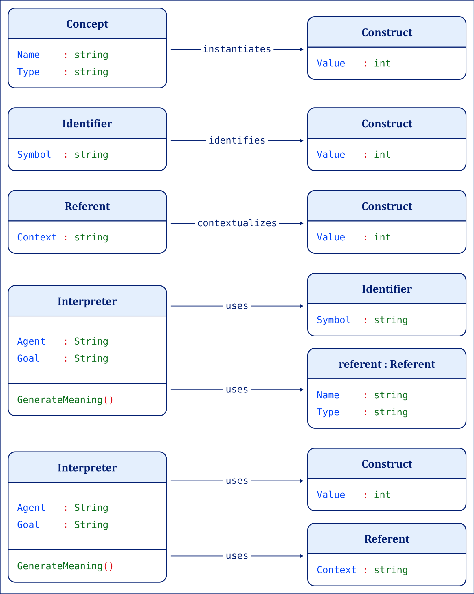

*Figure 7-1. Foundational Integer Constructivist Semiotic Sign UML Class Diagram*

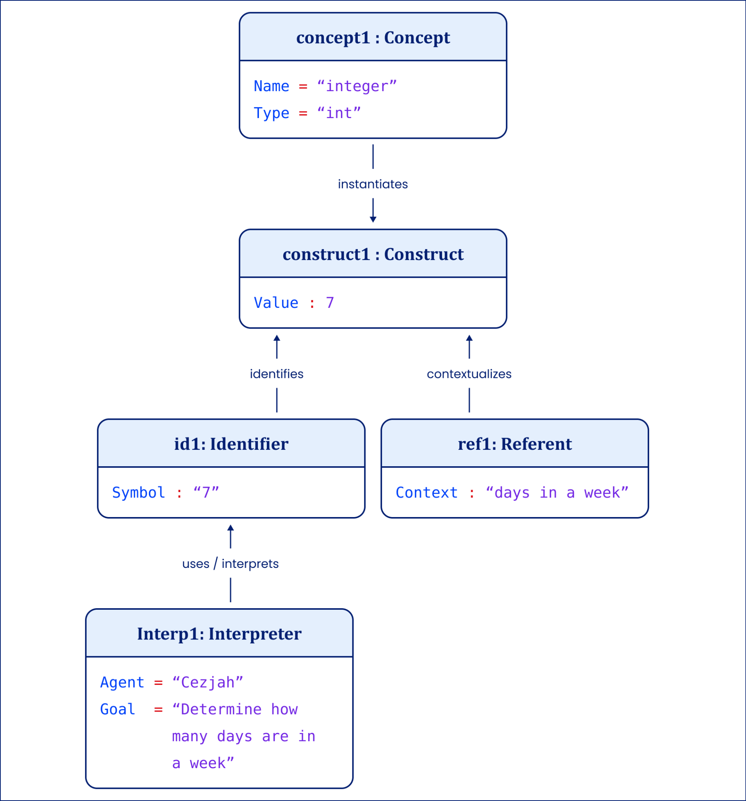

*Figure 7-2. Foundational Integer Constructivist Semiotic Sign UML Object Diagram*

Figure 7-2 presents the UML Object Diagram, showing a concrete execution of the architecture. Here, the model assigns specific values to each abstract class. This demonstrates instantiation integrity: the system preserves the distinction between definition (Concept) and instance (Construct) under execution.

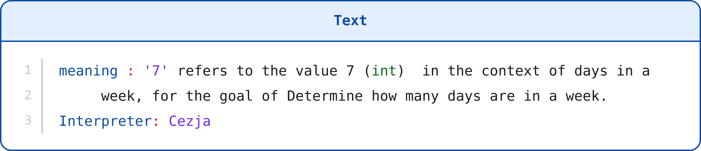

(Meaning: '7' refers to the value 7 (int) in the context of days in a week, for the goal of Determine how many days are in a week. Interpreter: Cezjah.)

The system does not retrieve this output. It generates it. The output represents the successful coordination of all five constituents under a governing goal. Remove any one component and the system cannot produce meaning. The symbol alone does not explain itself. The concept alone does not determine relevance. The construct alone does not fix interpretation. Only the interpreter’s governed act produces a result that can succeed or fail.

Project 1 establishes the architecture and demonstrates that meaning requires coordinated structure under an interpreting agent. The next question follows necessarily: even if the model preserves the structure, can any input successfully instantiate a concept?

Project 2 introduces admissibility conditions and tests the boundary between valid and invalid instantiation.

This project demonstrates that meaning cannot proceed from symbolic input alone. The system must test whether the Identifier’s symbolic value can instantiate a Construct under the Concept’s required type conditions. The Identifier “7” can instantiate an Integer Construct. The Identifier “rock” cannot instantiate an Integer Construct. The failure does not concern the mere presence of an Identifier; it concerns whether the input symbol can satisfy the Concept’s type requirements.

The project preserves the same architectural structure and scenario from Project 1. The Concept remains Integer, the Referent remains “days in a week,” and the Interpreter retains the same goal. The Identifier’s symbolic value alone varies at runtime.

Two cases test the boundary.

Valid instantiation:

Invalid instantiation:

Output:

This distinction demonstrates instantiation integrity. The Concept defines the admissibility conditions that govern whether the system can form a Construct. The system does not interpret arbitrarily. It rejects inputs that fail to satisfy the Concept’s type requirements.

The result is decisive. In the valid case, the Identifier’s symbolic value satisfies the Concept’s type conditions, the system forms a Construct, and all constituents coordinate successfully to produce meaning. In the invalid case, the input symbol fails the Concept’s type conditions, so the system cannot form a Construct. The process halts before interpretation.

This project establishes the first computational constraint on meaning: interpretation requires valid instantiation. Project 1 showed that meaning requires the full architecture of the sign. Project 2 shows that not every symbolic input can enter that architecture as a valid Construct. Meaning requires interpretation, but interpretation begins only after the system satisfies the identity conditions that govern valid instantiation.

The next question follows: even when instantiation succeeds, does context change meaning?

Project 3 holds the symbol and Construct constant while varying the Referent. It demonstrates that context governs meaning without making meaning arbitrary.

This project demonstrates that meaning does not reside inside the symbol, and successful instantiation does not exhaust meaning. Even when the Identifier satisfies the Concept’s type conditions and the system successfully forms the Construct, the system has not yet generated meaning. The interpreter still needs a Referent to anchor the Construct in context.

The project preserves the same architectural structure used in Projects 1 and 2. The Identifier remains “7,” the Concept remains Integer, and the Construct remains 7. The Interpreter remains constant. The Referent alone varies at runtime.

The project evaluates three contexts.

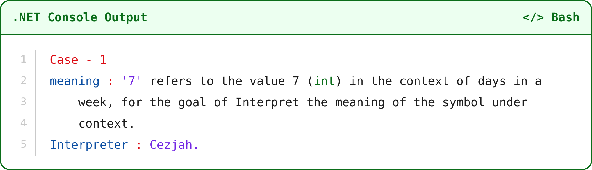

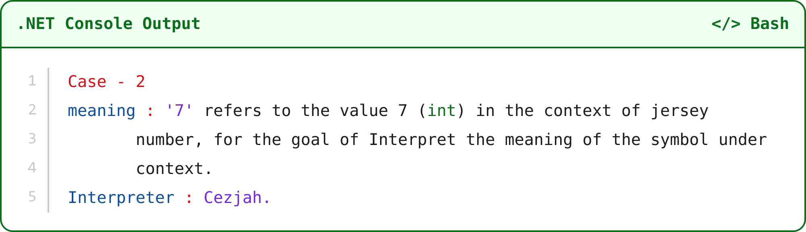

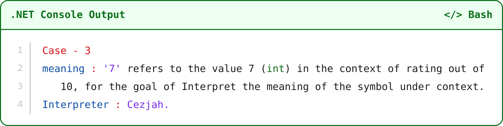

Case 1:  Meaning: '7' refers to the value 7 (int) in the context of days in a week, for the goal of Interpret the meaning of the symbol under context. Interpreter: Cezjah.

Case 2: Meaning: '7' refers to the value 7 (int) in the context of jersey number, for the goal of Interpret the meaning of the symbol under context. Interpreter: Cezjah.

Case 3: Meaning: '7' refers to the value 7 (int) in the context of rating out of 10, for the goal of Interpret the meaning of the symbol under context. Interpreter: Cezjah.

The structure remains constant across all executions. The Identifier, Concept, and Construct do not change. Yet meaning differs because the Referent determines the field of relevance within which the interpreter evaluates the Construct.

This demonstrates context anchoring. Meaning resides neither inside the symbol nor in arbitrary choice. The contextual frame determines what counts as relevant for interpretation. Without the Referent, the interpreter cannot resolve which application of the Construct matters.

The result establishes a critical boundary. Successful instantiation remains necessary, but it does not suffice for meaning. Context fixes relevance. Interpretation operates within this boundary rather than outside it.

Project 4 tests whether context alone determines meaning, or whether the Interpreter must also use a goal to fix the standard of success.

This project demonstrates that meaning depends not only on context, but also on a governing goal. Even when the Identifier, Concept, Construct, and Referent remain constant, the system does not fully determine meaning until the Interpreter evaluates the sign relative to a specific purpose.

The project preserves the same architecture and scenario from prior projects. The Identifier remains “7,” the Concept remains Integer, the Construct remains 7, and the Referent remains “days in a week.” The Interpreter’s goal alone varies at runtime.

The project evaluates three goals.

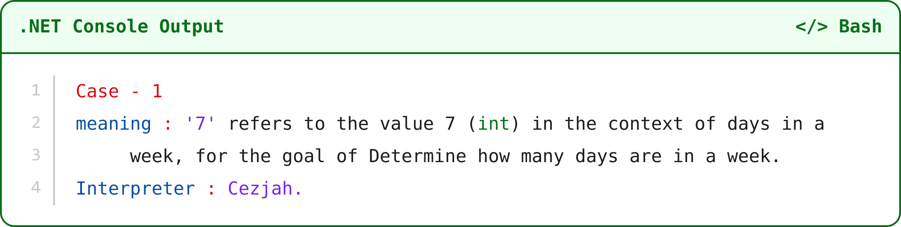

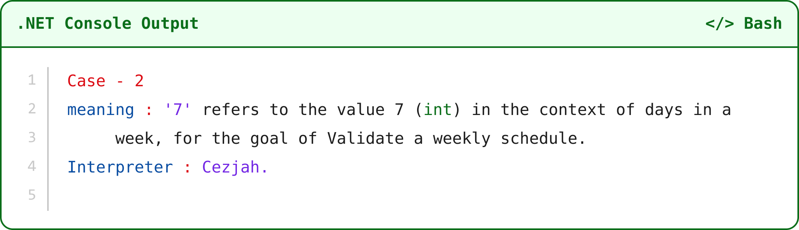

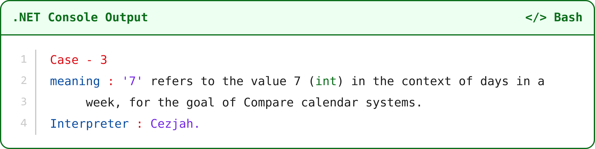

Case 1: Meaning: '7' refers to the value 7 (int) in the context of days in a week, for the goal of Determine how many days are in a week. Interpreter: Cezjah.

Case 2: Meaning: '7' refers to the value 7 (int) in the context of days in a week, for the goal of Validate a weekly schedule. Interpreter: Cezjah.

Case 3: Meaning: '7' refers to the value 7 (int) in the context of days in a week, for the goal of Compare calendar systems. Interpreter: Cezjah.

The structure and context remain constant across all executions. Yet meaning shifts because the goal determines what counts as success. The interpreter uses the same symbol, the same concept, and the same context, but different goals produce different interpretations.

This demonstrates goal-governed interpretation. Context constrains relevance, but the goal fixes the standard by which interpretation succeeds or fails. Without a governing goal, interpretation lacks direction. It cannot determine what is at stake.

The result establishes a deeper constraint. Structure and context alone do not fully specify meaning. Meaning requires a goal-directed agent who evaluates the sign relative to an end that defines correctness.

Project 4 establishes that a goal governs meaning and supplies the standard of success. The final question follows: if meaning depends on interpretation under goal-governed constraint, can a system that merely processes signals without stake generate meaning at all?

Project 5 contrasts signal processing with genuine sign interpretation and shows that computation alone does not produce semiosis.

Project 5 tests whether computation alone can generate meaning, or whether meaning requires interpretation under conditions of stake.

This project demonstrates the distinction between signal processing and sign interpretation. A system may detect patterns, parse inputs, and produce outputs without generating meaning. Meaning arises only when a rational agent interprets a sign relative to a goal under conditions that permit success or failure.

The project preserves the same architecture and scenario from the prior demonstrations. The Identifier remains “7,” the Concept remains Integer, the Construct remains 7, the Referent remains “days in a week,” and the Interpreter retains a role organized around a goal. The system runs in two modes: signal processing and sign interpretation.

Execution:

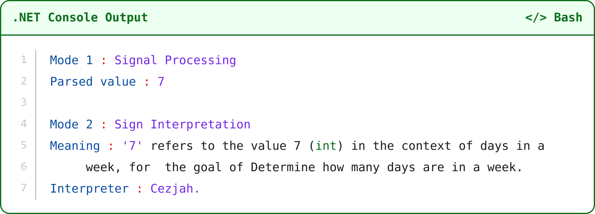

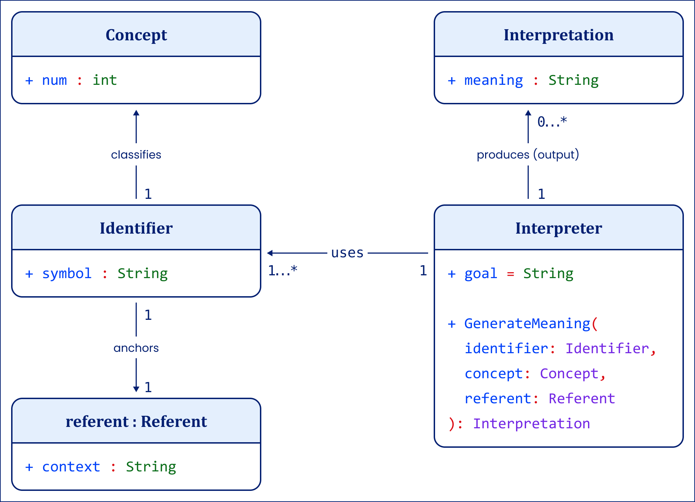

In the first mode, the system performs signal processing. It parses the input and produces a value. This operation detects structure and correlation, but it does not determine what the symbol is for. The system evaluates no context, applies no goal, and invokes no standard of success. It produces an output, but nothing is at stake.

In the second mode, the system processes the same input as a sign. The Interpreter coordinates the Identifier, Concept, Construct, and Referent under a governing goal. The system generates meaning, and the Interpreter can evaluate the result. Here, interpretation can succeed or fail. The output does not merely result from computation; it gains justification relative to a purpose.

This contrast establishes a decisive boundary. Computation is not interpretation. Pattern detection has no meaning. A system that processes signals without stake cannot generate semiosis. Meaning exists only where an agent interprets a sign relative to a goal under constraint.

The result completes the sequence of demonstrations. Project 1 builds the architecture. Project 2 adds admissibility constraints. Project 3 anchors meaning in context. Project 4 shows that a goal governs interpretation. Project 5 shows that without interpretation under stake, meaning does not arise.

With these demonstrations complete, the Constructivist Semiotic Sign has survived formal execution. The architecture preserves its distinctions, enforces its constraints, and produces accountable outcomes. Meaning is therefore not a metaphor, not an assumption, and not a byproduct of correlation. It is an achievement.

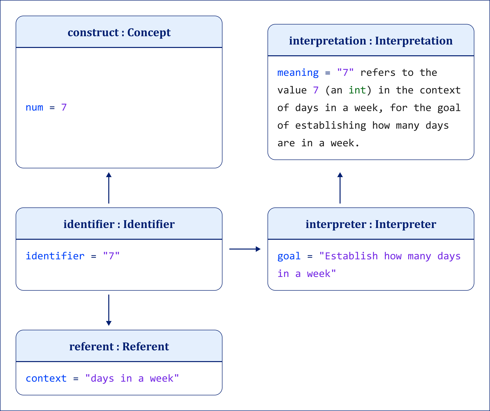

*Figure 7-3. Formal Integer Constructivist Semiotic Sign UML Class Diagram*

Figure 7-3 represents the Class Diagram, the foundational architecture for this theory of meaning. It defines the necessary constituents: Identifier, Concept, Construct, Referent, and Interpreter, and the specific relationships between them. The Interpreter coordinates the architecture by consuming the Identifier, Concept, Construct, and Referent and generating meaning under a governing goal. This structure shows that meaning is not a physical object to be found, but a result produced by an agent under constraint. By defining the GenerateMeaning() method within the Interpreter, the architecture ensures that interpretation remains a governed cognitive act rather than a subjective feeling.

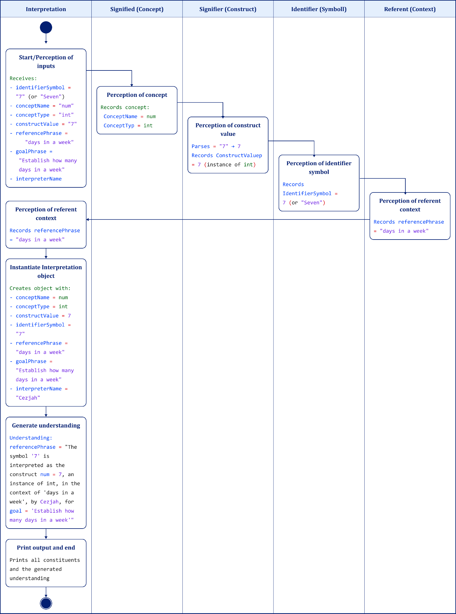

*Figure 7-4. Formal Integer Constructivist Semiotic Sign UML Object Diagram*

Figure 7-4 provides the Object Diagram, representing a concrete instance of formal execution. It captures the system in the act of specific identification.[@object2017work, p. 126]

•	The Identifier is the symbol “7”.

•	The Concept is Integer; the Construct is the instantiated integer value 7.

•	The Referent provides the context: “days in a week”.

•	The Interpreter operates with a specific goal: “Determine how many days are in a week.”

This diagram demonstrates the Foundational Cognitive-Semiotic Principle and its computational corollaries in action. The distinctions made in the abstract class diagram survive when applied to these concrete values. The interpreter does not merely see a number; the interpreter processes a sign within a field of relevance to achieve a purpose.

The Final Achievement: Console Output

Console Output:

Meaning: '7' refers to the value 7 (int) in the context of days in a week, for the goal of Determine how many days are in a week. Interpreter: Cezjah.

This output is the evidence of the system. It is the dependent achievement of a rational agent who has successfully navigated the structural requirements of meaning to produce an interpreted result.

*Figure 7-5. Integer Constructivist Semiotic Sign UML Activity Diagram*

Figure 7-5 illustrates the architectural execution of the sign through a UML activity diagram. Having shown architecture (class) and instance (object), I now show process (activity) so the order of interpretive constraints becomes explicit. This diagram maps the transition from raw symbolic inputs to a concrete, goal-directed interpretation.[@object2017work, p. 126]

The diagram organizes the interpretive process into five distinct functional columns: Interpretation, Signified (Concept), Signifier (Construct), Identifier (Symbol), and Referent (Context).[@saussure1959work]

•	Perception of Inputs: The process begins in the Interpretation lane, where the system receives the raw constituents, including the identifier symbol “7,” the concept type “int,” and a specific goal phrase.[@eric2023concepts]

•	Constituent Registration: The flow traverses the architecture to register the Signified (concept name and type), the Signifier (parsing the construct value), the Identifier (symbolic record), and the Referent (contextual reference phrase).[@saussure1959work]

•	Object Instantiation: The process returns to the Interpretation lane to capture the specific agent (Cezjah) and the governing goal. Here, the system performs the concrete instantiation of an Interpretation object while preserving the distinct roles that feed the interpretive act.[@jaroslav2023inferentialism]

•	Generation of Understanding: The final activity generates the console output. It defines the meaning of the symbol within its context and identifies the specific agent responsible for the goal.[@gottlob1952on]

By modeling these steps, Figure 7.3 shows that interpretation is a governed procedure. It transforms meaning from a vague phenomenological appeal into a formally executable achievement.[@gottlob1952on]

A theory that claims architectural structure must preserve its distinctions under formalization. If its constituents collapse when the model represents them, the theory fails to explain meaning at the architectural level. This principle does not apply to all theories of meaning.

Phenomenological or hermeneutic accounts may reject formalization on principled grounds. However, theories that claim structural, computational, or architectural adequacy must survive formal execution as a coherence test. Either the distinctions survive formal modeling, or they were never more than metaphorical.

From the architecture of the Constructivist Semiotic Sign follows the Foundational Computational Principle: A theory of meaning must preserve its claimed distinctions under formal execution. If formal analysis collapses the distinctions a theory claims to make, those distinctions were never architectural.[@eric2023concepts]

The following computational principles derive from this foundational principle. Together, they determine whether a theory preserves its architecture under formal execution.[@eric2023concepts]

Computational Principle 1. Ontological Separability: A theory of meaning must preserve the distinct identity of each constituent under formal execution; the part cannot be merged with the whole.[@gottlob1952on]

Computational Principle 2. Instantiation Integrity: The architecture must preserve the distinction between the definition and the instance. The concept serves as the Type, while the construct is the Case; they must remain separate during execution.[@lisa2017theory]

Computational Principle 3. Symbolic Reference Integrity: The distinction between the symbolic identifier and its referent must remain strict; the label is never the object, and the symbol is never the context.[@object2017work, p. 126]

Computational Principle 4. Context Anchoring: Context must be represented as a governing constraint, serving as the objective boundary of interpretation.[@object2017work, p. 126]

Computational Principle 5. Interpretive Governance: Interpretation must be modeled as a constrained procedure, not as a drift of whim.[@eric2023concepts]

Computational Principle 6. Agent and Goal Preservation: The architecture must preserve the goal-directed evaluator. Without an agent and a purpose, execution is merely hollow motion.[@eric2023concepts]

Computational Principle 7. Executability Without Collapse: A theory must not merge what it claims to distinguish under the pressure of execution. If these distinctions vanish in the machine, the theory is explanatorily inadequate.[@eric2023concepts]

These principles ensure that the Constructivist Semiotic Sign functions as a purposive instrument of reason. By mapping the Interpreter (Goal) and Referent (Context) above the Boundary of Stake, we satisfy the requirement for Interpretive Governance and Goal Preservation.[@gottlob1952on] The structure of the Semiotic Sign rectangle below that boundary ensures Ontological Separability and Symbolic Reference Integrity by isolating the Label from the Context.[@gottlob1952on]

In this chapter, I have answered the governing question: how does a symbol become meaningful without collapsing meaning into intrinsic essence, private feeling, social convention, or statistical correlation? I answered by specifying the Constructivist Semiotic Sign as an architecture. Its necessary constituents are Identifier, Concept, Construct, Referent, and Interpreter. Its governing act is interpretation under a goal.

The main proposition is direct: meaning is not inside the sign, and it is not arbitrary. It arises when a rational agent coordinates a symbol, a concept, an instantiated construct, and a contextual referent under constraints that determine whether interpretation succeeds or fails. This preserves the book's central distinction. Concept supplies identity conditions; construct supplies instantiated identity; interpretation generates meaning only when those roles operate within context and purpose.

I defended this proposition in three ways. First, I clarified why inherited semiotic theories leave the architecture incomplete when they detach signification from the explicit constraints of instantiation, context, goal, and agency. Second, I formalized the architecture through UML class, object, and activity diagrams, requiring each role to remain distinct under modeling. Third, I tested the architecture through five executable C# demonstrations that distinguish admissibility, contextual anchoring, goal-governed interpretation, and the boundary between signal processing and semiosis.

Beyond specifying this architecture, I have established the computational standard by which theories of meaning can be evaluated. A theory of meaning must preserve its distinctions under formal execution. If a framework collapses conceptual identity, instance differentiation, contextual anchoring, interpretive procedure, or agency when rendered executable, it did not explain meaning; it presupposed it.

I have now specified architecture of meaning as it pertains to the Constructivist Semiotics. The governing principles that make interpretation possible, correctable, and accountable are in place. What remains is comparative.

The result is not a new metaphor for meaning, but an executable criterion for evaluating theories of meaning. A theory that cannot preserve concept, construct, identifier, referent, interpreter, context, goal, and output under formal constraint has not explained meaning. It has merely renamed the mystery.

This conclusion also answers the chapter's practical question. The C# demonstrations show that the architecture can distinguish valid from invalid instantiation, hold a construct constant while context changes, hold context constant while goals change, and separate signal processing from genuine sign interpretation. The README files remain the canonical source for reproducing those runs; the chapter uses their outputs as evidence for the architecture.

I can therefore state the deliverable plainly: meaning is the achievement of a goal-directed interpreter coordinating an identifier, concept, construct, and referent under constraints that admit success or failure.

That deliverable prepares the next step. Once I have specified and tested the architecture of meaning, I can use it as a standard for judging historical semiotic frameworks rather than treating them as authorities in advance.

The next chapter applies the architecture, its governing principles, and its formal test in a comparison between the semiotic frameworks of Saussure and Peirce. These frameworks will each be examined under the same cognitive–semiotic architecture and subjected to the same computational discipline. The question will not be which framework feels intuitive or carries historical authority, but which can preserve the architecture of meaning under formal constraint. Only a framework that survives execution without collapse can claim to be generative rather than merely descriptive.

[Contents](../../README.md) · [Notes](../references/notes/chapter-08.md) · [Bibliography](../references/bibliography/chapter-08.md)

# Chapter 8 — The War of Signs

*Saussure, Peirce, and the Reconstruction of Meaning*

*In this chapter, I evaluate the semiotic frameworks of Ferdinand de Saussure and Charles Sanders Peirce against the cognitive-semiotic and computational principles I established in the previous chapter. Saussure sought to explain how linguistic systems produce stable meaning through structural relations among signs. Peirce sought to explain how signs participate in reasoning through interpretation and semiosis. Neither set out to develop an executable architecture of meaning. My objective is therefore not to reassess their original explanatory aims, but to determine whether their sign architectures satisfy the requirements of Constructivist Semiotics. This architectural compliance audit explains why I found it necessary to refactor the semiotic sign into a model that preserves conceptual identity, contextual anchoring, agentive interpretation, and goal-governed execution under formal constraint.*

*I retain Saussure's central insight that signs do not carry meaning intrinsically. The word justice does not contain justice within itself. It acquires stability through its place within a linguistic system, where its meaning differs from law, fairness, mercy, and revenge. Yet structural relations cannot determine how an interpreting agent should apply justice in a particular situation. A judge, legislator, and philosopher may all employ the same sign while arriving at different interpretations because linguistic structure cannot govern contextual application. I also retain Peirce's central insight that meaning requires interpretation rather than mere structural association. The sign justice may first generate the interpretant fairness. That interpretant then becomes a new sign that generates equal treatment under the law. That interpretant then becomes another sign that generates procedural due process. Peirce correctly explains how interpretation recursively generates further interpretation. However, his framework does not specify what authorizes an interpreting agent to terminate interpretation and act.*

*I show that these two frameworks become architecturally incomplete for complementary reasons. Saussure's dyadic sign explains structural relations among signs but cannot explain meaning as an agentive achievement. It collapses Concept, Construct, Identifier, Referent, Interpretation, and Interpreter into a structure that cannot preserve their distinct architectural roles. Peirce remedies part of this deficiency by distinguishing the representamen, object, and interpretant and by making interpretation central to the sign. Yet his framework still does not retain the full architecture required for executable meaning. It does not distinguish Concept from Construct, Interpretant from Interpreter, or contextual reference from goal-governed interpretation. Most importantly, because each interpretant becomes another sign, semiosis lacks a principled stopping condition. That openness explains inquiry, but execution requires termination. Courts must reach judgments. Programs must return values. Interpreting agents must determine whether meaning has succeeded or failed. These architectural limitations explain why I refactor the semiotic sign in Constructivist Semiotics.*

*In this chapter, I therefore deliver three results. First, I evaluate the semiotic frameworks of Saussure and Peirce against the cognitive-semiotic and computational principles established in the previous chapter. Second, I identify the enduring insights each framework contributes, including Saussure's rejection of intrinsic meaning and Peirce's account of interpretation as an active process. Third, I demonstrate why those insights require architectural refactoring before they can support executable meaning, specifically through intensional separation, context anchoring, agentive interpretation, error conditions, and goal-governed closure.*

*I conclude that neither static structure nor unbounded semiosis can explain meaning as an executable achievement. A viable semiotic theory must preserve the distinct architectural constituents of meaning while coordinating them within a unified, goal-governed system that explains how interpretation succeeds, fails, and terminates.*

*In the next chapter, Emotions Are Made Not Triggered: How We Construct Emotional Meaning, I extend Constructivist Semiotics from meaning to emotion. If agents construct meaning through governed interpretation, then stimuli cannot trigger emotions by themselves. Instead, agents construct emotions by interpreting bodily states, contextual information, conceptual knowledge, and goals within the semiotic architecture developed throughout this book.*

In this chapter, I evaluate the semiotic frameworks of Ferdinand de Saussure and Charles Sanders Peirce against the cognitive-semiotic and computational principles I established in the previous chapter. Saussure sought to explain how linguistic systems produce stable meaning through structural relations among signs. Peirce sought to explain how signs participate in reasoning through interpretation and semiosis. Neither set out to develop an executable architecture of meaning. My objective is therefore not to reassess their original explanatory aims, but to determine whether their sign architectures satisfy the requirements of Constructivist Semiotics. This architectural compliance audit explains why I found it necessary to refactor the semiotic sign into a model that preserves conceptual identity, contextual anchoring, agentive interpretation, and goal-governed execution under formal constraint.

I retain Saussure's central insight that signs do not carry meaning intrinsically. The word justice does not contain justice within itself. It acquires stability through its place within a linguistic system, where its meaning differs from law, fairness, mercy, and revenge. Yet structural relations cannot determine how an interpreting agent should apply justice in a particular situation. A judge, legislator, and philosopher may all employ the same sign while arriving at different interpretations because linguistic structure cannot govern contextual application. I also retain Peirce's central insight that meaning requires interpretation rather than mere structural association. The sign justice may first generate the interpretant fairness. That interpretant then becomes a new sign that generates equal treatment under the law. That interpretant then becomes another sign that generates procedural due process. Peirce correctly explains how interpretation recursively generates further interpretation. However, his framework does not specify what authorizes an interpreting agent to terminate interpretation and act.

I show that these two frameworks become architecturally incomplete for complementary reasons. Saussure's dyadic sign explains structural relations among signs but cannot explain meaning as an agentive achievement. It collapses Concept, Construct, Identifier, Referent, Interpretation, and Interpreter into a structure that cannot preserve their distinct architectural roles. Peirce remedies part of this deficiency by distinguishing the representamen, object, and interpretant and by making interpretation central to the sign. Yet his framework still does not retain the full architecture required for executable meaning. It does not distinguish Concept from Construct, Interpretant from Interpreter, or contextual reference from goal-governed interpretation. Most importantly, because each interpretant becomes another sign, semiosis lacks a principled stopping condition. That openness explains inquiry, but execution requires termination. Courts must reach judgments. Programs must return values. Interpreting agents must determine whether meaning has succeeded or failed. These architectural limitations explain why I refactor the semiotic sign in Constructivist Semiotics.

In this chapter, I therefore deliver three results. First, I evaluate the semiotic frameworks of Saussure and Peirce against the cognitive-semiotic and computational principles established in the previous chapter. Second, I identify the enduring insights each framework contributes, including Saussure's rejection of intrinsic meaning and Peirce's account of interpretation as an active process. Third, I demonstrate why those insights require architectural refactoring before they can support executable meaning, specifically through intensional separation, context anchoring, agentive interpretation, error conditions, and goal-governed closure.

I conclude that neither static structure nor unbounded semiosis can explain meaning as an executable achievement. A viable semiotic theory must preserve the distinct architectural constituents of meaning while coordinating them within a unified, goal-governed system that explains how interpretation succeeds, fails, and terminates.

In the next chapter, Emotions Are Made Not Triggered: How We Construct Emotional Meaning, I extend Constructivist Semiotics from meaning to emotion. If agents construct meaning through governed interpretation, then stimuli cannot trigger emotions by themselves. Instead, agents construct emotions by interpreting bodily states, contextual information, conceptual knowledge, and goals within the semiotic architecture developed throughout this book.

In the previous chapter, I established Constructivist Semiotics as an architecture of meaning by defining its foundational and corollary cognitive-semiotic and computational principles.[@david1982marr] Those principles now serve as the architectural benchmark for evaluating the dominant historical frameworks of semiotics. I do not revisit the explanatory problems Ferdinand de Saussure and Charles Sanders Peirce originally set out to solve. Saussure sought to explain how linguistic systems generate stable meaning through structural relations among signs.[@peirce1955logic] Peirce sought to explain how signs participate in reasoning through interpretation and semiosis.[@peirce1955logic] Instead, I evaluate whether their sign architectures satisfy the requirements of executable meaning.

This architectural compliance audit serves two purposes. First, it identifies the enduring insights from Saussure's and Peirce's frameworks that Constructivist Semiotics incorporates. Second, it demonstrates why their historical sign architectures require refactoring before they can support meaning as an agentive, executable cognitive achievement. That refactoring incorporates conceptual identity, contextual reference, interpretive governance, agency, and goal-governed execution while maintaining the architectural integrity that executable meaning requires.[@gottlob1952on]

A theory earns its place by its explanatory power rather than by its historical influence. I therefore examine the semiotic frameworks of Saussure and Peirce as architectural designs rather than objects of historical reverence. Their historical importance is not in question. The question is whether their architectures continue to support meaning as an executable cognitive achievement. Only an architecture that maintains its constituent distinctions throughout interpretation and execution qualifies as both generative and computable.[@eric2023concepts]

For over a century, linguists, philosophers, and semioticians have sought to explain how signs come to mean, how meaning becomes shareable across minds, and how symbols function in cognition and social coordination.[@gottlob1952on] They recognized that meaning does not arise automatically from reference or sensation. Pointing to a tree does not explain what tree means, nor does seeing a patch of red explain what danger, love, or anger means. Meaning depends on structured relations and interpretive activity.[@gottlob1952on]

Ferdinand de Saussure defined the sign as a dyadic unit composed of a signifier and a signified. The signifier denotes the sound-image or symbolic form of the sign, while the signified denotes the mental concept conventionally associated with that form.[@saussure1959work] By concept, Saussure refers to the sign's mental or psychological content rather than to the intensional constituent of Constructivist Semiotics.[@saussure1959work] He treated the signifier and signified as inseparable components of a single sign and argued that their relationship is arbitrary rather than natural.[@saussure1959work] Meaning therefore arises through the differential relations among signs within the linguistic system rather than through any intrinsic connection between a sign and the external world.[@saussure1959work]

Charles Sanders Peirce (1839–1914) developed a general theory of signs grounded in logic and inquiry rather than linguistics.[@peirce1955logic] He proposed a triadic model consisting of the representamen, the object, and the interpretant.[@peirce1955logic] The representamen denotes the sign itself. The object denotes what the sign represents. The interpretant denotes the understanding or sign that the representamen produces rather than the act of interpretation itself.[@peirce1955logic] For example, the sign justice may produce the interpretant fairness. That interpretant may then function as a new sign capable of producing another interpretant, such as equal treatment under the law.[@peirce1955logic] Peirce therefore explains meaning as an ongoing process of semiosis in which each interpretant becomes another sign capable of generating further interpretation.[@peirce1955logic] Constructivist Semiotics instead explains meaning as the outcome of an interpretive act performed by an Interpreter using the constituents of the Constructivist Semiotic Sign. Meaning therefore terminates as an achieved result rather than continuing as an indefinite chain of interpretants. Meaning therefore terminates as an achieved result rather than continuing as an indefinite chain of interpretants.[@peirce1955logic] I return to this distinction later in the chapter when I evaluate Peirce's architecture against the requirements of executable meaning.

Neither framework, however, pursued the objective that motivates this chapter. I therefore examine whether their sign architectures remain adequate once meaning is treated as a cognitive-semiotic and computational architecture. This is not a historical reproach but an architectural audit motivated by a different explanatory objective. The results demonstrate why the historical semiotic signs require refactoring before they can support a cognitive-semiotic and computational architecture of meaning.[@david1982marr]

I continue to use the UML notation I introduced in Chapter 2 as the formal grammar for evaluating semiotic architectures.[@david1982marr] By representing types as classes, instances as objects, and symbolic identifiers as references, UML provides a neutral computational standard.[@david1982marr]

Before Ferdinand de Saussure, linguists approached language primarily as a historical and comparative discipline. They focused on reconstructing ancient languages, tracing sound changes, and mapping genealogies within language families. By comparing systematic phonetic patterns across Sanskrit, Greek, Latin, and Germanic languages, they reconstructed Proto-Indo-European.[@lisa2017theory] They treated language as a historical lineage that evolved over time rather than as a structured system operating in the present.[@lisa2017theory]

Linguists of the period concentrated on etymology, philology, and diachronic change. They traced the historical development of words, documented sound changes, and reconstructed language families, but they did not investigate how speakers generate meaning within a living linguistic system. Instead, they treated language as the product of historical development rather than as a structured network in which signs derive their value from their relations to one another.[@eric2023concepts]

Saussure redirected the field by rejecting the view that meaning arises from historical origin or from any natural connection between words and things. He argued that meaning arises from structural relations among signs within a system. Each sign gains value only through its differences from others.[@eric2023concepts] To make this case, he distinguished diachronic analysis from synchronic analysis. He argued that only the latter can explain how language produces meaning at a given moment.[@gottlob1952on]

Saussure did not merely seek a new way to catalog words. He sought to establish linguistics as a scientific discipline grounded in systematic structure rather than historical accident or psychological speculation. His primary objective was to explain how meaning arises within language itself, so he developed a model independent of individual speakers, intentions, or external objects.[@object2017work, p. 126]

Saussure thereby analyzed language as a self-regulating network of relations rather than as a collection of names attached to things. Within that network, each sign acquires value only through its position relative to other signs.[@eric2023concepts]

Saussure sought to identify the structural principles that make communication possible across a linguistic community. He viewed language as a social institution governed by conventions. These conventions exist independently of any particular act of speech.[@gottlob1952on] In formulating the dyadic sign, he intended to isolate the internal logic by which a linguistic system generates stable meanings through structural opposition. His model provides a descriptive foundation for how signs function collectively to ensure shared intelligibility.[@eric2023concepts]

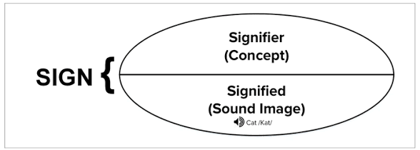

Figure 8-1. Saussure's Dyadic Sign

Figure 8-1 depicts the dyadic sign, a unity composed of two inseparable components:

•	The Signifier (Sound-Image): This is the psychological imprint of the sound, such as the phonemes /kat/.[@saussure1959work]

• The Signified (Concept): This is the abstract concept or mental image associated with the sound-image.[@saussure1959work]

Saussure argues that the bond between these two elements is arbitrary. There is no natural or inherent reason why a specific sound-image must represent a specific concept.[@gottlob1952on] Instead, meaning arises exclusively through the differential relations between signs within the linguistic system (langue).[@gottlob1952on]

I now examine Saussure's dyadic sign to determine whether it can support a cognitive-semiotic and computational architecture of meaning.[@david1982marr] The results explain why Constructivist Semiotics refactors the historical semiotic sign while retaining Saussure's enduring insights.

Table 8-1. Saussure's Framework Evaluated Against the Cognitive-Semiotic Principles of Constructivist Semiotics

Saussure conforms to the first cognitive-semiotic principle because he rejects intrinsic meaning. The sound pattern “tree” does not contain tree-ness. English gives the word its value through its difference from “free,” “three,” and “bush.” This example shows why Saussure’s model helps defeat the idea that symbols carry meaning inside themselves.[@gottlob1952on]

Saussure also conforms to the second principle because he treats langue as a system that constrains meaning once speakers inherit it. Although the bond between signifier and signified begins arbitrarily, individual speakers cannot assign meanings at will. A speaker cannot simply decide that “dog” means “cat” within English. The system defines “dog” through its difference from “cat,” “wolf,” and “fox,” and that structure constrains meaning.[@gottlob1952on]

Saussure does not conform to the third principle because he does not model interpretation as an explicit, goal-governed cognitive act. The word “bank” illustrates the problem. Saussure can locate “bank” within the lexicon, but his framework does not explain how an interpreter determines whether “bank” refers to a riverbank or a financial institution in a specific situation.[@eric2023concepts]

Saussure does not conform to the fourth principle because his theory does not explain meaning as an answer to standards of correctness. The word “tree” can refer to an oak, a palm, a shrub, or a diagram depending on context and purpose. Saussure explains the word’s position within langue, but he does not supply rules that guide an interpreter from symbol to correct contextual application.[@eric2023concepts]

Saussure does not conform to the fifth principle because his framework lacks conditions for interpretive success or failure. If a speaker calls a mushroom a “tree,” Saussure can describe a deviation from linguistic convention, but he does not explain why the interpretation fails relative to the object, context, and purpose at stake.[@object2017work, p. 126]

Saussure does not conform to the sixth principle because his model shifts meaning away from the interpreter's standpoint and into the collective linguistic system. The word “bat” may refer to an animal or a piece of sporting equipment. Saussure’s framework explains the lexical difference, but it does not explain how an agent evaluates the situation and selects the relevant meaning.[@gottlob1952on]

Saussure does not conform to the seventh principle because he does not define meaning relative to a goal. A speaker may use “tree” to classify a plant, teach a child, give directions, or interpret a diagram. Each use requires a different purpose. Saussure’s model explains stable linguistic value, but it does not explain how goals govern meaning in use.[@saussure1959work]

Table 8-2. Saussure's Framework Evaluated Against the Computational Principles of Constructivist Semiotics

I now audit Saussure’s dyadic sign against the computational principles of Constructivist Semiotics, using the UML class and object diagrams as the testing surface. The question is no longer whether Saussure describes meaning coherently, but whether his categories can survive formal modeling without collapsing the distinctions between concept, construct, symbol, context, and interpretation.[@lisa2017theory]

Saussure fails the first computational principle because his signified collapses conceptual identity and mental representation. A UML class must distinguish an abstract type, such as int, from a concrete value, such as 7. Saussure’s signified cannot preserve that distinction because it treats meaning as a psychological concept rather than as an architectural type with instantiation rules.[@saussure1959work]

Saussure fails the second computational principle because his framework does not distinguish definition from instance in executable terms. The word “triangle” has value through its relation to “square,” but Saussure does not explain how a three-sided figure satisfies the definition of triangle while a four-sided figure fails it. The model describes relational value, but it does not govern instantiation.[@object2017work, p. 126]

Saussure fails the third computational principle because his signifier does not function as a stable symbolic pointer. The word “lead” may refer to a heavy metal or to a command to follow. Saussure can describe its differential value within language, but he does not provide an architectural role that lets an identifier point to different referents under different contexts.[@eric2023concepts]

Saussure fails the fourth computational principle because his model excludes situational context from the architecture of meaning. The word “sharp” changes its relevance when a speaker applies it to a knife, a musical note, or an intellect. Saussure’s framework can describe the word’s systemic value, but it cannot explain how context governs the correct application.[@eric2023concepts]

Saussure fails the fifth computational principle because he provides no executable procedure for interpretation. The word “valid” may refer to a legal argument, a logical inference, or a software input. Saussure’s model does not explain how an interpreter moves from the symbol to a concluded meaning under rules of correctness.[@gottlob1952on]

Saussure fails the sixth computational principle because he removes agent-level goals from the architecture of meaning. A speaker who calls a circle a “square” does not merely deviate from language; the speaker fails relative to a task, a purpose, or a standard of classification. Saussure can describe social conformity, but he cannot represent an agent who evaluates success conditions.[@eric2023concepts]

Saussure fails the seventh computational principle because his categories merge under formal modeling. To model “dozen,” a system must distinguish the word, the concept of twelve, and a specific quantity of items. Saussure’s dyadic sign cannot preserve those separations as operational roles. It describes how signs relate within a system, but it does not supply separable components that formal execution can test.[@eric2023concepts]

Saussure’s framework fails every computational requirement. His distinctions do not survive formal modeling, execution, or constraint. This failure confirms that the dyadic sign offers only descriptive influence. It remains architecturally non-executable. By locating meaning entirely within langue, Saussure explains how symbols relate to one another but not how an agent produces, tests, or evaluates meaning in use.[@gottlob1952on]

The model collapses because it lacks an account of agency. Meaning exists prior to any interpreter and remains unaffected by goals or evaluative stakes. Consequently, the system cannot explain correctness, error, or revision. Saussure also provides no architectural separation between conceptual structure and contextual instantiation. His “signified” fails to function as an intensional universal capable of governing specific instances.[@saussure1959work]

Ultimately, Saussure describes how symbols relate, but not how meaning works. His theory rests on descriptive relations rather than enforceable constraints. What he offers is linguistically insightful but architecturally inert. Constructivist Semiotics requires an executable blueprint; Saussure provides only a stagnant abstraction.[@lisa2017theory]

Saussure’s framework fails as a generative architecture, yet it offers several indispensable insights. Constructivist Semiotics preserves these principles and re-grounds them within an executable architecture of meaning.[@lisa2017theory]

Rejection of Intrinsic Meaning: Saussure decisively rejects the idea that meaning resides in symbols themselves. He denies resemblance, material form, or causal linkage as sources of meaning.[@gottlob1952on]

Constructivist Semiotics fully preserves this insight under the Foundational Cognitive–Semiotic Principle: meaning is a dependent achievement of rational interpretation under constraint. Symbols remain inert until interpretation binds identifiers, concepts, constructs, and referents relative to a goal. Meaning never resides in the symbol itself.[@gottlob1952on]

Meaning Is Constrained, Not Arbitrary: Saussure correctly insists that meaning is rule-bound and socially constrained, not a matter of individual whim.[@gottlob1952on]

Constructivist Semiotics preserves constraint under Principle 2: Meaning Is Not Arbitrary. Constraint no longer arises from static differential position alone, but from governed interpretation operating under conceptual identity, contextual anchoring, and goal-relative evaluation. Error and correction become possible without surrendering objectivity.[@object2017work, p. 126]

Relational Identity of Symbols: Saussure shows that symbols acquire identity through relations within a system rather than in isolation.[@eric2023concepts]

Constructivist Semiotics formalizes relational identity through Principle 1: Ontological Separability. Concepts gain identity through structured relations within a system while remaining ontologically distinct. UML class diagrams preserve relational definition without collapsing constituents.[@object2017work, p. 126]

Separation of Meaning From Direct Reference: Saussure rejects naïve realism by denying that meaning arises directly from reference to external objects.[@object2017work, p. 126]

Constructivist Semiotics preserves this distinction under Principle 3: Symbolic Reference Integrity. Identifiers function as symbolic pointers that refer without becoming their referents. Reference is restored as a governed component mediated by context and interpretation, not as an intrinsic source of meaning.[@gottlob1952on]

Stability of Shared Meaning Systems: Saussure identifies langue as a socially stabilized system that persists beyond individual minds.[@gottlob1952on]

Constructivist Semiotics preserves shared stability under Principle 6: Meaning Requires Perspective, while refusing to eliminate agency. Social symbol systems constrain interpretation, but meaning still exists only when an agent evaluates a sign relative to a goal. Stability informs interpretation; it does not replace it.[@eric2023concepts]

Language as a Structured System: Saussure treats language as an organized system governed by internal relations rather than as a loose collection of names.[@eric2023concepts]

Constructivist Semiotics preserves systemic structure under Principle 7: Executability Without Collapse. The architecture must survive formal modeling without merging roles or erasing constraints. UML enforces system-level organization while maintaining separability across execution.[@eric2023concepts]

Saussure contributes indispensable constraints: meaning is not intrinsic, not arbitrary, not atomistic, and not reducible to reference, but mislocates them entirely in static structure; Constructivist Semiotics preserves these insights while re-grounding them in governed interpretation, contextual anchoring, and goal-relative execution.[@lisa2017theory]

Saussure explains how linguistic systems stabilize meaning. However, his exclusion of interpretation, agency, and inference leaves the theory incomplete and compels a shift to Peirce’s theory of signs.[@eric2023concepts]

Pragmatic theories do not fully foreground evaluative dimensions of meaning by grounding interpretation, intension, and felicity conditions. Nonetheless, they do not provide a fully developed architectural account of constraint propagation across interpretive acts.[@eric2023concepts]

Peirce confronted the problem of meaning from the perspective of logic, science, and inquiry. He worked against a different background and addressed a different failure. Where nineteenth-century linguistics remained historical, nineteenth-century philosophy struggled to explain how thought, reference, and knowledge could be objective without appealing to intuition or metaphysics.[@object2017work, p. 126]

The dominant philosophical frameworks of Peirce’s time treated meaning either as a mental association or as a direct correspondence between ideas and things. Empiricism reduced meaning to sensation. Rationalism grounded it in innate ideas. Both approaches failed to explain how signs support reasoning, communication, and scientific discovery. Neither could account for how meaning develops through inquiry rather than appearing fully formed.[@gottlob1952on]

Peirce rejected these limitations by reframing meaning as a logical and inferential process. He approached signs not as linguistic units but as the basic instruments of cognition. His aim was not to explain language as a social structure but to explain how reasoning itself is possible. He treated semiotics as a branch of logic rather than linguistics, placing it at the foundation of epistemology and scientific method.[@eric2023concepts]

To accomplish this, Peirce expanded the sign beyond Saussure’s dyadic relation. He introduced a triadic structure consisting of the representamen, the object, and the interpretant. This allowed him to explain how a sign can stand for something to someone in virtue of an interpretive effect. Meaning, on this account, arises through semiosis: a process in which one sign generates another through inference and interpretation.[@peirce1955logic]

In Figure 8-2, Charles Sanders Peirce presents a triadic model of the sign, which differs from Saussure’s dyadic approach by introducing a third element to mediate meaning. This structure is often represented as a triangle to show that meaning is not fixed but arises through the dynamic process of semiosis.[@peirce1955logic]

Figure 8-2. Peirce's Triadic Sign

Peirce’s model defines a sign as an irreducible relationship between three parts:

The Representamen: the physical or perceptible form that the sign takes, such as a written word, a sound, or a gesture. Peirce sometimes calls this the sign vehicle.[@eric2023concepts]

The Object: the thing, idea, or event to which the sign refers. Peirce further distinguishes the dynamical object, the object as it exists in reality, from the immediate object, the object as the sign represents it.[@object2017work, p. 126]

The Interpretant: the mental effect or sense an observer makes of the sign. The interpretant is not the interpreter. It is a new sign that translates and clarifies the relation between the representamen and the object.[@object2017work, p. 126]

Unlike Saussure’s model, which focuses on the internal linguistic structure, Peirce’s triadic model is grounded in logic and inquiry. The inclusion of the interpretant allows for unlimited semiosis, where one interpretation leads to another sign, which in turn creates another interpretant, forming an endless chain of meaning.[@peirce1955logic]

Peirce’s central objective was to show that meaning is neither a static mental image nor a fixed structural relation. It is an activity governed by reasoning. He sought to ground meaning in habits of inference, continuity, and law-like regularities rather than in psychological states or linguistic conventions. In doing so, he shifted semiotics toward process, mediation, and logic.[@eric2023concepts]

Unlike Saussure, Peirce did not aim to isolate a closed system of signs. He aimed to explain how signs participate in an open process of inquiry. He treated meaning as something that unfolds through interpretation across time, potentially without final termination. His model emphasizes mediation, inferential development, and the generative nature of sign activity.[@jaroslav2023inferentialism]

I now evaluate Peirce’s framework against the cognitive-semiotic principles of Constructivist Semiotics. This audit determines whether Peirce’s process-oriented model can preserve conceptual structure, contextual constraint, interpretive governance, and agent-level evaluation under formal execution, or whether its openness dissolves into architectural instability under constraint.[@eric2023concepts]

Conformity in this evaluation depends on whether a framework models interpretation as an agentive, context-sensitive, and constrained achievement of meaning.[@gottlob1952on]

Peirce conforms to the first cognitive-semiotic principle because he rejects meaning as something the sign vehicle carries by itself. A written word, a smoke signal, or a gesture does not mean by its material form alone. It becomes meaningful only when semiosis relates it to an object through an interpretant.[@peirce1955logic]

Peirce conforms to the second principle because he treats interpretation as law-like and inferential rather than arbitrary. If smoke indicates fire, the relation does not depend on personal whim. It depends on a habit of reasoning that links sign, object, and interpretant through a rule-governed expectation.[@peirce1955logic]

Peirce conforms to the third principle because interpretation stands at the center of his model. A sign does not merely connect to an object; it produces an interpretant. For example, a red traffic light does not simply exist as a red object. It leads an interpreter to the thought “stop,” which then guides action.[@eric2023concepts]

Peirce does not conform to the fourth principle because his model does not provide a determinate standard of correctness under a goal. The sign “justice” may lead to legal doctrine, moral desert, equality, punishment, or institutional legitimacy. Peirce explains how one interpretation leads to another, but he does not supply the rule that determines which interpretation should govern a particular action.[@eric2023concepts]

Peirce does not conform to the fifth principle because his model lacks explicit success and failure conditions for context-bound interpretation. If a doctor interprets a symptom as evidence of one disease rather than another, the interpretation must succeed or fail relative to diagnosis and treatment. Peirce explains the recursive generation of interpretants, but he does not define the point at which an interpretation succeeds for a specific goal.[@peirce1955logic]

Peirce does not conform to the sixth principle because the interpretant is not the interpreter and does not supply an interpreter's standpoint. The interpretant is another sign or effect within semiosis. If a jury interprets evidence, the jury acts as an evaluating agent with duties, goals, and responsibility. Peirce’s triad models the interpretive effect, but it does not preserve the agent as the one who evaluates and answers for the interpretation.[@eric2023concepts]

Peirce does not conform to the seventh principle because open-ended semiosis does not terminate interpretation through a governing purpose. A sign can generate another sign indefinitely. That openness helps explain inquiry, but action requires closure. If a driver sees a stop sign, interpretation must end in a practical judgment: stop now. Peirce explains the expansion of meaning, but he does not explain how a goal closes the chain.[@gottlob1952on]

Table 8-3. Peirce's Framework Evaluated Against the Cognitive-Semiotic Principles of Constructivist Semiotics

I now apply the computational audit to Peirce’s triadic model. While Peirce introduces a third element, the interpretant, to bridge the gap between sign and object, I must determine if this triadic relation provides the structural stability required for formal execution.[@peirce1955logic]

Conformity in this evaluation is assessed relative to computational principles, which concern whether those same structures are specified with sufficient architectural clarity to support generative, evaluable, and executable implementation.[@david1982marr]

Principle 1. Ontological Separability. Partially conforms.

Peirce distinguishes the representamen, the object, and the interpretant, which suggests an awareness of ontological differentiation. However, his definition of the object is excessively broad. He groups abstract universals, mental percepts, and concrete existents into a single category. In the UML class diagram, the class int must remain distinct from a specific instance such as 7. Peirce’s model lacks the architectural layers required to prevent these roles from bleeding into one another. He identifies the need for parts but fails to provide structural firewalls between them.[@eric2023concepts]

Principle 2. Instantiation Integrity. Does not conform.

Peirce treats the object as an undifferentiated category, which prevents his framework from preserving the distinction between Concept and Construct in an executable architecture. The theory treats the concept of justice and a specific court ruling as objects of semiosis without enforcing a hierarchy between universal and particular. In the UML model, the object 7 must instantiate the class int while remaining distinct from it. Peirce’s triadic relation describes a flow of meaning rather than a rule-governed structure of instantiation. It provides no mechanism to ensure that an instance conforms to its type.[@eric2023concepts]

Principle 3. Symbolic Reference Integrity. Does not conform.

Peirce partially recognizes symbolic reference through his notion of the index. However, his framework does not preserve the architectural distinction between the Identifier, the Construct, and the Referent. The Identifier becomes recursively absorbed into semiosis rather than remaining a stable symbolic pointer. However, in his system the identifier does not remain stable. The identifier num quickly dissolves into an interpretant, which then becomes a new sign. Reference therefore becomes recursive rather than fixed. In a computational system, a reference must remain an anchor to an object. Peirce’s model turns reference into a catalyst for infinite sign generation rather than a stable link.[@gottlob1952on]

Principle 4. Context Anchoring. Does not conform.

Peirce acknowledges the ground of a sign but does not anchor interpretation to a determinate contextual Referent that constrains relevance. The meaning of 7 depends on whether the context is days of the week or bits in a byte. Peirce’s framework treats context as implicit within interpretation rather than as an explicit architectural component. There is no slot in the model  where context functions as a fixed variable that governs correctness. Without context anchoring, the triadic relation lacks a frame that stabilizes meaning.[@peirce1955logic]

Principle 5. Interpretive Governance. Does not conform.

Peirce does not provide a rule-constrained interpretive process that permits success or failure. He characterizes interpretation as unlimited semiosis, in which one sign gives rise to further interpretation without principled finality. This provides a descriptively accurate account of how meaning unfolds through inquiry and reflection. However, Peirce does not specify how interpretation achieves context-relative closure when meaning must be resolved for action, decision, or execution. As a result, his framework remains architecturally incomplete relative to systems that require termination conditions, such as generative or computational procedures. A program requires a stopping condition—a point at which interpretation concludes and returns a value. In the UML activity diagram, execution must reach an exit node. Peirce's model supplies only additional nodes, ensuring perpetual continuation rather than resolution.[@eric2023concepts]

Principle 6. Agent and Goal Preservation. Does not conform.

Peirce does not preserve the Interpreter as a goal-directed evaluating agent. Instead, he treats the interpretant as a logical consequence rather than as the product of an agent who evaluates interpretation relative to a governing goal. In the Constructivist Semiotics architecture, the Interpreter class evaluates a sign relative to a Goal in order to determine success or failure. Peirce’s semiosis proceeds autonomously, governed by logical propagation rather than agentive purpose. Without an agent to supply a goal, interpretation has no reason to stop and no criterion by which it can fail.[@eric2023concepts]

Principle 7. Executability Without Collapse. Does not conform.

Peirce's triadic model cannot preserve the distinctions it claims to make under formal execution because unlimited semiosis collapses the architecture into infinite recursion. The interpretant of 7 generates a new sign, which generates another interpretant, and so on without termination. The architecture cannot sustain execution under formal constraint. While Peirce offers a powerful description of the flow of thought, he does not provide a blueprint for a machine of thought. The absence of stopping conditions and structural boundaries renders the model non-executable.[@eric2023concepts]

Table 8-4. Peirce's Framework Evaluated Against the Computational Principles of Constructivist Semiotics

Peirce partially conforms to ontological separability because he distinguishes the representamen, object, and interpretant. That distinction improves on Saussure's dyad. Yet Peirce's object category remains too broad for formal execution. It can include an abstract universal, a mental percept, or a concrete existent. In a UML model, int must remain distinct from the value 7. Peirce recognizes parts, but he does not provide the architectural layers that keep those parts separate.[@eric2023concepts]

Peirce does not conform to instantiation integrity because his framework does not enforce a hierarchy between type and instance. The concept of justice and a specific court ruling can both function as objects of semiosis. The theory does not require the ruling to instantiate the concept under defined conditions. In a computational architecture, an instance must satisfy its type. Peirce's triadic relation describes a flow of meaning, but it does not govern valid instantiation.[@peirce1955logic]

Peirce does not conform to symbolic reference integrity because reference becomes recursive rather than stable. His notion of the index resembles a pointer, but the sign quickly generates an interpretant, which then becomes another sign. In a computational model, a reference must anchor an object. Peirce turns reference into a catalyst for further semiosis rather than a stable link.[@peirce1955logic]

Peirce does not conform to context anchoring because he does not encode situational context as an explicit constraint on execution. The meaning of 7 changes when the context shifts from days in a week to bits in a byte. Peirce treats context as implicit within interpretation rather than as a formal component. Without a context slot, the triadic relation lacks the frame that stabilizes meaning.[@peirce1955logic]

Peirce does not conform to interpretive governance because unlimited semiosis lacks a stopping condition. A program requires an exit node. A legal decision requires a ruling. A driver who sees a stop sign must stop rather than generate further interpretants forever. Peirce captures the recursive expansion of inquiry, but he does not specify how interpretation terminates for action, decision, or execution.[@eric2023concepts]

Peirce does not conform to agent and goal preservation because he treats the interpretant as a logical consequence rather than as an output that a goal-directed agent evaluates. In Constructivist Semiotics, the Interpreter evaluates a sign relative to a goal. Peirce's semiosis proceeds through logical propagation. Without an agent who supplies a goal, interpretation lacks a reason to stop and a criterion by which it can fail.[@eric2023concepts]

Peirce does not conform to executability without collapse because the triadic model collapses into infinite recursion under formal execution. The interpretant of 7 generates a new sign, which generates another interpretant, and the process continues without termination. Peirce offers a powerful account of the flow of thought, but he does not provide a blueprint for executable meaning. Without stopping conditions and structural boundaries, the model cannot run as a generative architecture.[@eric2023concepts]

Like Saussure, Peirce fails as a generative architecture, yet he offers several indispensable insights. Constructivist Semiotics preserves those insights within an executable architecture of meaning.[@lisa2017theory]

Peirce correctly identifies interpretation as essential to meaning. By introducing the interpretant, he rejects the idea that symbols or structural relations alone create meaning. Constructivist Semiotics preserves this insight under Principle 3: Interpretation Is Necessary. Meaning exists only where an agent interprets a sign relative to a goal under constraint. Interpretation becomes an operation that can succeed or fail.[@eric2023concepts]

Peirce also reconceives meaning as an active process of semiosis rather than a static pairing of elements. Meaning unfolds through inference and reasoning rather than residing in fixed structures. Constructivist Semiotics preserves this insight under Principle 5: Meaning Can Succeed or Fail. Agents produce meaning through interpretive process, but Constructivist Semiotics adds termination conditions, correctness criteria, and evaluative closure. It keeps process without infinite regress.[@eric2023concepts]

Peirce grounds meaning in inference rather than resemblance or association. Signs mean by standing in logical relations that support reasoning and expectation. Constructivist Semiotics preserves inferential meaning under Principle 4: Meaning Is Normative. Interpretation answers to conceptual identity, contextual parameters, and agent goals. Inference becomes executable rather than metaphysical.[@eric2023concepts]

Peirce expands semiotics beyond language to include diagrams, indices, icons, and logical signs. Meaning does not belong only to linguistic structure. Constructivist Semiotics preserves this breadth under Principle 1: Meaning Is Not Intrinsic. Meaning does not belong to words, images, or symbols of any kind. It arises through interpretation across representational media, including formal diagrams and computational models.[@david1982marr]

Peirce insists that signs mediate between thought and world rather than mirroring reality directly. Meaning remains indirect, inferential, and representational. Constructivist Semiotics preserves mediation under Principle 3: Symbolic Reference Integrity. Identifiers refer without becoming their referents. Context and interpretation determine how reference contributes to meaning without collapsing meaning into world-mapping.[@alexander2024natural]

Peirce treats meaning as lawful rather than private psychological intuition. Semiosis follows rational patterns through habits, regularities, and inference. Constructivist Semiotics preserves lawfulness under Principle 2: Meaning Is Not Arbitrary and Principle 4: Meaning Is Normative. Laws become enforceable constraints within a formal architecture rather than abstract metaphysical tendencies.[@alexander2024natural]

Peirce also resists subjectivism by locating meaning within shared inferential practice rather than private mental states. Constructivist Semiotics preserves objectivity under Principle 6: Meaning Requires Perspective. Meaning exists only for agents, but shared structures, contexts, and goals constrain correctness rather than intuition or consensus alone.[@gottlob1952on]

Peirce contributes what Saussure lacks: interpretation, inference, mediation, and process. He correctly identifies meaning as something done, not merely structured. However, he leaves that process without termination or architectural stability. Constructivist Semiotics preserves Peirce's deepest insights while supplying what his system never provides: intensional separation, contextual anchoring, agentive purpose, and executable governance. Peirce explains why meaning must be active. Constructivist Semiotics explains how meaning can work.[@lisa2017theory]

I have now completed the audit of Saussure's and Peirce's frameworks against the architectural and principled requirements of Constructivist Semiotics. Tables 8-1 and 8-2 summarize Saussure's conformity with the cognitive-semiotic and computational principles, while Tables 8-3 and 8-4 present the corresponding results for Peirce.[@david1982marr]

I must now confront the systemic issues that haunt these historical frameworks. The first issue, recursion and unlimited semiosis, arises from the work of Charles Sanders Peirce and Jacques Derrida. Peirce identifies a genuine phenomenon: interpretation can generate further interpretation. A sign produces an interpretant, which itself becomes a sign, and semiosis can continue indefinitely. Derrida later radicalizes this problem by emphasizing the perpetual deferral of meaning. That move sharpens the problem of interpretive closure, but it does not change the structural issue already present in Peirce's framework.[@eric2023concepts]

Consider the word justice. It can prompt interpretation through legal doctrine, moral intuition, and historical precedent. Each interpretation invites another, and no single meaning automatically closes the chain. This phenomenon accurately describes philosophical analysis. But when I map it onto a computational model, it becomes fatal. Interpreting the value 7 yields an interpretant that becomes a new sign, which yields another interpretant. In a UML activity diagram, the process lacks an exit node. Execution never terminates. Constructivist Semiotics accepts recursion as possible but rejects it as necessary. A loop without a stopping condition is not meaning; it is drift. A theory that cannot stop cannot act.[@eric2023concepts]

This need for closure leads directly to telos and stopping conditions for meaning. Derrida treats any stopping point as an illusion imposed by power, convention, or habit. Constructivist Semiotics adopts the opposite position: meaning requires telos. Interpretation stops not because reality ends, but because purpose fixes relevance. A goal defines when interpretation has succeeded or failed. In a court ruling, the meaning of guilty must terminate because the goal is adjudication. Similarly, a function that evaluates if (num > 5) must return true or false. An interpreter that never returns a value does not compute meaning; it malfunctions. Telos supplies the stopping condition that neither Derrida nor Peirce can justify within their frameworks.[@eric2023concepts]

Without stopping conditions, a system cannot identify error, misinterpretation, or type violation. Saussure and Peirce both struggle to explain error in a principled way. If structure fixes meaning entirely, or if interpretation endlessly defers meaning, then misinterpretation becomes either impossible or meaningless. Constructivist Semiotics treats error as diagnostic. Error reveals the boundaries of meaning. Calling a whale a fish fails because biological classification imposes constraints. Correction restores conceptual integrity. In a formal system, assigning the string "seven" to an int variable produces a type error. The system rejects the interpretation. Meaning fails visibly and objectively. Error is not noise; it proves that interpretation operates under law. A system that cannot fail cannot mean.[@eric2023concepts]

Finally, I must resolve the recurring confusion between identity and reference stability. Saussure collapses identity into relational difference, while Peirce allows reference to proliferate through interpretants. Constructivist Semiotics insists on stability at both levels. The word bank can refer to a financial institution or a river edge. Reference shifts with context, but each concept retains its identity. Confusing the two produces ambiguity, not meaning. In code, the identifier num may reference different values over time, but the class int preserves its identity. Identity belongs to concepts; reference belongs to context. Meaning requires both to remain distinct under execution.[@gottlob1952on]

These fault lines reveal that recursion without telos dissolves meaning, and interpretation without stopping conditions cannot execute. Constructivist Semiotics resolves these tensions by imposing architectural discipline. It permits recursion but requires termination. It explains error as failure under law. It stabilizes identity while allowing reference to vary. Meaning survives not because it floats freely, but because it works under constraint.[@gottlob1952on]

Constructivist Semiotics therefore accounts for the formal conditions required to explain how meaning exists, functions, succeeds, and fails. It does so while intentionally excluding affective salience, goal genesis, non-symbolic cognition, historical evolution, and phenomenology. These exclusions are not oversights. They protect the formal integrity required for executable meaning.[@gottlob1952on]

The preceding analysis isolates a common architectural gap in classical semiotic theories. Saussure and Peirce each capture essential aspects of meaning: structure, difference, mediation, and process. Yet neither supplies a model that preserves these distinctions under execution. What is missing is not insight, but architecture: a formally articulated system that separates concepts from instances, anchors interpretation to referents, assigns agency to an interpreter, and supplies goal-relative conditions for success and termination. Figure 8-3 introduces the Constructivist Semiotic Sign, which integrates these requirements into a single executable architecture.[@object2017work, p. 126]

Figure 8-3. Constructivist Semiotic Sign UML Class Diagram

Figure 8-3 illustrates the Constructivist Semiotic Sign as a multi-constituent formal architecture. Unlike historical dyadic or triadic models, this framework uses architecture and governing principles to maintain strict boundaries between the elements of meaning so that they remain operationally distinct under formal execution.[@peirce1955logic]

This model resolves the architectural failures identified in Saussure and Peirce. It prevents the collapse of conceptual identity, the Concept, into symbolic labels, the Identifier, or specific instances, the Construct. By including the Interpreter and Referent, it models agency, goal-orientation, and context anchoring as necessary conditions for meaning as a computable achievement.[@gottlob1952on]

In this chapter, I have held the two pillars of modern semiotics, Ferdinand de Saussure and Charles Sanders Peirce, to the architectural standard of Constructivist Semiotics. I have also tested their frameworks against the formal rigor of the UML diagrams. That audit establishes three core results.[@eric2023concepts]

First, I identified the structural limits of the dyadic and triadic models. Saussure's model provides a descriptive inventory of linguistic relations, but it cannot account for the agent-level execution of meaning. It collapses universals and particulars into the signified, leaving the model computationally inert. Peirce's model correctly identifies meaning as a process of interpretation, but it supplies no stopping conditions. It produces an infinite loop of semiosis that lacks the boundaries and termination points required for a functional architecture.[@peirce1955logic]

Second, I recovered the essential insights these frameworks still provide. Saussure's rejection of intrinsic meaning remains indispensable. Peirce's emphasis on inferential process remains indispensable. Constructivist Semiotics does not discard these traditions. It preserves their valid observations by supplying the intensional separation, contextual anchoring, and goal-governed interpretation they lack.[@anil2021definitions]

Finally, I resolved the cross-cutting crises of semiotic drift. By imposing the discipline of telos, I showed that recursion without a stopping condition is not meaning, but malfunction. I also showed that a system of meaning must allow objective failure through error and type violation. If a system cannot fail, it cannot mean.[@eric2023concepts]

This chapter confirms that meaning survives not because signs defer meaning endlessly, but because interpretation functions as a governed achievement under formal constraint. I have cleared the historical ground. I can now move from the evaluation of past frameworks to the construction of a generative architecture of meaning.[@lisa2017theory]

In this chapter and the one preceding it, I examined the macro-semiotic architecture of meaning. I defined the structure of the sign, the principles that govern interpretation, and the conditions under which meaning succeeds or fails. I tested historical frameworks against these requirements. I showed that meaning emerges only when a complete semiotic architecture remains intact under constraint and execution.[@gottlob1952on]

Constructivist Semiotics provides a generative architecture of meaning because it transforms semiotic theory from descriptive taxonomy into executable structure. Saussure and Peirce each identify essential aspects of meaning, yet they leave those aspects architecturally unstable. Constructivist Semiotics integrates their valid insights into a single system where distinctions survive constraint, interpretation, and execution.[@lisa2017theory]

The disciplined separation and coordination of components constitutes the defining achievement of this framework. The architecture maintains strict boundaries between concepts, constructs, identifiers, referents, interpretation, and the interpreter. This structure prevents the category collapse that renders historical models non-generative. Meaning does not reside in structure alone or in unbounded inference. It emerges as the outcome of a governed interpretive sequence.[@eric2023concepts]

This architecture allows execution, testing, and evaluation without metaphor because it aligns with formal modeling disciplines. It treats meaning as a procedural achievement. It produces a result when an agent interprets an identified instance of a concept within a context and toward a goal. Constructivist Semiotics qualifies as generative for this reason. It does not merely describe how signs relate. It specifies the architectural conditions under which an interpreter can produce, constrain, and resolve meaning.[@gottlob1952on]

The next chapter applies this architecture to emotion. If agents make meaning through governed interpretation, then stimuli alone cannot trigger emotion. An agent must construct emotion by interpreting bodily, contextual, conceptual, and goal-relative information as an emotion. I now move from the architecture of meaning to the architecture of emotional construction.[@lisa2017theory]

This is the task of the next chapter:

# METAMORPHOSIS OF AN ONTOLOGY

*How to Design an Emotion*

\@Cézjah

# Part IV

*The Construction of Emotion*

[Contents](../../README.md) · [Notes](../references/notes/chapter-09.md) · [Bibliography](../references/bibliography/chapter-09.md)

# Chapter 9 — Emotions Are Not Triggered They Are Made

*How We Construct Emotional Meaning*

*In Chapter 8, I established that meaning is not intrinsic but is achieved through an agent interpreting signs under constraint. Saussure showed that signs gain stability through relations, and Peirce showed that interpretation is indispensable, but neither framework secured the full architecture of the Constructivist Semiotic Sign. In this chapter, I instantiate that architecture as the Constructivist Semiotic Model of Emotions (CSME). If emotional meaning is a semiotic achievement rather than an intrinsic property of bodily states, then emotion cannot be identified with physiological affect or bodily activity. I must therefore explain what it means for an agent to feel, how feeling becomes semiotically available for interpretation, and how an agent constructs emotional meaning as an interpretive act.*

*This chapter also marks a decisive stage in the metamorphosis of the ontology. In Part III, The Architecture of Meaning, I provisionally defined phenomenological experience as the conscious affective experience that enters the architecture of meaning through semiotic availability. I now determine that feeling replaces phenomenological experience as the proper ontological construct: the conscious metaperceptual awareness of a semiotically available affective experience with a distinctive affective character. Likewise, in Part III, I provisionally defined evaluative orientation as the cognitive disposition through which an agent subjects phenomenological experience to semiotic interpretation. I now determine that emotion replaces evaluative orientation as the proper ontological construct: the semiotic interpretive act by which an agent assigns meaning and significance to feeling. Finally, I introduce physiological affect as the bodily and regulatory substrate that causally prepares feeling without itself becoming feeling or emotion. The ontology now distinguishes three non-substitutable levels. Physiological affect is the causal bodily substrate. Feeling is the conscious metaperceptual awareness of a semiotically available affective experience. Emotion is the semiotic interpretive act by which an agent constructs emotional meaning.*

*Before I develop the Constructivist Semiotic Model of Emotions (CSME), I conduct a weighted score matrix (WSM) trade study to evaluate the principal theories, frameworks, and models of emotion against a common architectural standard. I evaluate each candidate using the dependency-ordered definitional and analytic criteria I established in Part II, The Goal-Governed Model of Conceptual Identity, together with the cognitive-semiotic and computational criteria I established in Part III, Constructivist Semiotics. I apply non-negotiable showstopper criteria at each stage of the evaluation so that failure of a prerequisite criterion eliminates a candidate from further consideration. The weighted score matrix then compares the surviving candidates to determine which theoretical contributions satisfy the architectural requirements of the model.*

*The purpose of the trade study is not to select theory of emotion I prefer, but to determine which theoretical contributions I preserve as architectural inputs to a new framework. I preserve those contributions that satisfy the governing criteria, including bodily causation, conscious feeling, appraisal, construction, regulation, and contextual sensitivity, while rejecting every ontological collapse that conflates physiological affect, feeling, appraisal, and emotion. The trade study therefore provides the logical foundation for four complementary deliverables.*

*The first deliverable is the Constructivist Semiotic Model of Emotions (CSME), a formal cognitive-semiotic architecture that specifies the identity conditions and semiotic structure through which an agent constructs emotional meaning.*

*The second deliverable is the Constructivist Computational Model of Emotions (CCME), an executable computational architecture that validates the CSME by preserving its ontological distinctions under computational constraint.*

*The third deliverable is the Constructivist Interpretation Theory of Emotion (CITE), which defines emotion as an interpretive act through which an agent assigns meaning and significance to feeling, rather than as the output of appraisal or bodily processes.*

*The fourth deliverable is Emotional Constructivism, the broader philosophical position that emotions are cognitive-semiotic constructions through which agents construct emotional meaning rather than discover it as an intrinsic property of bodily states.*

*I then demonstrate the CSME architecture computationally through five C# projects:*

*1.	Project 1 tests identity conditions by showing that a concept governs admissible instances.*

*2.	Project 2 tests the bridge between semiotic availability and semantic achievement by showing that feeling can become available for interpretation independent of meaning.*

*3.	Project 3 tests goal-governed interpretation by showing that the same feeling-in-context can yield different emotions under different goals.*

*4.	Project 4 tests phase separation by preserving the ontological distinction between situation, physiological affect, feeling, and emotional interpretation.*

*5.	Project 5 tests revisability by demonstrating that an agent can revise emotional meaning while preserving the underlying feeling.*

*Together, these projects show why computation matters: executable form forces the architecture to preserve distinctions that prose can too easily blur.*

*By the end of this chapter, I have delivered four complementary contributions: the Constructivist Semiotic Model of Emotions (CSME), the Constructivist Computational Model of Emotions (CCME), the Constructivist Interpretation Theory of Emotion (CITE), and the broader philosophical position of Emotional Constructivism. Together, these establish emotion as a cognitive-semiotic achievement that an agent constructs through interpretation rather than discovers as an intrinsic property of bodily states. In the next chapter, I move upstream from emotional meaning to the symbolic conditions that make signs, concepts, and understanding possible.*

1.  *Project 1 tests identity conditions by showing that a concept governs admissible instances.*

2.  *Project 2 tests the bridge between semiotic availability and semantic achievement by showing that feeling can become available for interpretation independent of meaning.*

3.  *Project 3 tests goal-governed interpretation by showing that the same feeling-in-context can yield different emotions under different goals.*

4.  *Project 4 tests phase separation by preserving the ontological distinction between situation, physiological affect, feeling, and emotional interpretation.*

5.  *Project 5 tests revisability by demonstrating that an agent can revise emotional meaning while preserving the underlying feeling.*

*  
Together, these projects show why computation matters: executable form forces the architecture to preserve distinctions that prose can too easily blur.*

*By the end of this chapter, I have delivered four complementary contributions: the Constructivist Semiotic Model of Emotions (CSME), the Constructivist Computational Model of Emotions (CCME), the Constructivist Interpretation Theory of Emotion (CITE), and the broader philosophical position of Emotional Constructivism. Together, these establish emotion as a cognitive-semiotic achievement that an agent constructs through interpretation rather than discovers as an intrinsic property of bodily states. In the next chapter, I move upstream from emotional meaning to the symbolic conditions that make signs, concepts, and understanding possible.  
  
**Chapter, 10. All I Know Is What I Have Symbols For:**  
The Making of Meaning*

In the previous chapter, I established Constructivist Semiotics as the cognitive-semiotic architecture that specifies the structural requirements for constructing meaning. Although agents may construct meaning automatically, passively, or intentionally, a rational agent ought to intentionally govern that construction in pursuit of rational self-interest.[@kant1998work] Constructivist Semiotics specifies the structural conditions that make such governance possible, but it does not itself explain what it means for an agent to feel or how an agent constructs emotional meaning by interpreting feeling.

A central limitation in many existing theories of emotion is architectural rather than empirical.[@panksepp1998work] They fail to establish stable identity conditions for affect, feeling, and emotion, instead collapsing them into successive stages of a single continuum rather than distinguishing them as functionally distinct constructs with separate explanatory roles.[@sellars1997work] This ontological collapse leaves the architecture unable to explain why physiological affect can exist without emotional meaning or how the same feeling can support different emotional interpretations.[@lazarus1991appraisal] Without stable identity conditions, explanation becomes ambiguous and emotional meaning becomes computationally indeterminate.[@barsalou1999perceptual]

Many theories of emotion lack a principled account of the transition from physiological affect, to phenomenological feeling, to cognitive-semiotic emotion. Panksepp treats affective systems as evolutionarily grounded causal substrates but does not distinguish physiological affect from emotional meaning.[@ryle2009work] Damasio distinguishes bodily states from conscious feeling, yet feeling remains closely tied to the body's causal processes rather than to an autonomous interpretive act.[@peirce1992work] Barrett correctly rejects intrinsic emotional essences and emphasizes construction, but her framework collapses feeling, conceptual categorization, and emotional meaning into a unified predictive process.[@damasio0000work] Appraisal theories, including those of Lazarus and Scherer, explain how situations acquire relevance through evaluation, yet they identify appraisal itself with emotional meaning rather than distinguishing appraisal from interpretation.[@peirce0000work] Together, these approaches collapse physiological affect, phenomenological feeling, and cognitive-semiotic emotion into different stages of a single process. The result is the same: they fail to distinguish semiotic availability from semantic achievement and therefore cannot explain emotion as an agent's interpretive construction of meaning.[@brandom0000work]

The most significant consequence of this missing bridge is the loss of interpretive governance. By treating emotional meaning as the output of appraisal processes, predictive processing, or biological causation, these theories leave no principled jurisdiction for determining whether an emotion is correct or mistaken, valid or invalid, or successful or unsuccessful.[@lazarus0000appraisal] Emotion still possesses correctness conditions, but the theories assign emotional meaning to causal processes instead of an agent's interpretive judgment.[@marr1982freeenergy] As a result, they can describe how emotional states arise, but they cannot explain how agents justify, revise, or take responsibility for the emotional meanings they construct.[@brandom1983work]

Sensation is not feeling. Feeling is not meaning. Semiotic availability is not semantic achievement. Appraisal is not interpretation. Each statement marks a necessary identity condition for a categorically distinct cognitive or semiotic state. Failure to preserve those identity conditions renders emotion formally indeterminate.[@marr1978confirmation]

My first objective is to resolve the ontological collapse of physiological affect, feeling, and emotion by establishing the identity conditions that distinguish each as a non-substitutable component of emotional meaning. Until I secure those distinctions, the architecture cannot assign each construct a unique explanatory role.[@popper2002why]

Having established clear identity conditions, I next address the bridge condition between semiotic availability and semantic achievement. My task is twofold: first, to explain how physiological affect becomes phenomenologically available as feeling without thereby constituting emotional meaning; second, to explain how an agent constructs emotional meaning by interpreting that feeling.[@panksepp0000appraisal]

The following illustration highlights the problems these objectives address.

When I walk alone at night and hear footsteps accelerating behind me, I first perceive an external situation. My body registers heightened physiological affect as arousal rises and attention narrows. I then feel tension and urgency. At this point, several questions arise. Does what I feel already constitute emotional meaning, or does it merely make my feeling available for interpretation? If I initially construct fear, but then recognize the approaching person as a friend and construct relief, how do I explain those different emotional meanings if I continue to register substantially the same physiological affect and feel substantially the same tension and urgency? What role does interpretation play in constructing those different emotional meanings?[@damasio2002how]

These questions define the remaining objectives of this chapter. I will establish the identity conditions that distinguish physiological affect, feeling, and emotion. I will establish the bridge between semiotic availability and semantic achievement. Finally, I will restore interpretive governance by explaining how an agent constructs emotional meaning through the interpretation of feeling.[@barrett2003core]

My final objective is to restore interpretive governance by locating emotional meaning within an interpretive act performed by an agent. If emotional meaning depends upon interpretation, then it must admit correctness, error, validity, invalidity, justification, revision, and responsibility. I therefore treat agency as a formal architectural requirement, ensuring that emotion remains an accountable cognitive-semiotic achievement rather than the output of bodily or predictive processes.[@peirce0000work2]

In this chapter, I do more than argue that emotions are constructions. I integrate ontological identity conditions, cognitive-semiotic interpretation, computational execution, and formal verification into a single architecture of emotional meaning. I distinguish physiological affect, feeling, and emotion as non-substitutable ontological constructs. I establish the bridge between semiotic availability and semantic achievement. I define emotion as the interpretive act through which an agent constructs emotional meaning under correctness conditions. I validate the architecture through a weighted score matrix trade study, specify its ontology through UML, and verify its computational coherence through executable implementations. I subject every proposition to definitional, analytic, cognitive-semiotic, and computational constraints, requiring the architecture to survive each without ontological collapse. Existing frameworks do not integrate these architectural, semiotic, and computational requirements into a single, formally specified account of emotional meaning.[@lazarus0000appraisal2]

I therefore offer more than another theory of emotion. I specify an accountable architecture that enables an agent to construct emotional meaning.

Before I develop the Constructivist Semiotic Model of Emotions (CSME), I conduct a weighted score matrix (WSM) trade study to determine which existing theories, frameworks, and models of emotion satisfy the architectural requirements for constructing emotional meaning. Rather than surveying the literature or selecting a preferred theory, I evaluate each candidate against a common architectural standard using the dependency-ordered definitional and analytic criteria I established in Part II, *The Goal-Governed Model of Conceptual Identity*, together with the cognitive-semiotic and computational criteria I established in Part III, *Constructivist Semiotics*. To qualify for further evaluation, each candidate must satisfy the governing architectural criteria, including computational survivability and executability without ontological collapse. I apply non-negotiable showstopper criteria throughout the evaluation so that failure of any prerequisite criterion eliminates a candidate from further consideration. The weighted score matrix then compares the surviving candidates to determine which theoretical contributions warrant preservation within the CSME.[@brandom0000work2]

The trade study does not determine whether a theory of emotion is correct. It determines which theoretical contributions satisfy the governing architectural criteria. I therefore preserve those contributions that survive the evaluation while rejecting every ontological collapse that conflates physiological affect, feeling, appraisal, and emotion. The trade study therefore determines which features I preserve and extend and which limitations I mitigate as architectural inputs to the Constructivist Semiotic Model of Emotions (CSME). The CSME then provides the foundation for the Constructivist Computational Model of Emotions (CCME), the Constructivist Interpretation Theory of Emotion (CITE), and the broader philosophical position of Emotional Constructivism.[@singer1962cognitive]

I do not evaluate phenomenological approaches to affect and emotion, including those of Edmund Husserl (1859–1938), Jean-Paul Sartre (1905–1980), and Maurice Merleau-Ponty (1908–1961), as candidate theories in the comparative trade study because they do not propose computational or cognitive architectures of emotion.[@husserl1983work] Nevertheless, phenomenology informs several distinctions that the Constructivist Semiotic Model of Emotions preserves, particularly first-person givenness,[@husserl0000work] the structure of felt experience,[@sartre0000work] and the distinction between pre-interpretive awareness and constituted meaning.[@husserl0000work2] Husserl’s analyses of intentional consciousness, Sartre’s account of emotion as lived experience, and Merleau-Ponty’s phenomenology of embodiment each illuminate aspects of emotional life that the CSME incorporates within its broader cognitive-semiotic architecture.[@husserl0000work3]

I exclude phenomenology from the trade study for methodological rather than substantive reasons because the weighted score matrix evaluates formal architectural models rather than phenomenological descriptions of lived experience.[@husserl0000work] [@sartre0000work]

To preserve the flow of the argument, I report only the final results of the weighted score matrix in the main text, including the surviving candidates and their weighted viability scores. I document the complete methodology in the appendices, including candidate selection, macro- and micro-weighting rationales, elimination criteria, detailed scoring justifications, sensitivity analyses, and the complete weighted score matrix. Appendix F documents candidate selection. Appendix G presents the macro-category weightings. Appendix H justifies the micro-level principle weightings. Appendix I reports the detailed scoring rationales together with the complete weighted score matrix.[@husserl0000work2] Table 9-1 summarizes the architectural viability of the surviving candidates.[@husserl0000work3]

| Candidate Theory / Model                               | Definitional (30%) | Analytic (20%)   | Cognitive–Semiotic (25%) | Computational (25%) | Total Weighted Score |
|--------------------------------------------------------|--------------------|------------------|--------------------------|---------------------|----------------------|
| Appraisal Theories (Lazarus, Roseman)                  | 0.75 × 30 = 22.5   | 0.65 × 20 = 13.0 | 0.70 × 25 = 17.5         | 0.55 × 25 = 13.75   | 66.75                |
| Component Process Model (CPM) (Scherer)                | 0.80 × 30 = 24.0   | 0.70 × 20 = 14.0 | 0.65 × 25 = 16.25        | 0.60 × 25 = 15.0    | 69.25                |
| Affective Neuroscience (Panksepp) (Feeling Layer only) | 0.90 × 30 = 27.0   | 0.75 × 20 = 15.0 | 0.40 × 25 = 10.0         | 0.80 × 25 = 20.0    | 72.00                |
| Conceptual Act Theory / TCE (Barrett) (Conditional)    | 0.55 × 30 = 16.5   | 0.50 × 20 = 10.0 | 0.45 × 25 = 11.25        | 0.65 × 25 = 16.25   | 54.00                |

-----------------------------------------------------------------------------------------------------------------------------------------------------------  
I now construct the Constructivist Semiotic Model of Emotions (CSME) by integrating the indispensable architectural contributions identified through the comparative trade study.[@lakatos1978work] I organize those contributions within a unified cognitive-semiotic architecture that preserves their explanatory strengths while maintaining stable ontological distinctions and computational coherence.[@brandom1994work]

I begin with Conceptual Act Theory (CAT), or the Theory of Constructed Emotion (TCE), because it contributes one of the most important architectural insights to the Constructivist Semiotic Model of Emotions (CSME) despite receiving the lowest architectural viability score among the qualifying candidates.[@barrett2017work] Barrett rejects the view that emotions exist as intrinsic natural kinds waiting for discovery.[@barrett2014conceptual] Instead, she explains how agents construct emotional meaning through the interaction of physiological affect,[@barrett0000work] conceptual knowledge,[@barrett0000conceptual] prediction,[@barrett2010freeenergy] prior experience,[@barrett0000work] and context.[@barrett2003core2]

I embrace Barrett’s central insight because agents construct emotional meaning rather than merely identify pre-existing emotional kinds.[@barrett0000conceptual2] Without construction, emotional meaning collapses into either intrinsic biological categories or arbitrary subjective invention.[@russell0000core] I also embrace her emphasis on conceptual knowledge, contextual variability, and prior experience because each provides an indispensable architectural condition for explaining how different agents can construct different emotional meanings from similar physiological states.[@barrett0000core]

TCE assigns physiological affect, phenomenological feeling, conceptual categorization, prediction, and emotional meaning to a single constructive process.[@barrett0000work] As these explanatory roles converge, the theory no longer preserves stable ontological distinctions among affect, feeling, interpretation, and emotion.[@machery2009work] Consequently, the architecture cannot determine whether prediction, categorization, interpretation, or their interaction constructs emotional meaning.[@brandom1934work]

The CSME embraces Barrett’s constructivist insight while extending it through explicit ontological separation. The CSME preserves physiological affect as the biological substrate,[@panksepp1998work2] phenomenological feeling as the conscious awareness of that substrate,[@husserl1983work2] conceptual knowledge as an interpretive resource,[@barrett0000work] and context as a governing constraint on interpretation.[@lazarus1991work] It then locates emotional construction within the agent’s interpretive act after affect and feeling acquire stable ontological status.[@peirce2000work] The CSME therefore preserves construction as the constitutive process of emotional meaning while mitigating the ontological collapse that prevents TCE from serving as a complete cognitive-semiotic architecture of emotion.[@marr1982work]

I next consider Appraisal Theory because it contributes another indispensable architectural insight to the Constructivist Semiotic Model of Emotions (CSME).[@lazarus1991model] Richard S. Lazarus (1922–2002) and Ira J. Roseman explain emotion through the evaluation of personal significance,[@lazarus1991work] situational relevance,[@lazarus1991work] action possibilities,[@roseman2001model] coping potential,[@roseman0000model] and goal relations[@lazarus1991work] rather than through physiological affect alone.[@scherer1999appraisal]

I embrace this contribution because emotional meaning depends upon the evaluation of contextual significance.[@lazarus1991work] Without evaluation, physiological affect remains biologically real but emotionally indeterminate.[@panksepp1998work2] I also embrace the central roles of goals,[@lazarus1991work] contextual relevance,[@lazarus1991work] coping potential,[@roseman0000model] and reinterpretation[@lazarus1991work] because each constrains how agents construct emotional meaning in particular situations.[@lazarus1991model2]

Appraisal Theory treats appraisal itself as the explanatory process that produces emotional meaning.[@scherer0000appraisal] Although appraisal evaluates contextual significance,[@lazarus1991work] it does not identify the interpreting agent,[@davidson1963actions] distinguish appraisal from interpretation,[@peirce1934work] or specify how interpretation transforms evaluative significance into emotional meaning.[@brandom2000work] Consequently, appraisal theory explains why situations matter without fully explaining how agents construct emotional meaning from those evaluations.[@peirce1934work2]

The CSME embraces appraisal as the evaluation of contextual significance while extending it through explicit interpretive architecture.[@lazarus1991work2] The CSME preserves goals, contextual relevance, coping potential, and reinterpretation as indispensable inputs to emotional construction.[@lazarus1991model2] It then distinguishes appraisal from interpretation by locating appraisal within contextual evaluation and locating emotional meaning within the agent’s interpretive act.[@peirce1934work3] Appendix K develops the Constructivist Interpretation Theory of Emotion (CITE), formally distinguishing appraisal from interpretation and identifying the point at which appraisal ends and interpretive construction begins. The CSME therefore preserves appraisal as an indispensable evaluative process while mitigating the architectural limitation that prevents appraisal theory from identifying interpretation as the constitutive act of emotional meaning.[@peirce1934work3]

I next consider the Component Process Model (CPM) because it contributes another indispensable architectural insight.[@scherer1999appraisal] Klaus R. Scherer (1943– ) distinguishes appraisal,[@scherer0000appraisal] physiological change,[@scherer2009dynamic] expression,[@scherer0000dynamic] action readiness,[@scherer0000dynamic] and feeling[@scherer2005what] as architecturally distinct constituents of an emotional episode rather than collapsing them into a single explanatory process.[@scherer0000dynamic]

I embrace this contribution because emotional meaning requires phase separation.[@scherer0000dynamic] Without distinct explanatory phases, physiological affect, phenomenological feeling, interpretation, and emotion collapse into a single undifferentiated process.[@marr1982work2] I also embrace Scherer’s explicit sequencing because it preserves the temporal organization of emotional life while allowing each constituent to perform a distinct explanatory role.[@scherer0000dynamic]

CPM distributes emotion across the sequence rather than fixing emotion as a distinct conceptual object.[@scherer2005what] Although the model clearly differentiates its constituent operations, it does not determine whether emotion consists in the sequence itself, the integration of its components, or the outcome that emerges from their interaction.[@carnap1956work] Consequently, the architecture explains how emotional processes unfold without fully explaining how an agent constructs emotional meaning.[@peirce1934work]

I extend Scherer’s architectural differentiation through explicit ontological separation. I preserve phase separation,[@scherer0000dynamic] physiological affect,[@panksepp1998work2] phenomenological feeling,[@husserl1983work2] appraisal,[@lazarus1991work] and interpretation[@peirce1934work4] as distinct architectural constituents. I then locate emotional meaning within the agent’s interpretive act rather than within the temporal sequence itself.[@peirce1934work3] In doing so, I preserve ordered emotional processing while mitigating the architectural limitation that prevents CPM from establishing stable identity conditions for emotional meaning.[@carnap1956work2]

I finally consider Jaak Panksepp’s Affective Neuroscience because it contributes the strongest biological foundation for the Constructivist Semiotic Model of Emotions (CSME).[@panksepp1998work2] Panksepp distinguishes biologically organized affective systems from higher cognitive processes[@panksepp0000work] and explains how physiological affect precedes conscious awareness and subsequent cognitive activity.[@biven2012work] He therefore provides the clearest account of the physiological substrate upon which emotional meaning ultimately depends.[@panksepp0000work]

I embrace this contribution because emotional meaning requires a physiological substrate.[@panksepp0000work] Without physiological affect, an agent has no bodily condition to perceive, evaluate, or interpret.[@damasio1994work] I also embrace Panksepp’s distinction between biologically organized affective systems and higher cognitive processes because that distinction establishes the biological foundation upon which the remaining architecture develops.[@biven0000work]

Affective Neuroscience explains physiological affect more successfully than emotional meaning.[@panksepp0000work] Although the theory clearly distinguishes affective systems from higher cognitive processes, it does not fully distinguish physiological affect from phenomenological feeling or cognitive-semiotic emotion.[@damasio1983work] Consequently, the architecture grounds affective experience without explaining how an agent transforms physiological affect into emotional meaning.[@peirce1934work]

I extend Panksepp’s architecture by preserving physiological affect as the biological substrate of emotional meaning while distinguishing it explicitly from phenomenological feeling and cognitive-semiotic emotion.[@panksepp0000work] I preserve the affective systems as the physiological foundation of emotional experience,[@panksepp0000work] preserve feeling as the conscious awareness of physiological affect,[@husserl0000work] and locate emotional meaning within the agent’s interpretive act.[@peirce2000work2] In doing so, I preserve Panksepp’s biological contribution while mitigating the architectural limitation that identifies physiological affect more clearly than emotional meaning itself.[@damasio0000work2]

The preceding analysis completes the architectural synthesis. I now specify the Constructivist Semiotic Model of Emotions (CSME) by integrating the indispensable contributions of the qualifying candidates within a single cognitive-semiotic architecture. In doing so, I fulfill the three objectives of this chapter:

1.  I establish the identity conditions that distinguish physiological affect, phenomenological feeling, and cognitive-semiotic emotion as non-substitutable ontological constructs.

2.  I specify the bridge between semiotic availability and semantic achievement by explaining how physiological affect becomes phenomenologically available as feeling and how an agent subsequently constructs emotional meaning by interpreting that feeling.

3.  I restore interpretive governance by locating emotional meaning within the interpretive act of an agent operating under standards of correctness, justification, revision, and responsibility.[@peirce1934work5]

I now complete the metamorphosis of the ontology that I have developed throughout this work. Earlier chapters introduced phenomenological experience and evaluative orientation as provisional explanatory constructs and progressively refined them through conceptual, semiotic, and computational analysis. I now fix their identity conditions by establishing affect, feeling, and emotion as the three ontological constructs that form the foundation of the Constructivist Semiotic Model of Emotions (CSME). From this point forward, these definitions govern the remaining architecture of the CSME.[@husserl1983work3] [@husserl1983work3]

I now declare that affect is the physiological and regulatory substrate that generates the conditions of feeling without itself constituting feeling or emotion.[@panksepp1998work2] Affect comprises objective physiological processes, including valence, arousal, and motivational intensity, that prepare the organism for adaptive action before conscious awareness arises.[@panksepp1998work3]

I embrace Panksepp’s account of biologically organized affective systems because it provides the strongest biological foundation for emotional life.[@panksepp1998work2] I extend that contribution by distinguishing affect from feeling and emotion, thereby establishing affect as the physiological substrate upon which conscious awareness and emotional meaning depend.[@husserl1983work4] In doing so, I preserve the distinct explanatory roles of affect, feeling, and emotion while mitigating the longstanding ontological conflation of physiological affect with phenomenological feeling and cognitive-semiotic emotion.[@brandom1994work2] [@carnap1956work3]

In Part I, *Foundations: The Problem of Feeling and Emotion*, I introduced *phenomenological experience* as a provisional explanatory construct. Throughout Parts II and III, I progressively refined that construct by placing it under conceptual identity conditions and locating it within semiotic availability. I now complete that progression by declaring that the phenomenological experience hitherto developed throughout this work is feeling.

In doing so, I embrace the phenomenological insight that conscious experience possesses an irreducible first-person character.[@husserl1983work5] I also embrace Panksepp’s distinction between physiological affect and higher cognitive processes because feeling presupposes an objective physiological substrate.[@panksepp1998work3] I extend both contributions by defining feeling as the conscious metaperceptual awareness of a semiotically available affective experience with a distinctive affective character. Feeling therefore neither generates affect nor assigns emotional meaning. Instead, it makes affect consciously available to the agent as first-person experience.[@husserl1994work]

I mitigate three architectural limitations. I mitigate the tendency within affective neuroscience to conflate physiological affect with conscious feeling.[@panksepp1998work2] I mitigate the tendency within phenomenology to describe first-person experience without distinguishing it formally from emotional meaning.[@husserl1948work] Finally, I mitigate the tendency within the Theory of Constructed Emotion to incorporate feeling into a broader constructive process by assigning feeling its own non-substitutable ontological status within the architecture of the CSME.[@barrett2017conceptual]

In Part I, *Foundations: The Problem of Feeling and Emotion*, I introduced *evaluative orientation* as a provisional explanatory construct. Throughout Parts II and III, I progressively refined that construct by making it goal-governed, context-sensitive, and semiotically interpretable. I now continue that progression by declaring that the evaluative orientation hitherto developed throughout this work is emotion.

Within the Constructivist Semiotic Model of Emotions (CSME), I define emotion as a goal-governed, context-sensitive semiotic interpretive act by which an agent assigns meaning and significance to feeling. Emotion neither generates physiological affect nor constitutes phenomenological feeling. Instead, it interprets feeling by organizing it under symbolic and contextual constraints.[@peirce1934work4] Emotion therefore occupies an ontological layer distinct from both physiological affect and phenomenological feeling.[@carnap1956work]

In doing so, I embrace Barrett’s central insight that agents construct emotional meaning rather than merely identify intrinsic emotional kinds.[@barrett2017conceptual] I also embrace Appraisal Theory’s recognition that emotional meaning depends upon contextual significance, goals, and evaluative orientation.[@lazarus1991model] I extend both contributions by locating emotional construction within the interpretive act of an agent rather than within appraisal, prediction, or categorization alone.[@peirce1994work]

I mitigate three architectural limitations. I mitigate the tendency within the Theory of Constructed Emotion to collapse affect, feeling, categorization, and emotional meaning into a single constructive process.[@barrett0000work] I mitigate the tendency within Appraisal Theory to identify appraisal rather than interpretation as the constitutive act of emotional meaning.[@lazarus1991appraisal2] Finally, I mitigate the tendency within the Component Process Model to distribute emotional meaning across a temporal sequence by locating emotional meaning within the agent’s interpretive act while preserving the architectural sequencing that precedes it.[@scherer2009dynamic2]

The preceding declarations establish three non-substitutable ontological constructs. Each performs a distinct explanatory function within the Constructivist Semiotic Model of Emotions (CSME). None substitutes for another, and no explanatory account of emotional meaning remains complete if any one of them collapses into another.[@carnap1956work2]

|               |                                            |                                                                                                                               |                         |
|---------------|--------------------------------------------|-------------------------------------------------------------------------------------------------------------------------------|-------------------------|
| **Construct** | **Ontological Status**                     | **Identity Conditions**                                                                                                       | **Primary Function**    |
| Affect        | Objective physiological‑regulatory process | Generates the physiological conditions that make conscious awareness possible without itself constituting feeling or emotion. | Physiological substrate |
| Feeling       | Subjective phenomenological awareness      | Conscious metaperceptual awareness of a semiotically available affective experience.                                          | Conscious availability  |
| Emotion       | Cognitive‑semiotic interpretive construct  | Goal‑governed, context‑sensitive interpretive act by which an agent assigns meaning and significance to feeling.              | Emotional meaning       |

**Table 9-1. Consolidated Weighted Score Matrix (WSM) Showing the Architectural Viability of Surviving Emotion Theories**

—------------------------------------------------------------------------------------------------------------------------------------------------------  
The tripartite ontology resolves the longstanding conflation of physiology, consciousness, and interpretation by assigning each construct a unique ontological identity and explanatory role.[@brandom1994work3]

I now specify how these constructs interact within the Constructivist Semiotic Model of Emotions (CSME). The layered architecture preserves the physiological foundation of affect, the phenomenological awareness of feeling, and the cognitive-semiotic construction of emotion while assigning each construct a distinct explanatory role within a single computational sequence.[@scherer2009dynamic3]

|                        |                        |                                              |                                          |
|------------------------|------------------------|----------------------------------------------|------------------------------------------|
| **Layer**              | **Ontological Status** | **Function**                                 | **Example**                              |
| Physical Reality       | Objective              | External or internal physical event          | Hot stove, falling tree                  |
| Physiological Affect   | Objective              | Regulatory state generated by the organism   | Valence, arousal, motivational intensity |
| Interoceptive Encoding | Objective              | Neural registration of physiological affect  | Bodily encoding                          |
| Feeling                | Subjective             | Conscious metaperceptual awareness of affect | Pain, tension, warmth                    |
| Interpretation         | Cognitive              | Assign meaning to feeling                    | “I am afraid.”                           |
| Commitment             | Normative              | Authorize one interpretation                 | “This is fear.”                          |
| Emotion                | Cognitive‑Semiotic     | Stabilized emotional meaning                 | Fear, relief, gratitude                  |

**Table 9-2. Tripartite Ontology of Affect, Feeling, and Emotion**

—------------------------------------------------------------------------------------------------------------------------------------------------------  
The layered architecture preserves the architectural differentiation introduced by the Component Process Model while extending it through explicit ontological separation. It also preserves the constructivist insight that emotional meaning emerges through interpretation while mitigating the longstanding conflation of objective physiology, subjective awareness, and emotional meaning.[@scherer2017dynamic]

The familiar experience of touching a hot stove illustrates why that distinction matters.[@damasio1994work2]

|                        |                                     |                                                                                       |
|------------------------|-------------------------------------|---------------------------------------------------------------------------------------|
| **Layer**              | **What Occurs**                     | **Example**                                                                           |
| Physical Reality       | External physical event             | Hand touches a hot stove                                                              |
| Physiological Affect   | Objective physiological response    | Tissue damage, negative valence, heightened arousal, increased motivational intensity |
| Interoceptive Encoding | Neural registration of bodily state | Central nervous system encodes tissue damage and autonomic change                     |
| Feeling                | Conscious metaperceptual awareness  | “Ouch. I feel pain.”                                                                  |
| Interpretation         | Assign meaning                      | “I burned myself.”                                                                    |
| Commitment             | Endorse one interpretation          | “This is dangerous.”                                                                  |
| Emotion                | Cognitive‑semiotic construct        | Fear, anger, embarrassment, relief                                                    |

**Table 9-3. Layered Architecture of Emotional Construction**

—------------------------------------------------------------------------------------------------------------------------------------------------------  
Suppose I fall and break my hand. The fracture produces tissue damage, physiological affect, and interoceptive signaling. Feeling makes that bodily condition consciously available through metaperception. At this stage, I consciously perceive my injured hand, but I have not yet constructed emotional meaning. The interpreter first constructs a **somatic state** by recognizing the bodily condition as injury. When I subsequently contemplate the consequences of that injury for my goals, activities, or future well-being, I experience **psychological pain**. Although psychological pain arises from the somatic state, it does not yet constitute emotion. Only after the interpreter assigns meaning and significance to that experience do emotions such as sadness, frustration, fear, or relief emerge.[@husserl1983work4]

This sequence resolves a longstanding ontological ambiguity. The CSME distinguishes physiological affect, metaperceived feeling, somatic state, psychological pain, and emotion as successive explanatory levels. Somatic states classify the condition of the body. Psychological pain expresses the conscious experience of the body’s affective disturbance. Emotion arises only when the interpreter assigns meaning and significance to that experience relative to goals and context. Although these operations often occur rapidly and appear unified in experience, they perform different explanatory functions and therefore cannot substitute for one another.[@damasio1999how]

***“If a tree falls in a forest and no one is around to hear it, does it make a sound?”***

The same layered architecture resolves another longstanding philosophical ambiguity. The familiar thought experiment asks whether a tree that falls in an unoccupied forest makes a sound. The ambiguity arises because the thought experiment conflates sensation with perception. A falling tree produces acoustic pressure waves regardless of whether anyone is present. Hearing, however, requires an observer to perceive those waves as sound. Had the question asked whether anyone hears the tree fall, no ambiguity would arise. The ambiguity exists only because the word *sound* refers both to the objective physical phenomenon and to the subjective conscious experience.[@husserl1983work6]

|                   |                                       |                                                |
|-------------------|---------------------------------------|------------------------------------------------|
| **Layer**         | **What Occurs**                       | **Example**                                    |
| Physical Reality  | External physical event               | Tree falls                                     |
| Physical Sound    | Objective acoustic pressure waves     | Air vibrates                                   |
| Auditory Encoding | Neural registration of acoustic waves | Cochlea and auditory pathways encode vibration |
| Hearing           | Conscious perception                  | “I hear the tree fall.”                        |
| Interpretation    | Assign meaning                        | “A tree has fallen.”                           |
| Commitment        | Endorse one interpretation            | “The forest path may be blocked.”              |
| Belief            | Stabilized cognitive construct        | “The tree fell.”                               |

**Table 9-4. From Physical Pain to Psychological Emotion**

—------------------------------------------------------------------------------------------------------------------------------------------------------  

**Table 9-5. From Physical Sound to Auditory Experience**

**Table 9.5 resolves this ambiguity by separating the physical event from its conscious perception.** Acoustic pressure waves belong to the physical world. Auditory encoding belongs to the nervous system. Hearing belongs to conscious awareness. The table therefore distinguishes sensation, encoding, and perception as separate explanatory layers rather than treating them as a single phenomenon.[@helmholtz0000work]

The same architectural distinction applies to affect, feeling, and emotion. Physiological affect belongs to the body. Feeling belongs to conscious awareness. Emotion belongs to interpretation. The CSME therefore resolves both thought experiments by distinguishing objective processes, conscious perception, and cognitive-semiotic interpretation without collapsing one into another.[@marr1982work3]

The CSME therefore resolves both thought experiments through the same layered ontology by distinguishing objective processes, conscious awareness, and cognitive-semiotic interpretation without collapsing them into a single explanatory level.[@brandom1994work3]

Objective 1 establishes the ontological foundation of the Constructivist Semiotic Model of Emotions by fixing the identity conditions of affect, feeling, and emotion.[@carnap1956work2]

I now turn to the second objective by specifying the bridge between semiotic availability and semantic achievement through which an agent constructs emotional meaning.[@brandom1994work3]

Having established the identity conditions of affect, feeling, and emotion, I now specify the bridge between semiotic availability and semantic achievement. Objective 2 resolves that architectural problem.[@peirce1934work3]

I preserve the phenomenological insight that feeling presents itself directly in first-person experience.[@husserl1983work2] I preserve Appraisal Theory’s recognition that contextual significance shapes emotional understanding.[@lazarus1991model] I also preserve Barrett’s insight that agents construct emotional meaning rather than merely identify intrinsic emotional kinds.[@barrett2017conceptual] I extend these contributions by specifying the bridge through which feeling enters semiotic availability before an agent assigns meaning to it through interpretation.[@peirce2000work2] In doing so, I mitigate the longstanding conflation of conscious awareness with emotional meaning.[@carnap1956work4]

Feeling makes affect consciously available, but conscious availability alone does not constitute emotional meaning.[@husserl1983work2] An agent may consciously experience identical or highly similar feelings while assigning different meanings to those experiences under different goals, contexts, and interpretive constraints.[@barrett2017work2] Conscious awareness therefore establishes the conditions under which interpretation becomes possible, but it does not itself determine what the feeling means.[@peirce1934work]

I preserve the phenomenological insight that feeling presents itself directly in first-person experience.[@husserl0000work] I also preserve Panksepp’s account of physiological affect as the biological substrate from which conscious feeling arises.[@panksepp1998work2] I extend both contributions by identifying feeling as the point at which affect enters semiotic availability without yet acquiring semantic content.[@peirce2000work] [@carnap1956work]

Feeling therefore functions as the architectural threshold between physiology and interpretation. It makes affect available to consciousness while leaving emotional meaning undetermined until an agent interprets and authorizes one meaning under goal-relative constraints.[@brandom1994work2]

Semiotic availability and semantic achievement perform different architectural functions. Semiotic availability makes feeling consciously available to an agent.[@peirce1934work] Semantic achievement begins only when the agent interprets that feeling by assigning meaning and significance under goal-relative constraints.[@brandom2000work] Feeling therefore supplies the object of interpretation without determining its meaning.[@husserl1983work2]

I preserve Barrett’s insight that agents construct emotional meaning rather than merely identify it.[@barrett2017work] I preserve Appraisal Theory’s recognition that contextual significance constrains emotional understanding.[@lazarus1991model] I preserve phenomenology’s account of first-person awareness by locating feeling prior to interpretation.[@husserl0000work] I extend these contributions by identifying interpretation as the bridge that transforms conscious feeling into emotional meaning.[@peirce1994work]

This bridge also resolves one of the principal ambiguities that motivated the present inquiry. Identical or substantially similar feelings can legitimately support different emotional meanings because feeling supplies only semiotic availability. Interpretation constructs semantic achievement by organizing feeling under contextual information, goals, prior knowledge, and symbolic constraints.[@barrett0000work2] Emotional meaning therefore emerges neither from physiology nor from feeling alone, but from the agent’s interpretive act.[@peirce0000work3]

|                         |                        |                                                   |                       |
|-------------------------|------------------------|---------------------------------------------------|-----------------------|
| **Architectural Stage** | **Ontological Status** | **Primary Function**                              | **Output**            |
| Physiological Affect    | Objective              | Generates physiological and regulatory conditions | Affective state       |
| Interoceptive Encoding  | Objective              | Registers physiological affect                    | Encoded bodily state  |
| Feeling                 | Subjective             | Makes affect consciously available                | Semiotic availability |
| Interpretation          | Cognitive              | Assigns candidate meaning to feeling              | Semantic proposal     |
| Commitment              | Normative              | Endorses one interpretation as authoritative      | Semantic achievement  |
| Emotion                 | Cognitive‑Semiotic     | Stabilizes the committed interpretation           | Emotional meaning     |

—------------------------------------------------------------------------------------------------------------------------------------------------------  

**Table 9-6. The Bridge Between Semiotic Availability and Semantic Achievement**

Table 9.6 shows that emotion emerges only after an agent completes the transition from semiotic availability to semantic achievement.[@peirce1934work3]

The bridge between semiotic availability and semantic achievement resolves the ambiguity introduced at the beginning of this chapter. Consider again the experience of walking alone at night and hearing footsteps accelerating behind you. Physiological affect elevates arousal, narrows attention, and prepares the organism for action. Interoceptive systems encode those physiological changes, and feeling makes them consciously available as tension and urgency. At this point, however, emotional meaning remains undetermined.[@panksepp1998work4]

One agent may interpret the feeling as fear because an unknown person appears to present a threat. Another may recognize the approaching individual as a trusted friend and instead interpret substantially the same feeling as relief or anticipation. Although physiological affect and phenomenological feeling remain largely unchanged, the emotional meaning differs because the agent assigns different meanings to the same semiotically available feeling.[@lazarus1991work3]

The bridge therefore explains why identical or substantially similar feelings can legitimately support different emotions without requiring different physiological states. Feeling supplies semiotic availability. Interpretation proposes emotional meaning. Commitment authorizes one interpretation as emotionally binding. Emotional meaning therefore emerges through semantic achievement rather than through physiology or conscious feeling alone.[@peirce1934work3] [@peirce1934work3]

I now fulfill the final objective of this chapter by restoring interpretive governance. The preceding objectives established the identity conditions of affect, feeling, and emotion and specified the bridge between semiotic availability and semantic achievement. They do not, however, explain why one interpretation rather than another becomes normatively authoritative. I resolve that problem by distinguishing intentionality, interpretation, and commitment as complementary dimensions of emotional governance. Intentionality explains what an emotion is about. Interpretation explains how an agent assigns meaning to feeling. Commitment explains why the agent authorizes one interpretation as emotionally binding under standards of correctness, justification, revision, and responsibility.[@brandom2000actions] [@peirce1934work3]

I preserve Barrett’s insight that agents construct emotional meaning.[@barrett2017work] I preserve Appraisal Theory’s recognition that contextual significance constrains interpretation.[@lazarus1991model] I preserve phenomenology’s account of intentional consciousness by recognizing that emotions are necessarily about something.[@husserl1983work2] I extend these contributions by distinguishing intentionality, interpretation, and commitment as complementary dimensions of emotional governance. Intentionality explains the object of emotion. Interpretation explains how an agent assigns meaning to feeling. Commitment explains why the agent authorizes one interpretation as emotionally binding under standards of correctness, justification, revision, and responsibility.[@brandom2000actions] In doing so, I mitigate the tendency to attribute emotional meaning to physiology, feeling, appraisal, prediction, categorization, or interpretation alone.[@peirce0000work3]

Contemporary philosophy commonly characterizes emotions as intentional states because they are directed toward objects, situations, or states of affairs.[@brentano1995work] Intentionality therefore explains what an emotion is about, but it does not explain why one interpretation becomes emotionally authoritative.[@searle1983work]

Peirce correctly locates meaning within interpretation.[@peirce1934work6] Interpretation therefore explains how an agent assigns meaning to feeling. Interpretation alone, however, leaves open multiple candidate meanings compatible with the same feeling.[@brandom2000work2]

Brandom explains how commitment establishes normative authority within discursive practice.[@brandom1994work4] I extend this insight into the affective domain. Emotional commitment precedes public assertion. An agent first authorizes one interpretation of feeling as emotionally binding before that interpretation becomes available for subsequent reasoning, communication, revision, or action.[@brandom1994work5]

Intentionality explains the object of emotion. Interpretation explains the construction of emotion. Commitment explains the authority of emotion.

Before I formally specify the Constructivist Semiotic Model of Emotions (CSME), I briefly acknowledge the additional philosophical distinctions it preserves. I preserve phenomenology’s account of first-person givenness by recognizing that affect and feeling become immediately available to consciousness without thereby constituting emotional meaning.[@husserl1983work7]

I preserve Panksepp’s distinction between physiological affect and lived experience by identifying feeling as the conscious metaperceptual awareness of affect rather than affect itself.[@panksepp1998work5] I preserve the phenomenological insight that conscious awareness precedes interpretation by locating feeling within a distinct pre-interpretive phase of the architecture.[@husserl1934work]

I preserve Merleau-Ponty’s account of embodied situatedness by grounding feeling in the organism’s physiological condition while locating emotional meaning within interpretation rather than bodily state alone.[@merleauponty1962work]

Finally, I preserve Husserl’s account of intentional consciousness by recognizing that emotions are necessarily about something, while extending that insight by explaining how intentional aboutness becomes emotional meaning through agent-governed interpretation.[@husserl1994work2] These preserved distinctions now converge within a single cognitive-semiotic architecture. I therefore turn to the formal specification of the Constructivist Semiotic Model of Emotions.

The architectural specification now stands complete. I have established the identity conditions of affect, feeling, and emotion; specified the bridge between semiotic availability and semantic achievement; and restored interpretive governance through agent-authorized interpretation. I now formalize those architectural commitments by specifying the Constructivist Semiotic Model of Emotions (CSME).[@marr1982work4]

The formal specification does not introduce new theoretical claims. Instead, it instantiates the architecture I developed throughout this chapter within a precise semiotic structure whose constituents, relationships, and governing constraints admit formal analysis and computational implementation. The Constructivist Computational Model of Emotions (CCME), presented in Appendix J, demonstrates that architecture under executable constraint while preserving the ontological distinctions I established here.[@booch2005work]

The Constructivist Semiotic Model of Emotions (CSME) is a formal cognitive-semiotic architecture that specifies the ontological constituents, structural relationships, and governing constraints through which an agent constructs emotional meaning. It distinguishes physiological affect, feeling, interpretation, commitment, and emotion as non-substitutable architectural constituents whose identities, relationships, and explanatory functions remain stable under conceptual, semiotic, and computational analysis.[@marr1982work4]

The function of the CSME is to explain how an agent constructs emotional meaning without collapsing physiology into consciousness, consciousness into interpretation, or interpretation into emotion. The model preserves stable identity conditions, specifies the bridge between semiotic availability and semantic achievement, and restores interpretive governance by locating emotional meaning within a commitment-governed interpretive act that admits correctness, error, justification, revision, and responsibility.[@booch2005work]

The CSME specifies the abstract architecture. A Constructivist Semiotic Sign (CSS) instantiates that architecture within a particular emotional episode. The architectural constituents remain invariant across every implementation. What changes from one instantiation to another are the values assigned to those constituents, including the physiological affect, contextual conditions, goals, symbolic identifiers, interpretations, and resulting emotional meaning. The UML Class Diagram therefore specifies the admissible architecture of every Constructivist Semiotic Sign, whereas the UML Object Diagram demonstrates one concrete realization of that architecture under particular contextual conditions.[@carnap1956work2]

The sections that follow formally specify the architectural constituents of the CSME and then demonstrate their realization within a Constructivist Semiotic Sign. The accompanying UML Class Diagram specifies the abstract architecture, while the UML Object Diagram instantiates that architecture as an executable semiotic structure capable of constructing emotional meaning under explicit ontological, semiotic, and computational constraints.[@brandom1994actions]

The ontology of the Constructivist Semiotic Model of Emotions consists of three non-substitutable constructs: affect, feeling, and emotion. Each construct possesses distinct identity conditions and performs a distinct explanatory role. The architecture therefore prohibits any one construct from performing the function of another.[@booch2005work2]

Affect is the physiological and regulatory mechanism that generates the conditions of feeling without itself constituting feeling or emotion. It includes bodily processes such as valence, arousal, motivational intensity, autonomic activation, and regulatory readiness. Affect belongs to the organism as an objective causal substrate.[@marr1982work5]

Feeling is the conscious metaperceptual awareness of a semiotically available affective experience with a distinctive affective character. Feeling makes affect available to the agent as first-person experience without assigning emotional meaning to that experience. It therefore belongs to phenomenological awareness rather than to physiology or interpretation.[@carnap1956work3]

Emotion is a goal-governed, context-sensitive semiotic interpretive act by which an agent assigns meaning and significance to feeling. Emotion neither generates affect nor constitutes feeling. It occupies the cognitive-semiotic layer in which an agent interprets a consciously available affective experience under conceptual, contextual, and goal-relative constraints.[@panksepp1998work6]

The tripartite ontology specifies what affect, feeling, and emotion are. It does not yet specify the semiotic constituents through which an agent represents an emotional sign or the semantic operations through which interpretation, meaning, significance, and commitment produce emotional meaning. The next specification therefore turns from the ontology of emotional phenomena to the five constituents of the Constructivist Semiotic Sign.[@husserl1983work8]

Whereas the tripartite ontology establishes the identity conditions of affect, feeling, and emotion, the Constructivist Semiotic Sign (CSS) specifies the semiotic constituents through which an agent represents and constructs emotional meaning. Every admissible emotional sign instantiates the same five constituents. Together, these constituents define the structural architecture of the sign rather than the semantic operations through which emotional meaning is constructed.[@peirce1992work2]

21. **Interpreter.** The interpreter is the conscious, goal-directed agent that constructs emotional meaning. The interpreter supplies agency, establishes the governing goal, executes interpretation, authorizes commitment, and assumes responsibility for the resulting emotional meaning. Without an interpreter, physiological affect and feeling remain available for interpretation but cannot become emotion.[@booch2005work3]

22. **Identifier.** The identifier is the detachable symbolic designation through which the emotional construct becomes cognitively and socially identifiable. It stabilizes reference by identifying which emotional construct the interpreter has instantiated without itself generating emotional meaning.[@peirce1934work6]

23. **Concept.** The concept is the intensional constraint structure that specifies the identity conditions governing an admissible emotional construct. It defines what must remain true for a construct to qualify as a particular kind of emotion while remaining independent of any individual emotional episode.[@davidson1963actions2]

24. **Construct.** The construct is the instantiated realization of the concept. It satisfies the governing identity conditions specified by the concept while remaining anchored to a particular emotional episode through the remaining constituents of the sign.[@frege1980on]

25. **Referent.** The referent is the situated object of interpretation. It consists of the physiological affect and phenomenological feeling experienced by the interpreter within a particular contextual situation. The referent therefore supplies the experiential object toward which interpretation is directed without itself constituting emotional meaning.[@carnap1956work5]

These five constituents specify the structural architecture of every Constructivist Semiotic Sign. They do not yet explain how emotional meaning arises. I therefore now turn to the semantic architecture through which interpretation, meaning, significance, and commitment transform the Constructivist Semiotic Sign into emotional meaning.[@carnap2005work]

The Constructivist Semiotic Sign specifies the structural constituents required to represent emotional meaning. Those constituents alone, however, do not produce emotion. Emotional meaning emerges only through the semantic operations that the interpreter performs upon the sign. I therefore distinguish four non-substitutable semantic operations: interpretation, meaning, significance, and commitment. Together, these operations explain how a Constructivist Semiotic Sign becomes emotionally meaningful.[@panksepp1998work7]

1.  **Interpretation.** Interpretation is the cognitive-semiotic act through which the interpreter evaluates the referent under conceptual, contextual, and goal-relative constraints. Interpretation proposes one or more candidate meanings without yet determining which interpretation becomes emotionally authoritative.[@peirce1994work]

2.  **Meaning.** Meaning is the semantic content that interpretation assigns to feeling. It organizes the referent under an intelligible conceptual structure, but it does not yet determine the personal or practical importance of that content to the interpreter.[@marr1982work6]

3.  **Significance.** Significance is the goal-relative importance that the interpreter assigns to meaning. Whereas meaning answers what the feeling means, significance answers why that meaning matters to the interpreter in the present context.[@friston2010freeenergy]

4.  **Commitment.** Commitment is the normative act through which the interpreter authorizes one interpretation as emotionally binding. Commitment transforms candidate meaning into emotionally authoritative meaning by admitting correctness, error, justification, revision, and responsibility. Emotional meaning therefore becomes complete only when the interpreter commits to one interpretation of feeling.[@sterling2012allostasis]

Together, these semantic operations explain how emotional meaning emerges from the structural constituents of the Constructivist Semiotic Sign without collapsing physiology into consciousness, consciousness into interpretation, or interpretation into emotion.

  
—---------------------------------------------------------------------------------------------------------------------------------------------------------  
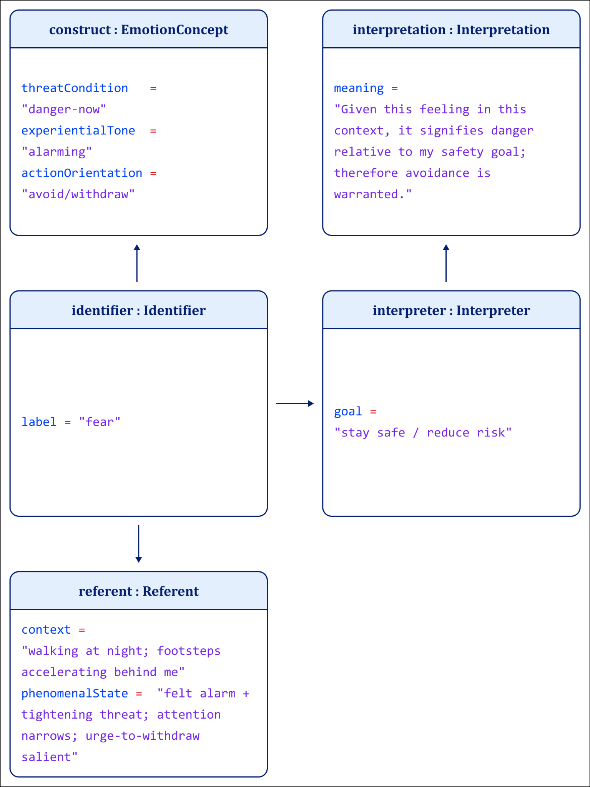

**Figure 9-1. Emotion Concept UML Class Diagram**
  
—--------------------------------------------------------------------------------------------------------------------------------------------------------  
**Figure 9-2. Emotion Semiotic Sign UML Object Diagram**

Figure 9-1 presents the Constructivist Semiotic Model of Emotions (CSME) as a UML class diagram. It specifies the abstract architecture of an admissible emotional construct by defining its constituent relationships and governing constraints. The diagram does not depict a particular emotional episode. Instead, it specifies the identity conditions that every emotional construct must satisfy in order to qualify as an instance of the architecture. The illustrated properties represent exemplar normative dimensions rather than an exhaustive schema for every possible emotion.

Figure 9-2 presents a Constructivist Semiotic Sign (CSS) as a UML object diagram. Whereas the class diagram specifies the architecture abstractly, the object diagram instantiates that architecture within a particular emotional episode. The interpreter constructs emotional meaning by interpreting a referent consisting of physiological affect, feeling, and context under a governing goal. The identifier stabilizes the resulting construct for cognition and communication, while the concept supplies the identity conditions that distinguish the construct from every other emotion type.

Together, these diagrams distinguish the architecture from its instantiation. The UML class diagram specifies what every admissible emotional construct must contain. The UML object diagram demonstrates how an interpreter realizes that architecture within a particular emotional episode. This distinction preserves the central claim of the CSME: emotional meaning does not reside in physiology, feeling, or symbolic labels alone. An agent constructs emotional meaning by instantiating a Constructivist Semiotic Sign under explicit ontological, semiotic, and computational constraints.

The diagrams that follow no longer argue for the architecture. They demonstrate that the architecture survives formal specification and computational execution without collapsing the distinctions among affect, feeling, interpretation, commitment, and emotion.

I can clarify the model by applying it to a familiar case: love. In this simplified illustration, I treat Love as the governing concept and show Romance, Lust, and Attachment as different instantiated interpretations of that concept. The example does not replace the full Constructivist Semiotic Sign. Rather, it condenses the sign structure so the reader can see how different identifiers arise from different relations among felt state, context, biochemical profile, and the interpreting agent's goal.

The point is not that Romance, Lust, and Attachment name three unrelated emotions. The point is that the same general concept, Love, can generate different constructs when the agent interprets a felt state under different contextual and purposive constraints. A candlelight dinner, a sexually charged setting, and a caregiving scene do not merely decorate the emotion. They help specify what kind of love the agent constructs.

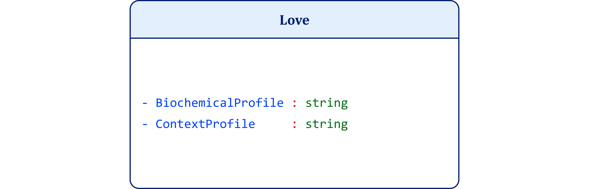  
—--------------------------------------------------------------------------------------------------------------------------------------------------------  
**Figure 9-3. Love Concept UML Class Diagram**

<table style="width:100%;">
<colgroup>
<col style="width: 17%" />
<col style="width: 27%" />
<col style="width: 27%" />
<col style="width: 28%" />
</colgroup>
<tbody>
<tr class="odd">
<td><strong>CSS Constituent</strong></td>
<td><strong>Romance</strong></td>
<td><strong>Lust</strong></td>
<td><strong>Attachment</strong></td>
</tr>
<tr class="even">
<td>Referent</td>
<td><strong> 
</strong>Romantic encounter</td>
<td> 
Sexually charged environment</td>
<td> 
Parents with child and dog</td>
</tr>
<tr class="odd">
<td>Identifier</td>
<td>Romance</td>
<td>Lust</td>
<td>Attachment</td>
</tr>
<tr class="even">
<td>Construct</td>
<td>1. BiochemicalProfile: dopamine, norepinephrine, serotonin. 
2. ContextProfile: courtship, attentiveness, exclusivity, affectionate exchange.</td>
<td>1. BiochemicalProfile: testosterone, estrogen. 
2. ContextProfile: sexual attraction, bodily display, erotic opportunity, physical proximity.</td>
<td>1. BiochemicalProfile: oxytocin, vasopressin. 
2. ContextProfile: care, familiarity, kinship, protection, durable trust.</td>
</tr>
<tr class="odd">
<td>Referent</td>
<td>Felt state of attraction, warmth, anticipation, and affiliative interest.</td>
<td>Felt state of sexual arousal, desire, bodily attraction, and approach readiness.</td>
<td>Felt state of safety, care, trust, belonging, and relational security.</td>
</tr>
<tr class="even">
<td>Interpreter</td>
<td>Interpreter seeking romantic bonding or exclusive affection.</td>
<td>Interpreter seeking sexual gratification or physical intimacy.</td>
<td>Interpreter seeking long-term security, emotional stability, or kinship continuity.</td>
</tr>
</tbody>
</table>

—--------------------------------------------------------------------------------------------------------------------------------------------------------  

**Table 9.7. Interpretive Variations of Love under the Constructivist Semiotic Model of Emotions**

Table 9.7 shows why CSME treats emotion as interpretive construction rather than simple biological activation. Biochemistry contributes real constraint, but it does not determine the emotion by itself. Context contributes real constraint, but it does not determine the emotion by itself. The agent constructs the emotion sign by binding felt state, context, concept, identifier, and goal into a coherent interpretation. In this sense, Romance, Lust, and Attachment function as distinct interpretations of Love rather than as isolated emotional substances.

Emotional meaning exists only when an agent interprets a sign relative to a goal and a context. I therefore require identifiable constituents, an act of interpretation, and constraints that allow success or failure. Without these, I can describe a biological event or a behavioral reflex, but I cannot claim emotional meaning.

This commitment grounds everything that follows. Without a semiotic architecture, emotion cannot be meaning at all. It becomes a pulse without a person. I restore the identity of emotion by restoring the authority of the agent who means it.

The corresponding C# executables for the projects below are available in the downloaded ZIP file under the matching project folder. Each folder includes a README with instructions for building, running, and reproducing the sample outputs.

Project 1 formalizes the claim that an emotion concept functions as a constraint structure. For demonstration, the program stipulates a simplified Fear concept with two admissibility conditions: the context must equal danger, and the arousal level must meet or exceed 6. The number does not claim to identify a psychological threshold for fear. It gives the executable a clear constraint so the program can test whether a runtime instance satisfies the concept.

The implementation defines an emotion concept with explicit constraint properties: required context and minimum arousal. Validation consists of testing whether the instance satisfies the concept’s constraints. The agent does not model validity as an object; the agent produces validity as a judgment.

Two parameters are accepted at runtime: context and arousal level.

Input

Output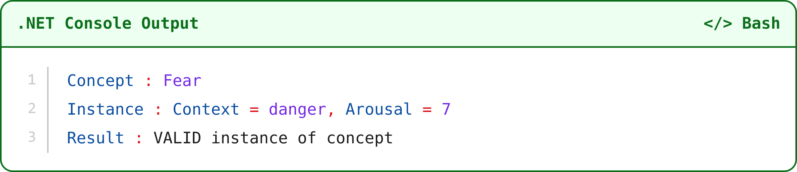

Input

Output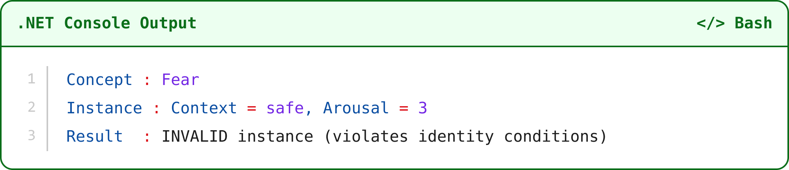

The run danger 7 passes because the instance satisfies both conditions: its context matches danger, and its arousal level exceeds the stipulated minimum of 6. The run safe 3 fails because the context does not match danger and the arousal level falls below 6. This demonstration does not claim that fear has a fixed psychological arousal threshold. It uses a stipulated threshold to show how a concept can govern admissible instances. Project 1 therefore demonstrates that identity depends on constraint satisfaction rather than resemblance or categorization. The structure accepts or rejects an instance according to whether the instance satisfies the concept’s admissibility conditions.

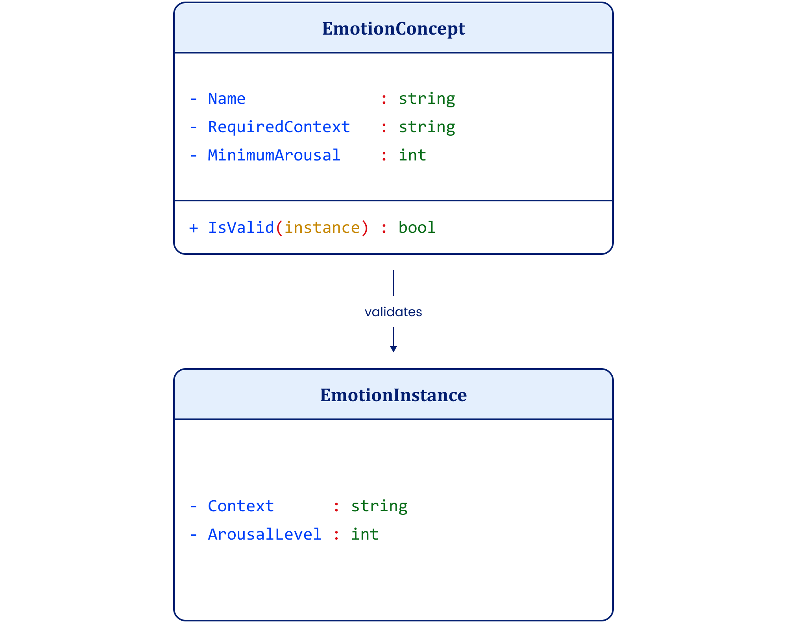  
—---------------------------------------------------------------------------------------------------------------------------------------------------------  
**Figure 9-4. Emotion Concept–Emotion Instance Validation UML Class Diagram**

Project 1 uses this validation structure to show how a concept governs an instance. The EmotionConcept supplies admissibility conditions, while IsValid(instance) tests whether a concrete EmotionInstance satisfies them. The example stipulates MinimumArousal = 6 only to make the validation executable; it does not claim that fear has a universal arousal threshold.

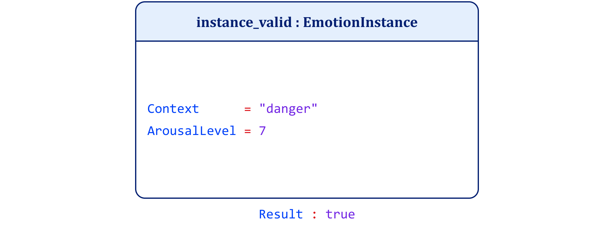  
—---------------------------------------------------------------------------------------------------------------------------------------------------------  
**Figure 9-5.** **Fear Instance (Valid) UML Object Diagram  
  
**

  
—---------------------------------------------------------------------------------------------------------------------------------------------------------  
**Figure 9-6. Fear Instance (Invalid) UML Object Diagram**

Project 1 demonstrates that the Fear concept accepts an instance only when the instance satisfies its stipulated admissibility conditions. Figure 9-5 shows the valid case: danger 7 satisfies the required context and minimum arousal condition. Figure 9-6 shows the invalid case: safe 3 fails because it satisfies neither condition. Thus, identity depends on constraint satisfaction rather than resemblance or categorization.

Project 2 defends the bridge condition established in the chapter: a feeling may be real, identifiable, and context-bound without yet carrying emotional meaning. Figure 9-7 shows this bridge structure: a FeelingState may support EmotionalMeaning, but it does not automatically become emotional meaning. The project therefore separates eligibility for meaning from meaning itself. This distinction matters because a theory of emotion can collapse feeling into emotion if it treats every conscious occurrence as an interpretation.

The implementation defines a feeling state through context and arousal. As Figure 9-8 shows, these properties establish semiotic availability: the state exists, the program can track it, and an interpreter can take it up as material for meaning. Emotional meaning appears only when the program invokes interpretation. This preserves the distinction between sign material and significance. The same feeling can therefore appear in two conditions: first, as available but not yet meaningful; second, as interpreted and semantically achieved.

The program accepts three runtime inputs: context, arousal level, and mode. Figure 9-8 shows the contrast between the two conditions. The mode controls whether the program stops at semiotic availability or proceeds to semantic achievement. In this way, Project 2 shows that feelings do not become meaningful by default. Meaning appears only when a separate interpretive step occurs.

Input  

Output  
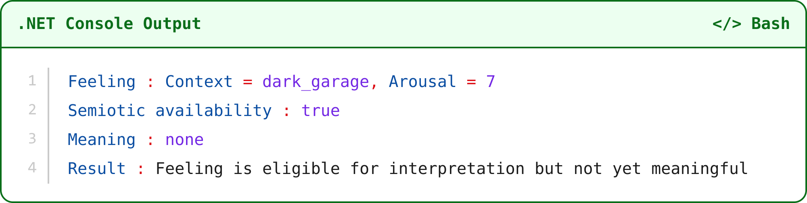

Input  

Output  
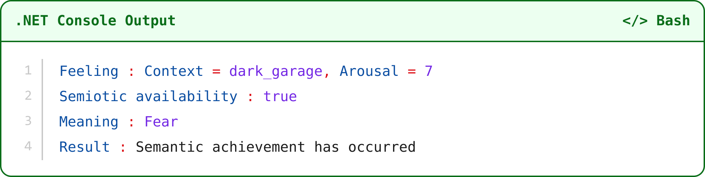

The contrast between these two outputs is the whole argument in executable form. Nothing in the underlying feeling changes. The contextualized arousal remains constant. The only change is whether interpretation has occurred. This demonstrates that feeling can function as sign-material without yet counting as an emotion.

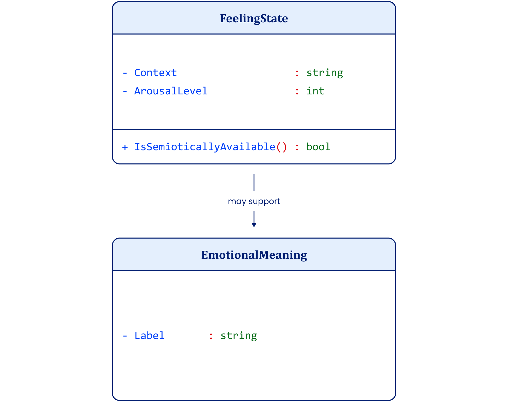  
-----------------------------------------------------------------------------------------------------------------------------------------------------------  
**Figure 9-7. Feeling State–Emotional Meaning Bridge UML Class Diagram**

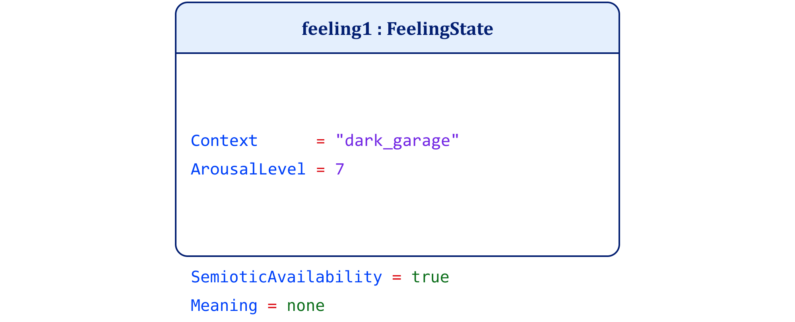  
---------------------------------------------------------------------------------------------------------------------------------------------------------  
**Figure 9-8. Feeling State (Before Interpretation) UML Object Diagram**

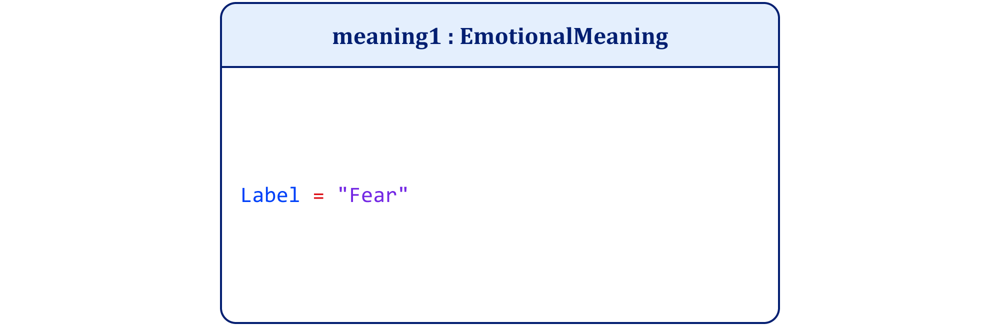  
------------------------------------------------------------------------------------------------------------------------------------------------------------  
**Figure 9-9. Emotional Meaning UML Object Diagram**

  
--------------------------------------------------------------------------------------------------------------------------------------------------------  
**Figure 9-10. Feeling State (Before Interpretation) UML Object Diagram**

Project 3 defends one of the chapter’s strongest claims: the same feeling-in-context can yield different emotions under different goals. This directly supports my argument that emotional meaning does not equal bodily state. If bodily state alone determined emotion, then a constant feeling would also produce a constant emotion. Project 3 shows the opposite: the feeling remains constant while the emotion changes when the governing goal changes.

Figures 9-11 through 9-14 present the class structure for this demonstration. Figure 9-11 defines the FeelingState through context and arousal. Figure 9-12 defines the Goal as the governing constraint. Figure 9-13 defines EmotionInterpretation as the resulting emotional meaning. Figure 9-14 defines the Interpreter, which uses the feeling state and goal together to produce the interpretation.

Figures 9-15 through 9-18 show the concrete object executions. Figure 9-15 holds the feeling constant: the context remains backstage, and arousal remains 8. Figure 9-16 introduces the goal perform_well, which supports the interpretation shown in Figure 9-17: Excitement. Figure 9-18 then changes the goal to avoid_failure, and Figure 9-19 shows the resulting interpretation: Anxiety.

The program accepts three runtime inputs: context, arousal level, and goal. In both executions, the feeling remains unchanged. Only the goal changes. That change produces a different emotional meaning. Project 3 therefore demonstrates that the body does not carry emotional meaning within itself. Meaning arises when an interpreter takes up a felt state under a governing aim.

Input  

Output  

Input  

Output  
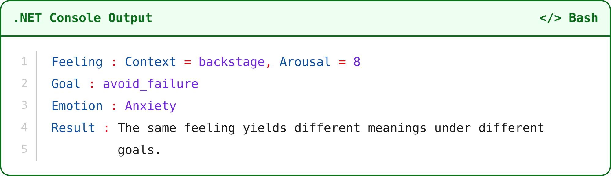

The contrast between these outputs demonstrates the core argument in executable form. Nothing in the feeling changes. The context remains backstage. The arousal remains high. Only the goal changes. Yet the meaning shifts from excitement to anxiety. This shows that emotional meaning is not found in the feeling alone but is constructed through goal-governed interpretation.

  
—----------------------------------------------------------------------------------------------------------------------------------------------------  
**Figure 9-11. Feeling State UML Class Diagram  
**

  
—----------------------------------------------------------------------------------------------------------------------------------------------------  
**Figure 9-12. Goal UML Class Diagram**

  
—----------------------------------------------------------------------------------------------------------------------------------------------------  
**Figure 9-13. Emotional Interpretation UML Class Diagram**

  
—----------------------------------------------------------------------------------------------------------------------------------------------------  
**Figure 9-14. Interpreter UML Class Diagram**

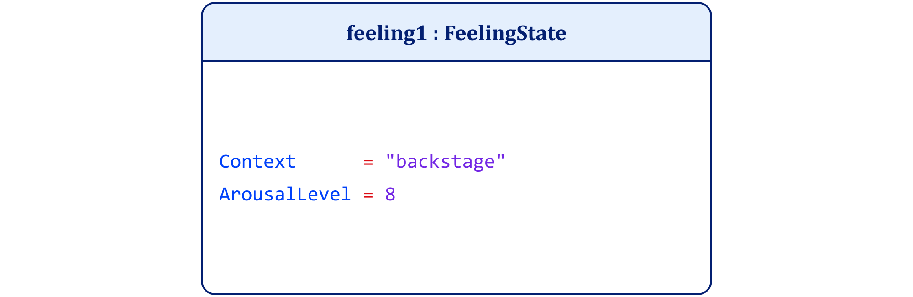  
—----------------------------------------------------------------------------------------------------------------------------------------------------  
**Figure 9-15. Feeling State UML Object Diagram**

  
—----------------------------------------------------------------------------------------------------------------------------------------------------  
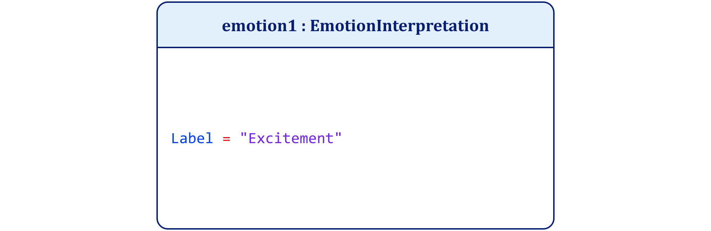

**Figure 9-16. Performance Goal UML Object Diagram**
  
—----------------------------------------------------------------------------------------------------------------------------------------------------  
**Figure 9-17. Excitement Interpretation UML Object Diagram**

  
—----------------------------------------------------------------------------------------------------------------------------------------------------  
**Figure 9-18. Avoidance Goal UML Object Diagram**

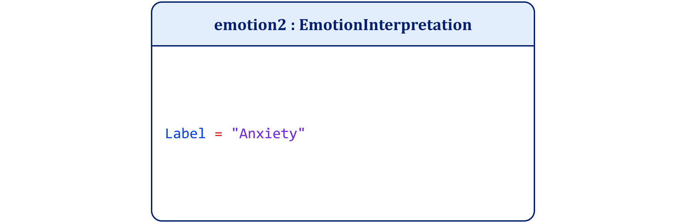  
—---------------------------------------------------------------------------------------------------------------------------------------------------------  
**Figure 9-19. Anxiety Interpretation UML Object Diagram**

Project 4 illustrates the chapter’s claim that emotional meaning arises through an ordered sequence rather than a single undifferentiated event. Figures 9-20 through 9-23 present the class structure for that sequence. Figure 9-20 defines the external situation. Figure 9-21 defines the feeling state that the situation can produce. Figure 9-22 defines the goal that governs interpretation. Figure 9-23 defines emotional meaning as the result of interpretation. Figure 9-24 shows the pipeline that first converts situation into feeling, then interprets that feeling under a goal.

Figures 9-25 through 9-28 show the corresponding object-level execution. Figure 9-25 presents the external situation, footsteps_behind. Figure 9-26 shows the resulting feeling state: context dark_street, arousal level 7. Figure 9-27 introduces the goal stay_safe, and Figure 9-28 shows the resulting meaning, Fear. Figure 9-29 then shows the alternative meaning, Relief, when the interpretive context changes.

Project 4 therefore demonstrates phase separation. The external situation does not contain emotional meaning by itself. The situation first gives rise to feeling. The agent then interprets that feeling under a goal. Emotion appears only after that interpretive act.

Input

Output  

Input  
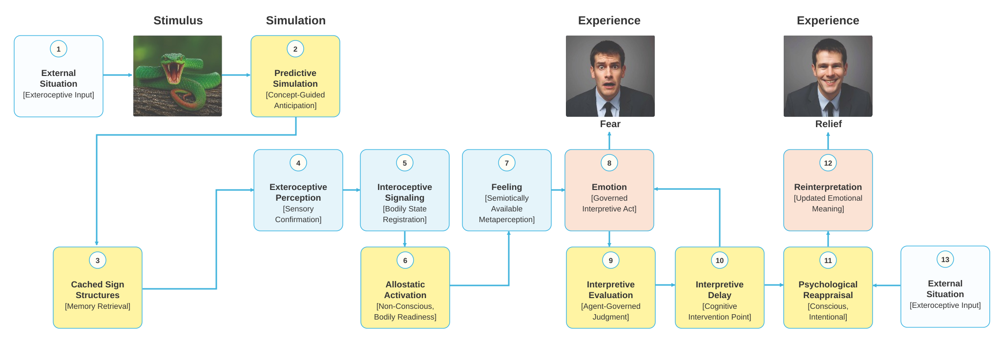

Output  
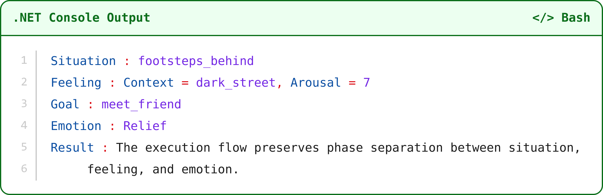

The contrast between these outputs demonstrates the architectural point. The external event does not contain emotional meaning within itself. It first produces a feeling state. That feeling then becomes emotionally meaningful only when interpreted under a governing goal. This preserves the chapter’s distinction between causal sequence and semantic achievement.

  
—----------------------------------------------------------------------------------------------------------------------------------------------------  
**Figure 9-20. External Situation UML Class Diagram**

  
—----------------------------------------------------------------------------------------------------------------------------------------------------  
**Figure 9-21. Feeling State UML Class Diagram**

  
—----------------------------------------------------------------------------------------------------------------------------------------------------  
**Figure 9-22. Goal UML Class Diagram**

  
—----------------------------------------------------------------------------------------------------------------------------------------------------  
**Figure 9-23. Emotional Meaning UML Class Diagram**

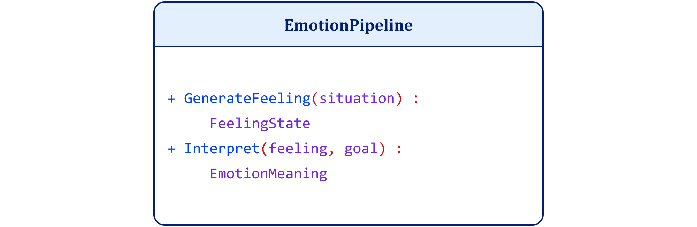  
—----------------------------------------------------------------------------------------------------------------------------------------------------  
**Figure 9-24. Emotion Pipeline UML Class Diagram**

  
—----------------------------------------------------------------------------------------------------------------------------------------------------  
**Figure 9-25. External Situation UML Object Diagram**

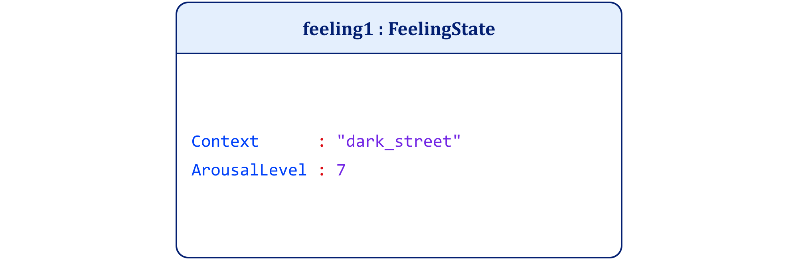  
—----------------------------------------------------------------------------------------------------------------------------------------------------  
**Figure 9-26. Feeling State UML Object Diagram**

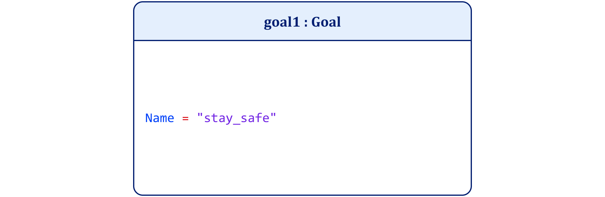  
—----------------------------------------------------------------------------------------------------------------------------------------------------  
**Figure 9-27. Safety Goal UML Object Diagram**

  
—----------------------------------------------------------------------------------------------------------------------------------------------------  
**Figure 9-28. Fear Meaning UML Object Diagram**

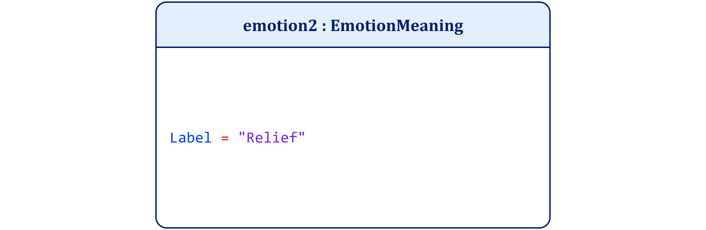  
—----------------------------------------------------------------------------------------------------------------------------------------------------  
**Figure 9-29. Relief Meaning UML Object Diagram**

Project 5 isolates the chapter’s final executable claim: an agent can revise emotional meaning without changing the underlying feeling. Figures 9-30 through 9-32 define the class structure for that revision. Figure 9-30 defines the feeling state through context and arousal. Figure 9-31 defines the goal that continues to govern interpretation. Figure 9-32 defines emotional meaning as the interpretive result. Figure 9-33 defines the Reinterpreter, which takes the same feeling and goal together with updated contextual knowledge.

Figures 9-34 through 9-36 show the object-level execution. Figure 9-34 holds the feeling constant: context dark_street, arousal level 7. Figure 9-35 holds the goal constant: stay_safe. Figure 9-36 shows the initial interpretation, Fear, when the agent treats the other person as unknown. Figure 9-37 shows the revised interpretation, Relief, when the agent recognizes the other person as a friend.

Project 5 therefore demonstrates revisability. The feeling does not change, and the governing goal does not change. Updated contextual knowledge changes the interpretation. Emotional meaning therefore does not reside inside the bodily state; an agent constructs it through interpretation and can revise it when context warrants correction.

Input  

Output  
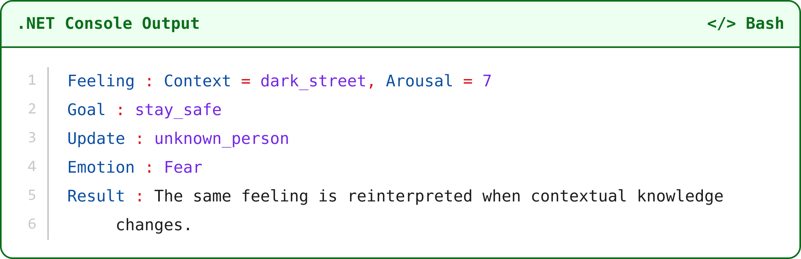

Input  

Output  

The contrast between these outputs demonstrates the argument in executable form. The feeling remains constant. The governing goal remains constant. Only contextual knowledge changes. Yet the meaning shifts from fear to relief. This shows that emotional meaning is not contained in the bodily state itself but arises through interpretation and can therefore be revised when interpretation is corrected.

  
—----------------------------------------------------------------------------------------------------------------------------------------------------  
**Figure 9-30. Feeling State UML Class Diagram**

  
—----------------------------------------------------------------------------------------------------------------------------------------------------  
**Figure 9-31. Goal UML Class Diagram**

  
—----------------------------------------------------------------------------------------------------------------------------------------------------  
**Figure 9-32. Emotional Meaning UML Class Diagram**

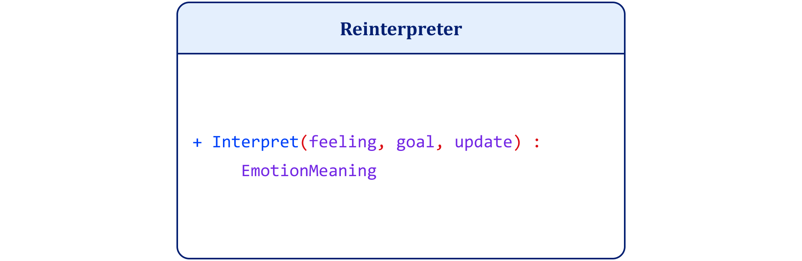  
—----------------------------------------------------------------------------------------------------------------------------------------------------  

**Figure 9-33. Reinterpreter UML Class Diagram**
  
—----------------------------------------------------------------------------------------------------------------------------------------------------  
**Figure 9-34. Feeling State (Stable) UML Object Diagram**

  
—----------------------------------------------------------------------------------------------------------------------------------------------------  
**Figure 9-35. Safety Goal (Stable) UML Object Diagram**

  
—----------------------------------------------------------------------------------------------------------------------------------------------------  
**Figure 9-36. Emotion Meaning (Initial Fear) UML Object Diagram**

  
—----------------------------------------------------------------------------------------------------------------------------------------------------  
**Figure 9-37. Emotion Meaning (Revised Relief) UML Object Diagram**

The five projects have now performed a single task under different constraints. They have not introduced new claims. They have enforced the claims already made.

Each project isolates a failure point in contemporary emotion theory and replaces it with an executable constraint. The first project fixes identity conditions by demonstrating that a concept governs its instances through admissibility rather than emerging from classification. The second project secures the bridge condition by showing that a feeling may be available for interpretation without already possessing meaning. The third project restores interpretive governance by proving that the same feeling-in-context yields different emotions under different goals. The fourth project preserves phase separation by enforcing the ordered transition from situation to feeling to interpretation without collapse. The fifth project establishes revisability by showing that meaning can change while the underlying feeling remains constant.

Taken together, these projects do not merely illustrate the theory. They constrain it. Each executable forces a distinction that the architecture requires. If any distinction is removed, the code collapses into contradiction. Identity dissolves into grouping. Availability collapses into meaning. The body is mistaken for the interpreter. Sequence collapses into simultaneity. Revision becomes impossible. The projects therefore function as proof by failure. They show not only what the model asserts, but what breaks when its constraints are violated.

The result is a system in which emotional meaning survives computational pressure without sacrificing philosophical precision. The architecture holds. Affect remains causal. Feeling remains experiential. Emotion remains interpretive. The agent remains responsible.

What remains is to present the system as a unified execution. The projects demonstrated the parts. The next step shows the whole.

Figure 9-38 now integrates these constraints into a single, phase-ordered architecture.

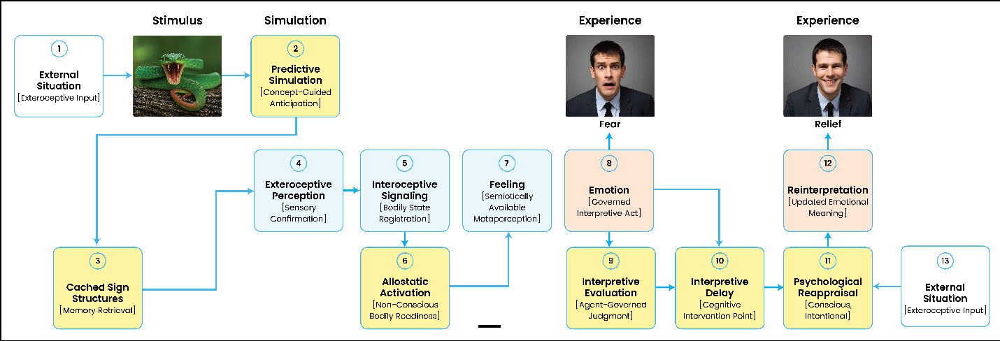  
—----------------------------------------------------------------------------------------------------------------------------------------------------  
**Figure 9-38. Metamorphosis of an Emotion**

Figure 9-38 illustrates the complete architecture through which emotional meaning is constructed within the Constructivist Semiotic Model of Emotions (CSME). The diagram separates simulation, bodily regulation, feeling, and interpretation into distinct stages so that the reader can see precisely where emotional meaning arises in the process. Each numbered step corresponds to a labeled component in the diagram and shows how environmental input, predictive cognition, physiological readiness, and conceptual interpretation interact without collapsing into one another. The sequence demonstrates that biological and predictive processes shape the field of possible interpretations but do not constitute emotional meaning themselves. Emotional meaning emerges only when the agent performs an interpretive act that stabilizes a semiotic sign binding affect, concept, and governing goal.[@barrett2016work]

Throughout the diagram, bodily regulation, prediction, and perception are treated as operations of the cognitive system. Interpretation, however, belongs to the agent. The system prepares and constrains the field of possible meanings, but only the agent performs the interpretive act that constitutes emotional meaning.

**(1) External Situation (Exteroceptive Input).  
** The process begins with an external situation that impinges on the sensory systems. At this stage the stimulus is a physical configuration of the environment. It may trigger perceptual and physiological responses, but it possesses no intrinsic emotional meaning. The stimulus is therefore causally efficacious but semantically inert.[@sellars0000work]

**(2) Predictive Simulation (Concept-Guided Anticipation).  
** The stimulus activates predictive simulation. The cognitive system anticipates possible outcomes by projecting concept-guided expectations about relevance, affordances, and potential consequences. This simulation narrows the range of plausible interpretations but remains pre-interpretive. It constrains the field within which an agent may later interpret the feeling, but it does not determine emotional meaning.[@friston0000freeenergy]

**(3) Cached Sign Structures (Memory Retrieval).  
** Predictive simulation draws upon cached sign structures stored in memory. Previously learned conceptual associations, cultural scripts, and past experiences supply the conceptual resources through which the situation may later be interpreted. These stored structures supply conceptual resources that the agent may draw upon during interpretation. They prepare the architecture of possible meanings but do not themselves produce emotional meaning.

**(4) Exteroceptive Perception (Sensory Confirmation).  
** Simultaneously, the organism organizes incoming sensory information through exteroceptive perception. Environmental features become structured into a coherent situational representation shaped by predictive expectations. Perception therefore delivers organized sensory input rather than evaluative meaning.[@clark0000work]

**(5) Interoceptive Signaling (Bodily State Registration).  
** At the same time the body generates interoceptive signals reflecting physiological changes within the organism. These signals communicate information about bodily condition such as heart rate, muscle tension, and metabolic readiness. Interoception supplies causal input to the system but does not yet constitute emotion.

**(6) Allostatic Activation (Non-Conscious Bodily Readiness).  
** The organism adjusts bodily resources through allostatic regulation in anticipation of potential demand. Energy allocation, arousal levels, and attentional readiness shift automatically as the system prepares for action. These changes influence the interpretive field by making certain responses more viable than others, yet they do not, in themselves, provide evaluative meaning.[@sterling2012allostasis2]

**(7) Feeling (Metaperceived Awareness of Bodily State).  
** Interoceptive activity becomes consciously accessible through metaperception. Feeling arises as the conscious awareness of bodily condition within context, making the affective state available to the agent as potential sign-material for interpretation. Although this experience is real and experientially salient, no emotion yet exists at this stage. Feeling constitutes the experiential referent that later becomes available for interpretation.[@damasio0000how]

At this point the diagram introduces two consecutive stages labeled Emotion (8) and Interpretive Evaluation (9) but stages 8 and 9 represent a single interpretive act analytically decomposed for conceptual clarity, not a temporal sequence. Stage 8 identifies the act as a whole; Stage 9 isolates its evaluative structure. The diagram's sequential notation is a representational convenience, not an ontological claim about temporal order. Stage 8 represents the unified interpretive act through which an agent constitutes emotional meaning by assigning significance to a felt state under goal-relative constraints. Stage 9 provides an internal analytical decomposition of that same act. It isolates the evaluative judgment that determines how the felt state should be understood relative to the agent’s goals and contextual conditions. The diagram therefore separates the act and its evaluative structure for purposes of conceptual clarity. In the actual operation of the architecture, these components occur as a single interpretive commitment rather than as sequential processes.

**(8) Emotion (Goal-Governed Interpretive Act).  
** Emotion arises when the agent performs a goal-governed interpretive act that assigns meaning to the felt state. At this point the agent binds the felt experience to an emotion concept under governing goals and contextual constraints. The cognitive system provides the enabling architecture that makes this act possible.

**(9) Interpretive Evaluation (Agent-Governed Judgment).  
** The interpretive act includes an evaluative judgment in which the agent determines how the felt state should be understood relative to contextual goals and conceptual constraints. Stage 9 isolates this evaluative dimension analytically, but it does not introduce a separate step in time. It specifies the internal structure of the interpretive act already represented in Stage 8. The cognitive system constrains the interpretive field, but the judgment itself belongs to the agent.[@lazarus0000work]

**(10) Interpretive Delay (Cognitive Intervention Point).  
** The architecture permits interpretive delay. The agent may pause before finalizing interpretation, allowing reflective consideration of alternative conceptual bindings. This stage explains how agents can intervene in emotional interpretation rather than remaining locked into automatic responses.[@gross1998emerging]

**(11) Psychological Reappraisal (Intentional Reinterpretation).  
** Through deliberate reflection the agent may reinterpret the situation by revising contextual assumptions, conceptual framing, or governing goals. Reappraisal does not eliminate the underlying feeling but alters the meaning assigned to it.

**(12) Reinterpretation (Updated Emotional Meaning).  
** When reinterpretation occurs, the same bodily state may stabilize under a different emotional concept. In the diagram the initial interpretation of fear may be reconstructed as relief once new contextual information becomes available. Emotional meaning therefore proves revisable rather than fixed.

**(13) Updated External Situation (Revised Exteroceptive Context).  
**Finally, step 13 returns the process to the external situation, completing the loop. Changes in the external environment do not retroactively alter earlier interpretations; rather, they update the predictive and allostatic parameters that shape future interpretive possibilities. This is the learning and refinement mechanism of the architecture. Over time this feedback contributes to learning and refinement of the interpretive system.[@singer0000cognitive]

Taken together, the sequence demonstrates that emotions are neither reflexive bodily outputs nor automatic products of predictive categorization. Bodily signals and predictive simulations prepare the interpretive field, but emotional meaning arises only when the cognitive system stabilizes a semiotic sign that binds affect, concept, and goal. Emotion is therefore not detected but constructed through interpretive commitment within a goal-governed architecture of cognition.

I did not merely claim in this chapter that emotions are constructed. I demonstrated what an emotion must be to qualify as meaning. I enforced that requirement through a disciplined, inspectable architecture. The Constructivist Semiotic Model of Emotions (CSME) does not describe emotional life through metaphor. It specifies the conditions that make emotional meaning possible, executable, and accountable.[@marr0000work]

I resolved the three structural failures that undermine most emotion theories.

First, I eliminated ontological collapse. Affect, feeling, and emotion do not form stages of a single process. They serve as non-substitutable roles with distinct identity conditions. Physiological affect belongs to the body as a causal substrate. Feeling belongs to consciousness as metaperceived interoception. Emotion belongs to interpretation as meaning achieved under constraint. With these roles fixed, sensation cannot masquerade as meaning. Regulation cannot masquerade as judgment.[@panksepp0000work2]

Second, I secured the bridge condition. Semiotic availability does not equal semantic achievement. A feeling becomes eligible for meaning without becoming meaningful by default. It functions as sign-material situated in context, but it does not yet signify. Emotional meaning emerges only when an agent interprets that feeling under goal-relative constraints. Without this distinction, theories either smuggle meaning into sensation or dissolve meaning into mechanism.[@peirce0000work4]

Third, I restored interpretive governance. Emotional meaning does not function as an automatic output of appraisal loops or predictive simulations. It constitutes an agent-owned act governed by correctness conditions. Because goals and context constrain interpretation, emotions can succeed or fail. They can be justified or mistaken. They can be revised over time. Without this governed act, no emotional meaning exists. One finds only physiological change and behavioral consequence.[@brandom0000work3]

I demonstrated that these distinctions survive formal pressure. The CSME applies a unified semiotic architecture across both feeling and emotion while it preserves phase separation. The UML class diagram fixes the identity conditions of emotion concepts. The object diagram shows how an agent instantiates emotional meaning in context. The metamorphosis flow illustrates how prediction, perception, allostasis, and metaperception prepare the field without themselves constituting significance. No level collapses into another. No role performs the work of its neighbor.[@marr0000work2]

The division of labor remains precise. Computation constrains and prepares. Interpretation constitutes meaning. Prediction biases salience. Allostasis shapes readiness. Simulation retrieves prior structures. None of these operations decides what a feeling signifies. They constrain the interpretive field, but only the agent determines the emotional meaning of the feeling through an act of interpretation. Meaning enters the architecture only when an agent interprets a semiotically available feeling relative to a governing goal.[@clark0000freeenergy]

. This model respecifies the identity conditions, bridged experience and meaning, and located governance in the agent. This model secures emotional meaning as accountable rather than automatic.[@brandom0000work4]

The architecture now stands complete. An agent does not discover emotion. An agent constructs it under the law.[@barrett0000work3]

I have fixed emotional meaning as a constructed achievement rather than a discovered state. Now I face an unavoidable task. If emotions are signs, I must explain what makes signs possible in the first place. Emotional Constructivism rests on a macro-semiotic architecture, yet that architecture presupposes a deeper layer it has not yet justified. Interpretation requires symbolic material before it can produce meaning.[@peirce1998work]

This chapter moves downward as well as forward. I shift from the macro-semiotic sign to its micro-semiotic constituents. I ask how symbols make concepts possible, how concepts become available for interpretation, and why meaning collapses whenever this symbolic substrate is absent. The focus is no longer emotion alone. I target the general machinery of understanding that emotions depend on.[@cassirer1944work]

What follows is a formal account of how symbols enable concepts, how concepts participate in signs, and how signs yield intensional meaning.[@frege1980on2] I show why perception can occur without symbols, but understanding cannot.[@wittgenstein1922work] I show why signals can exist without meaning, but signs cannot. Emotional meaning is only one instance of a more general semiotic achievement.[@peirce0000work5]

Chapter 10: All I know is what I have symbols for.  
The Making of Meaning.

**Sources**

[Contents](../../README.md) · [Notes](../references/notes/chapter-10.md) · [Bibliography](../references/bibliography/chapter-10.md)

# Chapter 10 — All I Know Is What I Have Symbols For

*The Linguistic Limits of Emotional Meaning*

*In this chapter, I move beneath emotion to the deeper architecture that makes emotional meaning possible at all. Chapter 9 showed that emotion does not live inside the body as a ready-made state. Emotion arises when an agent interprets feeling under goal, context, and constraint. Chapter 10 asks the next necessary question: what must a system possess before it can make that kind of meaning?*

*My answer begins with a hard distinction. Feeling is not meaning. A creature may feel, regulate, react, and adapt without yet producing emotional meaning in the strict sense. Meaning requires more than sensations, and phenomena. It requires symbols that a system can detach from immediate stimulus conditions, organize according to rules, and use to stabilize significance across contexts. Words count as symbols, but words do not exhaust the symbolic field. Gestures, diagrams, signs, musical notation, mathematical symbols, and internal identifiers can also function symbolically when a system uses them to organize meaning.*

*I argue that meaning requires structured representation interpreted relative to stake. Something must appear as something for a system for which it matters. This separates meaning from mere signal, reflex, and regulation. A thermostat can track a temperature difference, but it does not care. A body can activate under threat, but activation alone does not say what the activation means. Stake gives the system a normative orientation. Structure gives it form. Interpretation allows the system to use the representation to guide judgment, expectation, and response.*

*From there, I identify the symbolic thresholds that meaning requires. First, symbolic detachment allows an agent or system to invoke an identifier even when the original trigger is absent. Second, symbolic endorsement allows the system to proceed under that identifier as operative. Third, grammar allows symbols to produce significance with determinate structure. Fourth, metarepresentation allows the system to evaluate, revise, negate, or justify its own attributions. These thresholds turn raw affect and behavior into a genuine architecture of meaning.*

*This architecture also clarifies the difference between feeling and emotion. A feeling presents affect in first-person experience. It makes bodily life available to the subject, but it does not yet organize that life as structured significance. Emotion begins when an agent organizes feeling under a detachable symbolic identifier, conceptual constraint, context, and stake. Fear, shame, pride, embarrassment, anger, and betrayal do not simply occur as bodily facts. An agent stabilizes felt experience under identifiers that carry identity conditions and admit correction.*

*I call the domain-specific symbolic system of emotional meaning Emotionese. Emotionese names the generative architecture through which agents construct, stabilize, revise, and communicate emotional significance. It does not reduce emotion to spoken language. It names the broader symbolic system that allows affect to become intelligible as fear rather than excitement, shame rather than guilt, pride rather than relief. Without Emotionese, affect may occur, expression may occur, and regulation may occur. Emotional meaning does not yet occur.*

*The chapter’s governing thesis is therefore direct: the limits of my symbols are the limits of my meaning. In the emotional domain, the claim becomes sharper still: all I mean emotionally is what I have signs for. Where no detachable sign exists, no emotional meaning can arise in the strict architectural sense.*

*This conclusion does not deny feeling to animals or infants. It does not trivialize their affective lives. It raises the standard of the question. The issue is no longer whether animals and infants feel. They do. The issue is whether they possess the symbolic architecture required to transform feeling into detachable, endorsable, constraint-governed emotional meaning.*

*Chapter 11 applies that test. I now turn from the architecture of meaning to its most difficult cases: nonhuman animals and neurotypical infants. The question will not be whether they react, regulate, or suffer. The question will be whether they signify.*

Do animals have emotions? Do babies have emotions?

In Chapter 9, I established that emotion, in the strict sense developed here, is not physiological affect, not phenomenological feeling, and not an automatic appraisal output. Emotion is a goal-governed interpretive act through which an agent assigns significance to a felt state under conditions of context, constraint, and possible correction. Emotional meaning, therefore, is not discovered inside the body. An agent, for whom something is at stake, constructs emotion when they interpret a semiotically available feeling.

That account clarifies the nature of emotional meaning, but it also exposes a deeper requirement. If emotion is a constructed semiotic achievement by an agent, then I must now ask what makes semiotic achievement possible in the first place. Chapter 9 showed where emotional meaning arises in the architecture. Chapter 10 moves beneath that achievement to examine the symbolic conditions that allow any meaning, emotional or otherwise, to stabilize.

I therefore cannot answer the questions about animals and infants, simply by observing arousal, expression, or feeling alone. Those phenomena matter, but they do not settle the issue. The decisive question is whether a system possesses the symbolic architecture required to convert affective life into structured, detachable, and interpretable meaning. A creature may feel. It may regulate. It may respond intelligently to the world. But the question at issue is whether it can mean in the strict architectural sense required by the constructivist semiotic model of emotions.

I therefore begin upstream from emotion without abandoning emotion. I ask what must be present for something to count as meaning rather than mere sensation, signal, regulation, or behavioral coordination. Only after I define meaning in its structural forms can I specify the threshold for emotional meaning in animals and infants. Only then can I determine whether infants use symbols to stabilize feeling and ascribe it to themselves as content, and whether animal affect rises beyond structured regulation into detachable, endorsable emotion in the strict architectural sense.

Ludwig Wittgenstein famously wrote that “the limits of my language mean the limits of my world.”[@wittgenstein1922work] The thought is often paraphrased, somewhat misleadingly,  as the claim that one can only know what one has words for. My concern, however, is not knowledge but meaning. I am not delimiting what can be known; I am specifying what can count as structured significance within a system.

Ferdinand de Saussure distinguished between langue, the rule-governed system, and parole, its enactment in speech.[@saussure1966work] The present thesis extends beyond both parole and lexical vocabulary. In the present framework, words count as symbols, but they do not exhaust the category of symbols. Marks, gestures, diagrams, mathematical signs, musical notation, and other rule-governed forms may also function symbolically when a system can detach them from immediate stimulus conditions and use them to organize meaning. What limits meaning, then, is not necessarily uttered words, but the availability of detachable symbolic architecture itself. The limits of my symbols determine the limits of my meaning. In this structural sense, all I mean is what I have symbols for.

Within the present framework, I advance the claim that meaning in the full semiotic sense requires detachable symbolic architecture. Where there are no detachable symbols, there can be no grammar in the strict combinatorial sense defined here. Where there is no grammar, structured significance cannot arise. Where there is no structured significance, there can be no generative language in any modality, and therefore no emotional meaning in the strict sense.[@chomsky1965work]

On this foundation, I will specify the minimal semiotic constituents required for meaning and determine which are dispensable for proto-meaning. Only then can we answer, with precision rather than intuition: Do animals and babies meet the structural threshold for emotional meaning?

In this chapter, I treat emotional meaning as a problem in semiotic architecture rather than psychology or affective neuroscience. Instead of debating behavioral evidence or neural correlates, I identify the structural conditions that make meaning possible at all. I integrate philosophy of language, semiotics, cognitive architecture, and formal computational systems into a unified evaluative framework.[@fodor1975work] By specifying these thresholds explicitly, I replace anthropomorphic projection with principled criteria.

Before I ask whether animals or babies possess emotional meaning, I must clarify what meaning itself requires. The word “meaning” is used ambiguously. It often collapses fundamentally different dimensions under a single label. To avoid confusion, I must distinguish three axes along which the term shifts.

To maintain a rigorous standard for meaning, we must recognize it as an architectural achievement rather than a vague experiential glow. This requires a precise separation of the three axes along which meaning shifts, avoiding the ambiguities of folk psychology.

First, the phenomenological axis: sensation versus representation. A physiological event is a bodily change. Sensation is the felt awareness of such change, the “something it is like” to be in a state.[@nagel1974what] But sensation does not yet stabilize representational content. It presents experience without organizing it under conceptual constraint. Representation advances beyond immediacy by presenting something as something.[@sellars1963empiricism] Meaning in the semiotic sense never consists in mere sensation; it requires structured representation.

Second, the normative axis: structure versus stake. Structure refers to a patterned organization governed by rules. A thermostat detects temperature differentials under structural constraint and regulates behavior relative to a set point, yet it does so without intrinsic stake. Its function is externally assigned by design; nothing is at risk for the system itself.[@dennett1971intentional]

Stake introduces normative orientation: the system treats something as mattering because it can gain it, preserve it, or lose it through its own continued operation.[@millikan1984work] This requires that the system’s continued operation, integrity, or evaluative state is internally at issue. Structure without stake is blind computation. Stake without structure reduces to undifferentiated impulse. Meaning requires their integration.

Third, the interpretive axis: representation versus interpretation. A representation may exist within a system while remaining inert. Interpretation introduces uptake. The system proceeds under the representation as action-guiding, integrating it into expectation, choice, and outcome sensitivity.[@dretske1981work] Without interpretive integration, representations remain correlations within processing architecture.

Taken together, these axes yield a minimal criterion. Meaning arises when a state functions as a structured representation interpreted relative to stake within a system capable of integration and response. It is not mere sensation, not mere structure, and not mere causal linkage. It is structured significance: something presented as something for a system for which it matters.

Extensional classification can occur without fully intensional, identity-condition-governed meaning. A system may reliably sort patterns as threat, food, or ally through learned regularities while lacking identity conditions that fix what makes those classifications correct across contexts.[@frege1952on] Extensional success therefore does not imply detachable, endorsable, constraint-governed significance.[@kripke1980work] This distinction will matter when I evaluate whether animals and infants are eligible for emotional meaning.

I now preview the threshold claim that governs the rest of this chapter and the evaluation in Chapter 11, Do Animals and Infants Have Emotions? I do not view emotional meaning as a binary property that appears whenever affect is present. It is an architectural achievement that emerges only when a system crosses specific structural thresholds. I identify four thresholds as minimally required.

First, I require symbolic detachment. This is the capacity to invoke an identifier independently of its triggering instance.[@peirce1955logic] Second, I require symbolic endorsement. This is the integration of that identifier as action-guiding under its specific content.[@brandom1994work] Third, I require grammatical organization. These are the rule-governed constraints that relate identifiers into structured significance.[@chomsky1965work2] Finally, I require metarepresentation. This is the capacity to treat one’s own attributions as attributions, which enables evaluation, revision, negation, and justification.[@sperber1975work]

In the rest of this chapter, I  specify these thresholds precisely. In Chapter 11, I apply them to two specific cases. I evaluate nonhuman animals as a species-typical class and neurotypical infants as a developmental ascent.

In the emotional domain, this generative symbolic architecture takes a specific form. I will later refer to it as Emotionese: the rule-governed system through which agents stabilize, organize, and communicate emotional meaning. For now, I will leave the development of the term for later. First, I must specify the general architecture of meaning that makes any such system possible.

I move beyond the blind robot of behavioral observation to identify the objective necessity of these structural constituents. I will use “meaning” in this strict architectural sense throughout: structured representation interpreted relative to stake.[@dretske1988work]

If meaning requires structured representation interpreted relative to stake, then the next question becomes unavoidable: what kind of system is capable of producing such structured representation?

Language, in the present architectural sense, is not restricted to spoken or written words. It refers to a generative symbolic architecture capable of producing structured significance. A language, in this broader sense, consists of discrete combinable units organized by rule into higher-order forms that admit interpretation.[@jackendoff2002work]

This view aligns with the tradition represented by Jerry Fodor and Ray Jackendoff. Fodor argues that cognition operates over symbolically structured expressions with combinatorial and compositional properties.[@fodor1975work2] Jackendoff similarly maintains that linguistic competence reflects parallel representational structures linking form and conceptual organization.[@jackendoff1983work] What defines language, on this account, is not vocalization but rule-governed symbolic structure capable of generating indefinitely many meaningful combinations.

Natural language is  one paradigmatic instantiation of this architecture. Mathematics, music, and formal computational systems likewise organize discrete units under combinatorial constraint. In each domain, hierarchical organization enables structured significance to emerge from minimal symbolic primitives.[@hofstadter1979work]

| Domain | Minimal Unit | Intermediate Structure | Higher-Order Structure |
| --- | --- | --- | --- |
| Natural Language | Phoneme / Character | Word / Clause | Proposition |
| Mathematics | Symbol / Variable | Expression / Equation | Theorem / Formal Statement |
| Music | Note | Motif / Phrase | Thematic or Expressive Structure |
| Formal Systems | Token / Symbol | Statement / Instruction | Executable Program or Proof |

**Table 10-1. Hierarchical Organization of Meaning Across Symbolic Domains**

Table 10-1 illustrates a common structural pattern. Discrete elements do not merely accumulate; they are organized under rule into increasingly complex configurations that admit interpretation. Where such generative structure operates, symbols can function as components of structured meaning. Where it does not, tokens fail to enter relations with one another, and significance cannot stabilize.[@jackendoff2002work2]

If language produces structured significance, I must now ask what enables it to organize symbols into such structure.

If language is a generative symbolic architecture, grammar is the principle that makes that architecture productive. Grammar is the rule-governed combinatorial organization of symbols into structured forms capable of carrying significance. It is not merely a catalog of permissible expressions, but a system of constraints that determines how an interpreter may combine, order, and relate discrete units.[@chomsky1965work2]

Grammar operates by governing admissibility. It specifies which symbol combinations a system accepts as valid and which it rejects. In natural language, grammar regulates the arrangement of words into phrases and clauses. In mathematics, it governs the formation of expressions and equations. In music, it constrains harmonic progression, rhythmic organization, and thematic development. In formal systems, it determines which sequences of tokens constitute valid statements or executable instructions. In each case, grammar enables an interpreter to transform separate symbols into organized structures and assign them meaning.[@hofstadter1979work]

Structured significance emerges at this level. A single word such as “Danger” may already function as structured significance when it operates within a grammatical system that differentiates it from other possible symbols and situates it within a broader network of relations.[@saussure1966work2] Likewise, a musical motif may carry expressive force not because it forms a proposition, but because a rule-governed harmonic and rhythmic framework organizes it. Grammar therefore enables significance without requiring full predication.

Predication, the explicit subject–predicate form of “X is Y,” is one powerful grammatical construction, but it is not the only way structured significance can arise.[@frege1952on] “The apple is red” displays full propositional form. Yet an imperative such as “Stop,” a warning like “Fire,” or an exclamation such as “Danger!” can function meaningfully without conforming to complete propositional syntax. What matters is not the presence of a full sentence form, but the presence of rule-governed combinatorial organization that differentiates and stabilizes symbolic relations. Even the single-word warning “Fire” presupposes a structured relation among speaker, context, and possible action.[@austin1975work]

Grammar marks the transition from mere symbolic presence to structured significance. A list of isolated words such as “apple, red, table” carries no determinate meaning. Once grammar organizes them into “The red apple is on the table,” relations stabilize and grammatical structure constrains interpretation. Symbols become interpretable in relation to one another under rule-governed structure. Without grammar, symbols remain inert tokens. Grammar introduces relational constraint, allowing identifiers to enter structured configurations.[@wittgenstein1953work] At this point, the ascending levels of semiotic organization can be stated with precision.

A detachable identifier marks the first shift. Once stabilized under identity conditions and invocable beyond its immediate trigger, a reusable symbolic type exists.[@kripke1980work] Yet detachment alone does not yield structured meaning. The system must proceed under the identifier as operative. Endorsement occurs when the symbol functions as action-guiding within the field of alternatives.[@brandom1994work]

When an agent endorses an identifier and places it into relational organization under grammatical constraint, structured significance emerges. In a threat case, content such as hawk–danger–here is no longer a mere activation but a directional configuration linking predator type, threat value, and spatial immediacy. The structure encodes content without yet articulating full predication.

Propositional form advances this structure into explicit assertion. “There is a hawk overhead” distinguishes subject and predicate and introduces truth-evaluable content. The representation now admits negation, embedding, and counterfactual projection. Correctness conditions become explicit rather than implicit.[@strawson1952work]

Metarepresentation introduces a further transformation. The system represents its own representation as representation. It can assess, revise, or justify its attribution: “I thought there was a hawk, but I was mistaken.” The content itself becomes an object of evaluation.[@wilson1995work]

Detachment enables portability. Endorsement enables uptake. Grammar enables relational structure. Propositional form enables explicit correctness conditions. Metarepresentation enables reflective revision. Emotional meaning must be located somewhere along this progression. To determine where, we must now specify the minimal constituents of a semiotic sign.

In Chapter 7: The Constructivist Semiotics: The Architecture of Meaning, I introduced the formal structure of meaning as a Constructivist Semiotic Sign (CSS). The goal was to move beyond the traditional dyadic and triadic models of Ferdinand de Saussure and Charles Sanders Peirce and articulate the full micro-architecture required for semiotic meaning.[@saussure1966logic] Meaning, on this account, is not merely correlation or convention. It is a structured configuration composed of distinct but interdependent constituents.

The first constituent is the Identifier. The identifier is the detachable symbolic token. It may be linguistic, mathematical, musical, gestural, or internal. What defines it is not its modality but its detachment. It must be reusable across contexts and invocable in the absence of its instance. Without detachment, we remain at the level of signal.[@kripke1980work]

The second constituent is the Construct. The construct is the instantiated configuration organized under the identifier. It is the structured representation that arises when features are grouped according to constraint. Constructs are not mere sensations. They are organized configurations stabilized by an identifier.[@sellars1963empiricism]

The third constituent is the Concept. The concept provides the constraint structure that governs admissibility. It specifies what counts as a legitimate instantiation. Concepts are not fixed essences  but rule- governed constraint structures  that regulate the formation of constructs.[@rand1990work]

The fourth constituent is the Referent. The referent is what the construct is about. It may be external, internal, abstract, imagined, or absent. Importantly, referential presence is not required for proto-meaning. A construct may be internally organized without successfully referring to an external state.[@dretske1981work]

The fifth constituent is the Interpreter. The interpreter is the agent-relative system for whom the configuration matters. Without an interpreter, there is no stake, and therefore no meaning in the full semiotic sense.[@dennett1987work]

The sixth constituent is Interpretation. Interpretation is the act or process through which the interpreter organizes a construct under a concept relative to stake. Interpretation introduces correctness conditions and the possibility of error.[@brandom1994work]

These constituents do not all appear at every level of the ladder.

At the level of signal, an identifier may track an instance and possibly a referent, but no concept governs the construct, and the system has not detached the identifier from the immediate case. Interpretation remains regulatory rather than semiotic.

At the level of proto-meaning, we require a detachable identifier, a construct that conceptual constraints organize, and an interpreter. A referent is not essential. Interpretation occurs, but it may lack full propositional articulation or metarepresentational endorsement.

At the level of full CSS propositional meaning, all constituents are operative. The identifier is detachable and grammatically combinable. Conceptual constraint governs the construct. The referent may be external or abstract. The interpreter not only organizes the construct but can evaluate and revise it. Metarepresentation becomes possible: the system can represent its own representation as representation.[@wilson1995work] With the constituents specified, we can now locate feeling and emotion within this architecture.

Constructivist Semiotics does not emerge in isolation. It stands at the intersection of several major traditions, integrating their strongest insights while extending them into a unified procedural account of meaning.

Ludwig Wittgenstein shows that language structures the limits of what one can mean.[@wittgenstein1922work] We accept this insight but generalize it. Words are only one species of symbolic architecture. Meaning depends not merely on linguistic vocabulary but on the availability of symbols capable of structured recombination. In this broader sense, the limits of my symbols determine the limits of my meaning.

Ayn Rand argues that concepts depend on definitions.[@rand0000work] We preserve that insight while situating it within semiotic structure. Definitions clarify conceptual constraint, but meaning arises only when a concept operates within a fully activated sign. Conceptual structure alone does not generate understanding; an interpreter must coordinate it with identifier, construct, context, and stake.

Lisa Feldman Barrett demonstrates that emotion concepts are necessary for the construction of emotions.[@barrett2017work] We extend this dependency downward and upward. Concepts require symbolic primitives in order to exist, and emotional meaning requires more than concepts alone. It requires the activation of the entire macro-semiotic configuration.

Ferdinand de Saussure described pre-linguistic thought and sound as a “nebulous mass” that a system of differences must differentiate before language can produce meaning.[@saussure0000work] This insight implies that meaningful differentiation requires internal segmentation rather than mere flux. Jerry Fodor and Ray Jackendoff defend an internal symbolic system, often termed mentalese, that supplies the substrate for such differentiation.[@fodor1975work3] Their work secures the micro-semiotic requirement that representation presupposes symbolic tokens rather than associative linkage alone. Constructivist Semiotics integrates these insights by showing how symbolic primitives provide the internal segmentation that escapes the nebulous mass and scales upward into grammar, structured significance, and full sign formation.

These traditions are not competing theories but partial descriptions of a deeper unity. Constructivist Semiotics synthesizes them into a single procedural model: symbols are necessary at the micro-semiotic level; fully activated signs are necessary at the macro level. Meaning is not stimulus, not sensation, not mere concept, but structured semiotic organization under conditions of stake.[@brandom1994work]

This integrated architecture now provides the evaluative foundation required to revisit feeling and emotion with precision rather than intuition.

In Chapter 9, The Constructivist Semiotics Model of Emotion, I provisionally defined feeling as the conscious metaperceptual awareness of a semiotically available phenomenological experience, presented in first-person experience with a distinctive affective character, prior to interpretation, evaluation, or the assignment of meaning. That formulation remains fundamentally correct, but I must now synchronize it with this chapter’s architectural account of meaning.[@kriegel2011work]

A feeling is not identical to bodily sensation itself, nor is it an emotional judgment. The subject phenomenologically registers physiological affect as feeling. This registration makes affect consciously available to the agent without yet organizing it into structured significance.[@nagel1974what] In architectural terms, feeling occupies the level of conscious semiotic availability. It may supply material for symbolic organization, but it does not itself contain a detachable identifier, conceptual constraint, grammatical relation, or proto-propositional form. Availability is not activation. A feeling can enter interpretation, but an agent has not yet interpreted it. It presents affect as lived immediacy, not as structured meaning.

This distinction is decisive. Conceptual constraint does not yet govern feeling as a construct. Feeling does not operate under a detachable symbolic identifier. It does not participate in grammar or proto-propositional organization. It is therefore pre-interpretive. It supplies the phenomenological material from which an agent may construct emotional meaning, but it is not itself emotional meaning. Feeling therefore precedes the semiotic thresholds; it remains semiotically available affective experience prior to detachable symbolic stabilization as emotion.[@zahavi1999work]

In Chapter 9, I defined emotion as a goal-directed, context-sensitive interpretive act through which an agent assigns significance to a felt phenomenological experience under conditions that admit correctness, error, justification, and revision. That definition must now be reformulated in explicitly architectural terms.

Emotion is a goal-directed, context-sensitive semiotic interpretive act through which an agent organizes feeling into proto-propositional meaning under a detachable symbolic identifier governed by conceptual constraint and situated relative to stake. Emotion does not merely register feeling; it structures feeling. The agent stabilizes the felt experience under a symbol, constrains it by identity conditions, and integrates it into a system capable of normative assessment.[@searle1983work]

This clarification yields three consequences.

First, emotion requires structured representation. It is not reducible to physiological affect, phenomenological feeling, behavioral expression, regulatory modulation, or mere classification.[@ledoux1996work] Those may function as inputs, correlates, or components. Emotion occurs only when an agent organizes feeling into a semiotic construct under a detachable identifier governed by conceptual constraint.

Second, emotion introduces correctness conditions. Because the construct operates under identity conditions and contextual constraint, it may be appropriate or inappropriate, justified or mistaken. The possibility of revision presupposes at least proto-propositional organization.[@strawson1952work]

Third, emotion operates at minimum at the proto-propositional level. It need not exhibit explicit subject-predicate articulation, but it must manifest structured significance beyond phenomenological feeling. Metarepresentational interpretation marks the reflective form of emotion.[@fodor1975work4]

The distinction between feeling and emotion is therefore architectural rather than merely psychological. Feeling is conscious affective presentation prior to detachable symbolic stabilization. Emotion is the structured semiotic organization of that presentation under a detachable symbol.

Many contemporary theories equate emotion with affective circuitry, appraisal dynamics, expressive behavior, or regulatory modulation. Affective neuroscience often locates emotion in subcortical systems.[@panksepp1998work] Developmental psychology attributes emotions to infants based on patterned facial expression and goal-directed distress.[@lewis1993work] Minimalist theories treat emotion as any valenced appraisal that guides action.[@scherer1999appraisal] Within the present architectural framework, I argue that these equivalences are not sufficient for emotional meaning. Physiological activation, appraisal processes, and expressive patterns may be necessary components or correlates of emotion. They are not sufficient for emotional meaning. Emotion, in the strict sense I defend, requires semiotic organization under detachable symbolic identifiers governed by identity conditions. Without that architecture, there may be affect, regulation, and evaluation. There is not yet emotion as structured meaning.

Having defined emotional meaning in architectural terms, I can now identify the decisive threshold condition that determines whether such organization is present at all.

If emotional meaning requires symbolic detachment, endorsement, grammatical organization, and metarepresentational capacity, then a domain-specific symbolic system must realize it. Just as mathematics depends upon notation and rule-governed transformation, and music depends upon tonal grammar, emotional meaning depends upon its own generative architecture. I refer to this architecture as Emotionese.[@chomsky1965work2]

Emotionese is the symbolic system through which agents construct, stabilize, and communicate emotional meaning. It is not reducible to spoken language. Its grammar consists in rule-governed relations among detachable emotional identifiers, their objects, contextual parameters, and stake. Identifiers such as fear, shame, pride, or betrayal function as symbolic primitives that organize affect under conceptual constraint.[@fodor1975work2]

Emotionese does not depend exclusively on verbal labels. Facial configurations, vocal tone, posture, and physiological cues may contribute as properties within a construct. Their significance derives not from their physical form but from their organization within the semiotic architecture. A tightened jaw is a muscular contraction. It becomes anger only when an agent stabilizes it under an identifier governed by identity conditions.[@dennett1987work]

Emotionese functions within shared normative frameworks. Shared does not imply uniformity, but cultural stabilization of prototypes that coordinate interpretation. These prototypes operate as constraint structures that guide admissible instantiation. Members of a community do not merely detect inner entities; they participate in a rule-governed symbolic system that organizes affect into structured significance.[@rosch1978principles]

Emotionese therefore names the generative infrastructure of emotional meaning. Where such architecture is absent, there may be affect, expression, and regulation. Where it is present, affect can be organized into structured semiotic content. Emotional meaning emerges only within this system.

With the structure of Emotionese now clear, I can specify the decisive threshold condition that separates signaling from semiotic emotional meaning.

The Constructivist Semiotic Sign (CSS) formalizes this architecture by specifying the constituents required for intensional meaning.[@peirce1955logic] Only when all constituents of the CSS function together does intensional meaning arise. When one drops out, meaning correspondingly drops in kind and depth. Perception may persist. Sensation may persist. Behavior may persist. But understanding no longer follows in the full semiotic sense.

Lisa Feldman Barrett employs three recurring examples, the red apple, the falling tree, and the unfamiliar gamelan, to demonstrate that perception depends upon concepts.[@barrett2017work2] Her aim is not merely to deny naïve realism, but to show that the brain uses learned conceptual categories to organize sensory input into determinate experience. Color perception requires color concepts. Sound perception requires auditory concepts. Musical experience requires musical concepts. In her broader theory, emotion likewise requires emotion concepts to organize affect into instances such as fear or anger.[@barrett0000work]

I accept this conceptual dependence and extend it. Concepts are necessary for construction, but they are not sufficient for full semiotic meaning. For structured significance to arise, concepts must operate within a detachable symbolic architecture governed by identity conditions and combinatorial constraint. Full meaning requires activation of the complete Constructivist Semiotic Sign: a detachable identifier, intensional constraint, a structured construct, a referent situated in context, and an interpreter for whom something is at stake.[@kripke1980work]

Barrett’s examples of the red apple, the falling tree, and unfamiliar gamelan music illustrate this structure. In each case, sensory input alone does not generate meaning. Meaning arises only when a detachable identifier operates under intensional identity conditions, organizes a construct relative to a referent-in-context, and is endorsed by an interpreter for whom the distinction matters. The full formal walkthrough of these cases is provided in Appendix M. Here I move directly to the emotional domain, where the same architecture governs the transition from affect to emotional meaning.

Consider now the emotional meaning. Suppose an individual stands before an audience and experiences increased heart rate, muscle tension, narrowed attention, and anticipatory imagery of failure. The referent-in-context is this specific social situation: public speaking before evaluative others where reputation and status are at stake.

Physiological activation and phenomenological feeling are present. But affect alone does not yet constitute emotional meaning. Emotional meaning arises only when an agent applies the concept FEAR under its intensional identity conditions. Those identity conditions specify structural constraints such as perceived threat, anticipated harm, vulnerability relative to stake, and future-oriented negative possibility. They differentiate FEAR from excitement, shame, or anger.[@scherer1999appraisal]

The construct organizes the felt state under those governing constraints. It integrates bodily arousal, imagined outcome, evaluative appraisal, and situational context into a structured configuration such as “threat to social standing.” The detachable identifier “fear” stabilizes this construct. Because the identifier operates under conceptual constraint, it is endorsable. The interpreter can assert, “I am afraid of failing,” or revise the construct as, “This is excitement, not fear.” Correctness, error, justification, and revision become possible because the concept fixes admissibility conditions.[@brandom1994work]

The interpreter-with-stake is the agent whose reputation, self-concept, or goal attainment matters. Stake grounds evaluation. Without stake, the construct lacks normative orientation.[@millikan1984work]

Full emotional meaning therefore requires coordination of all constituents: a detachable and endorsable identifier such as “fear,” a concept specifying intensional identity conditions, a construct organizing felt affect under those constraints, a referent-in-context defining the social situation, and an interpreter for whom the outcome matters.

Without detachable symbolic stabilization under conceptual constraint, there may be physiological affect, phenomenological feeling, behavioral expression, or regulatory response. But there is no emotion in the strict semiotic sense. Emotional meaning emerges only when affect is organized into structured significance under a detachable and endorsable identifier within the full Constructivist Semiotic architecture.

This yields the governing thesis of the chapter. All we mean intensionally, in the strict architectural sense I have developed here, is what we have symbols for. The limits of my symbols are the limits of my meaning. In the emotional domain the principle is exact. All we mean emotionally is what we have signs for. Where no sign is available, no emotional meaning can arise.[@wittgenstein1922work]

Within this architecture, the decisive condition is symbolic detachment. A detachable symbolic identifier is a reusable token that can be invoked independent of its immediate instance and stabilized under conceptual constraint. Detachment makes displacement possible. Symbolic endorsement organizes a felt state under such an identifier, producing proto-propositional structure. Metarepresentational awareness adds the capacity to evaluate, revise, negate, or justify that organization, introducing correctness conditions in the strict sense.[@wilson1995work]

I can therefore state the threshold once, cleanly, and carry it forward into the next chapter. Emotional meaning exists if and only if, within this model, an interpreter with stake uses a detachable symbolic identifier, applies its identity conditions, instantiates a construct within context, and endorses the felt state as emotionally meaningful. Full propositional meaning further requires metarepresentational awareness sufficient for explicit evaluation and revision.[@brandom1994work]

Consider a student who receives critical feedback on an essay. Physiological activation and discomfort arise. This is affect and feeling, but not yet emotional meaning. When the student stabilizes the state under the identifier “embarrassment” and organizes it into the construct “others are judging my competence,” endorsement occurs. Emotional meaning is present. If the student then reflects, “Perhaps this is constructive criticism rather than humiliation,” the representation becomes an object of evaluation. Metarepresentation has entered. Correctness conditions now operate.[@wilson1995work]

My argument yields explicit threshold conditions. I identify symbolic detachment as the first decisive shift. An identifier must be invocable across contexts, even when its triggering instance is absent.[@kripke1980work] I see symbolic endorsement as the next shift. The system must proceed under the identifier as operative. It organizes behavior and expectation as if its content holds.[@dennett1987work] Grammar then supplies the relational admissibility that allows symbols to produce significance with determinate structure. Without grammar, symbols remain inert tokens.[@chomsky1965work2] Finally, I recognize that metarepresentational capacity introduces correctness conditions. The system can evaluate, revise, negate, or justify its own attributions as attributions.[@sperber1975work2]

Now that I have specified the architecture of meaning, I can state the remaining dispute with precision rather than intuition. The question is no longer whether animals and infants display affect, regulation, or patterned behavior. The question is whether they cross the symbolic thresholds that emotional meaning requires.

Do nonhuman animals possess detachable symbolic identifiers that identity conditions stabilize?[@tomasello2019work] Do neurotypical infants organize affect into constructs that such constraints govern?[@lewis1993work] Do either proceed under those identifiers as action-guiding in a manner that constitutes endorsement?[@millikan1984work] Do either demonstrate metarepresentational capacity sufficient to evaluate, revise, or negate their own attributions?[@perner1991work]

These are not rhetorical questions. They are architectural tests. Emotional meaning exists if and only if a system satisfies these conditions. In Chapter 11, I apply this threshold model directly. I evaluate nonhuman animals as a species-typical class and infants as a developmental ascent. The issue is not whether they feel. The issue is whether they signify in the strict semiotic sense I define here.

[Contents](../../README.md) · [Notes](../references/notes/chapter-11.md) · [Bibliography](../references/bibliography/chapter-11.md)

# Chapter 11 — Do Animals and Infants Have Emotions?

*The Difference Between Feeling and Meaning*

*Chapter 10 established the threshold: emotional meaning requires more than affect, feeling, signaling, or behavioral coordination. A felt state becomes emotional meaning only when an agent organizes it under a detachable symbolic identifier, applies it under conceptual identity conditions, and can endorse, correct, or revise that attribution. In this chapter, I bring that architecture to one of the most charged questions in the book: do animals and infants have emotions?*

*I do not ask whether animals feel. They do. I do not ask whether infants display distress, joy, attachment, or regulation. They do. I ask a narrower and more demanding question: do they cross the symbolic threshold where feeling becomes something an agent can name, stabilize, endorse, and revise? The answer depends on architecture, not sentiment. Animals show rich affective life, flexible learning, social sensitivity, and sophisticated regulation. Yet current evidence does not show, species-typically, that animals stabilize inner affective states under detachable symbolic identifiers governed by identity conditions. They can feel, signal, classify, and coordinate. They do not yet meet the strict semiotic threshold for emotional meaning.*

*Infants occupy a different position. They begin with affect and feeling before they possess emotional meaning. They cry, regulate, attach, and experience the world bodily before they can organize feeling under symbols. But unlike animals, neurotypical infants ascend developmentally into the symbolic architecture. As emotion words and reusable identifiers enter the system, children begin to stabilize felt states across contexts. Later, metarepresentational capacities allow them to revise their own attributions: what first seemed like fear may become excitement; what first seemed like anger may become embarrassment. Emotional agency emerges by development, not by mere biological activation.*

*The chapter’s central achievement is the Emotional Meaning Architecture as a threshold model. Levels 1 through 4 account for physiological activation, affective modulation, feeling, and structured proto-meaning. Level 5 marks the decisive crossing into detachable symbolic stabilization. Level 7 completes the architecture through metarepresentational endorsement, correction, and revision. This model lets me honor animal feeling without collapsing it into human emotional meaning, and it lets me explain infant development without pretending that newborn affect already carries mature emotion.*

*The result is deliberately unsentimental but not dismissive. Animals and infants can feel. Both can suffer, respond, bond, and regulate. But emotional meaning, in the strict constructivist semiotic sense, requires a further act: the organization of feeling under symbolic constraint. Animals do not yet appear to reach that threshold species-typically. Infants reach it by developmental ascent. This distinction prepares Chapter 12, where I turn from the symbolic threshold of emotion to the deeper ontological error behind our confusion: we misattribute affect, treating physiology, feeling, expression, and behavior as if they already contained emotion itself.*

Chapter 10 established the test. Emotional meaning requires a felt state to be organized under a detachable symbolic identifier governed by conceptual identity conditions, endorsed under stake, grammatically structured, and, at higher levels, subject to metarepresentational evaluation. If any of these structural constituents are absent, the system does not exhibit emotional meaning in the strict semiotic sense.[@peirce1955logic]

I apply that architecture in this chapter to the motivating question: Do animals and infants meet these conditions?

The issue is not whether animals feel. They do. Nor do I ask whether infants display affect, distress, joy, or attachment. They do. I pose a narrower and more exacting question. Do they use symbols, endorsement, and concepts to transform affective states into detachable emotional meaning? Do they stabilize felt states under reusable identifiers that they can invoke across contexts? Can they evaluate their own emotional attributions under correctness conditions?[@panksepp1998work],[@lewis1993work],[@tomasello2008work],[@perner0000work]

To answer this, I move from definition to discrimination. I use the Emotional Meaning Architecture as a threshold model. Each level specifies what must exist structurally. I do not interpret behavior generously or skeptically. I determine whether the necessary constituents are present.[@brandom0000work]

After I specified the architecture and its threshold clearly in Chapter 10, I can now ask the decisive question: Do animals and infants possess these structural conditions?

| Level | Architectural Stage | What Structurally Exists | Symbolic / Reflective Features Present | Meaning Status | Species Qualification (Animal / Adolescent) |
| --- | --- | --- | --- | --- | --- |
| 0 | Computational Mapping | Rule execution without lived stake | No interpreter-with-stake | None | Animal: N/A biologically / Adolescent: N/A |
| 1 | Physiological Activation | Neural or autonomic arousal | No feeling; no representation | None | Animal: Established / Adolescent: Established |
| 2 | Affective Modulation | Valence/arousal bias; non-conscious appraisal | Regulatory orientation; no conscious uptake | Affective-regulatory proto-meaning | Animal: Established / Adolescent: Established |
| 3 | Feeling | Conscious awareness of affective state | Phenomenological presence; no symbolic stabilization | Affective proto-meaning | Animal: Established / Adolescent: Established |
| 4 | Representational Feeling | Felt state organized about object or target | State stands for something; no detachable identifier | Structured affective proto-meaning | Animal: Established / Adolescent: Established |
| — Symbolic Threshold — | — Symbolic Threshold — | — Symbolic Threshold — | — Symbolic Threshold — | — Symbolic Threshold — | — Symbolic Threshold — |
| 5 | Detachable Symbolic Stabilization | Felt state organized under reusable identifier governed by conceptual identity conditions | Detachable symbolic identifier; symbolic endorsement | Proto-emotional meaning | Animal: Not established species-typically / Adolescent: Established |
| 6 | Goal-Integrated Emotional Organization | Emotional construct situated relative to stake, alternatives, and consequences | Stable endorsement under concept within contextual constraint | Goal-governed emotional meaning | Animal: Behavioral regulation only; no evidence of symbolic endorsement / Adolescent: Established |
| 7 | Metarepresentational Endorsement | Representation of one’s own emotional representation | Explicit endorsement, revision, negation, justification; correctness conditions | Full emotional meaning | Animal: Not established species-typically / Adolescent: Established |
| 8 | Normative Emotional Evaluation | Emotional interpretation evaluated under reasons and standards | Reflective comparison across alternatives | Reflectively governed emotional meaning | Animal: Not established / Adolescent: Established |
| 9 | Recursive Emotional Self-Regulation | Ongoing revision of emotional | Iterative metarepresentation | Fully recursive emotional agency | Animal: Not established / Adolescent: Established |

**Table 11-1. Emotional Meaning Architecture: Animal vs. Neurotypical Adolescent**

Table 11-1 presents the Emotional Meaning Architecture in its complete form. Each level specifies what must exist structurally for a felt state to qualify as emotional meaning in the strict semiotic sense.[@peirce0000logic]

The decisive transition occurs at Level 5, where the system stabilizes affect under a reusable identifier. Full emotional meaning requires the additional capacity I specify at Level 7.[@panksepp0000work]

The table compares each structural level across non-linguistic animals and neurotypical infant development. It separates capacities widely evidenced in non-linguistic animals, Levels 1 through 4, from capacities that emerge through human developmental ascent, especially detachable symbolic stabilization at Level 5 and reflective revision at Level 7.The decisive threshold for emotional meaning lies between Level 4 and Level 5 of the Emotional Meaning Architecture.[@panksepp0000work2]

The strongest resistance to this conclusion does not come from Levels 1 through 4. It comes from contemporary animal cognition research, which appears at first glance to press directly against Level 5. Vervet monkeys produce distinct alarm calls for different predators. Scrub-jays display episodic-like memory and cache food in ways that anticipate future need. Researchers trained great apes such as Kanzi to use lexigrams in flexible ways. Dogs learn object labels across contexts. Corvids engage in strategic social deception and appear sensitive to what others know from prior visual access. These findings are impressive and must be taken seriously. The question is not whether animals categorize, generalize, plan, or signal. The question is whether any of these behaviors demonstrate detachable symbolic stabilization under conceptual identity conditions.[@seyfarth1990work],[@dickinson1998episodiclike],[@savagerumbaugh1998work],[@kaminski2004word],[@clayton2004mentality]

Distinct alarm calls demonstrate structured classification and coordinated response. They show that the animal discriminates different stimuli and maps them onto different behavioral patterns. This is already significant, but it establishes stimulus-sensitive classification rather than detachable symbolic meaning. A call may reliably track a predator type and coordinate group behavior without functioning as a reusable identifier that the animal can invoke apart from the triggering situation. What such calls do not yet demonstrate is symbolic detachment. A detachable identifier must be invocable independently of its immediate trigger and must govern the stabilization of an internal construct under identity conditions across contexts. These alarm calls function primarily as indexical signs tied to environmental triggers. There is no evidence that the animal invokes the identifier in the absence of the stimulus, endorses it as such, or treats it as something that can be correct or mistaken. The system coordinates behavior, but it does not stabilize a felt state under a reusable symbolic type. If the identifier is not detachable and type-stable across contexts, there is nothing for endorsement to endorse and nothing for revision to revise.[@peirce0000logic2]

Scrub-jay planning demonstrates flexible representation and sensitivity to future possibility. Yet episodic-like memory and caching that anticipates later need do not by themselves entail symbolic detachment. Using David Marr’s levels of analysis, these behaviors succeed at the computational level: the animal solves a problem about later access by storing food where it can retrieve it. At the algorithmic level, however, the evidence does not require detachable symbolic identifiers. The behavior can arise from memory for what, where, and when, combined with regularities the animal has acquired about decay, hunger, and cache recovery. To cross Level 5, the system must organize an affective state under a reusable identifier that conceptual identity conditions govern. To cross Level 7, it must represent that representation as representation and revise it under correctness conditions. Behavioral flexibility alone does not establish either threshold.[@dickinson0000episodiclike],[@marr1982work],[@dickinson0000episodiclike]

Ape lexigram use is the strongest candidate for symbolic architecture. However, current evidence comes largely from intensive human-mediated training rather than from species-typical spontaneous use. Even in trained apes, the evidence primarily supports instrumental symbol use that operates within reward structures. It does not yet establish that apes species-typically stabilize inner affective states under detachable identifiers that identity conditions govern or that they revise such attributions reflectively. Training studies therefore provide important evidence of symbolic learning under scaffolded conditions, but they do not by themselves establish species-typical architectural attainment.[@savagerumbaugh0000work]

Cross-context word learning in dogs shows robust category generalization, but it does not establish the threshold at issue here. Object-label learning shows that a dog can connect a sound pattern with an object type across contexts. It does not show that the dog stabilizes an inner affective state under a detachable emotional identifier such as fear, shame, or anger. The relevant question is not whether a dog can learn that “ball” refers to a class of objects, but whether it can organize its own felt state under an emotion concept that identity conditions govern and that the animal can endorse, withdraw, or revise. Current evidence supports impressive associative and categorical learning, but it does not establish symbolic stabilization of affective states.[@kaminski0000word]

Strategic social deception in corvids suggests sensitivity to the perceptual access of others. Yet tracking what another has seen is not equivalent to representing one’s own representation as representation. Metarepresentational endorsement requires that a system treat its own attribution as something it can evaluate for correctness. Evidence of behavioral sensitivity does not by itself demonstrate reflective evaluation of internal emotional constructs.[@clayton1903mentality]

The boundary I draw is therefore architectural rather than sentimental. Signal systems may differentiate stimuli in highly specific ways. Category learning may flex across contexts. Planning may anticipate later need. Social cognition may be sophisticated. None of these, taken alone, entails that a system uses detachable symbolic identifiers, applies identity conditions, and endorses attributions under correctness conditions. The criteria were derived prior to their application to animals. If detachable stabilization and metarepresentational endorsement are necessary for intensional meaning in any domain, then their absence entails the absence of emotional meaning in the strict semiotic sense, regardless of species.[@dennett1987work],[@brandom1994work]

At this point, the dispute turns on a sharper question. What, in principle, would count as evidence that an animal has crossed the symbolic threshold? If I merely define the criteria into place, then I secure the conclusion by stipulation. The threshold must therefore be behaviorally and architecturally meaningful. It must allow a system to meet it.[@popper2002work]

Detachable symbolic stabilization requires more than stimulus discrimination, conditioned signaling, or context-sensitive generalization. The evidence would need to show that the organism organizes an affective state under a reusable internal identifier, invokes that identifier without the original trigger, applies it across distinct contexts under stable identity conditions, and corrects misapplication as misapplication. In other words, the system would need to show not merely flexible categorization, but stabilization under conceptual norms. Here “conceptual norms” means that the identifier does not merely track similarity or reinforcement history; it fixes what counts as an admissible instance and what counts as error. This follows the inferential tradition associated with Robert Brandom and John McDowell, where meaning depends on commitments, entitlement, and correction rather than bare causal association.[@brandom0000work2]

Metarepresentational endorsement requires more than sensitivity to another’s informational state. The organism would need to take its own emotional attribution as an object of evaluation and treat it as something it can affirm, reject, correct, revise, or negate. This need not require full natural language, but it does require symbolic or proto-syntactic structure sufficient to mark an attribution as an attribution. Without that structure, the behavior may show updating, inhibition, or social sensitivity, but it does not yet show reflective reclassification under correctness conditions.[@perner1995work]

The current animal cognition literature provides impressive demonstrations of discrimination, generalization, planning, and social sensitivity. Current animal cognition literature does not yet show, species-typically, that animals stabilize inner affective states under detachable identifiers according to conceptual norms, or that they reflectively revise such attributions under correctness conditions. On present evidence, animals therefore do not cross the threshold, not by stipulation, but because the architectural criteria require capacities that empirical research could in principle satisfy.[@seyfarth1903episodiclike]

A final clarification is necessary. It may be granted that certain animals use arbitrary symbols, exhibit referential displacement, and participate in shared conventional signaling. None of these features, taken alone or together, yet establishes intensional identity under correctness conditions. A lexigram such as “hurt” may be applied to bodily distress. A child may use a gesture to request cessation. A vocalization may refer to an absent predator. But detachable symbolic stabilization, in the sense I define here, requires more than arbitrariness, displacement, or shared interpretability. It requires that the identifier function as a governing constraint fixing what counts as a legitimate instance across contexts, such that misapplication is possible and correction is intelligible.[@peirce0000logic3],[@kripke0000work]

The decisive question is not whether an animal can produce a symbol in the absence of a stimulus, nor whether others can interpret it. The question is whether the organism treats the symbol as normatively binding on its own classification of inner states. To demonstrate Level 5, there would need to be evidence that the identifier regulates admissibility under stable identity conditions rather than tracking reinforcement history or instrumental success. To demonstrate Level 7, there would need to be evidence that the organism can take its own emotional attribution as an object of evaluation and revise it under reasons. Present evidence of symbol use that animals acquire through training, however sophisticated, does not yet establish this architectural form.[@savagerumbaugh0000work]

The criteria therefore do not exclude the empirical cases by definition. They distinguish between symbol use as behavioral coordination and symbol-governed stabilization of affect under intensional constraint. The former appears impressive and widespread. Current evidence has not established the latter species-typically.[@peirce0000logic4]

Consider a student who receives critical feedback in front of peers. At Level 4, the student experiences arousal and discomfort toward the evaluative event. The state stands for the situation. It organizes orientation and behavior relative to that social target. The student feels exposure or unease. This structured affect represents and targets the evaluative event, but it remains pre-symbolic. The student undergoes the feeling but has not yet stabilized it under a detachable identifier. This constitutes structured affective proto-meaning.[@rosch1978principles]

At Level 5, the architecture changes. The student organizes the felt state under a reusable symbolic identifier such as “embarrassment.” Conceptual identity conditions govern the identifier, and the student can invoke it independently of the immediate event. The student can later recall the episode and say, “I was embarrassed,” even in the absence of the original context. The student no longer merely feels the state. The student takes it up as something. By stabilizing it under a detachable symbolic identifier, the student brings proto-emotional meaning into existence. The student has crossed the symbolic threshold.[@lewis0000work]

By contrast, when a dominance display confronts a dog, the dog may exhibit arousal, avoidance, and structured threat classification. At Level 4, the state stands for a social target and organizes behavior relative to hierarchy. The response may be complex and context-sensitive. Yet current evidence does not show that the dog stabilizes the felt state under a detachable symbolic identifier that it can invoke across contexts or endorse as such. The response remains dependent on the stimulus. It does not cross into Level 5. The difference is architectural. The adolescent can organize the state under a reusable identifier that conceptual constraint governs. The animal exhibits structured affect without detaching it symbolically.[@panksepp2009work]

I must clarify the point here, because critics may object that animals clearly categorize. They discriminate predators from non-predators. They generalize across contexts. They track social rank and prior interactions. If such cross-context generalization exists, why is this not already conceptual identity under detachable symbolic constraint?

The answer lies in the difference between category formation and identity conditions that symbols govern.

Non-symbolic category learning operates through statistical regularities, feature clustering, and behavioral generalization. A system may reliably group stimuli that share relevant features and adjust behavior accordingly. Animals may group stimuli flexibly, context-sensitively, and with remarkable sophistication. It may support transfer across situations and even anticipatory planning. Yet this form of organization still depends on stimuli. The category functions as a regulatory pattern within the system. It does not exist as a detachable identifier that can be invoked independently of its triggering conditions.[@rosch0000principles]

Symbolic identity conditions require more. They require a symbolic type that stabilizes admissibility conditions for its instantiations. The identifier must be reusable across contexts, callable in the absence of the immediate stimulus, and subject to endorsement as such. It must fix what counts as a legitimate instance under intensional constraint, rather than merely reflecting similarity-based clustering or reinforcement history.[@kripke0000work]

A predator category in an animal may guide avoidance across contexts. But unless the animal stabilizes that category under a detachable symbolic identifier, invokes it, endorses it, and applies it independently of immediate cues, the category remains a regulatory construct rather than a semiotic one. The system responds with sensitivity to regularities; it does not take the state as something under a reusable symbolic type.

The distinction therefore does not rest on behavioral complexity. It rests on architectural form. Non-symbolic categorization organizes behavior through regularities the animal has come to track. Symbolic identity conditions organize constructs under detachable, endorsable identifiers that fix admissibility and permit reflective evaluation. Level 4 permits the former. Level 5 requires the latter.[@rosch0000principles2]

Until the system meets that latter condition, it remains within affective proto-meaning rather than proto-emotional meaning in the strict semiotic sense.

At Level 7, a further transformation occurs. The adolescent can represent the emotional representation itself. The student may reflect, “Perhaps this is not humiliation but constructive criticism,” or, “I misread the situation.” The original emotional construct becomes an object of evaluation. The adolescent can revise, justify, or withdraw it. Correctness conditions now operate. Emotional meaning in the full sense requires this metarepresentational endorsement.[@perner0000work2]

A serious challenge to the threshold model arises from research suggesting that some nonhuman animals track the knowledge states of others. Scrub-jays re-cache food when another bird has previously observed them, as if aware that another bird may remember the cache location. Certain apes alter behavior depending on what a competitor has seen. Dogs sometimes display behaviors that owners and researchers describe as guilt-like when owners confront them. Researchers frequently cite these findings as evidence that animals possess metarepresentational capacities. The decisive question, however, is not whether animals behave as if they are sensitive to informational states. It is what kind of representation is operative in those cases.[@clayton1903mentality2],[@perner1978does],[@clayton1903mentality3]

Metarepresentation in the strict semiotic sense does not consist in flexible behavior or even in tracking the perceptual access of another. It consists in representing a representation as representation. It requires that a system take its own attribution as an object of evaluation, capable of endorsement, withdrawal, revision, or negation under correctness conditions. The architecture must allow the agent not merely to respond under a representation, but to stand in reflective relation to it.[@tomasello0000does]

A scrub-jay that re-caches food after another bird observes it may track the other bird’s perceptual access. That capacity may take the form of second-order representation: other-bird-saw-cache. But this remains a representation about another’s perceptual state. It does not entail that the jay represents its own representation as a representation. There is no evidence that the bird can evaluate the correctness of its attribution, revise it under reasons, or negate it as mistaken. The behavior may show sophistication and context sensitivity while it remains entirely first-order in structure. This deflationary reading should acknowledge a complication from Clayton's own later work, Emery and Clayton (2001) found that scrub jays who had themselves pilfered another bird's cache were more likely to re-cache food when watched, suggesting the behavior may draw on the bird's own thieving experience rather than purely first-order perceptual tracking. This does not by itself establish metarepresentation, but it is a stronger finding than simple gaze-tracking and deserves acknowledgment before the first-order conclusion is drawn. [@horowitz0000disambiguating]

Similarly, when apes adjust actions depending on what a competitor has seen, the operative architecture may encode conditional mappings between observed gaze and subsequent opportunity. Even if this involves representing another’s informational state, it does not follow that the ape can take its own attribution as an object of reflective assessment. Tracking another’s knowledge is not equivalent to reflecting upon one’s own representational act.[@perner0000work2]

The same distinction applies to canine “guilt-like” behavior. Dogs exhibit submissive postures when confronted by owners after rule violations. Yet experimental work suggests that such displays correlate more reliably with the owner’s scolding behavior than with the dog’s own transgression history. Even if the dog associates past action with anticipated response, this does not demonstrate that it represents its prior emotional state as an emotional attribution subject to correction. Behavioral contingency and metarepresentational endorsement are not the same.[@panksepp0000work3]

I therefore do not defend linguistic introspection as the threshold here. It does not require verbal confession or explicit self-narration. It requires structural capacity for reflective stance toward one’s own emotional construct. A system that can say, implicitly or explicitly, “I was wrong to classify this as fear,” exhibits metarepresentation. A system that merely adjusts behavior under changing contingencies does not. The difference is not one of complexity, but of architectural level.[@lewis0000work]

Current evidence does not show that animals reach Level 7. Without detachable symbolic stabilization at Level 5 and without reflective revision at Level 7, affect may retain organization, but it does not become fully semiotic. Emotional meaning in the strict sense requires symbolic detachment and metarepresentational endorsement.[@lewis0000work2]

| Level | Architectural Stage | Approximate Age | What Structurally Exists | Symbolic / Reflective Features Present | Emotional Meaning Status |
| --- | --- | --- | --- | --- | --- |
| 0 | Physiological Activation | Birth | Neural and autonomic reflex responses | None | None |
| 1 | Affective Modulation | Birth–3 months | Valence/arousal regulation; approach/avoid bias | No detachment; no endorsement | None |
| 2 | Feeling | ~2–6 months | Conscious affective presence | Minimal self‑presence; no symbolic stabilization | Affective proto‑meaning |
| 3 | Pre‑Conceptual Awareness | ~6–12 months | Awareness of being in a state about something | No detachable identifier; no endorsement | Pre‑conceptual proto‑meaning |
| 4 | Conceptual Organization of Feeling | ~12–24 months | Stable affect categories emerging; differentiation of anger, fear, sadness | Implicit non‑symbolic conceptual constraint; no detachment | Structured affective proto‑meaning |
| — Symbolic Threshold Emerging — | — Symbolic Threshold Emerging — | — Symbolic Threshold Emerging — | — Symbolic Threshold Emerging — | — Symbolic Threshold Emerging — | — Symbolic Threshold Emerging — |
| 5 | Detachable Symbolic Stabilization | ~2–3 years | Emotion words applied to internal states; cross‑context labeling | Detachable symbolic identifier present; symbolic endorsement present; no metarepresentation | Proto‑emotional meaning |
| 6 | Goal‑Governed Emotional Organization | ~3–4 years | Emotion integrated relative to stake and alternatives | Stable endorsement under concept; reflective capacity emerging | Partially reflective emotional meaning |
| 7 | Metarepresentational Endorsement | ~4–5 years | Emotional interpretation becomes object of evaluation | Detachment, endorsement, and metarepresentation present | Full emotional meaning |

**Table 11-2. Neurotypical Infant Development from Affective Activation to Full Emotional Meaning**

Table 11-2 traces the developmental ascent toward emotional meaning. The age ranges are approximate and represent typical developmental windows rather than rigid thresholds. The architecture is the constant; developmental timing may vary across individuals.[@lewis1989work]

The early levels display physiological activation, affective modulation, conscious feeling, and increasingly differentiated affective organization. These stages demonstrate that infants experience and regulate affect long before symbolic stabilization emerges. Feeling precedes the symbol.[@panksepp0000work]

The decisive transition does not occur merely when a child acquires emotion vocabulary. Lexical labeling alone does not constitute detachable symbolic stabilization. A child may repeat an emotion word without yet organizing felt states under stable identity conditions across contexts. What matters is not word production, but whether the child uses the identifier as a reusable, cross-context stabilizer that conceptual constraint governs.[@nelson0000work]

Level 5 therefore requires more than the utterance of words such as “sad” or “mad.” It requires that the child organize affect under a detachable identifier that the child can invoke in the absence of the immediate stimulus, apply across varied contexts, and endorse as operative. The identifier must function under implicit identity conditions that distinguish it from neighboring states. Only then does proto-emotional meaning emerge.[@denham0000work]

In typical development, this stabilization appears during the early preschool years, though timing varies and the boundary is functional rather than lexical. What marks the transition is not vocabulary size but cross-situational application, self-attribution, and consistent differentiation among emotional categories.[@denham0000work2]

Full emotional meaning requires a further transformation. At Level 7, the child can represent the emotional representation itself. The child may revise an earlier attribution, recognize misclassification, or justify an emotional judgment relative to reasons. Here metarepresentation enters, and correctness conditions become explicit.[@perner2001metaanalysis]

The threshold for emotional meaning in infancy therefore lies not at speech acquisition, but at the emergence of detachable symbolic stabilization under identity conditions. Full maturity requires reflective endorsement and revision.

The sequence follows from the structural dependencies I identified in Chapter 10. Feeling precedes symbolic stabilization, and symbolic stabilization precedes reflective correction. Without these architectural developments, emotional meaning does not arise within the subject.[@brandom0000work3]

In this chapter I treated the question of emotion as a question of meaning. Feeling, expression, and regulation can occur without emotional meaning because they can occur without semiotic architecture.

This is the decisive threshold. On the Emotional Meaning Table, it corresponds to Level 5: detachable symbolic stabilization. Full emotional meaning requires more than stabilization. It requires metarepresentational endorsement: the capacity to evaluate, revise, negate, or justify one’s own emotional attribution under correctness conditions. On the table, that corresponds to Level 7.[@brandom0000work3]

With this criterion in place, the comparative result is straightforward. Non-human animals reliably reach Levels 1 through 4. They exhibit physiological activation, affective modulation, feeling, and structured representational organization of behavior relative to social targets and objects. They can regulate, learn, generalize, and coordinate signals. What the current evidence does not establish species-typically is Level 5: the stabilization of inner states under detachable, endorsable identifiers. Without Level 5, there is no proto-emotional meaning in the strict semiotic sense. Because current evidence does not establish Level 5, it also does not establish Level 7 species-typically. Animals therefore qualify for affect, feeling, and sophisticated regulation, but they do not meet the threshold for emotional meaning.[@seyfarth0000episodiclike]

Infants, by contrast, cross the threshold developmentally. They begin at Levels 0 through 4, with arousal, affective modulation, conscious feeling, and early non-symbolic organization of affect. They do not possess emotional meaning at birth. Proto-emotional meaning emerges when detachable identifiers enter the system and the child can apply them to felt states across contexts.[@lewis0000work]

On the table, that occurs at Level 5, typically around 2 to 3 years, when emotion words and other detachable identifiers begin to stabilize self-attributed constructs. Full emotional meaning emerges later when metarepresentational capacities develop and the child can reflectively revise an attribution, such as recognizing that an earlier “fear” was actually excitement. On the table, that corresponds to Level 7, typically around 4 to 5 years.[@lewis0000metaanalysis]

Animals and infants can feel. Both can display complex behavior. Emotional meaning, however, requires a specific semiotic achievement. On current evidence, nonhuman animals do not yet appear to reach that threshold species-typically, but I do not treat that conclusion as settled by definition. Cognitive science continues to debate the scope of animal symbolic cognition, shared intentionality, mindreading, and representational flexibility. Michael Tomasello emphasizes the distinctive role of shared intentionality in human cognition, while Daniel Dennett argues that intentional interpretation can reveal complex forms of animal agency without requiring human-style linguistic self-report. Humans do reach the symbolic threshold, and infants do so by developmental ascent, first crossing Level 5 and later achieving full emotional meaning at Level 7.[@tomasello0000work]

If emotional meaning requires detachable symbolic stabilization and metarepresentational endorsement, then emotion cannot be identical to physiology, arousal, expression, or even phenomenological feeling. Those phenomena can occur in the absence of symbolic architecture. Emotional meaning therefore cannot be located at the level of affective circuitry or bodily change alone.[@ledoux1996work]

Yet it would be equally mistaken to deny the reality of affect. Organisms undeniably undergo shifts in arousal, tension, attraction, aversion, depletion, and activation. These changes are measurable, reportable, and experientially present. They precede symbolic stabilization. They can occur in animals and in pre-symbolic infants. What they lack is not reality, but semiotic organization.[@panksepp0000work4]

The distinction I establish in this chapter therefore yields a new explanatory task. If animals possess affect and feeling without emotional meaning, and if infants begin life with affective experience that becomes consciously available before symbolic stabilization, then I should not treat bodily affect, phenomenological feeling, and emotional meaning as identical. They may emerge in close coordination, and phenomenologists may rightly emphasize their lived unity. My architectural claim is narrower: emotional meaning requires a further semiotic act. It arises when an agent organizes feeling under a detachable symbolic identifier, conceptual constraint, context, and stake. The subject feels that change. The agent interprets it.[@merleauponty2012work]

I have resolved the question of emotional meaning architecturally. In this model, semiotics governs the overall architecture, Kripkean identity conditions govern conceptual admissibility, and Brandomian normativity governs endorsement, correction, and revision. Animals exhibit affect, feeling, and sophisticated regulation, but current evidence does not show that they stabilize inner affective states under detachable symbolic identifiers or revise such attributions under correctness conditions. Infants begin with affect and feeling, then cross the symbolic threshold developmentally. Emotional meaning is therefore a constructed semiotic achievement, not a primitive biological given.[@peirce0000logic5]

This conclusion forces a deeper inquiry. If emotional meaning depends upon symbolic organization, then emotion cannot be identical to physiology, arousal, expression, or phenomenological feeling. Those phenomena can occur without detachable symbolic architecture. Yet affect is undeniably real. Organisms undergo measurable and lived shifts in arousal, tension, attraction, aversion, depletion, and activation. These changes precede interpretation. [@ledoux0000work]

The distinction now becomes ontological. If biology grounds affect and symbolic construction produces emotion, then an agent must organize emotion from affect rather than treat emotion as identical with affect.[@barrett0000work]

The next chapter examines that distinction directly. It asks whether emotions are objective psychological states or constructed configurations that arise when affect is organized under symbolic constraint.

[Contents](../../README.md) · [Notes](../references/notes/chapter-12.md) · [Bibliography](../references/bibliography/chapter-12.md)

# Chapter 12 — Our Feelings Are Real, But Are Our Emotions?

*How the Mind Misidentifies Sensation*

*Chapter 11 established the symbolic threshold: feeling becomes emotion only when an agent can organize it under a detachable identifier, apply identity conditions, and authorize the result as meaningful. Chapter 12 asks why we so often forget that threshold. I turn to the central error behind ordinary talk, psychology, social judgment, and artificial emotion detection: we collapse affect, feeling, expression, behavior, and emotion into one kind of reality, then treat the result as objective.*

*I distinguish the realities that emotional life contains. Physiological affect belongs to the body’s regulatory and predictive economy. Feeling arises when the organism becomes conscious of that bodily condition. Emotion begins only when an agent interprets feeling under symbolic, contextual, and goal-governed constraint. At the first-person level, emotion exists as an authorized prototype. At the social level, agents stabilize emotion as a non-pejorative stereotype through shared use, communication, and correction.*

*The chapter’s demonstrations test this ontology rather than merely state it. The semiotic tests show that identifiers do not determine meaning, that identity conditions can vary under the same label, and that no universal objective essence, identity, or significance governs every admissible case. The FamilyClanSign and job-interview examples make the point executable: the same symbol, state, or situation can support different meanings when agents alter the governing constraints.*

*The result matters beyond theory. A racing heart does not contain fear. A facial expression does not reveal anger. A machine that classifies a voice, posture, or neural pattern does not detect emotion itself. Observers infer; systems correlate; agents authorize. A signal can indicate change, but only a sign carries meaning. Emotion therefore cannot enter the world as a discovered object. It enters as an interpretation that an agent commits to under rules.*

*By the end of the chapter, I can say more precisely why our feelings are real while our emotions require construction. Emotion should not masquerade as objective moral truth. Its proper role is to interpret feeling so that it can influence moral action and reward the agent for acting well. This prepares Chapter 13, where I move from misattribution to grammar: affective mechanisms become like instruments, feeling acquires timbre, and emotions appear as genres of interpreted experience.*

Chapter 11 established a decisive threshold. Animals and infants, up to a certain stage of development, possess affect and feeling but are incapable of constructing emotional meaning. Emotional meaning arises only when a felt state is stabilized under symbolic constraint; at higher levels, it requires reflective endorsement and revision. Feeling therefore precedes emotion both developmentally and architecturally.[@damasio1999work]

Throughout this chapter, 'physiology' refers to both bodily and neural processes that generate and regulate affective states. That definition forces a deeper question. If affect exists as a physiological and regulatory process, and feeling as its conscious metaperceptual awareness, then emotion cannot be identical with physiology or felt experience. Yet affect and feeling are undeniably real. Organisms undergo measurable shifts in arousal, tension, attraction, aversion, depletion, and activation. These states become available in experience as feeling. What these processes and experiences lack is not reality, but meaning.[@panksepp1998work]

This chapter takes up that distinction directly. I argue that our feelings are real in the phenomenological sense, while our emotions arise only when an agent interprets a felt state under symbolic and contextual constraints. The problem is not whether we feel. The problem is that we systematically mistake physiology, and feeling for emotion itself.[@barrett2017work]

We experience emotions as if they are real features of the world, yet we lack a clear account of how they are real. This produces a set of persistent confusions. We assume that we can observe, detect, or measure emotions through scientific instruments or through physiological expressions, signals, and behaviors.[@ekman2007work]

We systematically misattribute affect and feeling in our attempts to derive emotional meaning. We treat emotional categories as if they possess objective essence, identity, and intrinsic meaning, rather than recognizing that agents interpret and construct them. These errors propagate across domains. They lead to interpersonal misunderstanding, clinical misdiagnosis, and the false assumption that artificial systems can detect emotion. We produce a stable illusion: that we detect emotion rather than construct it.[@hacking1999work]

In this chapter, I address a persistent confusion: agents often conflate different kinds of reality and collapse them into objectivity. Physiological affect is real as bodily process. Felt experience is real as conscious awareness. Emotion is real differently. At the first-person level, an agent produces emotion as a subjective prototype by organizing a felt state under a detachable symbolic identifier and authorizing that construct under symbolic and contextual constraints. At the social level, agents stabilize emotion as a non-pejorative stereotype through communication, correction, and consensus. Emotion therefore does not reside in the body, expression, or neural activity as an objective property waiting for detection. What appears as recognition is inference: agents do not find emotion as an object; they construct emotional meaning from real affective and experiential conditions.[@dennett1991work]

I treat this not as a problem of definition, but as a problem of misattribution. We take what is real in experience, affect and feeling, and treat it as if it already carries emotional meaning. Existing accounts attempt to locate emotion in physiology, behavior, or subjective experience and then debate which layer defines it. They shift the locus, but they do not explain why this confusion arises or what it means for emotion to count as meaningful at all.[@james2017what]

n this chapter, I distinguish four kinds of reality that agents often collapse into objectivity. First, physiological and predictive reality concerns bodily regulation, anticipation, and affective readiness. Second, phenomenological reality concerns what the agent consciously feels. Third, emotional reality concerns the first-person construct the agent authorizes by organizing feeling under a detachable symbolic identifier and identity conditions. Fourth, social reality concerns the shared stabilization of that construct through communication, correction, and consensus. The central error this chapter addresses is not that agents mistake unreality for reality, but that they treat every kind of reality as if it were objective in the same way.[@damasio1999work2]

Four Levels of Reality in Emotional Life

The issue is not where to locate emotion, but why agents misattribute it and what must occur for emotional meaning to exist at both the first-person and social levels. Resolving the confusion between affect, feeling, and emotion requires a distinction between what presents itself in experience and what an agent constructs from it. Agents often treat physiology, expression, and felt experience as if they already contain meaning. They do not. What, then, do we mean by “real”?[@searle1995work]

We believe what we feel.

Phenomenological reality refers to what the agent encounters directly in first-person experience. I do not infer, predict, or interpret this reality. I feel it. When an organism undergoes a shift in affective state, that shift becomes available in consciousness as feeling. This feeling presents itself immediately. It requires no justification, belief, or conceptual framing. It is not a conclusion I reach; it is a state I undergo.[@husserl1983what]

In this sense, phenomenological reality is epistemically primary. It provides the first point of access to the internal conditions of the organism. Even when the agent misidentifies the underlying causes, the experience remains. I may mistake why I feel a certain way or what that feeling signifies, but I do not mistake the fact of the feeling itself.[@damasio1999work3]

Consider a sudden racing heartbeat and bodily tension before a meeting. I may interpret this feeling as anxiety about the meeting itself, when in fact caffeine, lack of sleep, or residual arousal from prior activity caused the state. The feeling is real. The feeling is present. The error lies in the source I assign to it and the significance I give it.[@singer1962cognitive]

This distinction is critical. Feeling is not yet emotion. It is not yet meaning. Feeling presents the internal state of the organism before the agent takes anything to be the case. It does not represent a fact about the world, and it carries no objective psychological meaning on its own. When the agent later interprets that state, the agent may take it as fear, excitement, threat, or opportunity. Emotion therefore does not reveal the world. It reflects how an agent assigns meaning to an interoceptive condition. What appears in experience is not a fact about the external situation, but a candidate for interpretation that the agent may take up correctly or incorrectly.

We do not feel what we perceive. We feel what perception does to our bodies.[@damasio1999how]

We believe what we predict.

Predictive reality refers to the processes that generate affect prior to conscious awareness. The organism does not passively receive the world and then react. It continuously simulates, anticipates, and prepares for what it expects to occur. These predictive processes shape physiological states in advance. They modulate arousal, valence, and readiness before the agent feels anything at all. In this sense, prediction is causally prior to experience, even though the agent cannot directly access it.[@friston2010freeenergy]

What the agent feels in experience is therefore not a direct readout of the external world, but the result of internally generated expectations interacting with incoming signals. The body prepares first. That preparation becomes available as feeling. An elevated heart rate, tension, or unease may arise not because of what is objectively present, but because of what the system has predicted.[@clark2016work]

Consider walking down a dark street after watching a suspenseful film. The agent predicts a threat. The body increases arousal and prepares for danger. A shadow moves, and the agent feels fear. A moment later, the agent recognizes a harmless passerby. The prediction fails. This mismatch generates a prediction error, and the system updates its model. The agent then reinterprets the same physiological state as relief or embarrassment.[@hohwy2013freeenergy]

Prediction drives the initial state. Prediction error drives its correction.

Between what generates a feeling and what the agent experiences, the agent must still determine what that feeling means.

We believe what we interpret.

Emotional reality arises when an agent interprets a felt state under the constraints of context and goal. The feeling itself does not tell me what produced it, what it concerns, or what it means. I assign that significance by applying a symbolic identifier and authorizing it under specific identity conditions. The same physiological and felt pattern therefore takes on different meanings depending on the situation and my purposes. A racing heart and heightened arousal may become fear in one context and excitement in another. The underlying affect remains constant; the meaning I assign to it changes.[@bruner1990work]

Consider standing backstage before a performance. The body shows elevated heart rate, tension, and heightened alertness. One agent interprets this state as anxiety and concludes, “I am afraid of failing.” Another agent interprets the same state as excitement and concludes, “I am ready to perform.” The physiological and felt state remains largely the same. The emotion differs because the agent performs a different act of meaning.[@lazarus1991work]

Emotion does not reside in the body or emerge directly from experience. The agent constructs it by interpreting a felt state. Once they authorize the interpretation, it governs the system as an emotion and begins to guide attention, judgment, and action.[@searle1995work2]

These interpretations extend beyond the individual and enter shared use.

We believe what we agree.

Social reality arises when agents coordinate the use and interpretation of symbolic constructs across contexts. Emotional meanings move beyond first-person authorization when agents communicate, contest, and stabilize them through shared use. They stabilize when multiple agents communicate, interpret, and apply the same identifiers under shared rules. Through repeated use, correction, and alignment, agents converge on what counts as anger, fear, embarrassment, or pride in given situations. This convergence does not reveal intrinsic meanings in the underlying affect; it establishes norms of admissibility and use.[@mead1934work]

These norms function through agreement rather than discovery. Agents learn when a label applies, when it misapplies, and how to revise it under social feedback. In this way, agents stabilize emotional categories through shared practice. Such categories persist because agents recognize and reinforce them in interaction; they do not exist independently of that coordination.[@mead1934work2]

Consider a child learning to label a feeling as “anger.” Caregivers correct, reinforce, and model usage. Over time, the child aligns their interpretations with those of others. What begins as a first-person authorization becomes a shared convention.[@bruner1990work2]

Yet even within this shared system, observers do not access emotion directly.

We believe what we see.[@ekman2007is]

Empirical reality refers to what observers can measure, record, and verify from a third-person perspective. In the domain of affect, this includes physiological processes such as heart rate, hormonal changes, and neural activation. It also includes observable behavior such as facial expression, posture, and vocal tone. These phenomena are real, empirical, and accessible to observation. They admit measurement, replication, and analysis. In this sense, physiology and behavior belong fully to empirical reality.[@panksepp1998work2]

This point must remain clear. Organisms undergo measurable changes in arousal, activation, and regulation. Observers reliably detect and classify these changes. Scientific methods identify patterns, correlate them with stimuli, and model their dynamics. Nothing in this argument denies the reality of what the observer sees.[@damasio1999work4]

The error arises when observers move from observation to attribution. Consider a researcher who records a heart rate of 120 beats per minute, a rise in skin conductance, and stronger neural activation during a task. The data is empirically verifiable. But when the researcher concludes that the participant feels fear, the observer does not detect emotion. The observer infers it.[@barrett2017work2]

The misattribution begins when agents treat inference as detection. We collapse physiology, feeling, and interpretation into a single, undifferentiated layer. We mistake the signal for the meaning.[@russell2003core]

What feels most real in experience is feeling itself, but feeling does not begin the process. Prediction and physiological regulation prepare the state that later appears in awareness. At the same time, observers can most readily access behavior and physiology, but those signals do not contain the meaning the agent constructs. These layers operate together but they do not coincide. When I collapse them, I mistake cause for experience, experience for meaning, and observation for access.[@clark2016freeenergy]

This mismatch produces systematic misattribution. We treat feelings as if they report facts about the world. We treat bodily expressions as if they reveal emotion. We treat neuroanatomical and physiological signals as if they contain emotional meaning. In each case, the observer collapses one kind of reality into another.[@hacking1999work2]

Now that I have shown misattribution across levels of reality, I will formally test whether emotion can reside in any of these levels.

Before doing so, I can anchor the first-person reality of emotional life in feeling. The organism does not merely undergo changes in arousal, valence, and activation. It becomes aware of them. That awareness constitutes feeling.[@damasio1999work5]

Feeling also differs from emotion. Emotion requires interpretation. It involves taking a felt state as something under a symbolic identifier and authorizing that classification under context and goal. Feeling does not perform this work. It does not classify, evaluate, or assign meaning. It presents the internal condition of the organism without specifying what that condition signifies. In this sense, feeling is non-conceptual and pre-interpretive. It provides the material from which emotional meaning may later arise, but it does not contain that meaning itself.[@husserl1983work]

Feeling holds epistemic priority without holding explanatory authority. It gives the agent immediate access to experience, but it does not determine what that experience means.[@damasio1999how2] The agent must still interpret the state under symbolic constraint, and that interpretation may succeed or fail.[@sellars1997work] Once I secure feeling as a first-order reality, the error becomes visible.Once we secure feeling as a first-order reality, the error becomes visible.

The classical formulation of misattribution begins with arousal. Schachter and Singer proposed that physiological activation does not determine emotional meaning on its own. Instead, the agent interprets arousal using contextual cues, producing different emotions from similar bodily states. In their experiments, participants experienced elevated arousal and then labeled it differently depending on the situation, reporting euphoria in playful contexts and anger in irritating ones.[@singer1962cognitive2]

Subsequent research challenged the strength of this claim. Critics showed that emotional differentiation does not rely solely on undifferentiated arousal paired with cognition. Distinct physiological patterns, prior learning, and rapid appraisal processes contribute to how agents experience and report emotions. The original model overstates the role of conscious labeling and understates the structure already present in affective systems.[@panksepp1998work3]

Yet the core insight remains. Physiological activation does not fix emotional meaning. Even when affective processes exhibit structure, they still underdetermine interpretation. The agent does not detect emotion in arousal. The agent assigns meaning to a bodily state under context.[@barrett2017core]

The implication is critical, but it must be stated carefully. A more specific physiological signal may narrow the range of plausible interpretations, but specificity does not eliminate the need for interpretation. It can constrain the field; it cannot determine emotional meaning by itself. The underdetermination therefore does not disappear when the signal gains greater physiological specificity. It persists until an agent interprets the signal under context, goal, and symbolic constraint.[@clark2016work]

The problem extends beyond arousal, which represents only one dimension of affect. Affective states include valence, arousal, and motivational intensity. Each contributes to the readiness of the organism to act. These dimensions shape experience and behavior, but they do not determine emotional meaning.[@russell2003core2]

Even when affect carries structure, it still underdetermines interpretation. A state of high arousal and positive valence can become excitement, anticipation, or pride. A state of low energy and negative valence can become sadness, fatigue, or disappointment. The same affective configuration supports multiple interpretations. No configuration uniquely specifies an emotion.[@barrett2017work2]

This point marks the limitation of the original misattribution of arousal framework. Consider a persistent sense of unease during a conversation. The agent may interpret that state as distrust toward another person. Later, the agent may recognize that fatigue, hunger, or prior expectation produced the same feeling. The affect remains constant. The interpretation changes.[@lazarus1991work]

Misattribution does not depend on flawed experiments or special conditions. It follows from the nature of affect itself. Affect guides interpretation, but it does not determine it. The consequences of this misattribution are not theoretical. They are pervasive.[@hacking1999work3]

When clinicians treat affect and feeling as if they directly reveal emotional meaning, they risk misdiagnosis. A patient who presents with heightened arousal, tension, and unease may receive a diagnosis of anxiety, even when the underlying state reflects metabolic imbalance, sleep deprivation, or stimulant use. Similarly, low energy and diminished affect may lead to a diagnosis of depression when the condition arises from fatigue, illness, or environmental factors. In each case, the clinician moves from observable or reported affect to an inferred emotional category without isolating the interpretive step. The result is not merely conceptual confusion but practical error. Treatment targets the meaning the agent gives the state rather than the underlying condition. Misattribution therefore distorts both diagnosis and intervention by treating interpretation as if it were detection.[@horwitz2002concept]

In social interaction, agents routinely infer emotion from expression and behavior, treating these signals as if they revealed internal states directly. An agent may interpret a neutral expression as hostility, a delayed response as disinterest, or a raised voice as anger. These interpretations often reflect the observer’s expectations, prior experiences, and current affective state rather than the other person’s meaning. The observer projects interpretation onto expression and then treats that projection as fact. This reproduces the physiological misattribution pattern described above: expression provides signals, the observer assigns meaning, and the observer then treats that assignment as something the expression revealed. Misattribution therefore becomes a primary driver of interpersonal conflict.[@goffman1959work]

Engineers build artificial systems to detect emotion, and those systems replicate this error at scale. They analyze facial expressions, vocal patterns, and physiological signals, then classify them into emotional categories. They treat observable features as if they contained emotional meaning. Yet the system operates only on correlates. It identifies patterns that researchers or users correlate with certain labels, but it does not access the interpretive act that constitutes emotion. A model may classify a facial expression as anger or a vocal tone as sadness, but it does not determine what the agent takes their feeling to mean. As a result, AI systems do not access emotion. They approximate human inferences based on observable patterns, inheriting the same limitations and errors.[@picard1997work]

These failures point to a deeper structural issue. Agents treat meaning as intrinsic to signals rather than as something they construct through interpretation. The problem therefore cannot remain only psychological. It becomes semiotic. I must ask not merely where emotion occurs, but how agents construct meaning at all. Emotion cannot become intelligible until meaning itself becomes intelligible. If emotion counts as meaning, then it must satisfy the conditions under which meaning exists.[@peirce1931work]

Saussure identified a fundamental property of signs: arbitrariness. The relationship between a signifier and what it signifies does not arise from intrinsic resemblance or natural connection. The word "tree" does not resemble the concept it denotes. It contains no feature that fixes its meaning. Different languages assign different signifiers to the same concept. This shows that convention, not necessity, governs the relationship. Nothing in the symbol itself determines what it means. The system assigns that relation.[@saussure1959work]

Arbitrariness alone does not explain how meaning varies across contexts. The same signifier can support multiple meanings depending on how an agent interprets it. The word "bank" can refer to a financial institution or the side of a river. Nothing in the word itself determines which meaning applies. The agent must rely on context, prior knowledge, and situational cues to assign the appropriate interpretation. Meaning therefore does not reside in the symbol. The agent constructs it under constraint.[@eco1976work]

This dependence on interpretation extends beyond language. Consider an alarm. The sound produces immediate arousal and captures attention, but it does not contain a fixed meaning. The same signal may indicate danger, a scheduled test, or a malfunction, depending on context. The signal reliably produces affect, but it does not determine what that affect signifies. The agent must interpret the signal and assign its meaning.[@clark2016work2]

Arbitrariness therefore applies not only to words, but to all meaning-bearing constructs.[@goodman1976work]

Under the Constructivist Semiotic Sign (CSS), which I developed in Chapter 7, arbitrariness extends beyond the relation between symbol and concept to the structure of meaning itself. Meaning does not arise from intrinsic essence, fixed identity, or inherent properties. It arises when an agent stabilizes a construct under a detachable symbolic identifier governed by identity conditions. I authorize that construct in first-person use and align it through consensus across agents. These constraints do not eliminate arbitrariness. They organize it. Arbitrariness therefore does not imply randomness. It implies that agents construct meaning under rules rather than discover it in intrinsic features of the signal, the symbol, or the underlying state.[@searle1995constructivist] This allows me to examine emotional meaning as a sign the agent constructs.

If arbitrariness applies to signs in general, it applies with equal force to emotional meaning. Emotional categories do not arise from intrinsic properties in physiology, expression, or feeling. No physiological pattern, no felt state, and no observable signal uniquely determines an emotion. These elements provide conditions for interpretation, but they do not contain meaning. The agent assigns that meaning.[@barrett2017core]

Once emotional meaning depends on interpretation rather than intrinsic structure, three consequences follow. Emotional categories lack objective essence, fixed identity, and inherent meaning. No necessary set of properties define fear across all contexts. No invariant boundary separates fear from excitement in every case. No attribute in the body or brain carries emotional meaning as such. What exists instead are patterns that support multiple possible interpretations.[@barrett2017work3]

Consider a state in which the agent experiences rising arousal and increasing tension. In one context, they may take this as fear in response to a threat they perceive. In another, the agent may take it as excitement before a performance. The physiological and affective conditions can remain the same while the emotion differs. The difference arises because the agent assigns meaning under different constraints. The state does not contain fear or excitement. The agent constructs them.[@lazarus1991work]

This construction does not occur randomly. It occurs under constraint. The agent draws on context, prior experience, goals, and available symbolic identifiers to determine what the state counts as. Social interaction stabilizes these assignments further through shared usage and correction. Over time, these patterns produce the appearance of stable emotional categories.[@vygotsky1986work]

This appearance invites misattribution. Because agents converge on similar interpretations, emotional categories seem to possess intrinsic identity and meaning. Yet this stability reflects coordination, not discovery. It reflects rule-governed construction, not inherent structure.[@hacking1999work2]

Emotional meaning therefore takes the form of a sign the agent constructs. The agent stabilizes it under symbolic constraint, authorizes it in first-person use, and aligns it through social coordination. Nothing in the underlying affect, expression, or physiology fixes the meaning in advance.[@searle1995constructivist]

These claims carry a stronger implication. If emotional categories lack intrinsic essence, identity, and meaning, then no appeal to observation, intuition, or empirical correlation can establish them. I therefore need a formal test of whether emotional meaning resides in the signal or in the interpretive act. The question is architectural: does emotional meaning belong to the signal, or does an agent construct it through interpretation? To answer that question, I must examine the conditions under which meaning can and cannot arise.[@goodman1976work]

If signals do not contain emotion, then this requires more than philosophical assertion. It requires formal demonstration. By modeling signs as constraint structures and instances as admissible instantiations, I will now test whether essence, identity, meaning, and significance reside in the sign itself or depend on the system that interprets it.[@peirce1931work2]

Before proceeding, I clarify two terms used throughout the following tests.

By objective, I refer to properties that reside in the sign itself, independent of any agent’s interpretation.

By universal, I refer to properties that hold invariantly across all admissible instances of a sign.

A property qualifies as a universal objective feature only if it is both intrinsic to the sign and invariant across its instances.[@frege1980on]

The following tests do not assume the conclusion. They examine whether signs possess intrinsic structure, essence, identity, or meaning, or whether these depend on rule-governed construction.[@peirce1931work3]

For each demonstration, I begin with a sign-agnostic analysis under the Constructivist Semiotic Sign. I then apply the results to emotion.[@searle1995constructivist]

Test 1. The Arbitrariness of the Constructivist Semiotic Sign: Does any intrinsic feature of the sign determine its identifier?.

This test examines whether anything intrinsic to a sign determines its identifier. If the relation is objective, then identical sign configurations must yield the same identifier.[@saussure1959work2]

**Figure 12.1. FamilyClanSign UML Class Diagram**

**Figure 12.2. English Family Clan UML Object Diagram**

**Figure 12.3. Spanish Family Clan UML Object Diagram**

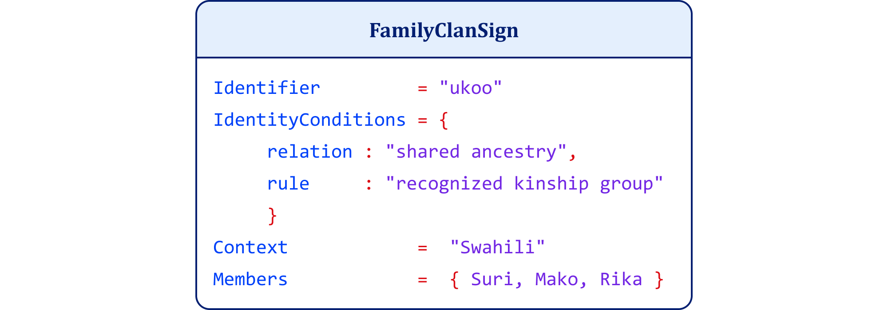

**Figure 12.4. Swahili Family Clan UML Object Diagram**

Each instance preserves the same admissible sign configuration relative to its context. The identity conditions remain constant. The members remain constant. The structural constraints remain constant. The context varies across linguistic systems, and the identifier varies accordingly.

Nothing in the structure determines which contextual system must apply. Nothing in the identity conditions determines it. Nothing in the members determines it. No intrinsic feature of the sign necessitates one identifier rather than another, nor the socio-cultural system in which that identifier operates.[@eco1976work2]

This establishes the result. No intrinsic feature of the sign determines the identifier. Agents assign identifiers under constraint within a given socio-cultural context.[@hacking1999work2]

The relation between the identifier and what it denotes within the sign is arbitrary. This arbitrariness does not imply randomness. It reflects rule-governed assignment within a linguistic and cultural system.[@goodman1976work2]

If emotional signs possessed an intrinsically fixed relation between identifier and sign configuration, then identical affective-emotional configurations would require identical emotional labels across contexts. They do not. The same configuration admits different identifiers across linguistic and cultural systems.[@barrett2017core2]

The assignment of emotional identifiers therefore does not arise from the underlying configuration alone. Agents construct it under constraint within a socio-cultural framework.[@vygotsky1986work]

Test 2. Underdetermination: Does one identifier uniquely fix one sign configuration?.

This test examines whether an identifier uniquely determines a sign. If the relation is objective, then a single identifier must fix a single set of identity conditions and corresponding instance.[@frege1980on]

**Figure 12.5. FamilyClanSign UML Class Diagram**

**Figure 12.6. English Family Clan UML Object Diagram (Biological)**

**Figure 12.7. English Family Clan UML Object Diagram (Chosen)**

**Figure 12.8. English Family Clan UML Object Diagram (Legal Household)**

Each instance uses the same identifier. The context remains constant. The members remain constant. The structure remains constant. The identity conditions differ. In the UML diagrams, those admissibility conditions appear in the IdentityConditions property.

Nothing in the identifier determines which identity conditions must apply. The same identifier corresponds to multiple distinct configurations, each with different admissibility criteria.[@eco1976work3]

This establishes the result. The identifier does not uniquely determine the sign configuration.[@frege1980on2]

The identifier underdetermines the sign configuration. If emotional identifiers uniquely determined emotional states, then a label such as “fear” or “anger” would fix a single affective configuration, context, and interpretation. It does not. The same identifier applies across structurally distinct configurations, and each configuration uses different admissibility conditions.[@lazarus1991work] In the class diagram, IdentityConditions : Map defines the property type. In the object diagrams, IdentityConditions = { ... } supplies the concrete admissibility conditions for that instance.

Emotional identifiers therefore do not determine emotional meaning. They underdetermine it. Meaning arises from how the system configures affect, context, and interpretation under constraint.[@bruner1990work3]

Test 3. Universal Objective Essence: Does a single invariant set of identity conditions govern all admissible instances of the sign?

This test examines whether a sign possesses a universal and objective essence. If such an essence exists, then a single set of identity conditions must hold invariantly across all admissible instances of the sign.[@peirce1931work4]

**Figure 12.9. FamilyClanSign UML Class Diagram**

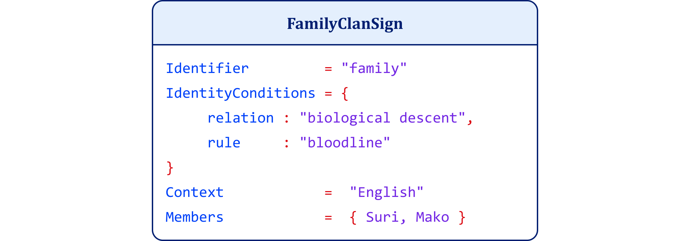

**Figure 12.10. English Family Clan UML Object Diagram (Biological Essence)**

**Figure 12.11. English Family Clan UML Object Diagram (Chosen Essence)**

**Figure 12.12. English Family Clan UML Object Diagram (Institutional Essence)**

Each instance uses the same identifier. The context remains constant. The structure remains constant. The identity conditions differ, and the admissible membership changes with them.

No single set of identity conditions governs all admissible instances. Each configuration establishes a different criterion for what counts as a family, and each criterion yields a different corresponding instance. Nothing in the sign elevates one of these configurations to the status of a universal and objective essence.[@wittgenstein2009work]

This establishes the result. No universal and objective essence determines the sign.[@goodman1976work3]

There are no universal objective essences. If emotional categories possessed universal objective essences, then a single invariant set of identity conditions would define what counts as fear, anger, or joy across all admissible instances. It does not. Different configurations of affect, context, and interpretation satisfy the category under different constraints, and those different constraints yield different corresponding instances.[@barrett2017core2]

Emotional categories therefore do not possess universal objective essences. Agents construct them under variable identity conditions, not under a single invariant essence.[@searle1995constructivist]

Test 4. Universal Objective Identity: Do identical identity conditions applied to the same referent yield a single invariant identity?

This test examines whether a sign possesses a universal and objective identity. If identity is intrinsic, then identical identity conditions applied to the same referent must yield a single, invariant identity.[@frege1980on]

**Figure 12.13. FamilyClanSign UML Class Diagram**

**Figure 12.14. English Family Clan UML Object Diagram (Kinship Identity)**

**Figure 12.15. Spanish Family Clan UML Object Diagram (Lineage Identity)**

**Figure 12.16. Swahili Family Clan UML Object Diagram (Clan Identity)**

Each instance applies the same identity conditions. The members remain constant. The structure remains constant. The underlying group remains constant. Only the context changes, and the resulting identity changes with it. In this test, the changing identifier marks the context-specific symbolic label, while the changing identity names the role the same group occupies within that context.

Nothing in the identity conditions determines a single identity for the sign. The same conditions support multiple identities depending on how the system applies them within context.[@wittgenstein2009work2]

This establishes the result. There is no universal and objective identity of the sign.[@goodman1976work4]

There are no universal objective identities. If emotional identities were intrinsic to affective configurations, then the same affective particulars would yield a single emotional identity whenever the underlying state remains the same. They do not. An agent can construct the same configuration as fear, excitement, anticipation, or stress depending on context and interpretation.[@barrett2017core3]

Emotional identity therefore does not reside in the underlying state. The agent assigns it under constraint.[@searle1995constructivist]

Test 5. Universal Objective Significance: Does the same sign carry the same motivational force for every interpreter?

This test examines whether a sign possesses a universal and objective significance. If significance is intrinsic to the sign, then the same sign must carry the same motivational force for every interpreter. If significance varies while the sign remains constant, then significance does not reside in the sign itself.[@peirce1931work5]

**Figure 12.17. EventSign UML Class Diagram**

**Figure 12.18. Job Interview UML Object Diagram**

**Figure 12.19. Interpreter UML Class Diagram**

**Figure 12.20. Interpreter UML Object Diagram (Low Significance)**

**Figure 12.21. Interpreter UML Object Diagram (Moderate Significance)**

**Figure 12.22. Interpreter UML Object Diagram (High Significance)**

The sign remains constant. Its identifier remains constant. Its identity conditions remain constant. The event remains the same. Only the interpreters differ in their motivational intensity toward the same sign. The variation arises because each interpreter relates the same sign to different goals, stakes, and consequences.

Nothing in the sign determines whether it carries low, moderate, or high significance for an interpreter. Significance arises from the interpreter’s relation to the sign, not from an intrinsic feature of the sign itself.[@eco1976work3]

This establishes the result. There is no universal objective significance of the sign.[@goodman1976work5]

There is no universal objective significance. If emotional significance were intrinsic to an emotional sign, then the same emotional construct would carry the same motivational force for every agent. It does not. The same emotional identity can matter little to one agent, moderately to another, and overwhelmingly to a third, depending on goals, values, and context.[@lazarus1991work]

Emotional significance therefore does not reside in the sign itself. It arises from the agent’s affective and motivational relation to the constructed meaning.[@bruner1990work3]

The corresponding C# executable for the tests below is available in the Chapter 12 project folder. The folder includes a README with instructions for building, running, and reproducing the sample outputs.

This C# project does not duplicate the UML diagrams. It operationalizes them. The diagrams show the static architecture of the Constructivist Semiotic Sign, but the executable project shows what that architecture permits and what it forbids. By running the demonstrations, the reader can see that no intrinsic feature of the sign determines the identifier, that a single identifier can underdetermine multiple sign configurations, that no invariant essence governs all admissible instances, that no universal objective identity follows necessarily from the same admissibility conditions, and that no universal objective significance resides in the sign itself. The project therefore functions as an executable supplement to the chapter’s formal argument. It does not prove the thesis by illustration alone. It tests the thesis by execution.[@simon1996work]

The project uses a shared JSON data layer and a single test engine. Each mode interrogates the same semiotic material differently. This matters because the argument of the chapter is not that signs are chaotic or random. The argument is that signs operate under constraint without intrinsic determination. The code makes that visible. It shows how the same structure can support variation without collapse, and how interpretation, rather than signal alone, completes meaning. In that respect, the program serves the same role for the chapter that a worked proof serves in mathematics. It allows the reader not only to inspect the architecture, but to watch it run.[@simon1972work]

For Test 1, the executable demonstration operationalizes arbitrariness by preserving the same admissible sign configuration while varying the identifier across socio-cultural contexts. The point is not that the system randomly changes labels, but that no intrinsic feature of the sign determines which identifier must apply. The identifiers are assigned under constraint within different linguistic systems.[@saussure1959work3]

The README documents the family-clan run as the canonical sample for Test 1.

For Test 2, the executable demonstration operationalizes underdetermination by holding the identifier constant while varying the admissible sign configuration. The reader supplies an identifier, and the program returns multiple valid configurations that the identifier can denote.[@eco1976work3]

For Test 3, the executable demonstration operationalizes the absence of universal objective essence by checking whether one invariant set of identity conditions governs all admissible instances of the sign. Unlike Test 2, this test also shows that different identity conditions reshape the admissible instance itself.[@wittgenstein2009work2]

For Test 4, the executable demonstration operationalizes the absence of universal objective identity by holding the admissibility conditions stable while showing that no single identity follows necessarily from them across contexts of interpretation. The reader supplies a concept, and the system reports multiple admissible identity assignments under the same underlying conditions.[@frege1980on3]

For Test 5, the executable demonstration operationalizes the absence of universal objective significance by holding the sign constant while varying the interpreter. The sign remains the same, but the motivational intensity differs because each interpreter relates the same sign to different goals, stakes, and consequences.[@searle1995work3]

Taken together, these runs show in executable form what the chapter establishes formally. No intrinsic feature of the sign determines its identifier. The identifier does not uniquely determine the sign configuration. No universal essence governs all admissible instances. No universal identity follows necessarily from the same admissibility conditions. No fixed significance resides in the sign apart from the interpreter. The code therefore augments the chapter by converting its conceptual demonstrations into operational tests.[@simon1996work2]

These results converge on a single conclusion. Emotional categories do not possess intrinsic identifiers, essence, identity, or significance. No element of the sign determines its meaning in advance. Meaning arises only through construction under constraint, authorization by the agent, and coordination across agents.[@hacking1999constructivist]

If emotional meaning does not reside in signals, physiology, or behavior, then no system can access it directly. A person cannot directly access another agent’s emotion either. To claim otherwise is to mistake inference for mind reading. Detection presupposes that the property exists in the observable input. The demonstrations and their executable counterparts show that it does not. Signals provide correlates. Physiology provides conditions. Behavior provides expression. None of these determine the meaning of the emotion itself.[@barrett2017work4]

When an observer classifies a facial expression as anger or a vocal tone as sadness, the observer does not access emotion itself but assigns an interpretation based on patterns, context, prior knowledge, and socio-cultural convention. Artificial systems follow the same path. They operate on correlations between observable features and labeled categories. They reproduce inference, not interpretation.[@picard1997work]

Recognition therefore operates inferentially, not directly. It reconstructs meaning from signals without accessing the interpretive act that constitutes it.[@dennett1991what]

Since I cannot detect emotion, I must determine where it exists and how an agent constructs it.

The preceding analysis establishes the structure of emotional meaning without locating it. If meaning arises through construction rather than residing in signals, I must identify where that construction occurs and how an agent gains access to it. The question shifts from what emotion is to where it exists. This shift directs attention to the locus of interpretation and the conditions under which an agent authorizes a construct as meaningful.[@peirce1931work2]

A change in heart rate, a tightening in the chest, or a shift in posture does not constitute fear, anger, or joy. These are conditions for interpretation, not instances of emotion. Emotion comes into existence when an agent organizes a felt state under a detachable symbolic identifier and authorizes it under identity conditions. Without that act, the state remains physiological or phenomenological. It does not become emotional.[@damasio1999how3]

Authorization plays a decisive role. An agent must endorse the construct as binding, not merely entertain it as a possibility. Without endorsement, the system produces representations or associations, but not emotional meaning. The agent commits to the classification and treats it as correct under the applicable constraints. This reflects a minimal form of rationality, intentionality, and commitment. This is what I mean when I say that emotions are both intentional and committal states: an emotion is about something as interpreted by the agent, and the agent authorizes that interpretation under identity conditions. The agent recognizes that the identifier governs admissibility and applies it accordingly.[@searle1995work4]

Without this authorization, no emotion exists. The system may generate affect and structured representation, but it does not produce an emotion.[@panksepp1998work4]

If emotion exists only through first-person authorization, others cannot access it directly.[@husserl1983what]

Scientific observation cannot bypass the boundary between signal and meaning. When a researcher uses fMRI, EEG, or skin conductance, they record physiological correlates. They do not record emotion. The data shows activation in the amygdala or changes in cortisol levels, but these are facts of physiological reality, not the emotional reality of the agent. The scientist must still map those signals to a category such as fear or stress. That mapping is an act of inference, not discovery. It relies on the researcher’s own symbolic constraints.[@friston2010freeenergy2]

This gap remains even when we use sophisticated machine learning. An algorithm identifies a pattern in a million data points and labels it "sadness" because a human trainer previously assigned that label to similar patterns. The system detects a correlation. It does not access the internal authorization that makes the state meaningful to the agent. No amount of data can transform an observation into an interpretation.[@picard1997work]

The limitation is not technological; it is ontological. Access to emotion requires participation in the act of authorization. Because that act belongs to the first-person agent, the observer remains outside it. Observers can measure correlates and infer meaning, but they do not participate in the authorizing act that constitutes the emotion. They encounter signals, not signs. A signal can indicate bodily or behavioral change. A sign requires an agent who authorizes what the signal means under a concept, context, and goal. The observer may infer the sign from the signal, but the observer does not possess the meaning the agent authorizes.[@nagel1974what]

This structural separation defines the boundary of the known.

Scientific methods quantify physiological and neural processes that correlate with affect and feeling. Researchers measure heart rate, hormonal changes, neural activation patterns, and behavioral outputs. These measurements reveal how the organism regulates and expresses internal states. They do not reveal what those states mean.[@panksepp1998work2]

A pattern of amygdala activation, increased arousal, or vocal intensity does not constitute fear, anger, or sadness. It marks a condition that an agent may interpret in multiple ways. The data identifies regularities and correlations across populations, but it does not capture the authorized interpretation that defines emotion in a particular case. The system records signals. It does not perform the interpretive act.[@barrett2017core4]

Third-person access therefore yields correlates without meaning. Science can map conditions under which emotions arise, but it cannot access the emotion itself.[@clark2016what]

These constraints lead to a general conclusion about access.

The gap between the observer and the agent is not a temporary hurdle for technology to clear. It is a structural feature of reality.[@nagel1974what2]

Because the observer only has direct access to the Objective level, any statement they make about the Emotional level is an inference. I can measure the heat of the engine, but I cannot see the driver’s authorization of the destination.

Emotion remains inaccessible from the outside perspective. It does not appear as an observable property in signals, physiology, or behavior, because meaning exists only where an agent authorizes a construct under symbolic constraint. Others interpret expression and infer emotional attribution. Science measures correlates and models regularities.

This does not render emotion unreal. It locates it precisely. Emotion exists where an agent constructs and endorses a felt state as something under identity conditions. Outside that act, observers encounter only signals, patterns, and data.

Emotion therefore admits no direct access from the outside. It exists only where the agent authorizes it.

If emotion exists only through authorized interpretation, I must now identify the minimum capacities required to construct and stabilize such meaning.

The barrier between the observer and the agent is not a technological hurdle. It is a structural feature of reality.

| Reality Level | Access Type | Primary Content |
| --- | --- | --- |
| Empirical | Third-Person (Direct) | Physiological signals, neural firing, behavior |
| Phenomenological | First-Person (Direct) | Raw feeling, interoception, affect |
| Emotional | First-Person (Authorized) | Constructed meaning, symbolic identifiers |
| Social | Second-Person (Inferred) | Shared labels, cultural norms, “Emotionese” |

**Table 12-1. Stratified Levels of Emotional Reality: Access and Primary Content**

Because the observer only has direct access to the Empirical level, any statement they make about the Emotional level is an inference. I can measure the heat of the engine, but I cannot see the driver’s authorization of the destination.[@friston2010freeenergy3]

Emotion remains inaccessible from the outside perspective. It does not appear as an observable property in signals, physiology, or behavior, because meaning exists only where an agent authorizes a construct under symbolic constraint. Others interpret expression and infer emotional attribution. Science measures correlates and models regularities.[@barrett2017work5]

This does not render emotion unreal. It locates it precisely. Emotion exists where an agent constructs and endorses a felt state as something under identity conditions. Outside that act, observers encounter only signals, patterns, and data.[@damasio1999work5]

Emotion therefore admits no direct access from the outside. It exists only where the agent authorizes it.[@searle1995work4]

If emotion exists only through authorized interpretation, I must now identify the minimum capacities required to construct and stabilize such meaning.

Meaning does not arise at a single level. [@searle1995work5] It requires a two-level architecture that links individual construction to social stabilization.[@mead1934work2]

At the first level, an agent constructs meaning by organizing a state under a detachable symbolic identifier governed by identity conditions and authorizing that construct as binding. This act establishes first-person meaning. It presupposes symbolic competence and a minimal rational capacity to apply identifiers across contexts, sustain consistency, and recognize admissibility. Without authorization, the system may generate affect and representation, but it does not produce meaning.[@brandom2000constructivist]

At the second level, meaning stabilizes through coordination across agents. Multiple agents communicate symbolic constructs, interpret them under shared rules, and apply them consistently across contexts. Through repeated alignment, they establish and maintain admissibility. Consensus does not uncover meaning in an underlying substrate. It stabilizes meaning through shared rules and agreement.[@mead1934work3]

These levels form a sequential architecture. The individual agent first constructs the prototype by authorizing a felt state under identity conditions. The stereotype emerges at the level of agents through consensus and coordination. The first establishes meaning when the agent constructs it. The second stabilizes meaning when agents share, correct, and coordinate it.[@searle1995constructivist2]

I use the terms prototype and stereotype in a technical, non-pejorative sense. A prototype denotes the first-person construct an agent produces by organizing a state under a symbolic identifier and authorizing it under identity conditions. A stereotype denotes the socially stabilized form of that construct, maintained through communication, correction, and consensus across agents. The terms do not imply distortion or bias; they identify the two levels at which agents construct and stabilize meaning.[@bruner1990constructivist] This structure also appears outside of the domain of emotion.

I will now leverage a hypothetical cryptocurrency token to illustrate the two-level architecture of constructed meaning in an emotion-agnostic domain.

At the agent level, the construct becomes meaningful only when the agent can operate within a formal symbolic system. This includes the ability to use tools, programming languages, and protocol rules to construct a token, recognize a detachable identifier, and apply it correctly within those constraints. Without this capacity and its authorization in use, the construct does not function as meaningful for that agent.[@simon1996work3]

At the social level, meaning depends on shared capabilities for communication and coordination across agents. The token must enter a shared system governed by rules of validation, transmission, and use. Multiple agents must possess the ability to interpret the construct under common constraints and to act on it in a coordinated way. Consensus stabilizes the construct across the network. Without these capacities, the construct remains private and does not achieve social reality.[@simon1972work2]

A single individual cannot create a currency through belief alone. The construct becomes socially real only when agents with the required capabilities validate, accept, and use it under shared rules.[@searle1995work6]

This example makes the two-level structure of constructed meaning explicit.[@hacking1999work4]

If a non-emotional construct requires this architecture, emotional meaning satisfies no weaker conditions. I now apply this architecture to emotion.[@barrett2017constructivist]

| Level | Process | Result |
| --- | --- | --- |
| Agent (Individual) | Authorization: Binding a symbolic identifier (e.g., “Grief”) to a felt state under specific identity conditions. | Prototype: A first-person authorized meaning that governs the agent’s internal state. |
| Agents (Social) | Consensus: Coordinating the use of “Grief” across multiple agents using shared rules and contextual cues. | Stereotype: A socially stabilized category that allows for coordination and “Emotionese.” |

**Table 12-2. Two-Level Architecture of Emotional Meaning: Process and Result**

This application reveals that emotion is not a biological "find" but a semiotic "achievement." To have an emotion, the agent must be a certain kind of system; one capable of both internal authorization and external alignment.[@peirce1931work6]

Emotion construction requires rule-governed application. The agent must apply the identifier across contexts, maintain admissibility under constraint, and sustain consistency over time. Without this capacity, the system produces affect and feeling but does not produce emotion.[@brandom2000work]

Social interaction extends this process. Agents communicate emotional constructs, interpret them under shared rules, and coordinate their use across contexts. Through this alignment, emotional meaning stabilizes as a shared construct rather than a private attribution.[@mead1934work2]

I can now proceed to further argue the distinction between entities that possess affective states and those that possess emotional meaning.

| Entity | Primary Process | Structural Capacity |
| --- | --- | --- |
| Infants / Animals | Reactivity & Association | Affective arousal + sensory integration |
| Interpretive Agents | Authorization & Consensus | Symbolic detachability + rule-governed identity |

**Table 12-3. Emotion Construction: Structural Capacities by Entity**

The two-level architecture clarifies why animals and infants differ in their capacity to construct emotional meaning. Animals exhibit affect, signaling, and coordinated behavior. They regulate states, respond to cues, and interact within social structures. These capacities, however, do not suffice for meaning. Animals do not demonstrate authorization. They do not stabilize the states they feel under detachable symbolic identifiers that identity conditions govern, nor do they endorse such constructs as binding. Their responses track stimuli and patterns, but they do not organize meaning under rules for construction.[@panksepp1998work5]

Animals also do not demonstrate consensus in the relevant sense. They coordinate behavior, but they do not agree on rules that determine when symbolic constructs count as admissible. Animal coordination does not stabilize meaning across agents.[@vygotsky1986work2]

In this model, an infant may experience the high arousal and displeasure of "distress," but they do not yet have the symbolic hardware to authorize that state as "Grief" or "Anger." The transition to emotional agency is the transition into a semiotic system. Early development shows affect and feeling without authorization or consensus. Over time, infants acquire symbolic identifiers, apply them across contexts, and begin to authorize emotional constructs. Later, through social interaction, they align these constructs with shared rules and participate in consensus.[@bruner1990work4]

The distinction is architectural and developmental. Animals lack the architecture. Infants acquire it.[@hacking1999work5]

Even partial capacities do not suffice to construct emotional meaning.

Consider a system that possesses some, but not all, of the required capacities. A system may discriminate stimuli, categorize inputs, and coordinate behavior across contexts. It may even use symbols in limited ways or signal internal states to others. These capacities do not suffice for meaning.[@simon1996work2]

Without authorization, the system does not treat a construct as binding under identity conditions. For example, an animal may respond to a threatening posture, but it does not authorize the construct fear as the correct classification of its own state. It may track cues and learn associations between signals, outcomes, and responses, but it does not commit to a classification as correct or incorrect. Without consensus, animals do not stabilize constructs across members of a group under shared rules. They may coordinate behavior, but they do not establish admissibility conditions that govern use.[@panksepp1998work6]

Even if a system combines signaling, categorization, and limited symbolic use, the absence of either authorization or consensus prevents the emergence of meaning. Each capacity contributes, but no subset replaces the full architecture.[@simon1996work4]

Emotional meaning therefore requires the complete system. Partial capacities cannot produce it.[@searle1995constructivist3]

Emotions are therefore real in a specific sense. At the agent level, the agent authorizes an interpretation as a prototype. At the group level, agents stabilize that interpretation as a non-pejorative stereotype through shared use. They do not exist as objective features in the signals from which observers attempt to read them.[@barrett2017constructivist2]

No observer detects emotion. Each observer infers it. No system measures emotion. Each system correlates it.[@picard1997work]

Emotion belongs to construction, not detection.[@dennett1991what]

The framework now applies across domains.

Once agents construct emotion as a system of meaning, its functional role changes. If emotions are constructions rather than sources of truth, what role should they play in guiding action? Having established what emotion is, I now turn to its normative role: how relevant are our emotions? The question matters because agents often treat emotion as if it delivered objective moral authority. Yet we often know what would serve us well and still fail to feel inclined toward it; we may also feel strongly toward what does not serve us well. The problem is not a lack of knowledge. It is a lack of alignment between evaluation and motivation. When agents treat emotional force as normative truth, they mistake an interpretive state for a moral judgment.[@lazarus1991work2]

This tension reveals the next problem: what is the proper place of emotion in a life where knowledge and motivation often come apart?[@lazarus1991work3]

Once agents construct emotion as a system of meaning, its functional role changes. If emotions are constructions rather than sources of truth, what role should they play in guiding action? Having established what emotion is, I now turn to its normative role: how relevant are our emotions? The question matters because agents often treat emotion as if it delivered objective moral authority. Yet we often know what would serve us well and still fail to feel inclined toward it; we may also feel strongly toward what does not serve us well. The problem is not a lack of knowledge. It is a lack of alignment between evaluation and motivation. When agents treat emotional force as normative truth, they mistake an interpretive state for a moral judgment.

The proper place of emotion is to interpret feeling so that it can influence moral action and reward the agent for acting well. Emotion should support moral judgment, not masquerade as moral truth.

In this chapter, I resolve a central confusion by distinguishing different kinds of reality rather than collapsing them into objectivity. Affect operates as a physiological and regulatory process. Feeling arises as conscious awareness of that process. Both are real in their own domains. Emotion is real differently: an agent produces emotion by organizing a felt state under a detachable symbolic identifier and authorizing it under shared symbolic and contextual constraints. Emotional meaning exists only through this interpretive act.[@husserl1983work2]

This analysis establishes four propositions. Emotional meaning does not reside in the signal. Emotional categories do not possess objective essence. Emotional identity does not reside in the referent. Emotional meaning does not reside in physiology, feeling, or behavior. In each case, meaning arises from structured interpretation under constraint.[@goodman1976work6]

These results converge on a unified account. Emotion functions as a two-level construct. At the first-person level, an agent authorizes a felt state under symbolic constraint, producing a prototype. At the social level, agents stabilize that construct through communication, interpretation, and consensus, producing a stereotype. Emotion is therefore both individually constructed and socially maintained.[@searle1995constructivist4]

This structure explains a systematic error. Agents encounter affect and feeling directly, yet treat them as if they already contain emotional meaning. Observers interpret expression and treat those interpretations as if they reveal internal states. Scientific systems measure physiological and behavioral patterns and treat those patterns as if they disclose emotion itself. In each case, the system mistakes the conditions of emotion for the emotion.[@hacking1999work6]

No system detects emotion. The agent constructs it. Others infer it. Science correlates it.[@picard1997work]

Emotion is therefore not a source of truth but a system of influence. Its proper role is subordinate. It should motivate action in accordance with what the agent has judged to be good, and it should reward successful alignment through felt experience. It does not define what is good. It supports or resists the agent's pursuit of it.[@lazarus1991work2]

If emotional meaning arises through the organization of feeling, the remaining question is how structured meaning emerges from affective experience. The next chapter answers that question through the analogy of music. Instruments produce sound without determining musical meaning. Meaning emerges when an agent organizes sound into composition, and genres provide a higher level of organization by grouping diverse compositions under shared conventions without imposing a single defining essence. Jazz, classical, and blues encompass countless distinct works while remaining recognizable categories. Emotional categories function in the same way. Affective systems generate feeling without determining emotional significance. Agents organize feeling into emotional constructs, and shared emotional categories stabilize those constructions without requiring a universal objective essence.[@goodman1976work7]

To understand emotion, I must first understand the sound of feeling.[@langer1957work]

[Contents](../../README.md) · [Notes](../references/notes/chapter-13.md) · [Bibliography](../references/bibliography/chapter-13.md)

# Chapter 13 — The Sound of Feelings

*Using Music to Model How We Make and Experience Emotion*

*Chapter 12 established the central distinction: affect prepares the body, feeling presents that preparation in consciousness, and emotion arises only when an agent interprets feeling under symbolic constraint. Chapter 13 asks what the ontology must still account for. I identify three problems: hedonic tone cannot explain the full qualitative character of feeling; emotion theory must distinguish affective mechanisms, interoceptive processing, feeling, and emotion; and emotional categories must explain how diverse instances can belong to the same kind without reducing that kind to biology, behavior, or essence.*

*I solve the first problem with timbre. Just as musical tone tells us what note sounds but cannot explain why a violin, piano, flute, and trumpet sound different, so hedonic tone tells us whether a feeling appears pleasant or unpleasant but cannot explain how that feeling appears in consciousness. I therefore introduce phenomenological timbre: the distinctive qualitative character through which feeling presents itself in first-person experience.*

*I solve the second problem with the instrument model. Just as an instrument supplies the mechanism that makes sound possible without becoming the sound or the composition, so affective mechanisms supply the bodily conditions that make feeling possible without becoming feeling or emotion. Interoception makes those bodily conditions available to consciousness. Feeling presents them with phenomenological timbre. Interpretation then constructs emotion from that felt experience.*

*I solve the third problem with the genre model. Just as a musical genre can include many performances without requiring identical instruments, notes, tempos, or arrangements, so an emotional category can include many interpreted instances without requiring one invariant physiological pattern, expression, or phenomenal quality. Emotional categories remain intelligible because agents organize diverse interpretations under rule-governed constraints.*

*Music therefore gives me more than an analogy. It gives me an explanatory architecture. Just as instrument, sound, timbre, composition, and genre occupy different roles in music, so affective mechanism, feeling, phenomenological timbre, emotion, and emotional category occupy different roles in the ontology of emotion. With this architecture in place, I can now move to Chapter 14, where the final question emerges: once emotion becomes meaningful, how does meaning become value?*

Chapter 12 established that emotion has a two-tier structure.[@damasio1999work] At the first tier, affective systems generate physiological states along the dimensions of valence, arousal, and motivational intensity.[@russell2003core] Interoceptive systems encode those states, and conscious awareness of that encoding produces feeling.[@damasio2002how] At the second tier, an agent interprets that experience under symbolic constraint and authorizes it as meaningful.[@searle1995work] These conclusions leave three problems to resolve. First, hedonic tone cannot account for the qualitative diversity of experience. Second, we must distinguish affective mechanisms, interoceptive processing, feeling as conscious metaperception, and emotion as its interpretive construction. Third, we require a structural account that explains how emotions form categories of diverse cognitive–semiotic instances despite lacking a common essence.

I begin with the first problem. The qualitative character of feeling extends beyond hedonic tone. According to the Distinctive Feeling View, pleasure consists in a feeling with a distinctive hedonic tone.[@feldman2004work] The question is whether hedonic tone exhausts the qualitative structure of feeling. I argue that it does not. Hedonic tone captures only the phenomenal appearance of valence.[@russell0000core] It does not account for the richer qualitative organization of conscious feeling. The limitation therefore lies not in the concept of hedonic tone itself, but in treating one phenomenal dimension as if it exhausted the whole of feeling.

Music confronts the same explanatory problem. A musical tone specifies measurable properties such as pitch, duration, and intensity.[@hall2002work] A violin, piano, flute, and trumpet may all produce the same note at the same loudness. Tone therefore identifies what is played, but it does not explain why each instrument sounds different.[@helmholtz1954work] Music resolves this limitation through the concept of timbre. Timbre refers to the characteristic qualitative colour of a sound that distinguishes one instrument from another despite identical pitch and intensity.[@goodman1976work] Where tone specifies measurable dimensions, timbre explains qualitative character.

Feeling exhibits the same architecture. Hedonic tone captures only the phenomenal appearance of affective valence as pleasure or displeasure., Feeling, however, presents the organism with a richer qualitative experience than hedonic polarity alone can explain. Physiological affect varies not only in valence, but also in arousal, motivational intensity, salience, temporal organization, and other dimensions of bodily organization., If feeling consists in the conscious metaperceptual awareness of physiological affect, then its qualitative character must likewise extend beyond hedonic tone.

Music therefore resolves precisely the explanatory problem that the Distinctive Feeling View leaves unresolved. If music requires timbre to explain the qualitative character of sound beyond tone, then an adequate theory of feeling likewise requires an additional dimension to explain the qualitative character of conscious experience beyond hedonic tone.

I therefore introduce the concept of phenomenological timbre. Phenomenological timbre refers to the structured qualitative character of conscious feeling beyond hedonic tone. Just as musical timbre distinguishes sounds that share the same pitch and intensity, so phenomenological timbre distinguishes feelings that share similar hedonic polarity while differing in their qualitative character. Hedonic tone explains whether a feeling appears pleasant or unpleasant. Phenomenological timbre explains how that feeling appears in conscious experience.

I now refine the definition developed in Chapter 12. Feeling is the conscious metaperceptual awareness of interoceptively available physiological affect, presented in first-person experience with a distinctive phenomenological timbre, prior to detachable symbolic stabilization as emotion. The introduction of phenomenological timbre therefore resolves the first problem by accounting for the qualitative character of feeling beyond hedonic tone.

A second problem nevertheless remains. We must now determine how physiological affect, interoceptive processing, feeling, and emotion relate within a single explanatory architecture. Existing theories frequently assign explanatory priority to one level while neglecting another.[@ryle1949work] Rather than redefining these phenomena, I assign each to its proper explanatory level.

Music again provides the methodological framework. I develop four corresponding thought experiments. Each isolates a different explanatory level and shows why identifying emotion requires more than observing the mechanisms that precede it. Together they expose the same architectural mistake from four complementary perspectives.

A musical instrument produces the physical conditions necessary for sound, but no musician identifies a composition by examining the instrument alone.[@goodman1976work2] The instrument constrains what a performer can produce, but it does not determine the composition. Likewise, physiology, anatomy, and neural activity generate the bodily conditions under which feeling becomes possible.[@damasio1999how] They do not determine emotional meaning. Researchers who identify emotion directly from physiological mechanisms therefore ask one explanatory level to perform the work of another.

The problem becomes even clearer when viewed through the philosophy of mind. The other minds problem reminds us that no observer possesses direct access to another person's conscious experience.[@nagel1974what] An observer may measure physiology with extraordinary precision, but physiology alone does not reveal phenomenology. Nor does phenomenology alone reveal emotional meaning. Emotion emerges only after an agent interprets experience under conceptual and contextual constraints.[@searle1995work2] An external observer therefore encounters successive explanatory boundaries rather than direct access to emotion itself.

Music illustrates these boundaries with unusual clarity. Imagine a profoundly deaf engineer who studies a violin. The engineer measures string tension, resonance, bow velocity, finger placement, and vibration with perfect accuracy. Despite possessing exhaustive knowledge of the instrument, the engineer cannot identify the composition because the engineer never encounters the sound itself. Complete knowledge of the mechanism does not produce knowledge of the phenomenon. The limitation does not arise from poor measurement. It arises because the engineer studies one explanatory level while the composition occupies another.

Behavior introduces the same limitation. A spectator may watch someone dance with remarkable precision. The spectator may describe posture, rhythm, timing, balance, and movement in extraordinary detail. Yet the spectator cannot identify the composition from the choreography alone. Different compositions support similar movements, and the same composition supports different choreography. The observer therefore infers rather than detects the music. Facial expression, posture, vocal tone, autonomic activity, and neural activation occupy the same epistemic position. They support inference about emotion without uniquely determining emotional identity.[@ekman1992argument]

Modern music-recognition systems reinforce the same point. Applications such as Shazam identify musical compositions because they analyze the sound itself rather than the instrument that produces it, the musician who performs it, or the audience that responds to it.[@wang2003industrialstrength] They operate at the explanatory level occupied by the composition's acoustic structure. Emotion research possesses no equivalent access. Researchers cannot analyze another person's phenomenological experience directly. Instead, they examine physiology, anatomy, neural activity, facial expression, or behavior. These observations reveal conditions that support emotion, but they do not constitute emotion itself.

Lisa Feldman Barrett's principle of degeneracy supports this analysis. Barrett argues that different neural and physiological organizations can instantiate the same emotional category rather than a single invariant biological pattern.[@barrett0000work] This principle corresponds closely to the musical model. Just as different instruments, ensembles, or orchestras can perform the same musical composition, different neural and physiological organizations can support the same interpreted emotion. Conversely, similar neural and physiological organization can support different emotional interpretations depending upon context, conceptual organization, and the agent's goals. Physiological affect therefore constrains emotional interpretation without uniquely determining emotional identity.

Researchers repeatedly commit two conceptual errors. First, they conflate explanatory levels by treating distinct processes as functionally interchangeable. Second, they collapse explanatory levels by allowing one level to perform the explanatory work of another.[@ryle0000work] John B. Watson explained emotional phenomena exclusively in terms of observable bodily responses and omitted qualitative experience altogether.[@watson1913psychology] Fred Feldman's Distinctive Feeling View defines pleasure as a feeling with a distinctive hedonic tone and therefore gives explanatory priority to qualitative feeling.[@feldman2004work] Martha Nussbaum identifies emotions primarily with evaluative judgment and therefore gives explanatory priority to interpretation.[@nussbaum2001work] Paul Ekman emphasizes recurring physiological and expressive organization.[@ekman1992argument2] Jaak Panksepp grounds emotional systems in evolutionarily conserved affective circuits.[@panksepp1998work] Lisa Feldman Barrett explains emotions through the conceptual categorization of core affect.[@barrett0000work2] Each theory illuminates an important explanatory level. None, by itself, explains the complete progression from physiological affect to phenomenological feeling to interpreted emotional meaning.

In this analysis, I resolve the second problem by assigning each phenomenon to its proper explanatory level. Physiological affect generates the bodily conditions of experience. Interoceptive processing makes those conditions available to consciousness. Feeling presents them as phenomenological experience characterized by phenomenological timbre. Emotion organizes that experience under conceptual and contextual constraints. Each level performs explanatory work that no other level can perform.

Music demands the same explanatory discipline. The instrument generates the sound. Timbre gives the sound its qualitative character. Composition organizes the sound into meaningful structure. No musicologist mistakes the instrument for the sound, the sound for the composition, or the composition for the instrument. Emotion requires the same discipline. Researchers should not ask physiological affect to perform the work of feeling, feeling to perform the work of interpretation, or interpretation to perform the work of physiological affect. Only after preserving these explanatory levels can I explain emotion without confusing physiological preparation, conscious experience, interpretive meaning, and emotional category.

I have now resolved the second problem by assigning physiological affect, interoceptive processing, feeling, and emotion to their proper explanatory levels. One problem nevertheless remains. I must still explain how emotional interpretations form coherent categories despite varying across contexts, cultures, individuals, and physiological realization. If no physiological mechanism, phenomenal quality, or conceptual feature uniquely determines emotional identity, what unifies an emotional category?

I return once more to music because it provides the final structural correspondence. A composition does not become a genre because every performance shares identical notes, instrumentation, tempo, or dynamics. Jazz remains jazz whether a solo pianist, a quartet, or a full orchestra performs it. Classical music remains classical despite enormous variation in instrumentation, phrasing, tempo, and interpretation. Genre therefore does not require identical instances. Instead, it organizes diverse compositions under a common structural identity while allowing substantial variation within the category.[@goodman1976emotional]

I propose that emotional categories exhibit the same architecture. No single physiological configuration, phenomenological timbre, behavioral expression, or conceptual feature determines membership in a category such as fear, grief, anger, or joy. Instead, agents organize individual emotional interpretations into recognizable categories that support communication, prediction, memory, and social coordination. The category does not arise from a shared essence. It arises from a structured pattern of admissible variation governed by conceptual constraints.

I can now explain why emotional categories remain both stable and flexible. Stability arises because agents repeatedly organize similar interpretations under shared conceptual constraints. Flexibility arises because no individual physiological state, phenomenological timbre, contextual feature, or behavioral expression fixes category membership. Musical genres tolerate variation without losing coherence. Emotional categories exhibit the same property. They organize families of related interpretations rather than collections of identical instances.[@wittgenstein2009principles]

Lisa Feldman Barrett's population thinking and principle of degeneracy support this conclusion. Barrett argues that emotional categories consist of diverse instances rather than invariant biological types. Different physiological organizations can therefore support the same emotional category, just as different instruments, ensembles, or orchestras can perform the same musical genre. Conversely, similar physiological organization can support different emotional interpretations depending upon context, conceptual organization, goals, and prior experience. Barrett's work therefore reinforces the conclusion that physiology constrains emotional interpretation without uniquely determining emotional identity.[@barrett2017work]

I now complete the musical correspondence. The instrument corresponds to physiological affect. Sound corresponds to feeling. Timbre corresponds to phenomenological timbre. Composition corresponds to emotion as an interpreted instance. Genre corresponds to emotional category. Each level depends upon the preceding level while performing explanatory work that no preceding level can perform. No level replaces another. No level performs another's explanatory work.

I have now resolved the third problem. Emotional categories neither constitute natural kinds nor require fixed defining essences. They organize diverse interpreted experiences under rule-governed conceptual constraints in the same way that musical genres organize diverse compositions without requiring identical performances. The architecture therefore preserves both stability and variability without collapsing one into the other.[@hacking1999work]

I reject the assumption that emotional categories correspond to natural kinds or that emotional grammar forms a fixed, mind-independent system shared uniformly across agents. No single physiological organization, behavioral expression, phenomenological quality, or conceptual feature determines membership in a category such as fear or anger. Instead, agents construct emotional categories by organizing interpreted experiences into recognizable forms. Categories therefore reflect how agents stabilize meaning across instances rather than how the world presents a pre-given emotional taxonomy.[@hacking1995work]

This conclusion clarifies the role of grammar in emotional life. Affective organization constrains feeling, but emotional grammar organizes feeling into intelligible categories. Just as musical grammar organizes sound into compositions and genres, emotional grammar organizes phenomenological timbre into recognizable kinds. Grammar does not produce feeling. Physiological affect generates feeling through interoceptive processing. Emotional grammar organizes that feeling into recognizable categories and stabilizes its interpretation across instances.[@wittgenstein0000work]

Empirical findings support this account. Studies of functional brain organization show that neural patterns associated with experience vary substantially across individuals and do not generalize cleanly without subject-specific transformation. Each individual exhibits a distinctive neural signature, and decoding approaches require individualized models to interpret neural activity accurately. Unlike music, which admits formal description through notes, pitch, rhythm, harmony, and compositional structure, affective experience possesses no comparable quantitative syntax. No accepted unit measures qualitative experience, and no formal grammar maps physiological affect to emotional categories with cross-agent invariance. Emotional grammar therefore operates as an agent-relative, constraint-governed system that stabilizes meaning without implying universality or reducibility to fixed structures.[@friston2010freeenergy]

Appendix N develops this account further by examining the relationship between emotional grammar, mathematical realism, and constraint-governed meaning.

I began this chapter by identifying three architectural problems. I have now resolved each of them.

First, I argued that hedonic tone cannot account for the qualitative character of feeling. I resolved this problem by introducing phenomenological timbre. Just as musical timbre distinguishes the qualitative character of sounds that share the same pitch and intensity, so phenomenological timbre distinguishes the qualitative character of feelings that share similar hedonic polarity. Hedonic tone explains whether an experience feels pleasant or unpleasant. Phenomenological timbre explains how it feels.[@feldman2004work2]

Second, I argued that existing theories blur or collapse the distinctions between physiological affect, interoceptive processing, feeling, and emotion. I resolved this problem by assigning each phenomenon to its proper explanatory level within a layered architecture. Just as a musical instrument generates the conditions for sound without becoming the composition, so physiological affect generates the bodily conditions of experience without becoming emotion. Just as sound precedes composition, so feeling precedes emotional interpretation. Each level performs explanatory work that no other level can perform.[@damasio1999how2]

Third, I argued that emotional categories require an account of unity without shared essence. I resolved this problem by showing that emotional categories function like musical genres. Just as a musical genre organizes diverse compositions without requiring identical performances, so an emotional category organizes diverse interpreted experiences without requiring invariant physiological mechanisms, phenomenological qualities, or conceptual features. Categories preserve identity through structured constraint rather than shared essence.[@wittgenstein2009work]

Music therefore serves not merely as an illustration, but as the methodological correspondence through which I derive the architecture of emotion. Just as musicians distinguish instrument from sound, sound from composition, and composition from genre, so I distinguish physiological affect from feeling, feeling from emotion, and emotion from emotional category. I preserve these distinctions because explanation depends upon them. Once I ask one explanatory level to perform the work of another, I cease to explain emotion and begin to confuse mechanism with experience, experience with meaning, and meaning with category. Only after preserving these distinctions can I explain emotion without confusing mechanism with experience, experience with meaning, meaning with category, or category with grammar.

One question nevertheless remains. Emotion no longer presents the deepest explanatory problem. Meaning does. If emotion consists in an interpreted, meaning-bearing construct, then I must now explain how agents evaluate that meaning, justify it, and coordinate it with others. In other words, I must move from the ontology of emotion to the ontology of value.

Music provides one final correspondence. An instrument produces sound. Timbre gives sound its qualitative character. Composition organizes sound into meaningful structure. Genre organizes compositions into recognizable families. None of these determines whether a composition is beautiful, elegant, profound, trivial, or morally significant. The listener must evaluate it. Meaning therefore precedes value. Value presupposes meaning without reducing to it.[@goodman1957work]

Emotion follows the same architecture. Physiological affect prepares experience. Feeling presents experience. Interpretation constructs emotional meaning. Emotional meaning alone, however, does not determine what an agent ought to value, endorse, justify, or pursue. Interpretation therefore completes the ontology of emotion, but it does not complete the ontology of value.[@searle1995work2]

The final chapter completes that remaining task. I integrate the Constructivist Semiotic Sign, the Goal-Governed Constraint Model of Concepts, the Constructivist Semiotic Model of Emotions, and the Constructivist Computational Model of Emotions into a unified architecture of affect, feeling, emotion, meaning, and value. Having explained how emotion becomes meaningful, I now explain how meaning becomes value.

# METAMORPHOSIS OF AN ONTOLOGY

*How to Design an Emotion*

\@Cézjah

# Part V

*The Constructivist Linguistics of Emotion*

[Contents](../../README.md) · [Notes](../references/notes/chapter-14.md) · [Bibliography](../references/bibliography/chapter-14.md)

# Chapter 14 — So, What Is an Emotion?

*A Unified Ontology of Affect, Feeling, and Emotion*

So What Is an Emotion?: A Unified Ontology of Affect, Feeling, and Emotion

I posed a fundamental sequence of questions in the Introduction: are emotions innate biological responses triggered directly by the world, or does the mind shape them through interpretation; do external events cause emotions, or does a conscious agent organize raw affect into meaning; and do non-human animals undergo affect without reaching symbolic emotional understanding? Most fundamentally, what exactly is an emotion, and how does it differ from sensation, physiological response, and conscious feeling?[@james1962what]

I have answered those questions by  a clear architecture: external events initiate conditions that alter the body, physiological affect supplies bodily conditions from which feeling arises, and emotion emerges only when an agent organizes feeling through conceptual constraints. Affect operates as bodily state, feeling registers as conscious awareness, and emotion functions as interpretive structure.[@damasio1999how]

This framework also clarifies  Non-human animals display attraction, aversion, and distress before reflective judgment. These observations establish affective significance, demonstrate basic bodily drive, and reveal physiological orientation, but they do not determine whether the state constitutes affect, feeling, or emotion.[@panksepp1998are]

The problem I posed in the Introduction was therefore not simply to select a theory of emotion. I sought to determine what kind of entity emotion is, how it acquires meaning, and how it relates to the processes with which it has historically been confused. The answer I developed throughout this book remains architectural: affect, feeling, and emotion form related, distinct, and non-redundant levels of affective life.[@lazarus1991appraisal]

I began this book with provisional declarations because I had not yet earned the right to make them final. My method was deliberately progressive: rather than fix emotion in advance, I allowed the ontology to change as each layer of the problem became clearer. What first appeared simply as phenomenological experience gradually acquired conceptual structure, semiotic availability, and symbolic stabilization.[@frege1952on]

In the early stages, I provisionally described phenomenological experience as a conscious idea bearing a distinctive affective character. As the inquiry advanced, I refined that experience as intelligible under conceptually governed identity conditions and available for semiotic interpretation. Only after that progression could I identify  more precisely as feeling: the conscious metaperceptual awareness of affective reality presented in first-person experience with a distinctive affective character.[@rosch1975cognitive]

I applied the same progressive method to evaluative orientation. What began as a cognitive disposition directed toward phenomenological experience became goal-governed, context-sensitive, and interpretive. In Part IV, I provisionally identified that evaluative orientation as emotion: a semiotic interpretive act through which an agent assigns meaning and significance to feeling. Later stages added the requirement of detachable symbolic stabilization, first as a first-person prototype and then as a social stereotype through communication, interpretation, and rule-governed consensus.[@saussure1986work]

I can now state the final ontology without collapsing one level into another:[@lazarus0000appraisal]

I define affect as the physiological and regulatory  that generates the conditions of feeling without itself constituting feeling or emotion.[@panksepp0000how]

I define feeling as the conscious metaperceptual awareness of affective reality as a semiotically available experience with a distinctive phenomenological timbre.[@damasio0000how]

I define emotion as a goal-governed, context-sensitive semiotic interpretive through which agents assign meaning to feeling by organizing  timbre into emotion categories through detachable symbolic stabilization.[@peirce1994work]

The metamorphosis was therefore not a sequence of discarded definitions. At each stage, I preserved what remained valid, increased descriptive precision, and refined structural rigor. The final ontology integrates physiology, consciousness, conceptual identity, semiotic interpretation, and symbolic organization without allowing any single level to stand for the whole.[@barrett0000work]

I could not solve the problem of emotion from within a single discipline because no single discipline contains the entire phenomenon. Philosophy, neuroscience, psychology, semiotics, music theory, and computer science each illuminate a different level of the architecture. The challenge was not to choose among them, but to assign each its proper explanatory role without allowing one discipline to absorb the others.[@klein1990work]

I used philosophy to clarify identity conditions, conceptual validity, and structural standards. I used affective neuroscience to preserve the biological reality of bodily affect, neural regulation, and physiological valence. I used cognitive psychology to explain how a working mind selects, prioritizes, compares, remembers, and organizes experience under goals and context. I used semiotics to explain how private experience becomes available for interpretation, symbolization, communication, and revision. I used music theory to model qualitative variation through timbre and genre without collapsing difference into a single hedonic scale. I used computer science to test whether the conceptual distinctions scale into formal software implementations, UML architecture, simulation, and executable constraint.[@frege1953on]

The interdisciplinary method therefore did not produce six parallel accounts of emotion; it produced six complementary levels of explanation within one ontology. Each discipline supplied something the others could not provide on its own, while the architecture prevented any one explanatory level from absorbing the whole.[@klein0000work]

This mattered because the central danger throughout the book was reduction: biology alone could not explain meaning, phenomenology alone could not explain identity, and psychology alone could not explain symbolic structure. Semiotics alone could not generate bodily affect, music theory could model qualitative organization but not establish the full ontology, and computation could test coherence but could not substitute formal executability for truth.[@marr0000are]

By bringing these disciplines into one constrained architecture The result is not an eclectic collection of perspectives, but a division of explanatory labor within a unified account of emotional meaning.[@marr0000work]

I developed seven interconnected frameworks because the problem of emotional meaning could not be solved at a single level. Each framework answered a question made unavoidable by the one before it, and together they progressively reconstructed the architecture of emotion.[@frege0000on]

The Theory of Constrained Identity established how a concept can preserve identity while authorizing variation across cases, contexts, and goals. Constructivist Semiotics then addressed how an interpreting agent constructs meaning under conceptual and contextual constraint. The Constructivist Semiotic Model of Emotions applied that architecture to affective life, explaining how an agent organizes feeling into emotional meaning rather than merely receiving a finished biological emotion.[@rosch0000cognitive]

I then asked whether these distinctions scale into formal software implementations. The Constructivist Computational Model of Emotions translated the architecture into computational form, testing whether its conceptual roles remained distinct under formal representation. The Constructivist Interpretation Theory of Emotion clarified where appraisal ends and interpretation begins, arguing that appraisal alone cannot supply the symbolic and conceptual organization required for emotional meaning. Emotional Constructivism then integrated these conceptual, semiotic, computational, and interpretive components into a unified architecture in which affect, feeling, interpretation, and emotion perform distinct but coordinated functions.[@group0000work]

Finally, the Constructivist Linguistics of Emotion addressed how emotional meaning becomes symbolically stabilized, communicable, and organized into recognizable categories. It allowed me to distinguish private affective experience from the detachable symbols through which agents identify, communicate, compare, and revise emotional meaning.[@searle0000work]

I therefore did not construct seven independent theories competing for explanatory priority; I constructed seven levels of a single inquiry. Identity makes conceptual stability possible, semiotics makes meaning possible, and emotional construction organizes feeling into meaning. Computation tests formal coherence, interpretation distinguishes appraisal from meaning-making, Emotional Constructivism integrates the architecture, and linguistics explains its symbolic stabilization and communication.[@marr0000work2]

Together, these frameworks provide the architecture that Chapter 1 demanded: one capable of preserving the body, conscious feeling, conceptual identity, interpretation, meaning, and agency without allowing any single component to masquerade as the whole.[@damasio0000how2]

I began with the Distinctive Feeling View and the Attitudinal View because each preserves features that any adequate ontology of emotion must retain. From the Distinctive Feeling View, I embraced the immediacy of feeling, its first-person character, and its prior emergence before conscious intention. I extended those features by defining feeling more precisely as conscious metaperceptual awareness of affective reality and by introducing phenomenological timbre to explain qualitative character without reducing feeling to hedonic tone. From the Attitudinal View, I embraced evaluation, normativity, and context sensitivity. I extended those features by developing evaluative orientation into a goal-governed, context-sensitive act of semiotic interpretation through which agents assign meaning to feeling.[@james2004what]

I also had to mitigate the limitations of both views. The Distinctive Feeling View treats phenomenal character as though it could explain itself, reduces qualitative experience to hedonic tone, and risks allowing feeling to interpret itself. I mitigate these limitations by distinguishing feeling from emotion, supplying conceptually governed identity conditions, providing phenomenological timbre, and introducing an interpreting agent. The Attitudinal View risks making evaluation primary without explaining the affective reality being evaluated or why an evaluative stance feels like anything at all. I mitigate these limitations by grounding evaluation in prior affect and feeling, then distinguishing appraisal from the fuller semiotic interpretation and detachable symbolic stabilization required for emotion.[@barrett0000are]

Finally, these solutions comply with the three rules I established in Chapter 1:[@gupta0000definitions]

First,  omponent with the whole. Throughout the book, I preserve affect, feeling, evaluation, interpretation, and emotion as distinct components within one architecture rather than allowing any single level to define the whole.[@damasio0000how3]

Second,   with essence. Physiological signals, facial expressions, behavior, verbal reports, and felt states may provide evidence of emotion, but   to establish  identity conditions.[@barrett0000are2]

Third, naming with knowing. Emotional labels do not define the states they name, so I develop identity conditions, semiotic interpretation, and symbolic stabilization to explain what makes an emotion the kind of emotion it is.[@frege0000on2]

I began with a question that is also the title of this book: How To Design an Emotion?[@brandom0000work]

At first glance, the question can sound artificial, as though I were claiming that an agent can simply fabricate emotion at will. I am not. I do not design the physiological affect that first arises within me, nor do I simply choose the qualitative character of feeling. Affect emerges from biological and regulatory processes, while feeling presents that affective reality to consciousness. What I can design is the architecture through which my feeling becomes emotional meaning.[@damasio0000how4]

That architecture now has a form: I experience affective reality as feeling; concepts constrain how I can identify and organize that experience; and my goals and context further constrain its significance. Through semiotic interpretation, I assign meaning to what I feel; through detachable symbolic stabilization, I organize that interpretation into recognizable emotion categories; and through reflection, I can then examine, revise, communicate, and govern the meaning I have constructed.[@peirce0000ad]

This is why the distinctions developed throughout this book matter. If I confuse affect with emotion, I mistake physiology for meaning. If I confuse feeling with emotion, I mistake experience for interpretation. If I confuse naming with knowing, I inherit a category without establishing whether it validly identifies my experience.[@barrett0000are3]

To design an emotion is therefore not to manufacture what I feel: it is to govern the process through which what I feel comes to mean something.[@brandom0000work2]

I begin with what my body undergoes, become conscious of that affective reality as feeling, interpret that feeling under conceptual, contextual, and goal-governed constraints, and stabilize that interpretation symbolically. In doing so, I construct emotional meaning.[@damasio0000how5]

That does not give me absolute control over affect or feeling: it gives me agency over interpretation.[@brandom0000work3]

And that is what it means to design an emotion.[@peirce0000work]

# METAMORPHOSIS OF AN ONTOLOGY

*How to Design an Emotion*

\@Cézjah

# Appendix A: Basic Emotion Theory

[Bibliography](../references/bibliography/appendix-a.md)

## An Assessment by Formal Identity and Truth Conditions

This appendix applies the conceptual principles I  established in Chapter 2 to Basic Emotion Theory. In that chapter, I argued that a theory cannot use a concept with authority unless it first specifies the identity conditions that govern the concept's meaning. Definition specifies identity conditions. Analytic truth enforces consequence. Without that sequence, theory mistakes familiar categories for concepts under constraint.1

Basic Emotion Theory asserts that at least some emotions form discrete, universal, biologically grounded kinds.2 Those claims carry conceptual obligations. If a theory asserts universality, discreteness, or biological necessity, then it must identify what makes an emotion the kind of thing it claims emotion to be. It must supply determinate identity conditions, non-circular criteria of application, scope discipline, and principled differentiation. Data, correlation, and explanatory usefulness can support a theory, but they cannot replace concept fixation.3

Consider fear. If Basic Emotion Theory treats fear as a discrete basic emotion, then it must say what makes fear fear across cases. Does fear consist in a facial expression, a physiological pattern, a neural circuit, an action tendency, a subjective feeling, an appraisal of threat, or some necessary relation among them? A widened eye, elevated heart rate, freezing response, and orientation toward danger may appear in fear. But they may also appear in surprise, vigilance, trauma, startle, strategic attention, or bodily preparation for action. If the theory cannot identify which condition governs the concept, it has not defined fear. It has proposed inferences.

I do not challenge Basic Emotion Theory here as an empirical research program. I challenge it at the level of conceptual architecture. The question is not whether its experiments produced useful findings. The question is whether the theory defines emotion with enough precision to bear the universality, discreteness, and necessity it claims. If the concept of emotion remains unstable, then the theory cannot secure the analytic commitments that follow from treating emotions as natural kinds.4

I therefore assess Basic Emotion Theory against the minimum requirements of identity, non-circularity, scope determinacy, and inferential constraint. The purpose is not to replace the theory with a competing metaphysics of emotion. The purpose is to determine whether the theory can bear the conceptual weight it places upon emotion.

Basic Emotion Theory introduces emotional categories through prototypical expressions, behavioral patterns, and biological correlates. Yet none of these, by itself, specifies what an emotion is rather than how it appears, correlates, or functions.5 A smile may accompany joy, politeness, embarrassment, contempt, relief, appeasement, or strategy. A racing heart may accompany fear, excitement, anger, exertion, illness, or anticipation. If a theory treats these marks as defining conditions without identifying the relation that makes them necessary, it mistakes what points to a category for what constitutes membership in it.

The same problem applies to discreteness. If anger, fear, disgust, sadness, happiness, and surprise form discrete kinds, then the theory must say which conditions separate one kind from another. Facial expression alone cannot do the work, because expression varies across agents, cultures, contexts, and display rules. Physiology alone cannot do the work, because arousal and autonomic activation overlap across affective states. Behavior alone cannot do the work, because avoidance, approach, freezing, withdrawal, and aggression can serve different meanings under different interpretations. The theory therefore needs an intensional structure that governs the category, not merely a list of recurring signs.6

The theory also violates the principle of non-circularity. It identifies emotions by patterns of facial expression, physiological response, or behavioral tendency, yet it justifies those patterns as evidential only because it already classifies them as expressions of emotion. This procedure presupposes the concept it claims to confirm.

Consider the fear face. If a researcher identifies widened eyes, raised brows, and a tense mouth as a fear expression because subjects classified as fearful display that pattern, and then infers fear from the same pattern because it is a fear expression, the argument becomes circular. The expression counts as evidence only because the emotion category already gives it evidential force. Triangulation across modalities does not remove the circularity if each modality relies on the same prior classification. Without an independent intensional specification of fear, no criterion governs correct application, and the explanatory structure remains circular.7

This circularity damages more than definition. It also prevents analytic truth. If "fear is a basic emotion" means that fear is discrete, universal, and biologically fixed, then necessary consequences should follow from the definition. If the defining markers appear, fear should follow. If the defining markers do not appear, fear should not follow. If a different pattern appears across cultures, contexts, or developmental stages, the theory must say whether the case falsifies the definition, revises the marker, or falls outside the category. But without fixed identity conditions, no such inference can hold. The claim "fear is a basic emotion" remains an empirical generalization, not an analytic truth.8

Because the concept of emotion lacks sufficient architectural determination, the theory cannot derive binding analytic consequences. Basic Emotion Theory permits incompatible characterizations of emotion across experimental contexts, cultures, and measurement techniques without a principled account of which variations preserve identity and which negate it. When a concept admits mutually incompatible instantiations without constraint, no necessary inferences follow from its use. Analytic truth collapses into empirical generalization, and explanation gives way to description.9

Defenders of Basic Emotion Theory may reply that the theory does not aim at strict definition but at explanatory adequacy.10 That reply does not resolve the critique. A theory can explain emotion adequately only after it individuates the concept it claims to explain. A theory cannot explain what it has not first fixed under determinate identity conditions. Without such conditions, explanatory success lacks determinate subject matter. Explanatory power cannot substitute for conceptual fixation when a theory asserts universality, discreteness, or necessity.

Heuristic classification can support pattern recognition, but it cannot ground analytic claims about what emotions are, how they differ in kind, or why they must take the forms the theory assigns. For example, a prototype of anger may help an observer recognize clenched fists, narrowed eyes, raised voice, or approach behavior. But recognition does not tell us whether anger requires judgment of offense, readiness for retaliation, physiological arousal, a facial expression, a social script, or some structured relation among them. Where identity conditions remain implicit, analytic force cannot arise.11

This critique does not deny that Basic Emotion Theory produced empirically useful findings.12 It denies that empirical success can compensate for conceptual instability when a theory claims to describe fundamental kinds. Once a theory treats emotion as a foundational explanatory unit, it must meet the standards that govern concept formation and analytic inference. Basic Emotion Theory does not fail because its data are false. It fails because its cornerstone concept lacks the precision required to bear doctrinal weight.13

The difficulty, then, is not whether emotions are constructions or natural kinds. The difficulty is whether the theory asserting either position supplies a conceptual architecture capable of sustaining that claim. In the case of Basic Emotion Theory, it does not. Because the concept of emotion never receives determinate identity conditions, the theory cannot sustain the universality, discreteness, or necessity it asserts. The stone the builders accepted has become the weak cornerstone.14

Appendix A applies Chapter 2's standards to Basic Emotion Theory and reaches a precise result. The theory contributes useful empirical observations about facial expression, physiology, behavior, and cross-case regularity. It also preserves an important intuition: some affective patterns recur strongly enough to invite classification. But recurrence does not equal identity. If Basic Emotion Theory claims that fear, anger, disgust, sadness, happiness, or surprise are discrete, universal, and biologically grounded kinds, then it must supply identity conditions strong enough to distinguish evidence from essence, correlation from definition, and useful classification from analytic necessity.

The appendix shows that the theory does not meet that burden. Prototypical expressions, biological correlates, and behavioral patterns can help researchers recognize or investigate affective episodes, but they do not explain what makes fear fear or anger anger across cases. The fear-face example exposes the deeper circularity: the facial pattern counts as evidence of fear only because the theory has already classified it as a fear expression. Without an independent intensional specification, the theory cannot say which variations preserve identity, which variations revise the category, and which variations negate the claim. It can describe recurring indicators, but it cannot enforce analytic consequence.

Basic Emotion theory's strongest claims require conceptual architecture: identity conditions, non-circular criteria, scope determinacy, and inferential constraint. Where those conditions remain implicit, data can accumulate without definition, and explanation can appear stronger than the concept beneath it. Appendix A therefore confirms the central lesson of Chapter 2: evidence can test or refine a definition, but it cannot replace the identity conditions that make definition possible.

## Endnotes

1. Gottlob Frege, "On Sense and Reference," trans. Max Black, in Translations from the Philosophical Writings of Gottlob Frege, ed. Peter Geach and Max Black (Oxford: Blackwell, 1952), 56-78; see also Edward N. Zalta, "Gottlob Frege," in The Stanford Encyclopedia of Philosophy, https://plato.stanford.edu/entries/frege/. Access basis: Open scholarly reference for verification.

2. Paul Ekman, "An Argument for Basic Emotions," Cognition and Emotion 6, nos. 3-4 (1992): 169-200, https://doi.org/10.1080/02699939208411068. Access basis: Publisher abstract and DOI verified.

3. Aristotle, Metaphysics, trans. W. D. Ross, Internet Classics Archive, http://classics.mit.edu/Aristotle/metaphysics.html. Access basis: Open primary text.

4. James A. Russell, "Core Affect and the Psychological Construction of Emotion," Psychological Review 110, no. 1 (2003): 145-172, https://doi.org/10.1037/0033-295X.110.1.145. Access basis: DOI and abstract/full-text preview verified.

5. Andrea Scarantino and Ronald de Sousa, "Emotion," in The Stanford Encyclopedia of Philosophy, Spring 2024 ed., ed. Edward N. Zalta and Uri Nodelman, https://plato.stanford.edu/entries/emotion/. Access basis: Open scholarly reference.

6. Anil Gupta, "Definitions," in The Stanford Encyclopedia of Philosophy, Fall 2021 ed., ed. Edward N. Zalta, https://plato.stanford.edu/entries/definitions/. Access basis: Open scholarly reference.

7. Klaus R. Scherer, "What Are Emotions? And How Can They Be Measured?" Social Science Information 44, no. 4 (2005): 695-729, https://doi.org/10.1177/0539018405058216. Access basis: Publisher page and repository abstract verified.

8. Paul Ekman, "An Argument for Basic Emotions," Cognition and Emotion 6, nos. 3-4 (1992): 169-200, https://doi.org/10.1080/02699939208411068. Access basis: Publisher abstract and DOI verified.

9. James A. Russell, "Core Affect and the Psychological Construction of Emotion," Psychological Review 110, no. 1 (2003): 145-172, https://doi.org/10.1037/0033-295X.110.1.145. Access basis: DOI and abstract/full-text preview verified.

10. Paul Ekman, "An Argument for Basic Emotions," Cognition and Emotion 6, nos. 3-4 (1992): 169-200, https://doi.org/10.1080/02699939208411068. Access basis: Publisher abstract and DOI verified.

11. Anil Gupta, "Definitions," in The Stanford Encyclopedia of Philosophy, Fall 2021 ed., ed. Edward N. Zalta, https://plato.stanford.edu/entries/definitions/. Access basis: Open scholarly reference.

12. Paul Ekman, "An Argument for Basic Emotions," Cognition and Emotion 6, nos. 3-4 (1992): 169-200, https://doi.org/10.1080/02699939208411068. Access basis: Publisher abstract and DOI verified.

13. Gottlob Frege, "On Sense and Reference," trans. Max Black, in Translations from the Philosophical Writings of Gottlob Frege, ed. Peter Geach and Max Black (Oxford: Blackwell, 1952), 56-78; see also Edward N. Zalta, "Gottlob Frege," in The Stanford Encyclopedia of Philosophy, https://plato.stanford.edu/entries/frege/. Access basis: Open scholarly reference for verification.

14. Aristotle, Metaphysics, trans. W. D. Ross, Internet Classics Archive, http://classics.mit.edu/Aristotle/metaphysics.html. Access basis: Open primary text.

## Bibliography

Aristotle. *Metaphysics*. Translated by W. D. Ross. Oxford: Oxford University Press, 1924.

Barrett, Lisa Feldman. *How Emotions Are Made: The Secret Life of the Brain*. Boston: Houghton Mifflin Harcourt, 2017.

Barrett, Lisa Feldman, Ralph Adolphs, Stacy Marsella, Aleix M. Martinez, and Seth D. Pollak. "Emotional Expressions Reconsidered: Challenges to Inferring Emotion From Human Facial Movements." *Psychological Science in the Public Interest* 20, no. 1 (2019): 1-68.

Carnap, Rudolf. *Meaning and Necessity*. Chicago: University of Chicago Press, 1947.

Ekman, Paul. "An Argument for Basic Emotions." *Cognition and Emotion* 6, nos. 3-4 (1992): 169-200.

Ekman, Paul, and Richard J. Davidson, eds. *The Nature of Emotion: Fundamental Questions*. Oxford: Oxford University Press, 1994.

Frege, Gottlob. *The Foundations of Arithmetic*. Translated by J. L. Austin. Evanston, IL: Northwestern University Press, 1980.

Frege, Gottlob. "The Thought: A Logical Inquiry." *Mind* 65, no. 259 (1956): 289-311.

Hale, Bob, and Crispin Wright. *The Reason's Proper Study: Essays towards a Neo-Fregean Philosophy of Mathematics*. Oxford: Oxford University Press, 2001.

Kant, Immanuel. *Critique of Pure Reason*. Translated by Paul Guyer and Allen W. Wood. Cambridge: Cambridge University Press, 1998.

Mesquita, Batja, Michael Boiger, and Iris Fischer. "Cultural Psychology of Emotion." In *Handbook of Emotions*, 4th ed., edited by Lisa Feldman Barrett, Michael Lewis, and Jeannette M. Haviland-Jones, 393-411. New York: Guilford Press, 2016.

Panksepp, Jaak. *Affective Neuroscience: The Foundations of Human and Animal Emotions*. New York: Oxford University Press, 1998.

Quine, W. V. O. "Two Dogmas of Empiricism." *Philosophical Review* 60, no. 1 (1951): 20-43.

Scherer, Klaus R. "What Are Emotions? And How Can They Be Measured?" *Social Science Information* 44, no. 4 (2005): 695-729.

Strawson, P. F. *Individuals: An Essay in Descriptive Metaphysics*. London: Methuen, 1959.

Tarski, Alfred. "On the Concept of Logical Consequence." In *Logic, Semantics, Metamathematics*, translated by J. H. Woodger, 409-20. Oxford: Oxford University Press, 1956.

# Appendix B: Complex Affective UML Architecture Diagrams

[Bibliography](../references/bibliography/appendix-b.md)

## Modeling How Emotions Are Made

In Chapter 2, I argued that a definition can do its work only when it specifies the architecture that governs identity. Appendix A then tested Basic Emotion Theory against the demands of identity, non-circularity, and analytic consequence. This appendix turns from critique to formal construction. If I treat emotion as something the mind constructs rather than something the body simply reveals, then I must show how construction can preserve identity without collapsing into arbitrariness.1 2

Natural language can state that requirement, but it cannot always discipline it. Prose tolerates ambiguity. It can conceal category errors. It can let identity drift across explanations without warning. UML and design patterns give me a stricter grammar. They force me to separate type from instance, structure from realization, and conceptual identity from contextual variation.3 4

In the diagrams and design patterns that follow, I do not claim to model neural activity or psychological mechanism. I model structure. Each figure formalizes a requirement the main text develops: the separation of genus and species in affective states, the distinction between identity and instantiation, the syntagmatic ordering required for meaning, and the principled generation of emotional episodes from stable conceptual architecture.5 6 The diagrams show how emotions can arise as context-sensitive instantiations of declared structure rather than as detected entities or post hoc labels.7 8 This appendix therefore demonstrates, rather than merely asserts, how emotional construction can remain explicit, inspectable, and constrained.9

**Figure B-1. UML Class Diagram: Inheritance Hierarchy of Affective States**

—---------------------------------------------------------------------------------------------------------------------------------------------------------  
Figure B-1. UML Class Diagram: Inheritance Hierarchy of Affective States

Figure B-1 models how affective kinds can differ structurally without presupposing different biological substrates. I model Feeling as the genus that fixes shared affective structure, and Emotion, Mood, and DriveState as species that inherit that structure while adding differentiating constraints. Affective diversity arises from structural specialization, not from distinct biological kinds, essences, or mechanisms.10 11

Feeling specifies core affect dimensions, including valence and arousal, as structural primitives within this formal model. They operate as genus-level admissibility constraints that fix shared affective structure for modeling purposes. This specification concerns modeling architecture rather than empirical reduction or biological necessity. It does not deny competing accounts that reject dimensional necessity in favor of basic affective systems.12 13

Emotion, Mood, and DriveState inherit this core structure and introduce kind-specific constraints. Emotion adds appraisal and attitude, marking emotions as affective states that involve interpretive evaluation and propositional stance toward something. Mood adds duration and diffuseness, distinguishing moods as persistent affective states without a specific object. DriveState adds action bias and goal direction, distinguishing drives as affective states oriented toward action selection and pursuit.14 15

In Aristotelian terms, feeling supplies the genus and the others function as species defined by differentiae. In object-oriented terms, feeling functions as the superclass and the others as subclasses that preserve identity through inheritance while introducing functional constraints. The diagram encodes a proposed set of identity conditions for affective kinds and blocks category error by showing that emotions, moods, and drives differ by how the same affective substrate receives structure and specialization, not by belonging to separate ontological kinds.

**Figure B-2. UML Activity Diagram: Syntagmatic Appraisal Structure**

—---------------------------------------------------------------------------------------------------------------------------------------------------------  
Figure B-2. UML Activity Diagram: Syntagmatic Appraisal Structure

Figure B-2 addresses a problem that prose can hide. Some emotion theories describe appraisal as if it were merely something that happens inside the mind. That description misses the structure I need to preserve. Appraisal has an agent, an object, a relation, and an end point. Someone appraises something as something. If prose does not make those roles explicit, appraisal can blur into feeling, mechanism, or private impression. The object of appraisal then disappears from the theory.18 19

I introduce Figure B-2 to make appraisal explicit as a syntagmatic operation. The activity diagram forces sequence, separates roles, and fixes termination. The Agent initiates the process. APPRAISES mediates the relation. The activity terminates in the Threat lane, fixing appraisal as about something rather than as a free-floating inner state. Meaning arises from ordered structure, not from isolated elements.20 21

This diagram solves a representational problem, not an empirical one. It renders appraisal as an architectural relation between agent and world. By making structure visible, it blocks category error and prepares the transition from internal coherence to reference.22 23

With the next two diagrams, I introduce Gang of Four design patterns to solve a specific modeling problem: how to represent construction without collapsing identity into instance. Gamma, Helm, Johnson, and Vlissides developed these patterns as reusable solutions to recurring object-oriented design problems, including creational problems such as object instantiation.24 Emotion theories routinely confuse what an emotion is with how an emotional episode arises. I isolate that distinction by using formal architectural patterns that separate definition from realization.25

The Gang of Four patterns do not describe mental mechanisms. They formalize structural solutions to recurring problems of construction. I use them here as disciplined syntactic tools. They allow me to model how stable conceptual identities can generate context-sensitive instances without treating emotions as discovered objects, biological essences, or free-floating labels. The aim is not empirical accuracy, but architectural clarity.26 27

**Figure B-3. Factory Design Pattern: Emotion Construction**

—---------------------------------------------------------------------------------------------------------------------------------------------------------Figure B-3. Factory Design Pattern: Emotion Construction

Figure B-3 models emotion construction using the Factory design pattern, which separates the declaration of a type from the logic responsible for creating its instances.28 In this architecture, Emotion functions as an abstract class that fixes the shared structural properties of an emotion, such as valence, context, and expression. The class defines identity conditions but does not instantiate any emotional episode.29

Concrete subclasses, Joy, Fear, and Anger, inherit this structure while assigning different values to it. In object-oriented terms, inheritance preserves conceptual identity while allowing variation in individual instances.30

The EmotionFactory centralizes instantiation. Instead of constructing a concrete emotion directly, the client requests an emotion from the factory, which selects the appropriate subclass and returns it as the abstract type Emotion. The client therefore interacts with the stable abstract interface rather than with specific implementations.31

Architecturally, this structure separates identity from instantiation. The abstract class corresponds to the emotion concept, while the instantiated object corresponds to a specific emotional episode. The factory models rule-governed construction that preserves conceptual identity while allowing contextual differentiation.32 33

The pattern illustrates how emotional episodes can be generated as instances of a stable conceptual architecture without treating emotional kinds as discovered entities or biological essences. I do not claim that minds implement software patterns. I use the pattern to make explicit a structural requirement of any coherent theory of emotion: the distinction between the identity of an emotion concept and the generation of its instances.34

The corresponding C# project appears in the downloaded code folder for Appendix B, Project 1. The project README provides the canonical build command, run command, supported input values, and expected output. The appendix explains the conceptual purpose of the code; the README governs execution.

After navigating to the folder containing the project:

**Source figure 4**

You can also run the code using joy or anger as the input parameter.

**Source figure 5**

**Source figure 6**

If the input parameter were joy or anger, the output would change accordingly.

### Figure B-4. Prototype Design Pattern: Emotion Construction UML

**Figure B-4. Prototype Design Pattern: Emotion Construction UML**

—---------------------------------------------------------------------------------------------------------------------------------------------------------Figure B-4. Prototype Design Pattern: Emotion Construction UML

Figure B-4 models emotion construction using the Prototype design pattern. The diagram shows how new emotional instances can arise through structured reuse rather than fresh construction.35

Here, Emotion again defines the abstract identity of an emotion and declares a clone() operation. This operation specifies how instances replicate structural identity while allowing contextual variation.36

JoyEmotion, FearEmotion, and AngerEmotion serve as concrete prototypes. Each implements cloning so that Joy produces Joy instances, Fear produces Fear instances, and Anger produces Anger instances. Identity remains fixed. Realization varies.37

The EmotionCache stores initialized prototypes indexed by key. When the client requests an emotion, the cache returns a clone of the appropriate prototype rather than constructing a new object from scratch.38

The architectural mapping remains precise:

• The concept corresponds to the prototype's declared structure.39

• The construct corresponds to each cloned instance.40

• The cache models stored conceptual templates.41

• Cloning models instantiation through reuse rather than discovery.42

This pattern formalizes a central constructionist claim without psychologizing it. Emotional episodes arise as context-specific realizations of stable conceptual templates. Identity precedes instance. Structure governs variation.43

These diagrams do not claim that the mind implements factories or prototypes. They claim something narrower and stronger: any coherent account of emotion must separate identity from instantiation. The Gang of Four patterns provide a formal grammar for making that separation explicit, inspectable, and non-rhetorical.44

Please see *Appendix E: Chrome DevTools Demonstration of Layered Ontology*, for a code walkthrough of the JavaScript Prototype Object Model.

Appendix B completes Chapter 2’s constructive argument: emotion can be constructed without losing identity, provided the model preserves the architecture that distinguishes concept, instance, context, and interpretation. The inheritance diagram separates genus from species: Feeling supplies shared affective structure, while Emotion, Mood, and DriveState specialize that structure through different constraints. The syntagmatic appraisal diagram then fixes the relational form that meaning requires. An agent appraises something as something. That ordered relation prevents appraisal from collapsing into a private impression, a bodily mechanism, or an isolated label.

The Factory and Prototype diagrams extend the same discipline to construction. Factory formalizes rule-governed instantiation: the abstract emotion concept remains stable while concrete episodes vary. Prototype formalizes structured reuse: cloned emotional instances can differ contextually while preserving the declared identity of the template from which they arise. These patterns do not claim that the mind runs software, and they do not reduce emotion to code.56 They supply a formal grammar for separating concept from construct, identity conditions from realized identity, and construction from arbitrary invention.57

The appendix therefore defends a narrow but crucial proposition. A constructionist theory of emotion does not have to choose between rigid natural kinds and conceptual drift. It can accept contextual generation, variation, and reuse while preserving the identity conditions that govern valid instantiation. Identity precedes instance; structure governs variation; construction produces realizations rather than replacing the concept that makes realization intelligible. Appendix B therefore turns the critique of Appendix A into a constructive modeling standard: emotion may be made, but it must be made under constraints.58

## Endnotes

1. Andrea Scarantino and Ronald de Sousa, "Emotion," in The Stanford Encyclopedia of Philosophy, Spring 2024 ed., ed. Edward N. Zalta and Uri Nodelman, https://plato.stanford.edu/entries/emotion/. Access basis: Open scholarly reference.

2. Andrea Scarantino and Ronald de Sousa, "Emotion," in The Stanford Encyclopedia of Philosophy, Spring 2024 ed., ed. Edward N. Zalta and Uri Nodelman, https://plato.stanford.edu/entries/emotion/. Access basis: Open scholarly reference.

3. Eric Margolis and Stephen Laurence, "Concepts," in The Stanford Encyclopedia of Philosophy, Fall 2023 ed., ed. Edward N. Zalta and Uri Nodelman, https://plato.stanford.edu/entries/concepts/. Access basis: Open scholarly reference.

4. W. V. O. Quine, "Two Dogmas of Empiricism," Philosophical Review 60, no. 1 (1951): 20-43, https://doi.org/10.2307/2181906. Access basis: DOI metadata and widely available journal record; claim verified through open scholarly summaries.

5. Object Management Group, Unified Modeling Language, Version 2.5.1, formal/17-12-05 (Milford, MA: Object Management Group, 2017), 126, https://www.omg.org/spec/UML/2.5.1/PDF. Access basis: Official open standard.

6. Object Management Group, Unified Modeling Language, Version 2.5.1, formal/17-12-05 (Milford, MA: Object Management Group, 2017), 126, https://www.omg.org/spec/UML/2.5.1/PDF. Access basis: Official open standard.

7. Object Management Group, Unified Modeling Language, Version 2.5.1, formal/17-12-05 (Milford, MA: Object Management Group, 2017), 126, https://www.omg.org/spec/UML/2.5.1/PDF. Access basis: Official open standard.

8. Object Management Group, Unified Modeling Language, Version 2.5.1, formal/17-12-05 (Milford, MA: Object Management Group, 2017), 126, https://www.omg.org/spec/UML/2.5.1/PDF. Access basis: Official open standard.

9. Object Management Group, Unified Modeling Language, Version 2.5.1, formal/17-12-05 (Milford, MA: Object Management Group, 2017), 126, https://www.omg.org/spec/UML/2.5.1/PDF. Access basis: Official open standard.

10. Aristotle, Metaphysics, trans. W. D. Ross, Internet Classics Archive, http://classics.mit.edu/Aristotle/metaphysics.html. Access basis: Open primary text.

11. Andrea Scarantino and Ronald de Sousa, "Emotion," in The Stanford Encyclopedia of Philosophy, Spring 2024 ed., ed. Edward N. Zalta and Uri Nodelman, https://plato.stanford.edu/entries/emotion/. Access basis: Open scholarly reference.

12. James A. Russell, "Core Affect and the Psychological Construction of Emotion," Psychological Review 110, no. 1 (2003): 145-172, https://doi.org/10.1037/0033-295X.110.1.145. Access basis: DOI and abstract/full-text preview verified.

13. Andrea Scarantino and Ronald de Sousa, "Emotion," in The Stanford Encyclopedia of Philosophy, Spring 2024 ed., ed. Edward N. Zalta and Uri Nodelman, https://plato.stanford.edu/entries/emotion/. Access basis: Open scholarly reference.

14. Klaus R. Scherer, "What Are Emotions? And How Can They Be Measured?" Social Science Information 44, no. 4 (2005): 695-729, https://doi.org/10.1177/0539018405058216. Access basis: Publisher page and repository abstract verified.

15. Andrea Scarantino and Ronald de Sousa, "Emotion," in The Stanford Encyclopedia of Philosophy, Spring 2024 ed., ed. Edward N. Zalta and Uri Nodelman, https://plato.stanford.edu/entries/emotion/. Access basis: Open scholarly reference.

18. Klaus R. Scherer, "What Are Emotions? And How Can They Be Measured?" Social Science Information 44, no. 4 (2005): 695-729, https://doi.org/10.1177/0539018405058216. Access basis: Publisher page and repository abstract verified.

19. Klaus R. Scherer, "What Are Emotions? And How Can They Be Measured?" Social Science Information 44, no. 4 (2005): 695-729, https://doi.org/10.1177/0539018405058216. Access basis: Publisher page and repository abstract verified.

20. Gottlob Frege, "On Sense and Reference," trans. Max Black, in Translations from the Philosophical Writings of Gottlob Frege, ed. Peter Geach and Max Black (Oxford: Blackwell, 1952), 56-78; see also Edward N. Zalta, "Gottlob Frege," in The Stanford Encyclopedia of Philosophy, https://plato.stanford.edu/entries/frege/. Access basis: Open scholarly reference for verification.

21. Gottlob Frege, "On Sense and Reference," trans. Max Black, in Translations from the Philosophical Writings of Gottlob Frege, ed. Peter Geach and Max Black (Oxford: Blackwell, 1952), 56-78; see also Edward N. Zalta, "Gottlob Frege," in The Stanford Encyclopedia of Philosophy, https://plato.stanford.edu/entries/frege/. Access basis: Open scholarly reference for verification.

22. Gottlob Frege, "On Sense and Reference," trans. Max Black, in Translations from the Philosophical Writings of Gottlob Frege, ed. Peter Geach and Max Black (Oxford: Blackwell, 1952), 56-78; see also Edward N. Zalta, "Gottlob Frege," in The Stanford Encyclopedia of Philosophy, https://plato.stanford.edu/entries/frege/. Access basis: Open scholarly reference for verification.

23. Object Management Group, Unified Modeling Language, Version 2.5.1, formal/17-12-05 (Milford, MA: Object Management Group, 2017), https://www.omg.org/spec/UML/2.5.1/PDF. Access basis: Official open standard.

24. Object Management Group, Unified Modeling Language, Version 2.5.1, formal/17-12-05 (Milford, MA: Object Management Group, 2017), https://www.omg.org/spec/UML/2.5.1/PDF. Access basis: Official open standard.

25. Anil Gupta, "Definitions," in The Stanford Encyclopedia of Philosophy, Fall 2021 ed., ed. Edward N. Zalta, https://plato.stanford.edu/entries/definitions/. Access basis: Open scholarly reference.

26. Object Management Group, Unified Modeling Language, Version 2.5.1, formal/17-12-05 (Milford, MA: Object Management Group, 2017), https://www.omg.org/spec/UML/2.5.1/PDF. Access basis: Official open standard.

27. Eric Margolis and Stephen Laurence, "Concepts," in The Stanford Encyclopedia of Philosophy, Fall 2023 ed., ed. Edward N. Zalta and Uri Nodelman, https://plato.stanford.edu/entries/concepts/. Access basis: Open scholarly reference.

28. Lisa Feldman Barrett, Ralph Adolphs, Stacy Marsella, Aleix M. Martinez, and Seth D. Pollak, "Emotional Expressions Reconsidered: Challenges to Inferring Emotion From Human Facial Movements," Psychological Science in the Public Interest 20, no. 1 (2019): 1-68, https://doi.org/10.1177/1529100619832930. Access basis: Open access/PubMed Central.

29. Object Management Group, Unified Modeling Language, Version 2.5.1, formal/17-12-05 (Milford, MA: Object Management Group, 2017), https://www.omg.org/spec/UML/2.5.1/PDF. Access basis: Official open standard.

30. Object Management Group, Unified Modeling Language, Version 2.5.1, formal/17-12-05 (Milford, MA: Object Management Group, 2017), 126, https://www.omg.org/spec/UML/2.5.1/PDF. Access basis: Official open standard.

31. Eric Margolis and Stephen Laurence, "Concepts," in The Stanford Encyclopedia of Philosophy, Fall 2023 ed., ed. Edward N. Zalta and Uri Nodelman, https://plato.stanford.edu/entries/concepts/. Access basis: Open scholarly reference.

32. Eric Margolis and Stephen Laurence, "Concepts," in The Stanford Encyclopedia of Philosophy, Fall 2023 ed., ed. Edward N. Zalta and Uri Nodelman, https://plato.stanford.edu/entries/concepts/. Access basis: Open scholarly reference.

33. W. V. O. Quine, "Two Dogmas of Empiricism," Philosophical Review 60, no. 1 (1951): 20-43, https://doi.org/10.2307/2181906. Access basis: DOI metadata and widely available journal record; claim verified through open scholarly summaries.

34. Andrea Scarantino and Ronald de Sousa, "Emotion," in The Stanford Encyclopedia of Philosophy, Spring 2024 ed., ed. Edward N. Zalta and Uri Nodelman, https://plato.stanford.edu/entries/emotion/. Access basis: Open scholarly reference.

35. Andrea Scarantino and Ronald de Sousa, "Emotion," in The Stanford Encyclopedia of Philosophy, Spring 2024 ed., ed. Edward N. Zalta and Uri Nodelman, https://plato.stanford.edu/entries/emotion/. Access basis: Open scholarly reference.

36. Object Management Group, Unified Modeling Language, Version 2.5.1, formal/17-12-05 (Milford, MA: Object Management Group, 2017), 126, https://www.omg.org/spec/UML/2.5.1/PDF. Access basis: Official open standard.

37. Eric Margolis and Stephen Laurence, "Concepts," in The Stanford Encyclopedia of Philosophy, Fall 2023 ed., ed. Edward N. Zalta and Uri Nodelman, https://plato.stanford.edu/entries/concepts/. Access basis: Open scholarly reference.

38. Michael I. Posner and Steven W. Keele, "On the Genesis of Abstract Ideas," Journal of Experimental Psychology 77, no. 3 (1968): 353-363, https://doi.org/10.1037/h0025953. Access basis: DOI and author-uploaded full text.

39. Michael I. Posner and Steven W. Keele, "On the Genesis of Abstract Ideas," Journal of Experimental Psychology 77, no. 3 (1968): 353-363, https://doi.org/10.1037/h0025953. Access basis: DOI and author-uploaded full text.

40. W. V. O. Quine, "Two Dogmas of Empiricism," Philosophical Review 60, no. 1 (1951): 20-43, https://doi.org/10.2307/2181906. Access basis: DOI metadata and widely available journal record; claim verified through open scholarly summaries.

41. Eric Margolis and Stephen Laurence, "Concepts," in The Stanford Encyclopedia of Philosophy, Fall 2023 ed., ed. Edward N. Zalta and Uri Nodelman, https://plato.stanford.edu/entries/concepts/. Access basis: Open scholarly reference.

42. Object Management Group, Unified Modeling Language, Version 2.5.1, formal/17-12-05 (Milford, MA: Object Management Group, 2017), https://www.omg.org/spec/UML/2.5.1/PDF. Access basis: Official open standard.

43. Eric Margolis and Stephen Laurence, "Concepts," in The Stanford Encyclopedia of Philosophy, Fall 2023 ed., ed. Edward N. Zalta and Uri Nodelman, https://plato.stanford.edu/entries/concepts/. Access basis: Open scholarly reference.

44. Eric Margolis and Stephen Laurence, "Concepts," in The Stanford Encyclopedia of Philosophy, Fall 2023 ed., ed. Edward N. Zalta and Uri Nodelman, https://plato.stanford.edu/entries/concepts/. Access basis: Open scholarly reference.

56. Object Management Group, Unified Modeling Language, Version 2.5.1, formal/17-12-05 (Milford, MA: Object Management Group, 2017), 126, https://www.omg.org/spec/UML/2.5.1/PDF. Access basis: Official open standard.

57. Anil Gupta, "Definitions," in The Stanford Encyclopedia of Philosophy, Fall 2021 ed., ed. Edward N. Zalta, https://plato.stanford.edu/entries/definitions/. Access basis: Open scholarly reference.

58. Andrea Scarantino and Ronald de Sousa, "Emotion," in The Stanford Encyclopedia of Philosophy, Spring 2024 ed., ed. Edward N. Zalta and Uri Nodelman, https://plato.stanford.edu/entries/emotion/. Access basis: Open scholarly reference.

## Bibliography

Aristotle. *Metaphysics*. Translated by W. D. Ross. Princeton: Princeton University Press, 1984.

Barrett, Lisa Feldman. *How Emotions Are Made: The Secret Life of the Brain*. Boston: Houghton Mifflin Harcourt, 2017.

Booch, Grady. *Object-Oriented Analysis and Design with Applications*. 3rd ed. Boston: Addison-Wesley, 2007.

Booch, Grady, James Rumbaugh, and Ivar Jacobson. *The Unified Modeling Language User Guide*. 2nd ed. Boston: Addison-Wesley, 2005.

Carnap, Rudolf. *Logical Foundations of Probability*. Chicago: University of Chicago Press, 1950.

Chandler, Daniel. *Semiotics: The Basics*. 3rd ed. London: Routledge, 2017.

Dennett, Daniel C. *The Intentional Stance*. Cambridge, MA: MIT Press, 1987.

Fowler, Martin. *Patterns of Enterprise Application Architecture*. Boston: Addison-Wesley, 2003.

Frijda, Nico H. *The Emotions*. Cambridge: Cambridge University Press, 1986.

Gamma, Erich, Richard Helm, Ralph Johnson, and John Vlissides. *Design Patterns: Elements of Reusable Object-Oriented Software*. Reading, MA: Addison-Wesley, 1994.

Hempel, Carl G. *Aspects of Scientific Explanation*. New York: Free Press, 1965.

Husserl, Edmund. *Logical Investigations*. Vol. 1. Translated by J. N. Findlay. London: Routledge, 2001.

Object Management Group. Unified Modeling Language (UML) Specification, Version 2.5.1. Needham, MA: OMG, 2017.

Panksepp, Jaak. *Affective Neuroscience: The Foundations of Human and Animal Emotions*. New York: Oxford University Press, 1998.

Quine, W. V. O. *From a Logical Point of View*. 2nd ed. Cambridge, MA: Harvard University Press, 1980.

Quine, W. V. O. *Word and Object*. Cambridge, MA: MIT Press, 1960.

Rand, Ayn. *Introduction to Objectivist Epistemology*. Expanded 2nd ed. Edited by Harry Binswanger and Leonard Peikoff. New York: Meridian, 1990.

Russell, James A. "Core Affect and the Psychological Construction of Emotion." *Psychological Review* 110, no. 1 (2003): 145-72.

Saussure, Ferdinand de. *Course in General Linguistics*. Edited by Charles Bally and Albert Sechehaye. Translated by Wade Baskin. New York: McGraw-Hill, 1959.

Scherer, Klaus R. *Appraisal Processes in Emotion: Theory, Methods, Research*. Oxford: Oxford University Press, 2001.

Scherer, Klaus R. "What Are Emotions? And How Can They Be Measured?" *Social Science Information* 44, no. 4 (2005): 695-729.

Sowa, John F. *Knowledge Representation: Logical, Philosophical, and Computational Foundations*. Pacific Grove, CA: Brooks/Cole, 2000.

Wittgenstein, Ludwig. *Philosophical Investigations*. Translated by G. E. M. Anscombe. Oxford: Blackwell, 1953.

# Appendix C: Reconstructing Goal-Based Concepts

[Bibliography](../references/bibliography/appendix-c.md)

## A Constraint Analysis of Feldman Barrett's Theory of Concepts

Barrett argues that concepts can adapt to changing purposes. She describes goal-based concepts as "super flexible and adaptable to the situation."1 She immediately ties that flexibility to goal variation, adding that concepts are malleable and context-dependent because goals can change with the situation.2 She illustrates the point with the fish example: when someone asks what kind of fish they would like, the active purpose constrains the answer. One may answer "goldfish" under one purpose and reject "poached salmon" under another.3 She then generalizes the same mechanism with an artifact example: a single car can enter different concepts depending on the active purpose. In different contexts, a car may function as transportation, a status symbol, a bed, a murder weapon, or an artificial reef.4

I agree that Barrett identifies a real phenomenon: goals regulate conceptual use. Research on ad hoc categories and situated conceptualization also supports the idea that agents form or activate categories relative to practical purposes.5 But that phenomenon does not establish that identity conditions are fluid. It supports a more precise interpretation: goal-indexed regulation can operate over a stable constraint structure.6

This appendix reconstructs Barrett's examples at the level of constraint architecture. I do not deny goal flexibility. I deny that goal flexibility dissolves identity conditions. A goal can select, filter, emphasize, rank, or construct a use-specific specification. It does not thereby rewrite the deeper conditions that make something a possible instance of the concept in the first place.7

The purpose of this appendix is therefore narrow but essential. I separate five layers that Barrett’s examples tend to compress: identity conditions, instantiation, goal selection, runtime construction, and multi-concept classification. Each layer performs a distinct function, and the argument fails when one layer substitutes for another.

The corresponding C# executables for the projects below appear in the downloaded ZIP file under the matching project folder. Each folder includes a README with the canonical run commands and expected outputs. The prose that follows explains the conceptual purpose of each project rather than duplicating the execution blocks.

Project 1 implements identity conditions as admissibility constraints that operate before instantiation, selection, or context. The goal is to show that a concept must first specify what can count as an admissible instance at all. I isolate identity conditions from downstream processes so that goal-based selection and contextual variability cannot usurp their role.8

In Project 1, I represent the concept Fish as a class with invariant admissibility conditions. A fish must be aquatic, and it must be an organism. These conditions do not vary with context. The constructor enforces them as necessary constraints. The system admits only candidates that satisfy them and rejects all others.

**Figure C-1. Fish UML Class Diagram**

---------------------------------------------------------------------------------------------------------------------------------------------------------------------  
**Figure C-1. Fish UML Class Diagram**

Figure C-1 defines the admissibility conditions that any instance must satisfy. No goals, parameters, or contextual modifiers appear at this level.

The valid and invalid candidates appear in separate object diagrams. Figure C-2 shows a valid Goldfish instance. Figure C-3 shows a valid Salmon instance. Figure C-4 shows an invalid Rock candidate.

**Figure C-2. Goldfish UML Object Diagram**

------------------------------------------------------------------------------------------------------------------------------------------------------------------------  
**Figure C-2. Goldfish ****UML Object Diagram**

**Figure C-3. Salmon UML Object Diagram**

------------------------------------------------------------------------------------------------------------------------------------------------------------------------  
**Figure C-3. Salmon UML Object Diagram**

**Figure C-4. Rock UML Object Diagram (Invalid Fish)**

------------------------------------------------------------------------------------------------------------------------------------------------------------------------  
**Figure C-4. Rock UML Object Diagram (Invalid Fish)**

In Project 1, the code evaluates a specific candidate passed as a command-line argument. This makes the admissibility test explicit. The system does not switch between an abstract valid mode and invalid mode. It evaluates whether a given candidate satisfies the admissibility conditions of Fish. The README for Project 1 provides the canonical run commands and expected outputs. When you execute the C# code with the following commands:

**Project 1 Run Commands**

-------------------------------------------------------------------------------------------------------------------------------------------------------------------------  
***Project ******1****** Run Commands***

**Project 1 Valid Output**

-------------------------------------------------------------------------------------------------------------------------------------------------------------------------  
***Project ******1****** Valid Output***

**Project 1 invalid Output**

*  
*-------------------------------------------------------------------------------------------------------------------------------------------------------------------------  
***Project ******1****** invalid Output***

You get a valid response for the first two object diagrams; for example, when you pass goldfish as an input parameter:

However, you get an  invalid response when you pass rock as the input parameter:

This behavior demonstrates that identity conditions operate upstream of all other processes. They constrain the space of possible instances before any goal-based filtering or contextual interpretation occurs. Project 1 therefore establishes the first architectural claim: identity conditions define admissibility and constrain what can count as an instance in the first place.

Project 2 isolates the instantiation layer. The goal is to show that multiple instances can satisfy the same identity conditions while differing in parametric values. Variation occurs within the boundary set by identity conditions, not by rewriting them. The rationale is to separate property assignment from the admissibility conditions Project 1 defined.9

In Project 2, the concept Fish remains unchanged. The system applies its admissibility conditions upstream. What changes at this stage is the assignment of parameter values to instances that already qualify as fish. Each instance has properties such as species and type, where type may take values such as PET or FOOD.

**Figure C-5. Shared Structure Fish UML Class Diagram**

-------------------------------------------------------------------------------------------------------------------------------------------------------------------------  
**Figure C-5. Shared Structure Fish UML Class Diagram**

Figure C-5 defines the shared structure that all instances must satisfy. The admissibility layer has already done its work. The focus now shifts to how admitted instances differ within that structure.

The object diagrams show distinct instantiations of the same concept. Figure C-6 represents a Goldfish instance. Figure C-7 represents a Salmon instance.

**Figure C-6. Goldfish UML Object Diagram**

-------------------------------------------------------------------------------------------------------------------------------------------------------------------------  
**Figure C-6. Goldfish UML Object Diagram**

**Figure C-7. Salmon UML Object Diagram**

-------------------------------------------------------------------------------------------------------------------------------------------------------------------------  
**Figure C-7. Salmon UML Object Diagram**

Both instances satisfy the identity conditions of Fish established in Project 1. Their difference lies entirely in their parameter values. These parameters do not redefine the concept. They specify the realization of the concept in particular instances.

In Project 2, the code creates fish instances with different parameter assignments. The system does not ask whether every possible object is a fish at this stage. It works only with candidates that satisfy the admissibility layer and then assigns determinate values. The README for Project 2 provides the canonical run commands and expected outputs.

**Project 2 Valid Run Commands**

-------------------------------------------------------------------------------------------------------------------------------------------------------------------------  
***Project ******2****** Valid Run Commands***

**Project 2 Valid Output**

-------------------------------------------------------------------------------------------------------------------------------------------------------------------------  
***Project ******2****** Valid Output***

**Project 2 Invalid Run Commands**

-------------------------------------------------------------------------------------------------------------------------------------------------------------------------  
***Project ******2****** Invalid Run Commands***

**Project 2 Invalid Output**

-------------------------------------------------------------------------------------------------------------------------------------------------------------------------  
***Project ******2****** Invalid Output***

This behavior demonstrates that instantiation assigns determinate values within a stable constraint structure. Variation occurs at the level of parameters such as species and type. It does not alter the concept.

Project 2 therefore establishes the second architectural claim: instantiation introduces variability without altering identity conditions. Identity conditions determine what can count as an instance. Instantiation assigns determinate values to the instance.

Project 3 isolates the goal layer. The goal is to show that purpose regulates selection among admissible instances without altering identity conditions or instantiation. Context enters the system as a selection mechanism. It does not determine conceptual identity.10

The concept Fish remains unchanged. The instantiated objects remain unchanged. The system now introduces a goal interface that evaluates which instances matter under a given purpose. Different goals apply different selection criteria to the same set of admitted instances.

**Figure C-8. Goal Layer Selection Structure UML Class Diagram**

-------------------------------------------------------------------------------------------------------------------------------------------------------------------------  
**Figure C-8. Goal Layer Selection Structure UML Class Diagram**

Figure C-8 shows the goal layer at the class level. The interface IGoal defines a selection function over Fish instances. PetGoal selects instances where Type = PET. DinnerGoal selects instances where Type = FOOD. These goals do not modify the instances. They evaluate them.

The object diagrams show how the same set of instances receives different selection treatment under different goals.

**Figure C-9. Selection Under a Pet Goal**

-------------------------------------------------------------------------------------------------------------------------------------------------------------------------  
**Figure C-9. Selection ****Under**** a Pet Goal**

**Figure C-9. Selection Under a Dinner Goal**

-------------------------------------------------------------------------------------------------------------------------------------------------------------------------  
**Figure C-9. Selection ****Under**** a Dinner Goal**

In Project 3, the code applies a goal to a fixed set of instances. The goal determines which instances satisfy its selection constraint, but it does not alter the instances themselves or the concept they instantiate. The README for Project 3 provides the canonical run commands and expected outputs.

**Project 3 Dinner Run Commands**

-------------------------------------------------------------------------------------------------------------------------------------------------------------------------  
***Project ******3****** Dinner Run Commands***

**Project 3 Dinner Output**

-------------------------------------------------------------------------------------------------------------------------------------------------------------------------  
***Project ******3****** Dinner Output***

**Project 3 Pet Run Commands**

-------------------------------------------------------------------------------------------------------------------------------------------------------------------------  
***Project 3 ******Pet  Run****** Commands***

**Project 3 Pet Output**

-------------------------------------------------------------------------------------------------------------------------------------------------------------------------  
***Project 3 Pet Output***

This behavior demonstrates that goals operate downstream of identity conditions and instantiation. Goals regulate relevance by selecting among admissible instances. They do not redefine what a fish is. They do not reassign the values of the instance.

Project 3 therefore establishes the third architectural claim: goals introduce context as selection over a fixed set of valid instances. Selection varies with purpose. Identity conditions and instantiated values remain stable.

Project 4 isolates runtime construction. The goal is to show that flexibility can operate through a dynamically built constraint specification rather than through the collapse of identity conditions. This project distinguishes selection over pre-existing instances from the construction of a goal-bound constraint structure for a particular episode.11

The system no longer applies a goal directly as a filter over instances. Instead, a builder constructs a constraint specification at runtime based on the active goal. This specification determines which condition the instance must satisfy in that context. The concept does not vanish into use. The system constructs a determinate constraint structure and then evaluates instances under it.

**Figure C-11. Runtime Construction Layer UML Class Diagram**

-------------------------------------------------------------------------------------------------------------------------------------------------------------------------  
**Figure C-11. Runtime Construction Layer UML Class Diagram**

The ConceptSpecification class encapsulates a constraint function. The RuntimeConceptBuilder constructs this function based on the goal. For a pet goal, the constraint evaluates whether Type == PET. For a dinner goal, the constraint evaluates whether Type == FOOD. Each invocation of the builder produces a determinate constraint structure tied to the active purpose.

The object diagrams show the constructed constraint specifications.

**Figure C-12. Runtime Specification for Pet Goal**

-------------------------------------------------------------------------------------------------------------------------------------------------------------------------  
**Figure C-12. Runtime Specification for Pet Goal**

**Figure C-13. Runtime Specification for Dinner Goal**

-------------------------------------------------------------------------------------------------------------------------------------------------------------------------  
**Figure C-13. Runtime Specification for Dinner Goal**

These constraints are not predefined classes. The system constructs them at runtime and applies them to the available instances. At this layer, the constructed constraint determines whether the instance qualifies. The code builds a ConceptSpecification based on the input goal and applies its constraint to the set of Fish instances. It performs two steps: it constructs the constraint, then it evaluates instances against that constraint. The README for Project 4 provides the canonical run commands and expected outputs.

**Project 4 Dinner Run Commands**

-------------------------------------------------------------------------------------------------------------------------------------------------------------------------  
***Project 4 ******Dinner  Run****** Commands***

**Project 4 Dinner Output**

-------------------------------------------------------------------------------------------------------------------------------------------------------------------------  
***Project ******4****** Dinner Output***

**Project 4 Pet Run Commands**

-------------------------------------------------------------------------------------------------------------------------------------------------------------------------  
***Project 4 ******Pet  Run****** Commands***

**Project 4 Pet Output**

-------------------------------------------------------------------------------------------------------------------------------------------------------------------------  
***Project 4 Pet Output***

This behavior demonstrates that runtime flexibility does not require conceptual drift. The system may construct a use-specific constraint structure, but the structure remains determinate for each execution. The active goal changes the constraint specification. It does not erase the need for constraint.

Project 4 therefore establishes the fourth architectural claim: conceptual flexibility can take the form of dynamic constraint construction. What changes is not identity itself, nor the deeper identity conditions of Fish, but the goal-bound specification that determines relevance in a given context.

Project 5 isolates multi-concept participation. The goal is to show that a single object can participate in multiple goal-bound concepts without changing its identity. Conceptual plurality arises when different constraint structures evaluate the same object under different purposes. It does not require a transformation of the object itself.12

In Project 5, the object Car remains constant across all evaluations. What varies is the goal under which the system evaluates it. Each goal defines a different constraint structure, and the same object may satisfy more than one such structure.

**Figure C-14. Goal Layer Selection Structure for Car UML Class Diagram**

-------------------------------------------------------------------------------------------------------------------------------------------------------------------------  
**Figure C-14. Goal Layer Selection Structure for Car UML Class Diagram**

The Car class defines the object's identity and properties. The goal interface defines a selection function. Each goal applies a different constraint. TransportGoal selects all cars. StatusGoal selects cars above a value threshold. ShelterGoal selects cars that can function as temporary shelter.

The UML object diagrams show how the same objects participate differently under each goal.

**Figure C-15. Transport Goal UML Object Diagram**

-------------------------------------------------------------------------------------------------------------------------------------------------------------------------  
**Figure C-15. Transport Goal UML Object Diagram**

**Figure C-16. Status Goal UML Object Diagram**

-------------------------------------------------------------------------------------------------------------------------------------------------------------------------  
**Figure C-16. Status Goal UML Object Diagram**

**Figure C-17. Shelter Goal UML Object Diagram**

-------------------------------------------------------------------------------------------------------------------------------------------------------------------------  
**Figure C-17. Shelter Goal UML Object Di****agram**

In Project 5, the code applies multiple goals sequentially to the same set of objects. Each goal evaluates the objects according to its own constraint. The objects do not change. Only their participation in the selected set changes. The README for Project 5 provides the canonical run command and expected output.

**Project 5 Run Commands**

-------------------------------------------------------------------------------------------------------------------------------------------------------------------------  
***Project ******5****** Run Comma******nds***

**Project 5 Run Output**

-------------------------------------------------------------------------------------------------------------------------------------------------------------------------  
***Project ******5****** Run Output***

This behavior demonstrates that a single object can satisfy multiple goal-bound constraint structures. Its identity remains stable across all evaluations. What changes is the role the object plays under different goals.

Project 5 therefore establishes the fifth architectural claim: conceptual plurality does not imply identity change. It reflects the application of different constraint structures to the same object.

In this appendix, I have tested Barrett's goal-based account at the level of executable constraint architecture. The result is not that Barrett is wrong to emphasize goal flexibility. She is right that concepts can shift with purpose and context. The question is what must remain stable for that flexibility to count as conceptual use rather than conceptual drift. The five projects answer that question directly: flexibility requires layers, and each layer must do its own work.

Project 1 fixes identity conditions as admissibility constraints: before a candidate can be selected for dinner, pet, transport, status, or shelter, it must first be a possible instance of the relevant concept. Project 2 then shows how instantiation permits variation inside that boundary without rewriting it. Project 3 shows that goals select among admissible instances rather than create their identity. Project 4 shows that runtime construction can bind determinate goal-specific specifications without abandoning constraint. Project 5 shows that one object can participate in multiple goal-bound concepts while retaining its own identity across evaluations.

These results preserve the strongest part of Barrett's account while correcting its architectural compression. Goals can select, filter, emphasize, and construct relevance. They cannot replace the identity conditions that determine what can count as an instance in the first place. Context and purpose operate downstream from admissibility. They modify use, not the basic fact that conceptual application answers to criteria.

Appendix C therefore confirms the thesis of Chapter 3 in executable form. Goal-based concepts are flexible because constraint structures can operate at several levels, not because identity conditions must be absorbed into goal-sensitive use. Variability does not entail indeterminacy. Runtime construction does not abolish structure. Multi-concept participation does not imply identity change. Flexibility presupposes constraint.13

## Endnotes

1. Eric Margolis and Stephen Laurence, "Concepts," in The Stanford Encyclopedia of Philosophy, Fall 2023 ed., ed. Edward N. Zalta and Uri Nodelman, https://plato.stanford.edu/entries/concepts/. Access basis: Open scholarly reference.

2. Eric Margolis and Stephen Laurence, "Concepts," in The Stanford Encyclopedia of Philosophy, Fall 2023 ed., ed. Edward N. Zalta and Uri Nodelman, https://plato.stanford.edu/entries/concepts/. Access basis: Open scholarly reference.

3. Eric Margolis and Stephen Laurence, "Concepts," in The Stanford Encyclopedia of Philosophy, Fall 2023 ed., ed. Edward N. Zalta and Uri Nodelman, https://plato.stanford.edu/entries/concepts/. Access basis: Open scholarly reference.

4. Eric Margolis and Stephen Laurence, "Concepts," in The Stanford Encyclopedia of Philosophy, Fall 2023 ed., ed. Edward N. Zalta and Uri Nodelman, https://plato.stanford.edu/entries/concepts/. Access basis: Open scholarly reference.

5. Lawrence W. Barsalou, "Ad Hoc Categories," Memory & Cognition 11, no. 3 (1983): 211-227, https://doi.org/10.3758/BF03196968. Access basis: DOI and publisher metadata verified.

6. Object Management Group, Unified Modeling Language, Version 2.5.1, formal/17-12-05 (Milford, MA: Object Management Group, 2017), https://www.omg.org/spec/UML/2.5.1/PDF. Access basis: Official open standard.

7. Object Management Group, Unified Modeling Language, Version 2.5.1, formal/17-12-05 (Milford, MA: Object Management Group, 2017), 126, https://www.omg.org/spec/UML/2.5.1/PDF. Access basis: Official open standard.

8. Object Management Group, Unified Modeling Language, Version 2.5.1, formal/17-12-05 (Milford, MA: Object Management Group, 2017), https://www.omg.org/spec/UML/2.5.1/PDF. Access basis: Official open standard.

9. Object Management Group, Unified Modeling Language, Version 2.5.1, formal/17-12-05 (Milford, MA: Object Management Group, 2017), https://www.omg.org/spec/UML/2.5.1/PDF. Access basis: Official open standard.

10. Lawrence W. Barsalou, "Ad Hoc Categories," Memory & Cognition 11, no. 3 (1983): 211-227, https://doi.org/10.3758/BF03196968. Access basis: DOI and publisher metadata verified.

11. Lawrence W. Barsalou, "Ad Hoc Categories," Memory & Cognition 11, no. 3 (1983): 211-227, https://doi.org/10.3758/BF03196968. Access basis: DOI and publisher metadata verified.

12. Object Management Group, Unified Modeling Language, Version 2.5.1, formal/17-12-05 (Milford, MA: Object Management Group, 2017), https://www.omg.org/spec/UML/2.5.1/PDF. Access basis: Official open standard.

13. Eric Margolis and Stephen Laurence, "Concepts," in The Stanford Encyclopedia of Philosophy, Fall 2023 ed., ed. Edward N. Zalta and Uri Nodelman, https://plato.stanford.edu/entries/concepts/. Access basis: Open scholarly reference.

## Bibliography

Aristotle. *Posterior Analytics*. Translated by Jonathan Barnes. Oxford: Clarendon Press, 1993.

Barrett, Lisa Feldman. *How Emotions **Are Made**: The Secret Life of the B**rain*. Boston: Houghton Mifflin Harcourt, 2017.

Barsalou, Lawrence W. "*Ad Hoc Categories*." *Memory & Cognition* 11, no. 3 (1983): 211-27.

Barsalou, Lawrence W. "*Perceptual Symbol Systems*." *Behavioral and Brain Sciences* 22, no. 4 (1999): 577-660.

Barsalou, Lawrence W. "*Situated Conceptualization*." *Cognitive Processing* 4 (2003): 61-84.

Booch, Grady, James Rumbaugh, and Ivar Jacobson. *The Unified Modeling Language User Guide*. 2nd ed. Boston: Addison-Wesley, 2005.

# Appendix D: Formal Reconstruction of the Posner-Keele Paradigm

[Bibliography](../references/bibliography/appendix-d.md)

## Why Statistical Abstraction Does Not Constitute Identity Conditions

In the Posner and Keele paradigm, the stimuli have a geometrically simple and mathematically precise structure. Each pattern consists of a fixed number n of dots positioned within a bounded coordinate system, such as a 30 × 30 grid. Formally, each stimulus can be represented as a vector in ℝ²ⁿ:

x = (x₁, y₁, …, xₙ, yₙ)

The unseen prototype is a single configuration:

P ∈ ℝ²ⁿ

and each training exemplar arises through distortion:

Iᵢ = P + εᵢ

where εᵢ is a noise vector. The empirical finding is that participants later classify novel patterns in accordance with an inferred central tendency, even though they never saw P itself.1 From this result, theorists often conclude that abstraction can occur without retrieving a stored canonical template.2

That conclusion is correct as far as it goes. Participants can approximate a central tendency, which in statistical terms corresponds to estimating:

P̂ = (1/k) Σᵢ₌₁ᵏ Iᵢ

Classification can then proceed by computing distance in the same space, for example by Euclidean metric:

d(x, P) = ‖x − P‖

and assigning category membership based on proximity.

The paradigm demonstrates the extraction of statistical regularities within a shared representational space.3 By itself, however, it does not establish that those regularities constitute identity conditions. At most, it shows that agents can recover central tendencies under distortion. It does not show that central tendency can ground identity conditions for the concept.

The very computation of P̂ and d(x, P) presupposes that all instances inhabit the same fixed vector space ℝ²ⁿ. Dimensionality, coordinate structure, and admissible stimulus representation must stand prior to averaging or distance computation.4 Within this already fixed space, the prototype functions as a statistical summary over admissible instances. It depends on the space for its definition and existence. It does not define that space.

Exemplar models, which compare a candidate x to stored instances Iᵢ rather than to P̂, operate in exactly the same space. Whether classification relies on the mean vector or on similarity to remembered exemplars, both procedures presuppose that valid stimuli are vectors in ℝ²ⁿ constrained by the same coordinate framework.

The dot-diagram paradigm secures identity conditions through this constraint structure. A legitimate instance must satisfy the structural specification:

x ∈ S ⊆ ℝ²ⁿ

where S encodes the fixed grid, fixed number of dots, and admissible coordinate bounds. Distortions modify coordinates, but they do not alter dimensionality or representational type. An instance may vary widely in position while remaining admissible because it satisfies the governing structural constraints of S.5

If theorists equate identity conditions with the statistical mean P̂, then any shift in distribution rewrites the concept. If they equate identity conditions with similarity regions defined by:

{x ∣ d(x, P̂) ≤ τ}

then a threshold, not a concept, carries the burden of definition. If they equate identity conditions with successful classification, convergence during learning functionally determines structure. The paradigm does not compel any of these conclusions. It shows only that agents can approximate central tendency under distortion within a fixed space.6

The deeper architectural claim is therefore this: statistical abstraction operates inside a constraint-defined representational space whose structure must exist independently of performance. The vector space ℝ²ⁿ, the bounded grid, and the admissibility constraints S make distortion, distance, averaging, and abstraction possible. Identity conditions reside at the level of that constraint specification. Identity belongs to an admissible instance under those conditions. Prototype estimation, exemplar comparison, and classification are execution-level operations within the space.

## Conclusion

I have therefore reconstructed the Posner-Keele result at the level where its real force can be seen. The experiment shows that agents can abstract a central tendency from distorted exemplars without first seeing the prototype. That result matters. It explains a form of learning, generalization, and statistical recovery. But it does not show that statistical abstraction supplies identity conditions.

The formal reconstruction exposes the prior structure the experiment requires. Averaging, distance, distortion, and classification all presuppose a fixed representational space: a determinate number of dots, a bounded coordinate system, and admissible locations within that system. The prototype estimate can summarize variation only because the space of possible instances has already been constrained. The threshold can sort candidates only because the relevant dimensions have already been fixed.

Appendix D therefore answers the governing question directly. Statistical central tendency is not conceptual identity. Similarity regions are not definitions. Successful classification is not the source of the concept it classifies. Identity conditions reside in the constraint specification that makes the statistical operation possible; identity belongs to an admissible instance under those conditions.

This appendix strengthens Chapter 4 by showing why partitioning cannot define what it partitions. The Posner-Keele paradigm supports abstraction within constraint, not abstraction in place of constraint. It therefore prepares the move into Chapter 5: the dispute between classical definitions and prototype theories cannot be resolved until I distinguish upstream admissibility conditions from downstream recognition, typicality, and similarity.

## Endnotes

1. Michael I. Posner and Steven W. Keele, "On the Genesis of Abstract Ideas," Journal of Experimental Psychology 77, no. 3 (1968): 353-363, https://doi.org/10.1037/h0025953. Access basis: DOI and author-uploaded full text.

2. Michael I. Posner and Steven W. Keele, "On the Genesis of Abstract Ideas," Journal of Experimental Psychology 77, no. 3 (1968): 353-363, https://doi.org/10.1037/h0025953. Access basis: DOI and author-uploaded full text.

3. Michael I. Posner and Steven W. Keele, "On the Genesis of Abstract Ideas," Journal of Experimental Psychology 77, no. 3 (1968): 353-363, https://doi.org/10.1037/h0025953. Access basis: DOI and author-uploaded full text.

4. Michael I. Posner and Steven W. Keele, "On the Genesis of Abstract Ideas," Journal of Experimental Psychology 77, no. 3 (1968): 353-363, https://doi.org/10.1037/h0025953. Access basis: DOI and author-uploaded full text.

5. Michael I. Posner and Steven W. Keele, "On the Genesis of Abstract Ideas," Journal of Experimental Psychology 77, no. 3 (1968): 353-363, https://doi.org/10.1037/h0025953. Access basis: DOI and author-uploaded full text.

6. Michael I. Posner and Steven W. Keele, "On the Genesis of Abstract Ideas," Journal of Experimental Psychology 77, no. 3 (1968): 353-363, https://doi.org/10.1037/h0025953. Access basis: DOI and author-uploaded full text.

## Bibliography

Posner, Michael I., and Stephen W. Keele. “*On the Genesis of Abstract Ideas*.” *Journal of Experimental Psychology* 77, no. 3 (1968): 353-63.

# Appendix E: Chrome DevTools

## Demonstration of Layered Ontology

# Purpose of This Demonstration

This appendix makes the central argument of Chapter 5 visible in a running JavaScript runtime. I do not use the JavaScript prototype chain as a metaphor. I use it as an inspectable structure.

The argument is this: the classical-prototype dichotomy rests on a false architectural premise. Classical theory seeks identity conditions but often hardens them into rigid classification rules. Prototype theory explains categorization behavior but often mistakes downstream similarity for the concept itself. The correct architecture separates upstream identity conditions from downstream instance behavior.

By inspecting a JavaScript object and expanding its prototype chain in DevTools, we can observe three distinct levels in runtime memory: infrastructure, concept-level constraint, and instance-level realization.

| No installation, server, package, build tool, or editor is required. This demonstration runs entirely inside Chrome's Console. |
| --- |

# Setting Up the Demo

## Step 1: Open Chrome DevTools

Open Google Chrome and navigate to any webpage, including about:blank.

Press F12 on Windows or Linux, or Cmd + Option + I on Mac.

Select the Console tab.

Click inside the Console input area at the bottom, where Chrome displays the > prompt.

## Step 2: Enter the Base Demonstration Code

Paste the following code into the Console, then press Enter. This creates the three-layer architecture in memory.

Layer 1: The Concept Object

**Source figure 1**

Layer 2: The Instance Objects

**Source figure 2**

| You can paste both code blocks together. Use Shift + Enter to add lines without running the code too early. Press Enter on a blank line to execute the full block. |
| --- |

After the code runs, the Console prints true twice. Each instance passes the valid() check inherited from Concept.

# Visual Inspection in DevTools

Now inspect the object structure directly. This is where the ontology becomes visible.

## Inspect the Instance: Layer 2

Type equilateral in the Console and press Enter.

Click the expand arrow next to the returned object.

At this level, Chrome shows the object's own properties:

**Source figure 3**

These are the instance's own properties: its particular descriptors and contextual values. This is Layer 2: Instance-Level Realization. The object has a type and a sides value, both assigned at the instance level. They do not define what a triangle is.

| Notice the collapsed [[Prototype]] entry. This is the gateway to the concept layer. Do not expand it yet. |
| --- |

## Expand [[Prototype]]: Layer 1

Click the expand arrow next to [[Prototype]], sometimes shown as __proto__.

At this level, Chrome shows the inherited structure:

**Source figure 4**

This is Layer 1: Concept-Level Constraint. Here you observe:

identity: "Triangle": the parametric universal establishing what kind of concept this is.

sidesRequired: 3: the parametric universal establishing the admissibility condition.

valid: ƒ valid(): the structural universal, the evaluative rule that determines whether an instance satisfies the concept.

These constraints do not come from the instances below them. The instances inherit from the prototype. The instances do not generate the concept. The concept governs the instances.

| This is the key observation: identity is upstream. The concept is not a summary of its instances. It is the constraint that makes those instances intelligible as instances of anything at all. |
| --- |

## Expand Further: Layer 0

Expand the second [[Prototype]] entry inside the first.

At this level, Chrome shows JavaScript's runtime infrastructure:

**Source figure 5**

This is Layer 0: Runtime Infrastructure Constraint. You have reached Object.prototype, the terminus of JavaScript's ordinary prototype chain. The final [[Prototype]] is null. Delegation has a boundary. Property lookup has an end.

This layer makes constraint inheritance possible, but it does not encode conceptual identity. It supplies the infrastructure on which the concept layer operates.

| Layer 0 is what classical essentialism can misidentify as the concept itself: identity conditions treated as infrastructural necessities. DevTools shows they are not. Layer 1 is revisable. Layer 0 is not. |
| --- |

# Demonstrating Layer-Specific Change

Each operation below targets a different ontological layer and produces a different kind of change. Run them in sequence to see what changes, what remains stable, and why the distinction matters.

## A. Misinstantiation: Layer 2 Change

Assign an invalid value to the instance's own property.

**What this shows:**

What this shows:

The particular sides changed at the instance level.

The concept, Concept, remains untouched.

valid() returns false because the instance now fails to satisfy the upstream constraint.

The error is intelligible only because identity conditions remain stable upstream.

Prototype theory can describe variation among instances, but this operation shows why variation cannot define the concept. The invalid instance does not revise the concept by existing. It fails against it.

| Typicality gradients and variability (the phenomena prototype theory correctly observes) appear here at Layer 2. But they presuppose the stability of Layer 1. |
| --- |

**Source figure 7**

## B. Parametric Revision: Layer 1 Change

Revise the governing admissibility condition on the prototype itself.

What this shows:

The parametric universal sidesRequired changed at the concept level.

equilateral.valid() returns true because equilateral.sides was changed to 4 in the previous step.

scalene.valid() returns false because scalene.sides remains 3.

All instances now evaluate against the revised admissibility condition inherited from Concept.

The extension of the concept shifts, but the architecture remains intact. Classical essentialism struggles with this distinction: identity conditions can change without structural collapse. Layer 1 is revisable. Revisability is not instability.

## C. Structural Revision: Layer 1A Change

Remove the evaluative rule from the prototype.

**Source figure 8**

What this shows:

The structural universal valid() has been removed from the concept layer.

This differs from parametric revision. The evaluative architecture changed, not merely the admissibility value.

No instance can now determine whether it satisfies the concept through valid().

The distinction between parametric revision and structural revision matters. One revises what counts as an admissible instance. The other revises the evaluative framework that makes counting intelligible at all.

| DevTools preserves this distinction in memory. A theory of concepts should preserve it in thought. |
| --- |

# The Three-Layer Ontology: Summary

The prototype chain visible in DevTools renders the layered ontology argued in Chapter 5. The three layers are not interpretive. Chrome displays them as runtime structure.

| Layer | Name | Role | Corresponds To |
| --- | --- | --- | --- |
| 0 | Runtime Infrastructure | Bounds delegation; terminates at null |  |
| 1 | Concept-Level Constraint | Encodes identity; fixes admissibility conditions and evaluative rule | Concept prototype object |
| 2 | Instance-Level Realization | Contextual values; particular assignments; graded variability | equilateral, scalene objects |

------------------------------------------------------------------------------------------------------------------------------------------------------------  
**Table E-1. Three-Layer Ontology: Runtime Infrastructure, Concept-Level Constraint, and Instance-Level Realization**

# Philosophical Implications

## Why Prototype Theory Fails at Layer 1

Prototype theory collapses Layer 1 into Layer 2. It treats the concept as a summary of its instances: a central tendency, similarity gradient, or distributional pattern. DevTools contradicts this directly. The prototype object does not derive from the instances. The instances inherit from it.

Typicality effects, graded membership, and similarity-based categorization are real phenomena, but they belong to Layer 2. They presuppose the stability of Layer 1. A system cannot exhibit graded membership unless something fixes what counts as membership in the first place.

## Why Classical Essentialism Overreaches at Layer 0

Classical theory sometimes collapses Layer 1 into Layer 0. It treats identity conditions as if they possessed the rigid, infrastructural necessity of the prototype chain's terminus. DevTools shows why this is wrong. Layer 0, Object.prototype -> null, is not revisable. Layer 1 is revisable.

## The Faux Dichotomy Loses Its Force

Once we distinguish the three layers, we no longer need the classical-prototype opposition. It becomes a division of labor.

Classical structure operates at Layer 1: it fixes identity conditions upstream.

Prototype effects operate at Layer 2: they describe instance distributions and categorization behavior downstream.

These are not competing answers to the same question. They answer different questions at different levels. The JavaScript prototype model makes this visible as runtime structure.

| Identity conditions stand upstream. Variability unfolds downstream.  Chrome DevTools makes both visible. A viable theory of concepts must preserve this distinction. It must not confuse sameness with similarity, identity conditions with frequency, or structure with execution. |
| --- |

## Conclusion

Appendix E supplies the runtime demonstration of the layered ontology. DevTools shows that instance behavior does not create the concept layer, and prototype effects do not replace inherited constraint. The appendix therefore answers its governing question: JavaScript's prototype chain does not vindicate prototype theory as concept theory. It makes visible the distinction between infrastructure, identity conditions, and instance-level variation.

Appendix E: Chrome DevTools Demonstration of Layered Ontology

# Appendix F: Selecting the Candidates

## Why These Emotion Theories Made the Cut

In this appendix, I explain why I included each candidate theory, framework, or model of emotion in the Chapter 9 comparative trade study. Inclusion does not imply endorsement. Instead, inclusion reflects architectural necessity. I include a candidate only when it contributes a distinct architectural strategy for explaining affect, emotion, meaning, agency, or computation. Each candidate therefore functions either as an architectural contributor, a limiting case, or a source of explanatory requirements evaluated under the governing principles I developed in the preceding chapters.[@russell2009emotion]

I select candidates according to their architectural relevance rather than their empirical popularity, historical prominence, or applied utility. A candidate qualifies only if it contributes a distinct architectural requirement that the trade study must either preserve, evaluate, or reject during the construction of the Constructivist Semiotic Model of Emotions.[@popper2002work]

I. Candidates Explicitly Addressing Meaning, Evaluation, or Construction

1. Appraisal Theories (Richard S. Lazarus, 1922–2002; Klaus R. Scherer, 1943– ; Ira J. Roseman, 1952– )

Appraisal theories explicitly treat emotions as about something. They explain emotion through the evaluation of relevance, consequence, action possibility, and personal significance. Unlike many biological or behavioral accounts, appraisal theories recognize that emotions involve judgments, whether implicit or explicit, about situations in relation to an organism's goals.[@moors2013appraisal]

For that reason, appraisal theories become unavoidable candidates under any framework that treats emotional meaning as central rather than incidental. They also introduce early accounts of error, misappraisal, and revision, recognizing that emotional evaluation can succeed or fail rather than merely occur. These commitments make appraisal theories indispensable for evaluating the analytic principles governing correctness conditions and the cognitive-semiotic principles governing contextual significance, goal-directedness, and reinterpretation, even though they ultimately stop short of explaining how appraisal becomes interpretation.[@roseman2001appraisal]

2. Component Process Model (CPM - Scherer)

Scherer's Component Process Model (CPM) provides one of contemporary psychology's most architecturally explicit accounts of emotion. CPM organizes an emotional episode into an explicit temporal progression in which evaluation gives rise to physiological change, physiological change gives rise to feeling, and these processes subsequently coordinate expression and action readiness. This explicit phase separation makes CPM especially valuable for the present trade study because it allows me to evaluate whether each phase preserves its own explanatory role while remaining distinct from the others.[@scherer2005work] [@scherer2009work]

3. Theory of Constructed Emotion (TCE) / Conceptual Act Theory (CAT) (Lisa Feldman Barrett, 1963– )

Barrett's Theory of Constructed Emotion, also known as Conceptual Act Theory, offers the most explicit contemporary attempt to integrate affect, concepts, categorization, prediction, and social learning into a unified constructionist account of emotion.[@barrett2017work]

TCE directly addresses concept, categorization, and construction, which places it at the center of this project's concerns. I therefore treat it as a necessary point of confrontation. It helps me preserve what constructivism gets right about variability, learning, and contextual interpretation, while also testing whether construction can preserve the formal difference between concept and instance, identifier and referent, interpreter and process.[@barrett2014work]

Beyond Barrett's Theory of Constructed Emotion, I include psychological constructionism as a broader family of theories represented by Russell, Barrett, and Frijda. These approaches explain emotions as products of more general psychological operations, including affect, attention, memory, conceptualization, categorization, and perception, rather than as biologically discrete natural kinds.[@russell2009emotion2]

This broader family allows me to test whether construction preserves stable identity across variation rather than becoming arbitrary. In other words, can a constructivist theory explain how emotions differ from one another without treating every emotional episode as a separate invention? That question matters because a constructivist account must preserve identity across variation: fear must remain fear across different situations, bodies, histories, and contexts, even though no single bodily pattern or facial display defines it.[@barrett1999work]

II. Candidates Grounding Physiological Affect as the Biological Substrate

5. Affective Neuroscience (Jaak Panksepp, 1943–2017)

Affective neuroscience provides one of the strongest biological accounts of physiological affect. Panksepp distinguishes primary affective systems from cognition, language, and culture, relating them to neural systems that organize seeking, fear, rage, care, panic, play, and desire.[@panksepp2011work]

This contribution makes affective neuroscience indispensable to the trade study because it explains the biological substrate from which emotional meaning later arises. It allows me to distinguish physiological affect from phenomenological feeling and from cognitive-semiotic emotion rather than collapsing them into a single phenomenon. I therefore preserve physiological affect as the biological foundation of emotional life while evaluating whether additional cognitive-semiotic architecture becomes necessary before an agent constructs emotional meaning.[@panksepp1998work]

6. Predictive Processing / Active Inference Accounts of Emotion (Karl Friston, 1959–; Andy Clark, 1957–; Jakob Hohwy, 1971–)

Predictive processing and active inference accounts propose a unified computational framework for perception, action, affect, and cognition. Their formal mathematical architectures also make them especially suitable for comparison with philosophical and computational accounts of emotion.[@hohwy2013work]

I include these accounts because they extend that framework to meaning itself. This broader explanatory scope allows me to evaluate whether formal computation preserves semantic distinctions or instead assimilates emotional meaning to prediction, control, or error correction.[@hohwy2013work]

III. Candidates Explaining Emotion Through Function, Regulation, or Behavior

7. Functionalist / Evolutionary Emotion Theories (Charles Darwin, 1809–1882; Nico H. Frijda, 1927–2015; Randolph M. Nesse, 1948– )

Functionalist and evolutionary theories explain affective mechanisms in terms of the adaptive problems they evolved to solve.[@nesse2009evolution] On this view, fear supports threat avoidance, anger supports confrontation or boundary defense, disgust supports contamination avoidance, and attachment supports bonding and care.[@nesse2009evolution] These accounts become important because many theorists treat adaptive function as sufficient to explain what an emotion is.[@nesse2009evolution]

However, adaptive function may explain why an affective mechanism exists or what behavior it promotes, but it does not by itself explain how an emotion acquires its semantic identity through interpretation by an agent in context.[@davidson1963work] I therefore include functionalist and evolutionary theories so the trade study can evaluate whether evolutionary utility fixes semantic identity or whether emotional meaning still requires interpretation by an agent in context.[@pessoa2010work]

8. Regulatory Models of Emotion (Antonio R. Damasio, 1944–; James J. Gross, 1960–)

Regulatory models explain emotional phenomena through bodily regulation, homeostatic control, decision guidance, and strategies for modifying emotional response.[@gross1998work] These approaches have strongly influenced neuroscience, psychology, and emotional intelligence research, making them necessary candidates for the present trade study.[@gross1998work2]

Regulatory models explain how organisms maintain, redirect, or modify their physiological and behavioral states, but regulation alone does not establish emotional meaning. Emotional meaning requires cognitive-semiotic interpretation by an agent in context.[@gross2015work] The trade study therefore evaluates whether regulation preserves the identity of an emotion or instead reduces emotional meaning to regulatory mechanism.[@gross2015work]

IV. Non-Qualifying Candidates and Boundary Conditions

9. Basic Emotion Theory (BET) (Silvan S. Tomkins, 1911–1991; Paul Ekman, 1934–2023; Carroll E. Izard, 1923–2017)

Basic Emotion Theory (BET) provides the strongest representative of natural-kind realism about emotion. BET proposes that emotions such as fear, anger, sadness, happiness, disgust, and surprise correspond to biologically discrete categories with characteristic expressions and universal signatures.[@ekman1992work]

I retain BET as a limiting case because it states its ontological commitments with unusual clarity. The trade study therefore tests whether biologically discrete kinds can satisfy the governing architectural criteria for emotional meaning. If they can, biological identity alone suffices to ground emotion. If they cannot, then the architecture requires additional explanatory elements beyond biological kinds, including interpretation, agency, and semantic constraint.[@ekman1992work]

10. Dimensional Models (James A. Russell, 1947–; Lisa Feldman Barrett, 1963– )

Dimensional models organize affective states along a small number of dimensions, most commonly valence and arousal. They provide useful tools for representing the body's physiological registration of affective intensity and hedonic tone, while also organizing reports of conscious feeling within the same dimensional space.[@russell1980work]

The trade study therefore asks whether dimensional models preserve the distinction between physiological sensation and phenomenological perception or instead collapse both into a single affective representation. It also asks whether that representation can determine emotional meaning. A location within valence-arousal space may characterize physiological sensation, phenomenological feeling, or both, but it does not determine what the feeling means. The same physiological and phenomenological profile may support fear, anger, shame, grief, or relief depending upon concept, context, referent, identifier, interpreter, and goal.[@barrett1999work2]

11. Behaviorist and Associative Accounts (John B. Watson, 1878–1958; Burrhus Frederic "B. F." Skinner, 1904–1990)

Behaviorist and associative accounts explain emotional phenomena through stimulus-response patterns, conditioning, reinforcement, and learned association.[@watson1913work]

These theories serve as limiting cases because they remove interpretation from the architecture of emotional meaning altogether. Once emotion becomes response or association, the architecture can no longer explain semantic achievement, interpretive governance, or emotional meaning itself. The trade study therefore identifies behaviorism as the point at which a theory fails the definitional and cognitive-semiotic domains because it cannot satisfy the architectural requirements for emotional meaning.[@watson1913work]

This appendix establishes the candidate theories, frameworks, and models that enter the Chapter 9 trade study. Appendix G establishes the weighting methodology by explaining how I evaluate every candidate according to explicit architectural criteria rather than preference, familiarity, or theoretical prestige. Appendix H justifies that weighting methodology, and Appendix I applies it by presenting the detailed scoring rationales and final weighted results.

Appendix G: Weighting Rationale and Methodological Justification for the Comparative Trade Studies

# Appendix G: The Metric of Emotion

## Weighting and Justifying the Comparative Framework

G1. Appendix F established the candidate theories, frameworks, and models for the Chapter 9 comparative trade study. This appendix explains the methodology used to evaluate those candidates. I evaluate these candidates according to the architectural requirements that any coherent theory of emotional meaning must satisfy. The trade study therefore compares candidate theories by asking which one preserves the distinctions required for constructing emotional meaning (using Popper, Hempel, and Haack as methodological background).[@popper2002work]

I organize the methodology around four dependency-ordered evaluative domains (following Aristotle, Carnap, Peirce, and Marr) that follow directly from the governing principles I established earlier in this work. Part II, The Nature of Concepts, establishes the definitional and analytic principles that govern conceptual identity and truth. Part III, The Architecture of Meaning, establishes the cognitive-semiotic and computational principles that govern the construction, interpretation, and formal execution of meaning. I therefore evaluate every candidate according to those four domains: definitional adequacy, analytic coherence, cognitive-semiotic adequacy, and computational adequacy. These domains do not function as independent preferences. Each presupposes the successful completion of the preceding domain. A theory must first establish what emotion is before I can evaluate whether its propositions hold necessarily, whether it explains emotional meaning through interpretation, and whether it preserves those distinctions during formal execution.[@aristotle1994work]

This dependency order follows the governing domains themselves. If a theory cannot satisfy the definitional domain by fixing what emotion is, I cannot meaningfully evaluate its analytic propositions because there is no stable concept to evaluate. If the theory cannot satisfy the analytic domain by establishing necessary and coherent propositions, I cannot determine whether it explains emotional meaning under the cognitive-semiotic domain. If the theory cannot satisfy the cognitive-semiotic domain by explaining how an agent constructs emotional meaning through interpretation, I cannot meaningfully test its computational adequacy because there is no coherent architecture to execute. Failure at any domain, therefore, terminates the evaluation because every subsequent domain presupposes the successful completion of the preceding one (a rule informed by Lakatos, Popper, and Haack on theory-evaluation).[@lakatos1978work]

Having established the methodological foundation of the comparative trade study, I now determine how each evaluative domain contributes to the overall assessment. Appendix H explains the macro-level weighting assigned to each governing domain together with the micro-level weighting assigned to the individual principles within those domains.

Appendix H Macro- and Micro-Level Weighting Across the Governing Domains

# Appendix H: Macro to Micro

## Justifying Weights Across Governing Domains

Appendix G established the methodological foundation for the Chapter 9 comparative trade study by deriving a dependency-ordered evaluation methodology. This appendix operationalizes that methodology through a two-level weighting structure. I first assign macro-level weights to the four governing evaluative domains according to their logical dependency within the overall architecture. I then assign micro-level weights to the individual principles within each domain according to their relative contribution to that domain's successful execution. Together, these two levels produce the explicit weighting structure that governs every evaluation in the trade study.[@popper2002work]

Macro-Level Weighting of the Dependency-Ordered Governing Domains

I assign macro-level weights to the four governing domains according to their logical dependency within the overall architecture of the trade study. A domain receives greater weight when failure within that domain prevents meaningful evaluation in the domains that follow. Table H.1 summarizes the resulting macro-level weighting structure.[@lakatos1978work]

Table H-1. Macro-Level Weighting of the Dependency-Ordered Governing Domains

H.1 Definitional (Concept-Fixing) Domain — 30%

I assign the definitional domain the highest macro-level weight because it establishes the identity conditions of emotion as the object of evaluation. Unless a theory first distinguishes emotion from affect, feeling, regulation, behavior, categorization, and prediction, I cannot meaningfully evaluate its analytic propositions, its account of emotional meaning, or its computational implementation. The definitional domain therefore functions as the primary gate of the trade study.[@aristotle1994work]

Table H-1.1. Definitional Domain: Micro-Level Weighting of the Governing Principles

The micro-level weightings in Table H.2.1 derive from the logical dependency among the definitional principles. Identity Fixation receives the highest weighting because it establishes the object of definition upon which every remaining principle depends. Without a stable object of inquiry, no subsequent principle can determine how the concept applies, whether it remains internally consistent, or whether it preserves its identity across contexts (a priority judgment informed by Aristotle, Carnap, Frege, and Kripke on conceptual identity).[@aristotle1994work2]

Determinacy receives the second-highest weighting because, once identity conditions have been established, the concept must specify the conditions under which it applies and the conditions under which it does not. Determinacy therefore governs the transition from conceptual identity to principled conceptual application (informed by Carnap, Suppes, and Rand on determinate conceptual application).[@carnap1956work]

The three fifteen-percent principles preserve the integrity of the definition after identity and application have been secured. Non-Contradiction ensures that the definition remains internally coherent. Non-Arbitrariness prevents the concept from resting on stipulation, preference, or convenience. Scope Invariance preserves the same identity conditions across legitimate contexts of use. Although each performs a distinct function, all depend upon the successful operation of Identity Fixation and Determinacy.[@haack1993work]

Ontological Coherence receives the lowest weighting because it serves as the final verification of the completed definition rather than its foundation. Once the preceding principles have established identity, application, consistency, and scope, Ontological Coherence confirms that the concept remains distinct from neighboring constructs such as affect, feeling, regulation, behavior, categorization, and prediction. It completes the definitional architecture rather than establishing it (a judgment informed by Kripke, Quine, and Carnap on referential and categorial coherence).[@kripke1980work]

H.2 Analytic (Truth-Governing) Domain — 20%

I assign the analytic domain the second-highest macro-level priority because it evaluates whether propositions concerning emotion follow necessarily and coherently from the theory's definitions. Unlike the definitional domain, analytic evaluation presupposes that the theory has already established a stable concept of emotion. It therefore receives a lower macro-level weight while remaining indispensable to the logical integrity of the architecture.[@tarski1944work]

Table H-2.1. Analytic Domain: Micro-Level Weighting of the Governing Principles

The micro-level weightings in Table H.3 derive from the logical dependency among the analytic principles. Logical Entailment receives the highest weighting because it determines whether propositions follow necessarily from the fixed definitions established in the preceding domain. Without necessary entailment, no subsequent analytic principle can evaluate the coherence, necessity, or validity of the theory's propositions (informed by Tarski, Carnap, and Suppes on logical entailment).[@tarski1944work2]

Inferential Closure, Necessity Under Substitution, and Counterexample Impossibility receive equal weight because each preserves the integrity of analytic reasoning once logical entailment has been established. Inferential Closure ensures that valid conclusions remain consistent with the theory's definitions. Necessity Under Substitution preserves truth when equivalent expressions replace one another. Counterexample Impossibility confirms that no contradiction or admissible exception can invalidate an analytically necessary proposition. Although each performs a distinct function, all presuppose successful logical entailment (a judgment informed by Suppes, Tarski, and Haack).[@suppes1999work]

Independence from Empirical Revision, Modal Stability, and Non-Circular Justification receive the remaining weight because they reinforce and verify the completed analytic architecture rather than establishing it. Independence from Empirical Revision distinguishes analytic necessity from empirical contingency. Modal Stability ensures that analytically true propositions remain valid across admissible contexts. Non-Circular Justification confirms that the theory does not assume the very propositions it seeks to establish. Together, these principles complete the analytic architecture by safeguarding its objectivity, necessity, and explanatory integrity (informed by Haack, Carnap, and Quine on analytic objectivity).[@haack1993work2]

H.3 Cognitive-Semiotic Domain — 25%

I assign the cognitive-semiotic domain a higher macro-level weight than the analytic domain because the present inquiry concerns emotional meaning rather than conceptual analysis alone, requiring every theory to explain not only what emotion is and whether propositions about emotion hold, but also how an agent achieves emotional meaning through interpretation under goal-relative constraints.[@peirce1934work]

Table H-3.1. Cognitive-Semiotic Domain: Micro-Level Weighting of the Governing Principles

The micro-level weightings in Table H.3.1 derive from the logical dependency among the cognitive-semiotic principles. The first six principles receive equal weight because each follows directly from the Foundational Cognitive-Semiotic Principle established in Chapter 7. Together, they define the minimum architectural conditions required for meaning as an interpretive achievement. No single principle can perform the work of another. A theory that fails any one of these principles cannot adequately explain meaning as a governed act of interpretation (a judgment informed by Peirce, Eco, and Brandom on governed interpretation).[@peirce1934work2]

Meaning Is Not Intrinsic rejects the claim that meaning resides within symbols or bodily states. Meaning Is Not Arbitrary requires interpretation to remain constrained rather than unconstrained. Interpretation Is Necessary establishes interpretation as indispensable to meaning. Meaning Is Normative subjects interpretation to standards of correctness. Meaning Can Succeed or Fail establishes accountability by permitting error, correction, and revision. Meaning Requires Perspective preserves the standpoint of the interpreting agent. Together, these six principles establish the irreducible architecture of cognitive-semiotic meaning.[@peirce1934work3]

Goals Govern Meaning receives a slightly lower weighting because it governs the application of the preceding principles rather than establishing them. Once an interpreting agent exists, goals determine relevance, constrain interpretation, and define the conditions under which meaning succeeds or fails. The principle therefore completes the architecture of meaning without replacing the foundational role performed collectively by the preceding six principles (informed by Brandom, Frankfurt, and Searle on goal-governed interpretation).[@brandom2000work]

H.4 Computational Domain — 25%

I assign the computational domain the same macro-level weight as the cognitive-semiotic domain because both domains test whether the architecture survives execution. The cognitive-semiotic domain evaluates meaning conceptually. The computational domain evaluates whether those same distinctions remain intact when a subject formally executes the theory. A theory that cannot preserve its own distinctions during execution has not supplied an architecture capable of implementation. Computational adequacy therefore carries equal importance within the present trade study.[@marr1982work]

Table H-4.1. Computational Domain: Micro-Level Weighting of the Governing Principles

The micro-level weightings in Table H.5 derive from the logical dependency among the computational principles. Executability Without Collapse receives the highest weighting because it determines whether the theory preserves every architectural distinction it claims to make under formal execution. A theory may appear coherent in prose yet fail when implemented computationally. This principle therefore evaluates the integrity of the computational architecture as a whole rather than any individual component (a judgment informed by Marr, Floridi, and Booch, Rumbaugh, and Jacobson).[@marr1982work2]

Ontological Separability, Instantiation Integrity, Symbolic Reference Integrity, and Context Anchoring receive equal weight because each preserves a distinct structural requirement of executable meaning. Ontological Separability prevents the architecture from collapsing its constituent roles. Instantiation Integrity preserves the distinction between concepts and their realized constructs. Symbolic Reference Integrity maintains the distinction between identifiers and referents. Context Anchoring ensures that interpretation remains constrained by a determinate situational context. Although each protects a different architectural distinction, all function together to preserve the integrity of formal execution (informed by Booch, Rumbaugh, and Jacobson; Fowler; and Marr).[@booch2005work]

Interpretive Governance and Agent and Goal Preservation receive the remaining weight because they govern the successful execution of the preserved architecture rather than establishing it. Interpretive Governance ensures that meaning remains the product of a rule-constrained interpretive act rather than an automatic computational process. Agent and Goal Preservation maintains the interpreting agent and its governing purpose as indispensable constituents of executable meaning. Together, these principles complete the computational architecture by ensuring that formal execution preserves not only structural distinctions but also interpretive accountability (a judgment informed by Brandom, Searle, and Floridi).[@brandom1994work]

Appendix H completes the weighting framework for the Chapter 9 comparative trade study. The macro-level weightings establish the relative contribution of each governing domain to the overall evaluation, while the micro-level weightings distribute that contribution according to the logical dependency among the principles within each domain. Together, these weightings operationalize the dependency-ordered methodology established in Appendix G and provide the explicit evaluation framework for the weighted scoring matrix. Appendix I now applies this framework by assigning scores to each candidate theory, framework, and model and presenting the detailed scoring rationales together with the consolidated weighted scoring matrix.[@lakatos1978work2]

Appendix I Detailed Scoring Rationales and Consolidated Weighted Scoring Matrix

# Appendix I: Detailed Scoring Rationales and Consolidated Weighted Scoring Matrix

In Chapter 9, I conduct a comparative trade study of candidate theories, frameworks, and models of emotion. Appendix F establishes the candidate pool. Appendix G establishes the methodology for comparing those candidates, and Appendix H derives the macro- and micro-level weighting structure from that methodology. In this appendix, I apply that methodology by assigning numerical scores to each qualifying candidate across the four governing domains: definitional adequacy, analytic coherence, cognitive-semiotic adequacy, and computational adequacy.[@administration2016work]

My goal in this appendix is to make the trade study fully transparent. I explain the rationale for every score assigned to each qualifying candidate and the rationale for eliminating every non-qualifying candidate. In doing so, I show why no existing theory, framework, or model provides a complete architectural foundation for constructing emotional meaning through goal-directed interpretive agency. Each qualifying candidate preserves an indispensable architectural contribution, yet none preserves the complete architecture that the Constructivist Semiotic Model of Emotions specifies.[@theories2009work]

Before assigning numerical scores, I apply the dependency-ordered methodology I established in Appendices G and H. The trade study first enforces a single showstopper criterion: the definitional gate. A candidate must fix the identity conditions of emotion before I can evaluate its analytic coherence, cognitive-semiotic adequacy, or computational adequacy. Because each remaining domain presupposes a determinate object of evaluation, failure at the definitional gate immediately disqualifies a candidate from the weighted scoring matrix.

The following section lists the non-qualifying candidate theories, frameworks, and models together with the rationale explaining why each one fails the definitional gate, the trade study's sole showstopper criterion.[@administration0000work]

1. Broader Psychological Constructionism

Psychological constructionism comes closest to qualification because it recognizes variability, contextual construction, and the rejection of natural-kind realism. It fails the definitional gate, however, because it does not specify which architectural constituent fixes the identity of emotion or distinguish clearly among affect, feeling, conceptualization, categorization, and emotion itself. The resulting architecture leaves emotional identity indeterminate.[@russell2015work]

2. Predictive Processing / Active Inference

Predictive processing and active inference explain perception, cognition, and affect through prediction and error correction. They fail the definitional gate because they identify computational prediction rather than emotional identity as their primary explanatory object. Prediction may constrain interpretation, but it does not define what an emotion is.[@friston2010work]

3. Emotion-as-Regulation Models

Emotion-as-regulation models explain how organisms manage, redirect, or regulate affective states. They fail the definitional gate because regulation presupposes an emotion to regulate. The theory therefore explains what emotions do rather than what emotions are.[@gross1998work]

4. Functionalist / Evolutionary Emotion Theories

Functionalist and evolutionary theories explain emotions according to the adaptive problems they solve. They fail the definitional gate because biological function cannot by itself establish the identity conditions of emotion. Adaptive utility explains evolutionary purpose rather than emotional meaning.[@tooby2000work]

5. Dimensional Models

Dimensional models organize affective states along dimensions such as valence and arousal. They fail the definitional gate because coordinates within an affective space do not distinguish emotion from affect or specify the identity conditions that differentiate fear, anger, shame, or grief.[@russell1980work]

6. Basic Emotion Theory

Basic Emotion Theory identifies emotions with biologically discrete categories supported by characteristic expressions and physiological signatures. It fails the definitional gate because biological classification alone cannot distinguish affective substrate, phenomenological feeling, and cognitive-semiotic emotion as non-substitutable ontological constructs.[@ekman1992work]

7. Behaviorist and Associative Accounts

Behaviorist and associative accounts explain emotion through conditioning, reinforcement, and stimulus-response regularities. They fail the definitional gate immediately because they eliminate interpretation altogether, reducing emotion to behavior rather than defining it as a distinct conceptual object.[@watson1913work]

The remaining four candidates satisfy the definitional gate and therefore advance to the weighted phase of the comparative trade study. The scoring tables below assign a value between 0.00 and 1.00 to each governing principle within the four evaluative domains. I compute each macro-level domain score as the weighted arithmetic mean of its corresponding micro-level principle scores using the weighting structure I established in Appendix H. These macro-level scores then produce each candidate's overall weighted score and the rationale supporting it.[@administration0000work2] [@triantaphyllou2000work]

I. Appraisal Theories (Richard S. Lazarus, Ira J. Roseman)

Definitional Domain

| Principle | Micro Weight | Raw Score | Weighted Contribution |
| --- | --- | --- | --- |
| D1. Identity Fixation | 25% | 0.70 | 0.1750 |
| D2. Determinacy | 20% | 0.70 | 0.1400 |
| D3. Non-Contradiction | 15% | 0.85 | 0.1275 |
| D4. Non-Arbitrariness | 15% | 0.85 | 0.1275 |
| D5. Scope Invariance | 15% | 0.75 | 0.1125 |
| D6. Ontological Coherence | 10% | 0.675 | 0.0675 |
| Weighted Macro Score | 100% |  | 0.7500 |

Scoring Rationale

The lower scores for Identity Fixation, Determinacy, and Ontological Coherence reflect a persistent architectural ambiguity concerning the identity of emotion itself.[@smith2001work]

Across appraisal theories, appraisal functions variously as an evaluative judgment,[@moors2014work] a sequence of cognitive checks,[@arnold1960work] a significance-detection mechanism,[@scherer2001work] and the process that generates an emotional episode.[@sander2005work] As these explanatory roles shift, the theory never fully fixes whether emotion consists in appraisal, emerges from appraisal, or results from the interaction of appraisal with physiological, motivational, expressive, and phenomenological processes.[@moors2013work] Appraisal theories therefore preserve the evaluative character of emotion without fully fixing its identity conditions as a distinct cognitive-semiotic construct.[@moors0000work]

[@moors0000work2]

Analytic Domain

| Principle | Micro Weight | Raw Score | Weighted Contribution |
| --- | --- | --- | --- |
| A1. Logical Entailment | 25% | 0.75 | 0.1875 |
| A2. Inferential Closure | 15% | 0.60 | 0.0900 |
| A3. Necessity Under Substitution | 15% | 0.60 | 0.0900 |
| A4. Counterexample Impossibility | 15% | 0.55 | 0.0825 |
| A5. Independence from Empirical Revision | 10% | 0.65 | 0.0650 |
| A6. Modal Stability | 10% | 0.65 | 0.0650 |
| A7. Non-Circular Justification | 10% | 0.70 | 0.0700 |
| Weighted Macro Score | 100% |  | 0.6500 |

**Table I-2: Definitional Micro-Level Scoring for Appraisal Theories**

Scoring Rationale

Appraisal theories perform reasonably well in the analytic domain because many of their central propositions follow coherently from their own definitions.[@moors0000work3] If emotional significance depends upon an appraisal of relevance,[@smith2001work2] goals,[@lazarus1990work] coping potential,[@lazarus0000work] or personal concern,[@lazarus0000work2] then changes in those appraisal variables should produce corresponding changes in emotional interpretation.[@frijda1986work] These relations support comparatively strong scores for Logical Entailment, Independence from Empirical Revision, Modal Stability, and Non-Circular Justification.[@ellsworth1985work]

The lower scores reflect persistent weaknesses in the inferential architecture. Appraisal theories frequently expand or modify appraisal variables to accommodate difficult cases in which existing variables fail to distinguish closely related emotions.[@ellsworth0000work] As a result, Inferential Closure, Necessity Under Substitution, and Counterexample Impossibility remain comparatively weak because the theory does not consistently preserve necessary analytic relations among its central explanatory concepts.[@kirby0000work] Appraisal theories therefore maintain a coherent inferential structure without fully achieving analytic necessity across their explanatory architecture.[@kirby0000work2]

Cognitive-Semiotic Domain

| Principle | Micro Weight | Raw Score | Weighted Contribution |
| --- | --- | --- | --- |
| CS1. Meaning Is Not Intrinsic | 15% | 0.80 | 0.1200 |
| CS2. Meaning Is Not Arbitrary | 15% | 0.75 | 0.1125 |
| CS3. Interpretation Is Necessary | 15% | 0.70 | 0.1050 |
| CS4. Meaning Is Normative | 15% | 0.65 | 0.0975 |
| CS5. Meaning Can Succeed or Fail | 15% | 0.65 | 0.0975 |
| CS6. Meaning Requires Perspective | 15% | 0.70 | 0.1050 |
| CS7. Goals Govern Meaning | 10% | 0.80 | 0.0800 |
| Weighted Macro Score | 100% |  | 0.7175 |

**Table I-3: Analytic Micro-Level Scoring for Appraisal Theories**

Scoring Rationale

Appraisal theories perform well in the cognitive-semiotic domain because they reject the view that emotions arise directly from physiological states.[@kirby0000work3] Instead, they explain emotional significance through the evaluation of situations in relation to an organism's goals,[@arnold0000work] concerns,[@lazarus0000work3] and circumstances.[@frijda0000work] This preserves the principles that meaning is neither intrinsic nor arbitrary[@scherer2003work] and explains why Goals Govern Meaning receives one of the strongest scores within the domain.[@smith0000work]

The lower scores reflect appraisal theory's treatment of interpretation as an anonymous evaluative process rather than as an interpretive act performed by an agent.[@lazarus0000work4] Although appraisal explains how situations become significant, it does not fully specify who performs the interpretive act,[@moors0000work4] what standards determine its correctness,[@moors0000work5] or how an interpretation succeeds, fails, or undergoes revision.[@kirby0000work4] Consequently, the theory preserves evaluative meaning without fully establishing agent-governed interpretation as the constitutive architecture of emotional meaning.[@scherer0000work]

Computational Domain

| Principle | Micro Weight | Raw Score | Weighted Contribution |
| --- | --- | --- | --- |
| C7. Executability Without Collapse | 20% | 0.55 | 0.1100 |
| C1. Ontological Separability | 15% | 0.55 | 0.0825 |
| C2. Instantiation Integrity | 15% | 0.55 | 0.0825 |
| C3. Symbolic Reference Integrity | 15% | 0.55 | 0.0825 |
| C4. Context Anchoring | 15% | 0.60 | 0.0900 |
| C5. Interpretive Governance | 10% | 0.50 | 0.0500 |
| C6. Agent and Goal Preservation | 10% | 0.525 | 0.0525 |
| Weighted Macro Score | 100% |  | 0.5500 |

**Table I-4: Cognitive-Semiotic Micro-Level Scoring for Appraisal Theories**

Scoring Rationale

Appraisal theories remain computationally tractable because they provide sufficient structure to model evaluative variables such as relevance,[@al0000work] coping potential,[@marsella2004work] goal congruence,[@scherer2001work2] and situational significance.[@scherer0000work2] These variables permit formal representations of appraisal processes while preserving contextual dependence better than many purely behavioral or physiological accounts.[@marsella0000work] Consequently, the theory performs comparatively well on Context Anchoring.[@gratch2009work]

The lower scores reflect a more fundamental architectural limitation. Formal implementations typically transform appraisal into parameter evaluation,[@gratch0000work] decision rules,[@marsella0000work2] or feature mappings[@scherer0000work3] that automatically produce emotional outcomes.[@sander2005work2] In doing so, they fail to preserve interpretation as a distinct, goal-directed act performed by an agent.[@marsella0000work3] The resulting implementation weakens Ontological Separability, Instantiation Integrity, Symbolic Reference Integrity, Interpretive Governance, and Agent and Goal Preservation.[@gratch0000work2] Appraisal theories therefore remain computationally implementable without fully preserving the cognitive-semiotic architecture of emotional meaning.[@marsella0000work4]

II. Component Process Model (CPM) (Klaus R. Scherer)

Definitional Domain

| Principle | Micro Weight | Raw Score | Weighted Contribution |
| --- | --- | --- | --- |
| D1. Identity Fixation | 25% | 0.75 | 0.1875 |
| D2. Determinacy | 20% | 0.75 | 0.1500 |
| D3. Non-Contradiction | 15% | 0.90 | 0.1350 |
| D4. Non-Arbitrariness | 15% | 0.85 | 0.1275 |
| D5. Scope Invariance | 15% | 0.85 | 0.1275 |
| D6. Ontological Coherence | 10% | 0.725 | 0.0725 |
| Weighted Macro Score | 100% |  | 0.8000 |

**Table I-5: Computational Micro-Level Scoring for Appraisal Theories**

Scoring Rationale

CPM performs strongly in the definitional domain because it explicitly distinguishes appraisal,[@marsella0000work5] physiological change,[@scherer2005work] expression,[@scherer0000work4] action readiness,[@scherer0000work5] and feeling[@scherer0000work6] as architecturally distinct constituents of an emotional episode. This separation preserves clear structural relationships among the principal components rather than collapsing them into a single explanatory process, thereby supporting comparatively strong scores for Non-Contradiction, Non-Arbitrariness, and Scope Invariance.[@scherer0000work7]

he lower scores for Identity Fixation, Determinacy, and Ontological Coherence reflect a remaining ambiguity concerning the identity of emotion itself.[@scherer2009work] Although CPM clearly differentiates the constituent operations, it distributes emotion across a temporal sequence rather than fixing emotion as a distinct conceptual object.[@scherer0000work8] Consequently, the theory does not fully determine whether emotion consists in the sequence itself, the integration of its components, or the outcome that emerges from their interaction.[@scherer0000work9] CPM therefore improves substantially upon general appraisal theory in its architectural organization while stopping short of establishing stable identity conditions for emotion as a distinct cognitive-semiotic construct.[@scherer0000work10]

Analytic Domain

| Principle | Micro Weight | Raw Score | Weighted Contribution |
| --- | --- | --- | --- |
| A1. Logical Entailment | 25% | 0.80 | 0.2000 |
| A2. Inferential Closure | 15% | 0.75 | 0.1125 |
| A3. Necessity Under Substitution | 15% | 0.65 | 0.0975 |
| A4. Counterexample Impossibility | 15% | 0.65 | 0.0975 |
| A5. Independence from Empirical Revision | 10% | 0.65 | 0.0650 |
| A6. Modal Stability | 10% | 0.65 | 0.0650 |
| A7. Non-Circular Justification | 10% | 0.625 | 0.0625 |
| Weighted Macro Score | 100% |  | 0.7000 |

**Table I-6: Definitional Micro-Level Scoring for the Component Process Model (CPM)**

Scoring Rationale

CPM performs well in the analytic domain because its explicitly ordered architecture establishes stronger inferential relations than most appraisal theories.[@scherer0000work11] CPM organizes appraisal,[@scherer0000work12] physiological change,[@scherer0000work13] expression,[@scherer0000work14] action readiness,[@scherer0000work15] and feeling[@scherer0000work16] into a coherent temporal sequence, allowing later components to follow systematically from earlier evaluative operations.[@scherer0000work17] This organization strengthens Logical Entailment and Inferential Closure while reducing the conceptual drift found in broader appraisal accounts.[@scherer0000work18]

The lower scores reflect the fact that several inferential relations depend upon empirical observation rather than analytic necessity.[@scherer0000work19] CPM derives its temporal sequence from observations about how emotional episodes develop rather than from the definition of emotion itself.[@scherer0000work20] Consequently, Necessity Under Substitution, Counterexample Impossibility, Independence from Empirical Revision, Modal Stability, and Non-Circular Justification remain comparatively weaker because the theory cannot demonstrate that its sequential organization follows necessarily from the identity conditions of emotion.[@scherer0000work21] CPM therefore strengthens analytic coherence without fully establishing analytic necessity.[@scherer0000work22]

Cognitive-Semiotic Domain

| Principle | Micro Weight | Raw Score | Weighted Contribution |
| --- | --- | --- | --- |
| CS1. Meaning Is Not Intrinsic | 15% | 0.72 | 0.1080 |
| CS2. Meaning Is Not Arbitrary | 15% | 0.68 | 0.1020 |
| CS3. Interpretation Is Necessary | 15% | 0.65 | 0.0975 |
| CS4. Meaning Is Normative | 15% | 0.60 | 0.0900 |
| CS5. Meaning Can Succeed or Fail | 15% | 0.60 | 0.0900 |
| CS6. Meaning Requires Perspective | 15% | 0.65 | 0.0975 |
| CS7. Goals Govern Meaning | 10% | 0.65 | 0.0650 |
| Weighted Macro Score | 100% |  | 0.6500 |

**Table I-7: Analytic Micro-Level Scoring for the Component Process Model (CPM)**

Scoring Rationale

CPM performs reasonably well in the cognitive-semiotic domain because it distinguishes evaluation,[@scherer0000work23] physiological change,[@scherer0000work24] expression,[@scherer0000work25] action readiness,[@scherer0000work26] and feeling[@scherer0000work27] as separate stages within an emotional episode. This separation preserves the non-intrinsic character of emotional meaning[@scherer0000work28] and recognizes the importance of contextual evaluation in determining emotional significance.[@scherer0000work29] Consequently, the theory performs comparatively well on Meaning Is Not Intrinsic, Meaning Is Not Arbitrary, and Interpretation Is Necessary.[@scherer0000work30]

The lower scores reflect a more fundamental limitation concerning interpretive governance.[@scherer0000work31] CPM explains emotional episodes through a structured sequence of interacting components,[@scherer0000work32] but it does not fully establish interpretation as an act that an interpreting agent carries out according to standards of correctness.[@scherer0000work33] Meaning therefore emerges from the completion of the sequence rather than from an accountable interpretive achievement.[@scherer0000work34] This limitation lowers Meaning Is Normative, Meaning Can Succeed or Fail, Meaning Requires Perspective, and Goals Govern Meaning.[@scherer0000work35] CPM therefore preserves the architecture of emotional processing more successfully than the architecture of emotional meaning.[@scherer0000work36]

Computational Domain

| Principle | Micro Weight | Raw Score | Weighted Contribution |
| --- | --- | --- | --- |
| C7. Executability Without Collapse | 20% | 0.60 | 0.1200 |
| C1. Ontological Separability | 15% | 0.65 | 0.0975 |
| C2. Instantiation Integrity | 15% | 0.60 | 0.0900 |
| C3. Symbolic Reference Integrity | 15% | 0.60 | 0.0900 |
| C4. Context Anchoring | 15% | 0.65 | 0.0975 |
| C5. Interpretive Governance | 10% | 0.50 | 0.0500 |
| C6. Agent and Goal Preservation | 10% | 0.55 | 0.0550 |
| Weighted Macro Score | 100% |  | 0.6000 |

**Table I-8: Cognitive-Semiotic Micro-Level Scoring for the Component Process Model (CPM)**

Scoring Rationale

CPM performs reasonably well in the computational domain because its explicit sequencing of appraisal,[@scherer0000work37] physiological change,[@scherer2001work3] expression,[@scherer2005work2] action readiness,[@scherer0000work38] and feeling[@scherer0000work39] provides a structured architecture that readily supports formal implementation.[@scherer0000work40] These clearly differentiated stages preserve Ontological Separability and Context Anchoring more successfully than general appraisal theories while allowing the overall sequence to execute without architectural collapse.[@scherer2010work]

The lower scores reflect the theory’s treatment of interpretation as the outcome of a computational sequence rather than as an interpretive act that an agent carries out according to governing standards.[@scherer2009work2] Although CPM successfully models transitions among its constituent processes, formal implementation still reduces emotional meaning to the completion of those processes rather than preserving interpretation as a distinct cognitive-semiotic operation.[@scherer0000work41] Consequently, Instantiation Integrity, Symbolic Reference Integrity, Interpretive Governance, and Agent and Goal Preservation remain only partially satisfied.[@scherer0000work42] CPM therefore provides a stronger computational architecture than general appraisal theory while stopping short of preserving the full cognitive-semiotic architecture of emotional meaning.[@scherer0000work43]

III. Conceptual Act Theory / Theory of Constructed Emotion (TCE) (Lisa Feldman Barrett)

Definitional Domain

| Principle | Micro Weight | Raw Score | Weighted Contribution |
| --- | --- | --- | --- |
| D1. Identity Fixation | 25% | 0.52 | 0.1300 |
| D2. Determinacy | 20% | 0.52 | 0.1040 |
| D3. Non-Contradiction | 15% | 0.60 | 0.0900 |
| D4. Non-Arbitrariness | 15% | 0.60 | 0.0900 |
| D5. Scope Invariance | 15% | 0.58 | 0.0870 |
| D6. Ontological Coherence | 10% | 0.49 | 0.0490 |
| Weighted Macro Score | 100% |  | 0.5500 |

**Table I-9: Computational Micro-Level Scoring for the Component Process Model (CPM)**

Scoring Rationale

TCE performs reasonably well in the definitional domain because it rejects natural-kind realism[@scherer0000work44] and recognizes that emotions arise through construction rather than intrinsic biological categories.[@barrett2006work] By emphasizing concepts,[@barrett2017work] categorization,[@barrett2006work2] prediction,[@barrett0000work] and contextual variation,[@barrett0000work2] the theory avoids reducing emotion to physiology or facial expression alone.[@wilsonmendenhall2011work] These commitments support comparatively stronger scores for Non-Contradiction, Non-Arbitrariness, and Scope Invariance.[@barrett0000work3]

The lower scores for Identity Fixation, Determinacy, and Ontological Coherence reflect a more fundamental architectural problem.[@barrett0000work4] Across TCE, concepts, categorization, prediction, and construction frequently exchange explanatory roles.[@barrett0000work5] Concepts may function as resources for construction, mechanisms that perform construction, or products that result from construction.[@barrett0000work6] Categorization likewise appears as both explanatory process and explanatory outcome.[@barrett0000work7] These shifting roles prevent the theory from fixing stable identity conditions for emotion and weaken the ontological distinction among affect, feeling, categorization, prediction, and emotion.[@barrett0000work8] TCE therefore establishes construction as an indispensable explanatory insight without fully stabilizing the identity conditions of emotion as a distinct cognitive-semiotic construct.[@barrett0000work9] This limitation persists even though the theory's rejection of natural-kind essences in favor of construction and variability remains one of its central theoretical contributions.[@barrett0000work10]

Analytic Domain

| Principle | Micro Weight | Raw Score | Weighted Contribution |
| --- | --- | --- | --- |
| A1. Logical Entailment | 25% | 0.55 | 0.1375 |
| A2. Inferential Closure | 15% | 0.50 | 0.0750 |
| A3. Necessity Under Substitution | 15% | 0.45 | 0.0675 |
| A4. Counterexample Impossibility | 15% | 0.45 | 0.0675 |
| A5. Independence from Empirical Revision | 10% | 0.50 | 0.0500 |
| A6. Modal Stability | 10% | 0.50 | 0.0500 |
| A7. Non-Circular Justification | 10% | 0.525 | 0.0525 |
| Weighted Macro Score | 100% |  | 0.5000 |

**Table I-10: Definitional Micro-Level Scoring for the Conceptual Act Theory / Theory of Constructed Emotion**

Scoring Rationale

TCE achieves moderate scores in the analytic domain because its central propositions remain broadly coherent. If the mind constructs emotions rather than discovers biologically discrete kinds,[@barrett0000work11] then concepts,[@barrett0000work12] prediction,[@barrett0000work13] categorization,[@barrett0000work14] and contextual information[@wilsonmendenhall0000work] all contribute to emotional formation. These commitments provide a coherent explanatory direction and support the strongest score within the domain for Logical Entailment.[@barrett0000work15]

The lower scores reflect instability in the inferential architecture.[@barrett0000work16] Concepts, categorization, prediction, and construction frequently exchange explanatory roles, allowing explanatory mechanisms to become explanatory outcomes.[@barrett0000work17] As these distinctions shift, Inferential Closure weakens, Necessity Under Substitution no longer holds, and Non-Circular Justification becomes increasingly difficult to maintain.[@barrett0000work18] Consequently, TCE preserves an important constructivist insight while falling short of the analytic rigor required to stabilize its own explanatory architecture.[@barrett0000work19]

Cognitive-Semiotic Domain

| Principle | Micro Weight | Raw Score | Weighted Contribution |
| --- | --- | --- | --- |
| CS1. Meaning Is Not Intrinsic | 15% | 0.70 | 0.1050 |
| CS2. Meaning Is Not Arbitrary | 15% | 0.50 | 0.0750 |
| CS3. Interpretation Is Necessary | 15% | 0.45 | 0.0675 |
| CS4. Meaning Is Normative | 15% | 0.35 | 0.0525 |
| CS5. Meaning Can Succeed or Fail | 15% | 0.35 | 0.0525 |
| CS6. Meaning Requires Perspective | 15% | 0.45 | 0.0675 |
| CS7. Goals Govern Meaning | 10% | 0.30 | 0.0300 |
| Weighted Macro Score | 100% |  | 0.4500 |

**Table I-11: Analytic Micro-Level Scoring for the Conceptual Act Theory / Theory of Constructed Emotion**

Scoring Rationale

TCE receives its strongest cognitive-semiotic scores because it rejects intrinsic emotional meaning[@barrett0000work20] and explains emotional meaning through conceptual construction within context.[@barrett0000work21] By rejecting biologically discrete natural kinds as the foundation of emotion,[@barrett0000work22] the theory preserves the important insight that conceptual organization, rather than physiological states alone, determines emotional meaning.[@lindquist2012work] Consequently, Meaning Is Not Intrinsic receives the strongest score within the domain.[@barrett0000work23]

The remaining scores reflect a more fundamental limitation. TCE assigns the principal explanatory work to subpersonal prediction,[@barrett0000work24] conceptual categorization,[@barrett0000work25] and neural construction[@barrett0000work26] rather than to an interpreting agent acting according to goal-relative standards of correctness.[@barrett0000work27] As a result, the theory does not fully establish interpretation as an act that permits correctness, error, revision, or accountability.[@barrett0000work28] Meaning therefore follows from predictive categorization rather than from agent-directed interpretation.[@barrett0000work29] TCE preserves the constructivist character of emotional meaning while stopping short of a complete cognitive-semiotic architecture.[@barrett0000work30]

Computational Domain

| Principle | Micro Weight | Raw Score | Weighted Contribution |
| --- | --- | --- | --- |
| C7. Executability Without Collapse | 20% | 0.725 | 0.1450 |
| C1. Ontological Separability | 15% | 0.60 | 0.0900 |
| C2. Instantiation Integrity | 15% | 0.65 | 0.0975 |
| C3. Symbolic Reference Integrity | 15% | 0.65 | 0.0975 |
| C4. Context Anchoring | 15% | 0.70 | 0.1050 |
| C5. Interpretive Governance | 10% | 0.55 | 0.0550 |
| C6. Agent and Goal Preservation | 10% | 0.60 | 0.0600 |
| Weighted Macro Score | 100% |  | 0.6500 |

**Table I-12: Cognitive-Semiotic Micro-Level Scoring for the Conceptual Act Theory / Theory of Constructed Emotion**

Scoring Rationale

TCE performs best in the computational domain because its explanatory architecture readily supports formal implementation.[@barrett0000work31] Predictive processing,[@barrett0000work32] conceptual categorization,[@barrett0000work33] contextual updating,[@barrett0000work34] and error correction[@barrett0000work35] provide clearly defined computational operations that preserve executability, contextual dependence, and symbolic organization.[@barrett0000work36] Consequently, Executability Without Collapse and Context Anchoring receive the strongest scores within the domain.[@barrett0000work37]

The lower scores reflect a more fundamental architectural limitation. Although TCE readily supports computational implementation, its implementations typically treat prediction, categorization, and neural processing as sufficient to produce emotional meaning.[@barrett0000work38] They do not preserve interpretation as a distinct, goal-directed act that an interpreting agent carries out according to standards of correctness.[@barrett0000work39] As a result, Ontological Separability, Instantiation Integrity, Symbolic Reference Integrity, Interpretive Governance, and Agent and Goal Preservation remain only partially satisfied.[@barrett0000work40] TCE therefore demonstrates exceptional computational tractability without fully preserving the cognitive-semiotic architecture of emotional meaning.[@barrett0000work41]

IV. Affective Neuroscience (Jaak Panksepp)

(Physiological Affective Layer Only)

Definitional Domain

| Principle | Micro Weight | Raw Score | Weighted Contribution |
| --- | --- | --- | --- |
| D1. Identity Fixation | 25% | 0.90 | 0.2250 |
| D2. Determinacy | 20% | 0.90 | 0.1800 |
| D3. Non-Contradiction | 15% | 0.95 | 0.1425 |
| D4. Non-Arbitrariness | 15% | 0.95 | 0.1425 |
| D5. Scope Invariance | 15% | 0.90 | 0.1350 |
| D6. Ontological Coherence | 10% | 0.75 | 0.0750 |
| Weighted Macro Score | 100% |  | 0.9000 |

**Table I-13: Computational Micro-Level Scoring for the Conceptual Act Theory / Theory of Constructed Emotion**

Scoring Rationale

Affective neuroscience achieves the strongest definitional score in the trade study because it clearly individuates primary affective systems as biologically grounded processes.[@panksepp2011work] By distinguishing affective systems according to identifiable neural organization,[@panksepp2011work2] behavioral tendencies,[@panksepp1998work] and evolutionary function,[@panksepp0000work] the theory establishes strong Identity Fixation, Determinacy, Non-Contradiction, Non-Arbitrariness, and Scope Invariance.[@panksepp0000work2] Its ontology remains remarkably stable across explanatory contexts and avoids much of the conceptual ambiguity present in competing psychological theories.[@panksepp2012work]

The score falls short of perfection because the theory defines physiological affect more successfully than it defines emotion itself.[@panksepp2005work] Although affective neuroscience clearly establishes the identity of affective systems, it does not fully distinguish physiological affect from phenomenological feeling or cognitive-semiotic emotion.[@panksepp2012work2] Consequently, Ontological Coherence receives the lowest score within the domain because the theory leaves the relationship among affect, feeling, and emotion only partially specified.[@panksepp0000work3] Affective neuroscience therefore provides an exceptionally strong ontology of affect without fully establishing the identity conditions of emotion as a distinct cognitive-semiotic construct.[@panksepp0000work4]

Analytic Domain

| Principle | Micro Weight | Raw Score | Weighted Contribution |
| --- | --- | --- | --- |
| A1. Logical Entailment | 25% | 0.83 | 0.2075 |
| A2. Inferential Closure | 15% | 0.80 | 0.1200 |
| A3. Necessity Under Substitution | 15% | 0.75 | 0.1125 |
| A4. Counterexample Impossibility | 15% | 0.75 | 0.1125 |
| A5. Independence from Empirical Revision | 10% | 0.70 | 0.0700 |
| A6. Modal Stability | 10% | 0.70 | 0.0700 |
| A7. Non-Circular Justification | 10% | 0.575 | 0.0575 |
| Weighted Macro Score | 100% |  | 0.7500 |

**Table I-10: Definitional Micro-Level Scoring for Affective Neuroscience**

Scoring Rationale

Affective neuroscience performs strongly in the analytic domain because its principal propositions concerning primary-process affective systems follow coherently from a clearly defined biological ontology.[@panksepp0000work5] Once the theory identifies distinct affective systems[@panksepp0000work6] and their neural organization,[@panksepp0000work7] its explanatory propositions exhibit strong Logical Entailment, Inferential Closure, Necessity Under Substitution, and Counterexample Impossibility.[@panksepp0000work8] Within the scope of affective neuroscience, these propositions remain internally coherent and analytically disciplined.[@panksepp0000work9]

The score remains below the highest tier because the analytic strength of affective neuroscience applies to affective systems rather than emotional meaning.[@panksepp0000work10] Although the theory maintains a stable explanatory architecture within that scope, it neither derives emotion analytically from its ontology of affect nor explains how physiological affect becomes phenomenological feeling and, subsequently, cognitive-semiotic emotion.[@panksepp0000work11] Consequently, the theory achieves strong analytic coherence while stopping short of a complete analytic account of emotion.[@panksepp0000work12]

Cognitive-Semiotic Domain

| Principle | Micro Weight | Raw Score | Weighted Contribution |
| --- | --- | --- | --- |
| CS1. Meaning Is Not Intrinsic | 15% | 0.50 | 0.0750 |
| CS2. Meaning Is Not Arbitrary | 15% | 0.45 | 0.0675 |
| CS3. Interpretation Is Necessary | 15% | 0.40 | 0.0600 |
| CS4. Meaning Is Normative | 15% | 0.30 | 0.0450 |
| CS5. Meaning Can Succeed or Fail | 15% | 0.30 | 0.0450 |
| CS6. Meaning Requires Perspective | 15% | 0.40 | 0.0600 |
| CS7. Goals Govern Meaning | 10% | 0.475 | 0.0475 |
| Weighted Macro Score | 100% |  | 0.4000 |

**Table I-11: Analytic Micro-Level Scoring for Affective Neuroscience (Affective Layer Only)**

Scoring Rationale

Affective neuroscience receives its lowest score in the cognitive-semiotic domain because it deliberately limits its explanatory scope to the biological organization of affective systems.[@panksepp0000work13] The theory explains physiological affect exceptionally well[@panksepp2010work] but does not explain how affect becomes emotional meaning through interpretation.[@panksepp0000work14] Consequently, it receives comparatively stronger scores only for Meaning Is Not Intrinsic and Meaning Is Not Arbitrary because it rejects the claim that intrinsic properties of bodily states determine emotional meaning.[@panksepp0000work15]

The remaining principles receive substantially lower scores because affective neuroscience places agency,[@panksepp0000work16] interpretive governance,[@panksepp0000work17] normativity,[@panksepp0000work18] and correctness conditions[@panksepp0000work19] outside its principal explanatory framework. The theory neither identifies an interpreting agent,[@panksepp0000work20] explains how meaning succeeds or fails,[@panksepp0000work21] nor explains how goals govern the interpretation of affective experience.[@panksepp0000work22] Instead, it explains the biological substrate that makes emotional meaning possible without explaining the interpretive processes that construct that meaning.[@panksepp0000work23] Affective neuroscience therefore provides the strongest available account of physiological affect while stopping short of a cognitive-semiotic theory of emotion.[@panksepp0000work24]

Computational Domain

| Principle | Micro Weight | Raw Score | Weighted Contribution |
| --- | --- | --- | --- |
| C7. Executability Without Collapse | 20% | 0.90 | 0.1800 |
| C1. Ontological Separability | 15% | 0.85 | 0.1275 |
| C2. Instantiation Integrity | 15% | 0.80 | 0.1200 |
| C3. Symbolic Reference Integrity | 15% | 0.75 | 0.1125 |
| C4. Context Anchoring | 15% | 0.75 | 0.1125 |
| C5. Interpretive Governance | 10% | 0.65 | 0.0650 |
| C6. Agent and Goal Preservation | 10% | 0.825 | 0.0825 |
| Weighted Macro Score | 100% |  | 0.8000 |

**Table I-12: Cognitive-Semiotic Micro-Level Scoring for Affective Neuroscience (Affective Layer Only)**

Scoring Rationale

Affective neuroscience performs exceptionally well in the computational domain because its biologically grounded architecture readily supports formal implementation.[@panksepp0000work25] Primary affective systems,[@panksepp0000work26] neural organization,[@panksepp0000work27] behavioral tendencies,[@panksepp0000work28] and causal interactions[@panksepp0000work29] readily support computational representation while preserving clear ontological distinctions.[@panksepp0000work30] Consequently, Executability Without Collapse, Ontological Separability, and Instantiation Integrity receive the strongest scores within the domain.[@panksepp0000work31]

The score remains below perfection because computational implementation preserves the architecture of affective systems rather than the architecture of emotional meaning.[@panksepp0000work32] Although the theory executes robustly as a model of physiological affect, it does not preserve interpretation as a distinct, goal-directed act that an interpreting agent carries out according to standards of correctness.[@panksepp0000work33] Symbolic Reference Integrity, Context Anchoring, Interpretive Governance, and Agent and Goal Preservation therefore remain only partially satisfied because the computational model does not extend beyond affective organization to a complete cognitive-semiotic account of emotion.[@panksepp0000work34] Affective neuroscience consequently provides the strongest computational model of affect while stopping short of a computational architecture of emotional meaning.[@panksepp0000work35]

| Candidate Theory / Model | Definitional (30%) | Analytic (20%) | Cognitive-Semiotic (25%) | Computational (25%) | Total Weighted Score |
| --- | --- | --- | --- | --- | --- |
| Appraisal Theories (Lazarus, Roseman) | 0.75 × 30 = 22.5 | 0.65 × 20 = 13.0 | 0.70 × 25 = 17.5 | 0.55 × 25 = 13.75 | 66.75 |
| Component Process Model (CPM) (Scherer) | 0.80 × 30 = 24.0 | 0.70 × 20 = 14.0 | 0.65 × 25 = 16.25 | 0.60 × 25 = 15.0 | 69.25 |
| Affective Neuroscience (Panksepp) (Feeling only) | 0.90 × 30 = 27.0 | 0.75 × 20 = 15.0 | 0.40 × 25 = 10.0 | 0.80 × 25 = 20.0 | 72.00 |
| Conceptual Act Theory / Theory of Constructed Emotion (TCE) | 0.55 × 30 = 16.5 | 0.50 × 20 = 10.0 | 0.45 × 25 = 11.25 | 0.65 × 25 = 16.25 | 54.00 |

**Table I-13: Computational Micro-Level Scoring for Affective Neuroscience (Affective Layer Only)**

**Table I-18 summarizes the outcome of the comparative trade study.[@scores0000work] Affective Neuroscience achieves the highest overall score because it provides the strongest ontological and computational account of physiological affect.[@panksepp0000work36] The Component Process Model follows by preserving the clearest architectural differentiation among the constituent processes of emotional episodes.[@scherer2005work3] Appraisal Theory preserves evaluative significance and contextual relevance while leaving the identity conditions of emotion incompletely specified.[@smith2001work3] The Theory of Constructed Emotion contributes the indispensable insight that the mind constructs emotions rather than discovers them as biologically discrete kinds, yet it does not stabilize the identity conditions required for a disciplined cognitive-semiotic architecture.[@barrett2006work3]**

The trade study demonstrates that no existing candidate preserves every governing domain simultaneously.[^fn-i-1] Affective Neuroscience grounds physiological affect but does not explain emotional meaning.[@panksepp0000work37] The Component Process Model preserves architectural differentiation but distributes emotion across a temporal sequence.[@scherer0000work45] Appraisal Theory preserves evaluative significance without fully fixing emotional identity.[@smith0000work2] The Theory of Constructed Emotion correctly recognizes construction while assigning the principal explanatory work to subpersonal prediction and categorization rather than to agent-directed interpretation.[@barrett0000work42] Each candidate therefore contributes an indispensable architectural insight while leaving a corresponding structural deficiency.[@panksepp0000work38]

The comparative trade study now stands complete.[^fn-i-2] The Constructivist Semiotic Model of Emotions follows from these results rather than competing with them.[@constructivist0000work] Throughout the remainder of Chapter 9, I finalize the CSME by integrating the strongest architectural contributions of the qualifying candidates while repairing the structural deficiencies identified by the trade study.[@panksepp0000work39] As noted in Appendix F, I also incorporate selected architectural features of Basic Emotion Theory and the Component Process Model whenever those features strengthen the final architecture without reintroducing the identity, cognitive-semiotic, or computational limitations that prevent those theories from serving as complete architectural foundations for emotional meaning.[@ekman1992work2]

Chapter 9. Emotions Are Not Triggered They Are Made:

A Constructivist Semiotic Model of Emotions

[^fn-i-1]: The finding that no candidate satisfies every governing domain simultaneously is produced by the author’s weighted scoring matrix and the candidate-specific rationales in Appendix I. It is not a proposition attributable to any individual external source.

[^fn-i-2]: The completion of the comparative trade study is an internal organizational conclusion marking the completion of the scoring and elimination procedures established in Appendices F through I; it requires no independent external authority.

# Appendix J: Constructivist Computational Model of  Emotions

[Bibliography](../references/bibliography/appendix-j.md)

## A Hypothetical Architecture

I present this appendix as a formal, hypothetical specification of the Constructivist Computational Model of Emotions (CCME). The model specifies the functional roles and logical dependencies necessary to frame emotion as interpretive sign construction under biological constraint, rather than as a literal account of neural implementation.[@barrett2017work]

Before I examine the computational architecture, I want to stabilize several terms that appear throughout the model. These terms refer to distinct levels in the construction of emotion, and I do not treat them as interchangeable.[@russell2003core]

A feeling is a metaperceived interoceptive state. It is the conscious registration of bodily  affective conditions such as arousal, tension, warmth, or unease. Feelings arise from biological  regulation and exist independently of any emotional interpretation.[@damasio1999work]

I define a referent in this model as a felt state that the system binds to a simulated situation under contextual constraint. At this stage, the system has linked bodily affect with a perceived or imagined circumstance, producing a structured affective situation.[@barrett0000work]

This usage departs from standard semiotic definitions, where the referent denotes an external object or state of affairs. I redefine the referent here to reflect the internal object of interpretation within the emotional system: not the world as such, but the world that the agent simulates and affectively registers.

An emotion construct emerges only when the agent commits to an emotion identifier under a governing goal. This act instantiates the corresponding emotion concept. Emotional meaning  therefore appears at the moment of interpretive commitment rather than during affective  activation or contextual simulation.[@barrett0000work2]

The CCME also distinguishes emotion concepts from category schemas, which serve different architectural roles. A category schema is a learned predictive structure that organizes prior experience and supports comparison, ranking, and prediction during emotional simulation. An emotion concept, by contrast, is an identity-bearing type that encodes the conditions under which an agent may endorse an emotional interpretation.6  Schemas also participate in computational preparation, but plays a different role. They supply learned predictive structure for simulation, ranking, and manageable comparison. Computation can therefore retrieve and rank candidates using schema-guided expectations under concept-level constraints, but the agent still must select and identify the emotion under a governing goal. In short: schemas help the system predict and prioritize; concepts constrain admissibility and later become the object of commitment.[@oatley2018work]

I distinguish between computational processes and interpretive commitment. Computation, as I define it here, includes predictive simulation, allostatic regulation, retrieval of prior experience, prioritization under practical limits, and iterative schema revision under prediction error. These processes prepare, bias, and constrain the field of possible interpretations8. Within this architecture, they do not confer emotional meaning. They establish the conditions under which the agent can cross the meaning boundary.[@barrett2017work2]

I use terms such as “application server,” “stored procedures,” and “queries” as structural metaphors to designate distinct functional roles within the architecture. These terms do not describe neural mechanisms. They clarify the division of labor between processes that simulate, regulate, retrieve, and update, and the act that interprets and commits. I use these metaphors to clarify a vital constraint in my model: computation can prepare and constrain possible interpretations, but it cannot generate meaning on its own. In this spirit, I offer the pseudocode to formalize dependencies and execution order without implying that the brain literally executes software instructions.[@clark2016work]

Because I prioritize architectural coherence over mechanistic reduction, this model demands a clear division of labor. If emotion can go wrong, change under correction, and depend on concepts, the system must distinguish between processes that simulate or regulate and the act that interprets and commits.11 This appendix demonstrates one internally consistent way to formalize that distinction.

**Figure AJ-1. CCME Architecture Overview**

------------------------------------------------------------------------------------------------------------------------------------------------------
Figure AJ-1. Constructivist Computational Model of Emotions (CCME) -Conscious Emotional Cognition

I now introduce the architecture in visual and functional terms. Figures AJ-1 and AJ-2 present the CCME as a layered system where I define components by their operational roles rather than anchoring them to specific brain structures. The diagrams distinguish four major domains: stimulus activation, contextual framing, the Biological Intelligence Application Server, and agency. They also mark the meaning boundary between processes that prepare interpretation and the act through which the agent commits.[@barrett2017work3]

Within the diagrams, I show the Database Lane as a visually distinct layer, but I do not treat it as an additional architectural domain. The database functions as the persistent memory substrate of the Biological Intelligence Application Server. It stores learned schemas, stored procedures, and conceptual repertoires that the system retrieves during computation. I separate it graphically only to illustrate retrieval and update operations during emotional processing.[@barsalou2008situated2]

**Figure AJ-2. CCME Database Lane Architecture**

------------------------------------------------------------------------------------------------------------------------------------------------------
Figure AJ-2. Constructivist Computational Model of Emotions (CCME) -Non-Conscious Emotional Cognition

The flow begins with stimulus activation. An exteroceptive input reaches the agent within a determinate context. Context is no passive backdrop; it functions as a structural parameter. It shapes simulation, modulates relevance, and alters which category schemas the system retrieves from memory. Because a stimulus never occurs in isolation, this fully embedded situation provides the raw material for all subsequent processing.[@barsalou2003situated]

Next, the stimulus-context pair passes to what I designate as the Biological Intelligence Application Server. This metaphor captures a cluster of predictive and regulatory operations: simulating possible situations, managing the body budget allostatically, retrieving past experiences, and probabilistically weighting category schemas under prediction error. The server prepares and narrows the field by generating situation models, urgency gradients, and ranked conceptual candidates. It also revises schemas whenever persistent error demands refinement. Crucially, however, this computational stage represents neither the place nor the moment where interpretation actually occurs.[@friston2010freeenergy2]

From these operations, the system forms a structured referent: a felt state bound to a simulated situation under contextual constraint. This referent, together with ranked category schemas and prior emotion instances, then reaches agency. Here, ranking means the probabilistic ordering of stored experiences and schema matches that appear most relevant to the present referent. These ranked schemas retrieve associated emotion concepts, and those concepts form the candidate set that the system presents to the agent for interpretation. Only at this stage does interpretation occur. The agent evaluates candidate concepts against identity conditions and governing goals, assigns an identifier, and commits to an emotion construct. The diagrams visually encode this boundary, and the pseudocode that follows expresses it formally.[@barrett0000work3]

The first substantive operations inside the Biological Intelligence Application Server involve simulation and interoceptive regulation. These processes establish the computational field within which interpretation later operates. They do not generate emotion. They generate structured constraint.[@damasio1999work2]

Simulation begins when the architecture constructs a situation model. Given a stimulus within a context, the predictive machinery projects what occurs now and what likely occurs next. This projection maps predicted affordances, candidate threats, relevance gradients, and expected outcome trajectories under the current governing goal. For example, the stimulus “snake” on a dim trail activates a completely different simulated landscape than that same stimulus behind reinforced glass in a zoo. Context dynamically modulates the simulation space. Ultimately, this preparatory stage provides a scenario rather than a verdict: a structured set of possibilities against which the agent may later evaluate action and interpretation.[@clark2016work2]

Parallel to situation simulation, the system performs anticipatory regulation of the body budget. Allostatic prediction prepares energetic resources in light of environmental demand. This regulation generates arousal, urgency, cost expectations, and readiness states. These do not yet constitute emotional meaning. They represent dynamic adjustments that increase or decrease the agent’s capacity to respond. The organism does not wait for meaning before it prepares; preparation precedes interpretation.[@sterling2012allostasis]

Felt awareness emerges from this regulatory activity. A heightened arousal state, elevated urgency, or constrained energy profile becomes phenomenally available. This availability carries causal significance. It biases attention and action tendency. Yet it remains semantically available.. It supplies raw intensity and valence, but it defers the final task of reference-marking to the interpretive stage.[@russell2003core2]

The crucial move occurs when the system binds feeling to the simulated situation. The system forms a referent that combines bodily readiness with a projected world-model under contextual constraint. This referent possesses structure but lacks interpretation. It serves as a candidate for meaning. Because the simulation remains probabilistic and the feeling remains real but not self-interpreting, error remains possible. A high-urgency state in a dim café may bind to a danger simulation, yet the simulation may prove mistaken. The architecture preserves this distinction deliberately. The bodily readiness state may persist even when the simulated situation misrepresents the world, because the feeling itself does not assert a proposition about the situation.21 Within this model, both affect and the felt state remain non-propositional; neither encodes a determinate evaluative judgment before interpretation.

Simulation and interoception establish the conditions under which the agent later constructs emotional meaning. They narrow the field of possibilities while shaping salience, urgency, and practical manageability. Yet, they do not confer meaning; he agent must still evaluate this referent against conceptual identity conditions and their governing goals.[@barrett2017work4]

Once the preparatory machinery forms a structured referent, the Biological Intelligence Application Server accesses the database lane to retrieve and evaluate category schemas. At this stage, the agent does not yet ask, “Which emotion is this?” Instead, these background database queries address a more basic question: “Which category schemas can plausibly explain this referent under the present goal?”23

Category schemas are not mere collections of past episodes. They are concept-governed abstractions derived from prior experience. Each schema encodes predictive commitments: what features should co-occur, what costs the agent should expect, what actions tend to follow, and what outcomes historically satisfy or frustrate the governing goal. In this sense, each schema has an underlying concept with identity conditions that determine what counts as an instance. The system retrieves these schemas through what the model metaphorically calls stored procedures. The language of stored procedures does not imply literal SQL execution in the brain; it identifies a functional role. These stored procedures execute retrieval in a systematic, goal-sensitive manner, respecting the boundaries of prior learning.[@rosch1978principles]

To initiate the search, stored procedures use conceptual constraints to run a targeted query in memory. The current referent, which occurs when the server integrates a raw feeling with a live situation model, activates a subset of category schemas whose predictive commitments match the present configuration. The active goal then filters this subset further. For example, under a harm-avoidance goal, the application server applies extra weight to threat schemas rather than novelty schemas. Under a social-belonging goal, interpersonal schemas dominate. Consequently, the database returns a broad candidate set rather than a single category.[@barsalou2003situated2]

Each candidate schema then undergoes iterative evaluation. The schema generates predicted features and expected outcomes. The application server compares these predictions against the current referent and computes prediction error. Schemas that minimize error gain posterior weight; schemas that fail lose weight or trigger revision. Persistent error may lead to schema refinement, splitting, or the creation of a new category. Learning occurs at this level through structural adjustment of the schema network. The organism does not revise feeling; it revises the conceptual scaffolding that organizes feeling into interpretable patterns.[@friston2010freeenergy3]

Following this iterative cycle, the Biological Intelligence Application Server ranks schemas by posterior probability to keep comparisons manageable. This step narrows the interpretive field to the conceptual structures that best explain the present case. Only then does the server retrieve prior emotion instances that align with schemas holding the highest probability under the active goal. These instances represent historical meanings and the outcomes they produced. They function as evidential resources, not as binding templates. Consequently, the server presents a candidate hierarchy that reflects past experience, probabilistic fit, and goal relevance. This preparation does not yet confer emotional meaning; the agent must still decide whether the present referent satisfies a candidate concept’s identity conditions.[@barrett2017work5]

After simulation, interoceptive regulation, category iteration, and instance retrieval complete their work, the agent reaches the interpretive stage. At this point, the application server has generated a structured referent, retrieved governing schemas, minimized prediction error, and ranked candidates under the governing goal, but no determinate emotional interpretation yet exists.[@barrett2017work6]

At this stage, I need to clarify that the governing goal is never absent. Even when the agent does not consciously endorse an explicit project, there is a default hedonic-regulatory goal. The organism continuously works to maintain viability, reduce disruptive prediction error, preserve energy balance, and stabilize affective equilibrium. This background orientation supplies a minimal evaluative frame within which interpretation occurs. By default, the agent operates under a baseline hedonic-regulatory goal. However, when an explicit intentional aim arises, such as avoiding harm, securing belonging, or pursuing achievement, that new goal overrides the default state. Interpretation therefore never occurs in a vacuum. The agent always evaluates a referent relative to an active goal, whether it springs from the default hedonic drive or a specific intentional aim.[@eyer1988allostasis]

The meaning boundary marks the transition from computation to commitment. It functions as a functional distinction within the model rather than a spatial boundary in the brain. On one side lie probabilistic weighting, predictive updating, and efficiency optimization. On the other side lies interpretation. The preparatory stages of the architecture perform necessary computational preparation by simulating contexts, retrieving schemas, and weighting candidate interpretations. Emotional meaning, however, does not arise within this computational layer; it emerges only when an agent commits to one interpretation as the governing emotional sign.[@clark2016work3]

Constructing this final sign requires a decisive interpretive act: the binding of a candidate emotion concept to the present referent under governing goals when the referent satisfies the concept’s identity conditions.31 This commitment answers to two strict constraints. First, the referent must satisfy the concept's structural requirements. Second, the concept must advance the active goal. The agent may reject a construction that undermines core purposes even if it meets the structural criteria. This judgment remains entirely normative rather than computational. The agent asks not only whether the concept fits, but whether it serves.[@nussbaum2001work2]

When the agent commits to a concept, the application server assigns an identifier. This assignment marks the moment of commitment. The identifier binds the universal to this case and stabilizes the interpretation. What began as a field of weighted possibilities becomes a determinate emotion construct. The output therefore constitutes emotional meaning: an emotion sign instantiated through the binding of the concept to the present referent under the governing goal.[@barsalou2008situated4]

Because commitment occurs at this boundary, error remains intelligible. The feeling may stay accurate and the simulation plausible while the committed concept fails relative to the outcome. If avoidance in response to a harmless stimulus undermines the agents purposes, the mismatch becomes an error signal. The next iteration revises schema weights or category structure. The feeling remains what it was while the sign system adjusts.[@friston2010freeenergy4]

I present the architecture as a C# code walkthrough. I use the code to clarify the functional structure of the computational model. The pseudocode demonstrates how the components I introduced above interact in sequence: stimulus activation, simulation, predictive processing, body-budget regulation, schema retrieval, candidate formation, and finally interpretive commitment. The code that follows therefore serves as a formal representation of the architecture I illustrated in the preceding diagrams.[@clark0000work]

The scope of this demonstration is intentionally limited. It traces how a stimulus becomes an interpreted emotion construct under computational constraint. It does not address later revisions of meaning such as conscious reinterpretation or recognition updates.

The C# executables for the projects below are in the downloaded ZIP file under the matching project folders. Each folder includes a README with instructions for building, running, and reproducing the sample outputs.

**Project 1 — Architecture Diagram**

-----------------------------------------------------------------------------------------------------------------------------
Figure AJ-3. UML Class Diagram for PreparationTrace

**Project 1 — Component Detail**

------------------------------------------------------------------------------------------------------------------------------
Figure AJ-4. UML Object Diagram for PreparationTrace

Project 1 demonstrates the computational preparation layer of the model before any emotion exists. I make one proposition operationally explicit: simulation, prediction, bodily regulation, referent formation, and schema retrieval can all occur while emotional meaning remains absent. This matters because I argue that these processes prepare and constrain interpretation, but do not themselves confer meaning. The code therefore models an affective-cognitive trace rather than an emotion construct. It takes a stimulus, simulates a situation, registers bodily readiness, retrieves candidate schemas, and then stops before interpretive commitment. In that sense, the project remains deliberately incomplete. Its incompleteness carries the argument.

The rationale for the project is straightforward. A computational model of emotions must preserve a strict boundary between preparation and meaning. A model that outputs fear as soon as threat-related variables activate would collapse feeling, simulation, and prediction into emotion, which is precisely the confusion I strive to avoid. Project 1 therefore serves as a negative demonstration. It shows that even a rich preparatory state remains pre-emotional until an agent commits to an emotion concept under a governing goal.

The additional README test case, dotnet run -- dog, confirms the same point with an unfamiliar stimulus: the program changes the simulation, prediction, body budget, referent, and candidate schemas, but still refuses to construct an emotion before interpretation.

The run command is shown in the input image.

**Project 1 — Run Command (Input)**

The corresponding output is shown in the output image.

**Project 1 — Output**

At this stage, the system has fully prepared the field of possible interpretations, yet no emotional meaning exists. The next step introduces the operation that produces emotion: commitment to a concept under a governing goal.

**Project 1 — Execution Result**

----------------------------------------------------------------------------------------------------------------------------
Figure AJ-5: UML Object Diagram for Fear Instance

**Project 1 — Final Output**

----------------------------------------------------------------------------------------------------------------------------
Figure AJ-6: UML Object Diagram for Interest Instance

Project 2 demonstrates the interpretive layer of the model, where the agent constructs emotional meaning. It makes explicit the decisive operation that Project 1 deliberately withheld: commitment to a concept under a governing goal. Project 1 showed that simulation, prediction, bodily regulation, referent formation, and schema retrieval can all occur without producing emotion. Project 2 now shows that emotion emerges only when the agent selects a concept, binds it to the referent, and assigns an identifier under a goal.

Figures AJ-5 and AJ-6 show the decisive contrast. In Figure AJ-5, the agent operates under the goal safety, selects the concept fear, assigns the identifier Fear(snake), and orients action toward withdrawal. In Figure AJ-6, the stimulus remains a snake, but the governing goal changes to curiosity; the agent selects interest, assigns the identifier Interest(snake), and orients action toward cautious approach.

When the agent runs dotnet run -- snake safety, the program selects fear, assigns Fear(snake), and orients action toward withdrawal. When the agent runs dotnet run -- snake curiosity, the program selects interest, assigns Interest(snake), and orients action toward cautious approach. When the agent runs dotnet run -- dog safety, the program returns no qualifying concept, no identifier, and no action because the input does not satisfy the available interpretive conditions.

This project operationalizes the central claim of the model: computation does not produce meaning by itself; the agent achieves meaning through interpretive commitment. Emotional meaning does not reside in the stimulus, the body state, or predictive processing alone. It arises when the agent selects a concept, binds it to the referent, and commits to an identifier under a goal. Figures AJ-5 and AJ-6 show that the goal parameter crosses the meaning boundary: the agent does not merely process the snake; the agent constructs the snake as fear-relevant or interest-relevant.

The run command is shown in the following image.

**Project 2 — Run Command (Input)**

The corresponding output is shown in the following image.

**Project 2 — Output**

This execution completes the architecture. The system now produces an emotion, not because it simulates or predicts more accurately, but because the agent commits to a concept under constraint. If the goal changes, the meaning changes, even if all prior computational steps remain the same. The contrast between snake safety and snake curiosity demonstrates that emotional meaning remains goal-relative and capable of correction, while conceptual identity rather than computation governs the result.

I preserve sovereignty at the point of meaning within this architecture. Computation constrains and prepares. Interpretation governs. The server does not calculate emotional meaning. The agent achieves meaning through commitment under constraint.[@damasio1999work3]

Having shown the completed interpretive output, I now move inside the executable trace to show how the program builds that result step by step. The next set of C# code blocks follow the CCME architecture in execution order. They begin with the interpreter’s governing goal, then proceed through stimulus registration, prediction, bodily regulation, referent formation, schema retrieval, concept selection, identifier assignment, and action orientation. This walkthrough matters because the model’s philosophical claim depends on the order of operations: computation may prepare meaning, but the agent’s interpretive commitment completes it.

//Interpreter Initialization

**Code — Interpreter Initialization**

This block initializes the execution environment and defines the interpreter’s governing inputs. The interpreter operates as a goal-governed agent that receives a stimulus and determines how much of the computational trace to expose through the verbose flag.

Within CCME, the interpreter corresponds to the CSS constituent: Interpreter (Goal). The interpreter does not passively receive meaning from computation. It governs evaluation by maintaining the agent’s current goal as a constraint on interpretation. The stimulus therefore enters the system already situated within an evaluative frame rather than in a neutral computational vacuum.

//CSS Constituent: Interpreter (Goal)

**Code — CSS Constituent: Interpreter (Goal)**

This block establishes the governing goal that constrains evaluation. The interpreter explicitly declares the goal before any simulation or prediction occurs.

Within CCME, the goal functions as an interpretive constraint, not as an outcome of computation. Computational processes can narrow possibilities, but they cannot determine meaning independently of the agent’s purposes. By fixing the goal at the beginning of execution, the program demonstrates that evaluation does not occur in a goal vacuum.

//Computational Stage: Simulation

**Code — Computational Stage: Simulation**

This block models the first computational stage of the architecture: simulation of the external situation.

The system constructs a predictive representation of the environment before emotional meaning emerges. Simulation generates a structured model of the situation in which the stimulus appears. At this stage, the program treats the snake as a potentially dangerous object in a low-visibility environment.

Simulation does not assign meaning. It produces the environmental model that later interpretive processes will evaluate.

//Computational Stage: Predictive Processing

**Code — Computational Stage: Predictive Processing**

This block represents the predictive processing layer.

The predictive system evaluates the simulated situation and generates expectations about possible outcomes. In this scenario, the model predicts danger and prepares a withdrawal response.

Prediction narrows the space of possible interpretations, but it does not yet commit to an emotion concept. The architecture therefore maintains a strict distinction between prediction and interpretation.

//Computational Stage: Body Budget Regulation

**Code — Computational Stage: Body Budget Regulation**

This block models allostatic regulation, often described in the model as body-budget management.

The system adjusts physiological readiness in response to predicted demands. Increased arousal prepares the organism for rapid action, creating a bodily state that the interpreter will later perceive.

The body budget generates affective readiness, not emotional meaning. It produces the energetic conditions under which interpretation becomes possible.

//CSS Constituent: Referent (Context)

**Code — CSS Constituent: Referent (Context)**

This block constructs the referent, which binds together the simulated situation and the metaperceived bodily state.

The referent corresponds to the CSS constituent Referent (Context). It integrates environmental representation with interoceptive awareness while remaining pre-interpretive. At this stage, the system has formed a structured situation for the interpreter, but the agent has not yet assigned an emotional category.

//Category Retrieval (Stored Procedures)

**Code — Category Retrieval (Stored Procedures)**

This block represents the retrieval of conceptual categories from memory.

In the computational metaphor used throughout the architecture, this retrieval process functions like stored procedures in a database. Each category contains learned patterns that the system uses to predict how the current referent might fit previously encountered situations.

Categories therefore supply candidate interpretations without determining which interpretation the agent ultimately commits to.

//CSS Constituent: Concept

**Code — CSS Constituent: Concept**

This block selects the emotion concept that best satisfies the structural constraints of the referent under the governing goal.

Emotion concepts function as universal-bearing types that define the identity conditions of possible emotional constructs. The concept of fear specifies what must be true for an emotional episode to count as fear.

The program therefore identifies the concept that fits the predicted threat conditions.

//CSS Constituent: Interpretation (Default Meaning)

**Code — CSS Constituent: Interpretation (Default Meaning)**

This block marks the transition from computation to interpretation.

The interpreter evaluates the referent relative to the governing goal and commits to a meaning. The act of interpretation transforms a field of weighted possibilities into a determinate judgment.

Within CCME, this moment constitutes the origin of emotional meaning.

//CSS Constituent: Identifier

**Code — CSS Constituent: Identifier**

This block assigns an identifier to the emotional instance.

The identifier stabilizes the interpretation by binding the selected concept to the specific referent. In this example, the system labels the emotional instance as Fear(snake).

The identifier therefore represents the moment of commitment within the architecture.

//CSS Constituent: Construct

**Code — CSS Constituent: Construct**

This block produces the final emotional construct.

The construct integrates the concept, the referent, and the interpretation into a coherent emotional episode that includes bodily manifestation and behavioral orientation.

At this point, the agent instantiates a complete emotional instance.

The formalization now stands complete. I present an architectural clarification of how emotion remains interpretive while operating under biological constraint. The model demonstrates that predictive simulation, allostatic regulation, category retrieval, and probabilistic updating narrow and structure the field of possibilities without generating emotional meaning. Computation prepares. It does not decide.[@clark2016work4]

By isolating the meaning boundary, the architecture preserves three features that any viable theory of emotion must explain: the possibility of error and correction, goal relativity, and conceptual identity. Because emotional meaning arises only at the point of commitment, error remains intelligible. A felt state may remain accurate as bodily registration while the interpretation bound to it fails relative to the outcome. Learning therefore occurs through the revision of schemas and category structures rather than the suppression of affect. The organism does not correct feeling. It corrects its sign system.[@barrett2017work7]

The inclusion of stored procedures, category schemas, and prediction error updating shows that I can model learning and efficiency without collapsing interpretation into mechanism. Retrieval biases candidates. Simulation constrains affordances. Posterior weighting improves practical manageability. None of these operations possesses authority over meaning. Authority remains with the agent who evaluates identity conditions under a governing goal and assigns an identifier that stabilizes the construct.[@friston2010freeenergy5]

The CCME thus achieves a strict division of labor. Biological intelligence supplies readiness and probabilistic structure. Memory supplies conceptual resources shaped by past success and failure. Interpretation binds universals to particulars and commits to an evaluative orientation. Emotional meaning does not function as the output of a calculation. It constitutes the achievement of a judgment enacted within constraint.[@nussbaum2001work3]

The CCME offers one coherent way to formalize that structure. If we understand emotion as interpretive rather than merely reactive, then we must preserve the distinction between constraint and commitment, between preparation and interpretation. The Constructivist Computational Model of Emotions (CCME) demonstrates such a distinction precisely without denying the predictive, regulatory, and learning capacities of the organism.

The agent does not calculate meaning; the agent achieves it.[@russell2003core4]

# Appendix K: The Constructivist Interpretation Theory of Emotion

[Notes](../references/notes/appendix-k.md) · [Bibliography](../references/bibliography/appendix-k.md)

## Why Interpretation, Not Appraisal, Constructs Emotional Meaning

In this appendix, I solve a specific architectural problem: appraisal theory explains how a subject evaluates significance, but it does not fully explain how the subject constructs that evaluation as a determinate emotion sign.

Appraisal approaches explain emotions through structured evaluations of relevance, goal relation, agency, control, and coping capacity.¹ CSME embraces that achievement. It then asks the next question: after appraisal makes an evaluative judgment, what determines which emotion the agent constructs?

CSME treats appraisal as necessary but not sufficient for emotional meaning. Most appraisal frameworks locate emotion in the agent’s evaluation of a situation’s significance for goals, concerns, and well-being.² CSME instead locates emotional meaning in interpretation. Appraisal constrains emotional possibility; interpretation constructs emotional meaning. The Constructivist Interpretation Theory of Emotion is the interpretive thesis of the Constructivist Semiotic Model of Emotion.

The Constructivist Interpretation Theory of Emotion holds that interpretation, rather than appraisal, constitutes emotional meaning. Appraisal, prediction, categorization, and physiological affect constrain emotional possibility, but they do not themselves determine what an emotion means. Emotional meaning emerges only when an agent commits to one interpretation by binding an emotion concept to a referent under a governing goal and stabilizing that interpretation through an identifier. CITE therefore identifies interpretive commitment as the constitutive act that transforms structured affect into a meaning-bearing emotion sign.I now compare appraisal frameworks and CSME to identify the distinct architectural roles of appraisal and interpretation in the construction of emotional meaning. Rather than cataloging appraisal theories or debating empirical mechanisms, I compare the two architectures across five structural divergences. Each divergence isolates a fundamental difference in how the two architectures explain emotional meaning.

The first structural divergence concerns where emotional meaning arises.

Richard Lazarus locates emotion in the appraisal of an encounter’s significance for well-being.³ Primary appraisal determines whether the encounter bears upon the agent’s goals, commitments, or well-being.⁴ Secondary appraisal evaluates the agent’s available coping resources.⁵ Consider the sound of rapid footsteps approaching from behind while walking alone at night. Fear arises, on Lazarus’s account, because the agent appraises the approaching footsteps as threatening.⁶ That appraisal further establishes the encounter’s personal significance.⁷ It also evaluates whether the agent possesses sufficient coping resources.⁸

Klaus Scherer’s Component Process Model likewise locates emotional differentiation within sequential appraisal.⁹ The approaching footsteps first register as novel.¹⁰ The event is then evaluated for its significance to the agent’s goals.¹¹ The appraisal process next evaluates coping potential.¹² It also evaluates norm compatibility by assessing consistency with personal and social expectations.¹³ Once these appraisal checks stabilize into a coherent evaluative organization, the model treats that organization as sufficient to differentiate fear from other emotions.¹⁴

CSME preserves appraisal as an indispensable evaluative process because it determines the significance of an encounter and constrains subsequent interpretation. Appraisal establishes that the situation matters and narrows the range of admissible emotion concepts. However, appraisal alone does not produce emotional meaning. The agent must still interpret what the approaching footsteps signify by binding an emotion concept to the referent under a governing goal and stabilizing that interpretation through an identifier. Emotional meaning emerges only after that interpretive commitment.

Lazarus locates emotional meaning in evaluative appraisal.¹⁵ Scherer locates emotional meaning in sequential appraisal.¹⁶ CSME locates emotional meaning in interpretive construction. Appraisal determines what matters; interpretation determines what the emotion means.

James-Lange identifies emotion with the perception of bodily change.¹⁷ Consider again the sound of rapid footsteps approaching from behind while walking alone at night. The approaching footsteps first produce physiological changes such as increased heart rate, muscle tension, and accelerated breathing.¹⁸ Fear consists in perceiving those bodily changes.¹⁹ Within this account, bodily perception and emotion coincide.

Schachter and Singer distinguish physiological arousal from emotional identification.²⁰ The approaching footsteps first produce physiological arousal.²¹ The subject then interprets and labels that arousal in light of the surrounding context.²² Fear emerges only after that cognitive labeling.²³ The theory therefore separates physiological arousal from emotional identification without introducing feeling as a distinct explanatory construct.

Lazarus likewise integrates subjective feeling within appraisal.²⁴ The bodily changes and subjective experience accompanying the approaching footsteps form part of the agent’s appraisal of the encounter’s significance for well-being.²⁵ Emotion emerges through that evaluative process.

Scherer’s Component Process Model likewise integrates subjective feeling within the coordinated outputs of sequential appraisal.²⁶ As the approaching footsteps undergo appraisal for novelty, goal significance, coping potential, agency, and norm compatibility, physiological activation, subjective experience, motor expression, and action readiness emerge together.²⁷ Emotion therefore develops through the coordinated operation of these appraisal processes.

CSME assigns feeling a different architectural role. The approaching footsteps first generate physiological affect through predictive regulation of the body. That affect becomes consciously available as feeling through metaperceptual awareness before the agent assigns emotional meaning. At this stage, the agent genuinely experiences bodily tension, urgency, and heightened arousal, yet none of these experiences specifies fear. Feeling is therefore neither identical with bodily change nor one component of appraisal. It is a distinct phenomenological layer that makes affect available for interpretation while remaining semantically indeterminate. Only when the agent interprets that feeling by binding an emotion concept to the referent under a governing goal does fear emerge as emotional meaning.

James-Lange identifies emotion with bodily perception.²⁸ Schachter and Singer distinguish physiological arousal from emotional identification.²⁹ Lazarus and Scherer integrate subjective feeling within appraisal.³⁰ CSME distinguishes physiological affect, phenomenological feeling, and emotional meaning as non-substitutable components of emotional construction.

The third structural divergence concerns the role emotion concepts play in differentiating emotions. Lazarus, Scherer, and Roseman each distinguish emotions through recurring patterns of appraisal, but none treats the emotion concept itself as a formal type defined by identity conditions.³¹

Richard Lazarus distinguishes emotions through what he calls core relational themes.³² In the footsteps example, fear arises because the encounter instantiates the relational theme of danger to well-being.³³

Klaus Scherer’s Component Process Model likewise differentiates emotions through characteristic configurations of appraisal outcomes.³⁴ In the footsteps example, fear emerges when the event registers as novel, goal-relevant, difficult to control, and inconsistent with expectations of personal safety.³⁵

Ira Roseman similarly distinguishes emotions through combinations of appraisal variables such as motive consistency, agency, probability, control, and legitimacy.³⁶ In the footsteps example, fear corresponds to a characteristic combination of those evaluative variables.³⁷

CSME assigns the emotion concept a different architectural role. I treat the concept as a formal type defined by identity conditions. In the footsteps example, appraisal may establish urgency, danger, and personal significance, yet those evaluations alone do not license fear. The agent must still select an emotion concept whose identity conditions fit the referent under the governing goal. If those identity conditions are not satisfied, the agent may still experience urgency, bodily tension, or heightened vigilance, but the construct does not yet qualify as fear.

This distinction preserves the type-instance architecture of CSME. The emotion concept supplies the type. The constructed emotion supplies the instance. The referent identifies what the emotion is about. The governing goal constrains interpretation. The identifier stabilizes the completed interpretation as a meaning-bearing emotion sign.

Lazarus, Scherer, and Roseman distinguish emotions through recurring appraisal outcomes.³⁸ CSME uses emotion concepts to govern whether an emotion may be validly constructed. The question therefore changes from Which appraisal pattern best differentiates this encounter? to Which concept licenses this emotion? That shift moves the architecture from evaluative differentiation to semiotic construction.

The fourth structural divergence concerns the role of appraisal in emotional construction. Richard Lazarus treats appraisal as the process through which emotion arises by evaluating an encounter’s significance for the agent’s well-being.³⁹ In the footsteps example, fear arises because the agent appraises the approaching footsteps as threatening to personal safety.⁴⁰ The appraisal also evaluates whether available coping resources are sufficient.⁴¹

Klaus Scherer’s Component Process Model likewise explains emotion through sequential appraisal.⁴² The approaching footsteps undergo successive evaluations for novelty, goal significance, coping potential, agency, and norm compatibility.⁴³ Once these appraisal checks stabilize into a coherent evaluative organization, the model differentiates fear from other emotions through that appraisal process.⁴⁴

CSME preserves appraisal as an indispensable component of emotional construction because it evaluates significance, updates urgency, and constrains subsequent interpretation. In the footsteps example, appraisal establishes that the encounter matters to the agent and narrows the range of admissible emotion concepts. However, appraisal alone does not construct emotional meaning. The agent must still interpret what the approaching footsteps signify by binding an emotion concept to the referent under a governing goal. That interpretive commitment stabilizes the completed emotion through an identifier.

The same appraisal may therefore support different emotional interpretations. The approaching footsteps may become fear if they signify immediate danger, relief if the approaching person proves to be a trusted friend, suspicion if the agent questions the person’s intentions, or curiosity if the context eliminates threat. Appraisal constrains those interpretations by determining what matters to the agent, but interpretation determines which emotion the agent ultimately constructs.

Lazarus locates emotional differentiation in appraisal.⁴⁵ Scherer likewise explains emotional differentiation through appraisal.⁴⁶ CSME assigns appraisal an evaluative role while assigning interpretation the constitutive role. Appraisal determines significance; interpretation constructs emotional meaning.

The fifth structural divergence concerns the possibility of interpretive error. Richard Lazarus explains emotional correction through reappraisal.⁴⁷ If the agent initially appraises the approaching footsteps as threatening but later recognizes them as harmless, the appraisal changes and the resulting emotion changes accordingly.⁴⁸ Emotional correction therefore follows from revising the evaluation of the encounter.⁴⁹

Klaus Scherer’s Component Process Model likewise permits emotional revision through successive appraisal updates.⁵⁰ The approaching footsteps may initially appear novel, goal-relevant, externally caused, and difficult to control.⁵¹ As additional information becomes available, those appraisal outcomes may change, producing a different emotional response.⁵² Emotional correction therefore occurs through revision of the appraisal process itself.⁵³

CSME preserves both forms of correction but introduces a further possibility. The agent may evaluate the situation appropriately and still construct the wrong emotion. In the footsteps example, the agent may correctly recognize that the approaching footsteps are close, unexpected, and personally significant, yet incorrectly interpret them as fear when caution, curiosity, or relief better satisfies the governing concept under the actual circumstances. The error therefore lies not in appraisal but in the interpretive commitment that binds an emotion concept to the referent.

Interpretive correction consequently extends beyond reappraisal. The agent may revise the selected emotion concept, reinterpret the referent, or reconsider the governing goal while leaving the original appraisal substantially intact. Emotional correction therefore need not require a new appraisal; it may require only a different interpretation of the same evaluated situation.

The architectural distinction is therefore explicit. Lazarus explains emotional correction through revised appraisal.⁵⁴ Scherer likewise explains emotional correction through revised appraisal.⁵⁵ CSME preserves reappraisal but also explains errors that arise after appraisal has completed its work. Appraisal determines whether the encounter matters. Interpretation determines what the encounter ultimately means emotionally.

The five structural divergences identify the architectural boundary between appraisal and interpretation. James-Lange explains bodily perception. Schachter and Singer explain cognitive attribution. Lazarus, Scherer, and Roseman explain evaluative appraisal. Each framework identifies indispensable components of emotional life and contributes genuine explanatory insight.

CSME preserves those contributions while assigning each a distinct computational role. Physiological regulation generates affect. Feeling makes that affect phenomenologically available. Appraisal evaluates significance and constrains admissible interpretations. Interpretation constructs emotional meaning by binding an emotion concept to a referent under a governing goal and stabilizing that construction through an identifier.

The Constructivist Interpretation Theory of Emotion therefore does not reject appraisal theory. It relocates appraisal within a broader cognitive-semiotic architecture by distinguishing evaluative constraint from interpretive construction. Appraisal determines what matters. Interpretation determines what the emotion means.

# Appendix L: Emotional Constructivism

## A Formal Architecture of Emotion as Interpretive Sign

The Intentional Design of Emotional Meaning Throughout this book, I have argued that rational agents construct rather than discover emotions. The Constructivist Semiotic Model of Emotion (CSME) explains how emotional meaning arises through the interpretation of feeling constrained by conceptual identity conditions and governing goals. CSME explains what emotions are and how emotional meaning becomes possible. It does not, however, explain the extent to which rational agents can intentionally influence or intentionally construct different emotions by redesigning the conditions under which those emotions arise.

Existing approaches offer important perspectives on this question. Emotional Granularity (EG),[@tan2022work] Cognitive Behavioral Therapy (CBT),[@nakao2021work] Rational Emotive Behavior Therapy (REBT),[@david2018work] Acceptance and Commitment Therapy (ACT),[@hayes2006work] and related theories each contribute valuable insights into emotional regulation and psychological well-being.[@palmieri2022work] In this appendix, I place those contributions within the broader cognitive-semiotic architecture I developed throughout this book. From that perspective, I examine the explanatory contributions and limitations of each approach , and how Emotional Constructivism proceeds beyond those limits.

Emotional Constructivism (EC) is the practical implementation of the Constructivist Semiotic Model of Emotion. It holds that rational agents possess agency to intentionally challenge automatic emotional constructions by strategically designing and tactically implementing changes to the evaluative and interpretive architecture under which they construct emotions.

Bereavement serves as a paradigmatic case because it illustrates the interaction of physiological affect, cultural expectations, symbolic interpretations, and long-term meaning-making.. An individual has lost a parent. Although grief  is often the culturally expected emotional response,[@smid2020work] the underlying phenomenological experience remains open to multiple interpretations.[@smid2020work] Each theory explains different aspects of how an agent constructs emotional meaning from that experience.

Lisa Feldman Barrett developed the construct of emotional granularity to describe the ability to experience and represent emotions with greater conceptual precision. Individuals with high emotional granularity distinguish among closely related emotions, whereas individuals with low emotional granularity tend to characterize those same experiences using broader and less differentiated emotional terms. Emotional granularity therefore links conceptual precision with emotional differentiation.[@barrett2006work]

Emotional Constructivism   incorporates this insight into its broader cognitive-semiotic framework.

Following the death of a parent, rather than describing the experience simply as feeling bad, an individual with high emotional granularity may distinguish grief from sorrow, longing, nostalgia, gratitude, relief, pride, or bittersweetness. Greater conceptual precision allows the individual to characterize the experience with increasing emotional specificity.[@tan2022work]

Aaron T. Beck developed Cognitive Behavioral Therapy to explain how patterns of thought influence emotional and behavioral responses. CBT holds that maladaptive cognitions contribute to emotional distress and that identifying and restructuring those cognitions can produce healthier emotional and behavioral outcomes. Emotional change therefore follows from changes in the way individuals think about themselves, others, and the situations they encounter.[@nakao2021work]

Emotional Constructivism preserves this insight.

An individual may initially believe, I cannot live without my parent or my life can never be meaningful again. CBT encourages them to identify, evaluate, and replace those maladaptive beliefs with more adaptive interpretations. As those beliefs change, emotional responses often change as well, allowing the individual to move toward greater psychological well-being.[@nakao2021work]

Albert Ellis developed Rational Emotive Behavior Therapy to explain how irrational evaluations, rather than external events themselves, generate emotional disturbance. REBT holds that individuals create unnecessary psychological suffering through irrational beliefs and rigid evaluations. Emotional improvement follows by identifying, disputing, and replacing those irrational evaluations with rational alternatives.[@david2018work]

Emotional Constructivism preserves this insight.

An individual may conclude, my parent should not have died, this loss is unbearable, or I must never experience this kind of suffering. REBT encourages the individual to dispute these evaluations and replace them with rational preferences, acknowledging that profound loss can be painful without becoming catastrophic or intolerable.[@david2018work]

Steven C. Hayes developed Acceptance and Commitment Therapy to promote psychological flexibility through acceptance, mindfulness, and commitment to personally chosen values. ACT holds that psychological suffering often arises from attempts to avoid or control unwanted thoughts and feelings rather than from those experiences themselves. Emotional well-being therefore follows from accepting internal experiences while acting consistently with one’s values.[@hayes2006work]

Emotional Constructivism preserves this insight.

An individual may continue to experience sadness following the death of a parent without attempting to suppress or eliminate that feeling. Instead, they accept the experience of grief while choosing actions that honor deeply held values, such as maintaining meaningful relationships, serving others, or living in a manner that reflects the parent’s influence. Acceptance enables purposeful action despite emotional pain.[@hayes2019work]

Taken together, these approaches explain important aspects of emotional life. Emotional Granularity explains conceptual differentiation. Cognitive Behavioral Therapy explains cognitive restructuring. Rational Emotive Behavior Therapy explains the revision of irrational evaluations. Acceptance and Commitment Therapy explains psychological flexibility through acceptance and value-guided action.[@hayes2006work2] Emotional Constructivism preserves each of these contributions.

From the perspective adopted in this book,  these approaches  share a common explanatory limit. Each explains conditions that influence emotional construction, but none explicitly specifies the cognitive-semiotic act through which an agent commits to one  emotional interpretation rather than another. They explain how conceptual precision, beliefs, evaluations, and acceptance shape emotional construction. They do not explain how those influences become a determinate emotional meaning.

Rather than treating Emotional Granularity, Cognitive Behavioral Therapy, Rational Emotive Behavior Therapy, and Acceptance and Commitment Therapy as competing approaches, Emotional Constructivism locates each within the broader cognitive-semiotic architecture developed throughout this book. Within that architecture, these approaches operate primarily within the Interpretive Constraints boundary by refining conceptual precision, restructuring beliefs, revising evaluations, and cultivating psychological flexibility. They therefore explain complementary aspects of how interpretation may be constrained without exhausting the architecture through which emotional meaning is intentionally constructed.

The Interpretive Systems constitute only one component of the broader cognitive-semiotic architecture. Emotional construction begins with an object of evaluation. That object is first processed through the Evaluative Systems, comprising non-conscious psychological evaluation, physiological affect, and phenomenological feeling. Once the phenomenological feeling becomes semiotically available as the referent, it enters the Interpretive Systems, where automatic, intuitive, and habitual processes (akin to dual-process accounts of cognition) ordinarily construct a default emotional meaning. Emotional Constructivism extends this architecture by introducing an intentional, deliberative, and goal-directed interpretive system through which rational agents may consciously redesign that default construction. In either case, the rational agent enters into a first-person binding resolution with themselves that commits them to a particular emotional construction. That construction is subsequently expressed through Emotionese and may later become the object of intentional redesign through pharmacological, physical, social, and other interventions. The question therefore becomes not simply how emotional meaning arises, but how rational agents may intentionally redesign the architecture that gives rise to it.

I now return to the deceased-parent-as-referent scenario I introduced throughout the preceding analysis. In many cultures, grief functions as the expected emotional response. Family, friends, and society often regard grief not merely as a common reaction but as the appropriate emotional interpretation of bereavement. Cultural convention often establishes grief as the default emotional construction.[@smid2020work] Emotional Constructivism does not deny the legitimacy of grief. Rather, it asks whether grief remains the emotional construction that best advances the individual’s governing goals. This common scenario provides the foundation for both the Emotional Constructivism Prototype, which models the intrapersonal architecture of intentional emotional construction, and the Emotional Constructivism Stereotype, which models the interpersonal architecture through which another rational agent may assist in intentionally redesigning it.

**Figure AL-1. The Emotional Constructivism Prototype: The Intentional Architecture of Emotional Meaning**

Figure AL-1 presents the Emotional Constructivism Prototype. It first models the intrapersonal cognitive-semiotic architecture through which a rational agent arrives at the default automatic emotional construction. Beginning with the deceased parent as the object of evaluation, physiological affect gives rise to phenomenological feeling. As I established in the Constructivist Semiotic Model of Emotion, I depart from Charles Sanders Peirce’s use of the term referent. Rather than denoting the external object itself, the referent is the phenomenological feeling once it becomes semiotically available for interpretation.[^fn-l-1] The agent then evaluates and interprets that referent in accordance with governing goals before entering into a first-person binding resolution with themselves that commits them to a particular emotional construction.

Unlike existing therapeutic approaches, Emotional Constructivism explicitly incorporates intentional agency into the architecture itself. The Prototype identifies the principal loci at which rational agents may intentionally intervene. These interventions do not directly produce emotional meaning. Rather, they modify the physiological, evaluative, interpretive, behavioral, and goal-directed components that constrain emotional construction, thereby influencing the emotional meanings that become available for commitment. Emotional Constructivism therefore understands interventions as architectural modifications rather than emotional causes.

Before an architect renovates a building, the architect first inspects the structure. Before a physician prescribes treatment, the physician first examines the patient. Likewise, before a scientist trusts experimental results, the scientist first evaluates and calibrates the measurement apparatus. Emotional Constructivism follows the same principle. Before rational agents intentionally redesign emotional meaning, they must first establish an Observer State that best serves their governing goals.

The Observer State is neither a separate consciousness nor an inner self detached from emotional experience. It is a reflective mode of agency in which rational agents temporarily suspend commitment to an immediate emotional interpretation so they can examine how they evaluated and interpreted their experience, identify the assumptions and conditions that shaped that construction, and intentionally construct alternative emotional interpretations.

To establish an appropriate Observer State, rational agents intentionally calibrate their evaluative architecture. They regulate physiology, affect, attention, and motivation while clarifying the governing goals and value propositions that will guide subsequent interpretation. They do not begin by asking, Is this emotion correct? They begin by asking, *Am I evaluating this experience from a state that best serves my governing goals?*[@pessoa2010work]

Ordinary experience illustrates why this calibration matters. Two rational agents may evaluate the same object under identical external circumstances yet construct different emotional meanings because they begin from different evaluative states. One interprets the glass as half full, the other as half empty. One approaches uncertainty with optimism, the other with pessimism. Likewise, the same rational agent may resist going to the gym immediately after waking yet welcome the identical objective after restoring energy through sleep, nourishment, hydration, or exercise. The object of evaluation remains unchanged. The evaluative architecture does not.[@pessoa2010work]

The Observer State therefore provides the calibrated psychological and biochemical homeostasis from which rational agents intentionally reconstruct emotional meaning. From that state, they enter into a first-person binding resolution that aligns their emotional construction with their governing goals rather than with the transient biases of an uncalibrated evaluative architecture.

In this way, Emotional Constructivism distinguishes between evaluating an emotional interpretation and evaluating the evaluative architecture through which rational agents arrived at that interpretation. The first concerns the emotional conclusion. The second concerns the reliability of the evaluative architecture.

Returning to the grieving daughter, Emotional Constructivism first asks her to examine herself before attempting to redesign her emotions. Through the Observer State, she intentionally audits the evaluative architecture through which she constructed grief. She does not begin by asking whether grief is the correct emotion. Instead, she first asks a more fundamental question: What problem am I trying to solve? She then asks, What ought my governing goals to be? What value proposition do I want my life to embody? What emotional construction will best advance those goals? These questions precede emotional reconstruction because they establish the normative foundation upon which she will later enter into a first-person binding resolution with herself.

As she reflects, she recognizes that remaining emotionally overwhelmed will neither honor her father’s life nor advance the responsibilities she now bears toward herself and her family. She may conclude  that her father would not have wanted her to remain imprisoned by grief, but to live with the same courage, resilience, and dignity that he demonstrated throughout his own life and in the way he embraced death. That realization does not invalidate grief. It clarifies the governing goals against which she will intentionally reconstruct emotional meaning.

Having established those goals, she intentionally recalibrates her evaluative architecture. She restores psychological and biochemical homeostasis through restorative sleep, exercise, nutrition, breathing techniques, meditation, meaningful social engagement, nutritional supplementation, pharmacological treatment where appropriate, and other interventions that improve the physiological conditions under which she evaluates experience. Exercise may increase brain-derived neurotrophic factor (BDNF) and endorphins associated with resilience and cognitive flexibility.[@erickson2015work] Slow diaphragmatic breathing and meditation increase parasympathetic activity while reducing physiological arousal.[@zaccaro2018work] Nutritional interventions and appropriate amino acid precursors may support healthy neurotransmitter function, while cold-water immersion may enhance alertness and emotional regulation through autonomic and neurochemical adaptation. A 2025 systematic review and meta-analysis of cold-water immersion trials found time-dependent benefits for inflammation, stress, sleep quality, and quality of life, but did not find a significant effect on mood specifically.[@huttunen2004work] Together, these interventions recalibrate what Lisa Feldman Barrett describes as the body’s “body budget.“[@barrett2017work] They do not determine emotional meaning. Rather, they increase the likelihood that rational agents will intentionally construct emotional interpretations that reliably advance their governing goals.

She then redesigns the conceptual, evaluative, and behavioral resources available for interpretation. Emotional Granularity expands the emotional concepts available to her. Cognitive Behavioral Therapy helps her identify beliefs that unnecessarily perpetuate suffering. Rational Emotive Behavior Therapy challenges irrational evaluations. Her daily routines, relationships, and actions reinforce the life she has chosen to pursue. Each intervention strengthens the evaluative architecture that supports her binding resolution without independently determining the emotional construction that follows.[@tan2022work2]

The death of her father remains an irreversible fact. The phenomenological feeling of loss remains genuine. Emotional Constructivism neither denies nor attempts to eliminate grief. Instead, it enables her to intentionally amplify alternative emotional constructions that better advance her governing goals. Gratitude for the years she shared with her father, pride in the dignity with which he planned his own death, admiration for the courage with which he faced mortality, and renewed commitment to the values he entrusted to his family gradually acquire greater interpretive and motivational prominence. Grief remains a legitimate emotional construction, but gratitude may gradually become the dominant interpretive framework  through which she  understands  the loss of her father that guides her future actions. Success, therefore, does not require forgetting the wounds of the past. It requires intentionally amplifying the emotional constructions that enable rational agents to celebrate what remains good while acknowledging what they have lost.

Emotional Constructivism also recognizes that emotional construction frequently occurs within social contexts. The evaluative architecture I established in the Prototype continues to govern emotional construction. The Stereotype extends that architecture by introducing four additional conditions required for interpersonal cooperation. First, both participants voluntarily consent to cooperate toward a mutually accepted objective. Second, they establish a shared governing goal that defines the purpose of their interaction. Third, each participant recognizes a reciprocal value proposition that makes participation rational. Finally, both participants preserve independent agency by retaining sole authority over their own emotional constructions. Figure AL-2 and Table AL-1 summarize the additional architectural components introduced by the interpersonal model.

The Stereotype therefore models a voluntary therapeutic partnership  between two autonomous rational agents. One agent, such as a counselor, may assist the other in examining their evaluative architecture, but only the grieving individual can enter into the first-person binding resolution that commits them to a particular emotional construction. Emotional Constructivism therefore rejects the notion that one rational agent ought to manage another person’s emotions. Another rational agent may educate, question, challenge, encourage, or assist in examining the evaluative architecture, but they cannot ultimately   determine, manipulate, or impose another person’s emotional meaning. Doing so undermines personal agency, compromises voluntary consent, and substitutes another person’s governing goals for the individual’s own. The interpersonal architecture therefore preserves reciprocal agency while enabling voluntary cooperation toward a mutually accepted objective.

In this appendix, I have focused on the constructive application of Emotional Constructivism. In Appendix O, I examine the ethical boundaries of the same architecture by considering its potential misuse through manipulation, coercion, disinformation, emotional exploitation, and other forms of psychological harm, together with the normative constraints required to prevent such abuse.

**Figure AL-2. The Emotional Constructivism Stereotype: The Interpersonal Architecture of Emotional Meaning**

Table AL-1. Shared Goals and Reciprocal Value Propositions in the Emotional Constructivism Stereotype

The shared goal establishes the common objective that both rational agents voluntarily agree to pursue. It provides the purpose of the interaction and the standard against which proposed interventions are evaluated.

The value proposition explains why participation is rational for each agent. Each participant contributes something the other cannot provide alone and, in return, receives value that justifies continued cooperation. That value need not be identical. It may be psychological, relational, moral, professional, or material, provided both agents voluntarily regard the exchange as worthwhile.

Emotional Constructivism, therefore, understands emotional assistance as a mutually beneficial social contract rather than a unilateral attempt to influence another person's emotions. Both participants retain full agency throughout the interaction, and either may revise or terminate the relationship at any time. Emotional meaning emerges through voluntary cooperation directed toward a shared goal, not through emotional control.

The Emotional Constructivism Stereotype models emotional redesign as a collaborative process mediated through communication. As I discussed in Chapter 11, I use the term Emotionese to describe the observable expressions through which rational agents communicate information relevant to emotional construction. These include facial expressions, vocal intonation, body language, verbal reports, and other intentional or unintentional behavioral cues. Emotionese does not transmit emotion directly but provides communicative evidence from which emotions may be inferred.  It provides evidence from which another rational agent may infer the evaluative architecture contributing to an emotional construction.

Within the Emotional Constructivism Stereotype, Party A interprets Emotionese together with the individual's self-report and surrounding context to identify opportunities for intervention. Those interventions may target physiological regulation, conceptual understanding, behavioral change, or goal clarification. The individual remains free to accept, reject, or modify every recommendation in accordance with their own governing goals and values.

Interpersonal Emotional Constructivism therefore preserves the central principle established throughout this book: emotional meaning cannot be transferred, imposed, or managed by another person. Only the individual whose emotional architecture is engaged can intentionally reconstruct emotional meaning. The assisting agent contributes knowledge, guidance, and support while preserving the other person's agency and responsibility for the resulting emotional construction.

Throughout this appendix, I have presented Emotional Constructivism as the practical application of the Constructivist Semiotic Model of Emotion. Existing therapeutic approaches contribute valuable techniques for improving emotional well-being. Emotional Constructivism explains where and how those techniques operate within a unified cognitive-semiotic architecture, integrating physiological, cognitive, behavioral, and goal-directed interventions into a single framework of intentional emotional reconstruction.

I have also extended this architecture from the intrapersonal to the interpersonal domain. The Emotional Constructivism Stereotype demonstrates how rational agents may voluntarily cooperate toward a shared goal through reciprocal value propositions while preserving the agency of every participant.

Emotional Constructivism seeks to provide a unified  account of theory and practice. It explains not only what emotions are, but how rational agents may intentionally redesign the evaluative architecture through which they construct emotional meaning. Although affect and feeling may arise without choice, emotional meaning remains subject to evaluation, interpretation, and agency. By intentionally redesigning the architecture through which emotional meaning is constructed, rational agents gain the capacity to reshape  aspects of their emotional lives and, where circumstances permit, influence the trajectories of their future decisions.

The world gives us experiences. We give them meaning. Within biological, developmental, and social constraints, we  become  architects of our emotional lives.

[^fn-l-1]: (No external citation recommended. Original discussion of your departure from Peirce.)

# Appendix M: Formal CSS Walkthrough

## The Color Red, The Sound of a Tree and Gamelan

Lisa Feldman Barrett uses the red apple, the falling tree, and unfamiliar gamelan music to illustrate the claim that perception depends upon concepts.¹ Cognitive science and philosophy of perception widely support the view that sensory input alone does not yield determinate experience.² Conceptual constraint organizes sensory input into recognizable categories such as color, sound, or music.³

My extension is architectural. onceptual constraint provides a necessary condition for meaning, but is not sufficient for full  semiotic interpretation. Meaning arises only when conceptual constraint operates within a broader structure of interpretation.⁴ The constituents of the sign must coordinate for intensional interpretation to occur.⁵ Each case below can therefore be analyzed as an instance of this semiotic architecture.

The CSS specifies seven constituents required for intensional meaning: an identifier, a construct, a concept, an interpreter, a goal, a context, and, when dealing with abstract or intensional content, a referent. Semiotic theory has long treated meaning as arising from coordinated relations among symbolic elements rather than from isolated signals.⁶

The identifier supplies the symbolic token that designates the content under interpretation. The construct provides the extensional instance that grounds recognition. The concept introduces the intensional structure that enables classification and predication. The interpreter supplies agency and cognitive stance. The goal specifies the relevance of the sign within the interpreter’s evaluative frame. The context situates the sign within spatial, temporal, or cultural conditions. The referent anchors the sign to either an extensional object or an intensional state.⁷

Interpretation arises only when these constituents coordinate within a coherent semiotic structure. If any key constituent is absent, interpretation cannot achieve fully determined, goal-governed adequacy. Partial or heuristic interpretations may persist, but intensional meaning as a governed, evaluable achievement collapses.⁸

The following three examples instantiate this architecture in different domains: perceptual classification (color), philosophical categorization (sound), and cultural symbolic systems (music).

Color: The Red Apple

Consider first the apple. Reflected wavelengths strike the retina. Color perception depends on the interaction between sensory input and conceptual classification systems.⁹ The concept RED specifies the conditions under which a perceptual configuration counts as an instance of redness under relevant contrast and lighting conditions.¹⁰

A construct emerges when the perceptual configuration satisfies those governing conditions. The detachable identifier “red” stabilizes that construct across contexts.¹¹

The referent-in-context is the apple under particular environmental conditions. The interpreter evaluates the classification in light of perceptual evidence and contextual understanding.¹² When identifier, concept, construct, referent, interpreter, goal, and context align, structured meaning arises.

If any constituent collapses, interpretation fails. Without the identifier “red,” symbolic designation cannot occur. Without an appropriate conceptual framework, stable linguistic and intensional classification cannot proceed. Perceptual discrimination may persist, but it does not yield governed, symbolically articulated meaning.¹⁰

Distorted lighting may prevent the construct from satisfying the governing conditions. The perceptual stimulus remains available, but intensional understanding disappears.

Sound: If a Tree Falls in a Forest

We turn next to sound. The familiar philosophical question asks whether a falling tree produces sound in the absence of a listener. Philosophers have long debated this problem in connection with distinctions between physical vibration and auditory experience.¹³

Within the CSS framework, the disagreement can be understood as arising from different ways of defining the concept SOUND.

The identifier “sound” frames the question. The construct consists of the physical event of the tree falling and producing pressure waves. The concept SOUND specifies the conditions under which the event qualifies as sound. The interpreter adopts a conceptual definition that governs classification. The goal is to determine whether the concept applies to the event, and the context includes the philosophical framework in which the question is posed.

Two interpretations follow from different conceptual definitions. If we define sound as mechanical vibration propagating through a medium, the event produces sound regardless of listeners. If we define sound as auditory experience, sound occurs only when a perceiver hears it.¹⁴

Once these constituents coordinate, interpretation emerges. The interpreter may conclude that the event produces sound or that it does not, depending on the governing concept.

If any constituent fails, interpretation collapses. Without the identifier “sound,” the question cannot be posed. Without the concept SOUND, the phenomenon cannot be classified. Without context and goal, the referent remains ambiguous. The physical event persists, but intensional meaning disappears.

Music: Hearing Gamelan Without Understanding

The final example concerns music. Imagine hearing a gamelan ensemble for the first time. The listener perceives tones, rhythms, and sonic textures. Yet without enculturation, the acquisition of the symbolic identifiers, conceptual grammar, and contextual norms that govern the system, the listener cannot interpret what the performance means.¹⁵ Enculturation therefore functions as the developmental condition by which the interpreter acquires the semiotic resources required for intensional interpretation.

Perception occurs, but interpretation fails.

In the CSS architecture, the construct consists of the sounding performance itself. The concept involves the musical grammar that governs gamelan composition, including tuning structures and interlocking rhythmic patterns.¹⁶ The identifier consists of musical symbols that enable classification of motifs, rhythms, and forms.

The interpreter attempts to parse the auditory input using available conceptual tools. The goal is to understand the musical structure or expressive meaning of the piece. The context includes cultural and musical conventions surrounding gamelan performance. The referent is the musical work instantiated in the performance.

Interpretation emerges only when the symbolic and conceptual resources of the musical system are available to the listener. If any constituent fails, interpretation collapses. Without musical identifiers such as motifs or notation, classification cannot occur. Without the conceptual grammar of gamelan music, the performance cannot be structured. The listener continues to perceive sound, but intensional musical meaning disappears.

Across color, sound, and music, the pattern remains constant. Perception provides access to extensional constructs, but meaning requires the coordination of symbols and signs. Interpretation arises only when the full architecture of the Constructivist Semiotic Sign becomes active.¹⁷

Whenever an essential constituent is missing, intensional understanding collapses. Sensory input may persist, but the ability to classify, interpret, or evaluate the phenomenon disappears.

These examples therefore illustrate a stronger claim than conceptual dependence alone. They show that meaning arises only when the complete semiotic architecture of the sign operates in coordination.

All I can mean is what I have symbols for.

The limits of my signs are the limits of what I can interpret.

Footnotes (Chicago Manual of Style, 17th ed.)

Lisa Feldman Barrett, How Emotions Are Made: The Secret Life of the Brain (Boston: Houghton Mifflin Harcourt, 2017), 24–45.

Jesse J. Prinz, The Emotional Construction of Morals (Oxford: Oxford University Press, 2007), 21–39.

Eleanor Rosch, “Principles of Categorization,” in Cognition and Categorization, ed. Eleanor Rosch and Barbara B. Lloyd (Hillsdale, NJ: Lawrence Erlbaum, 1978), 27–48.

Charles S. Peirce, “Logic as Semiotic: The Theory of Signs,” in Philosophical Writings of Peirce, ed. Justus Buchler (New York: Dover, 1955), 98–119.

Umberto Eco, A Theory of Semiotics (Bloomington: Indiana University Press, 1976), 48–70.

Ferdinand de Saussure, Course in General Linguistics, trans. Wade Baskin (New York: Philosophical Library, 1959), 65–70.

John R. Searle, Intentionality: An Essay in the Philosophy of Mind (Cambridge: Cambridge University Press, 1983), 27–52.

Robert Brandom, Making It Explicit: Reasoning, Representing, and Discursive Commitment (Cambridge, MA: Harvard University Press, 1994), 159–200.

Evan Thompson, Mind in Life: Biology, Phenomenology, and the Sciences of Mind (Cambridge, MA: Harvard University Press, 2007), 242–266.

Saul A. Kripke, Naming and Necessity (Cambridge, MA: Harvard University Press, 1980), 48–96.

Jerry A. Fodor, The Language of Thought (New York: Thomas Y. Crowell, 1975), 27–52.

Andy Clark, Surfing Uncertainty: Prediction, Action, and the Embodied Mind (Oxford: Oxford University Press, 2016), 67–89.

George Berkeley, A Treatise Concerning the Principles of Human Knowledge (1710; repr., Oxford: Oxford University Press, 1996), 42–47.

Ludwig Wittgenstein, Philosophical Investigations, trans. G. E. M. Anscombe (Oxford: Blackwell, 1953), §§293–308.

Mantle Hood, The Ethnomusicologist (Kent, OH: Kent State University Press, 1971), 101–120.

Michael Tenzer, Gamelan Gong Kebyar: The Art of Twentieth-Century Balinese Music (Chicago: University of Chicago Press, 2000), 17–45.

Thomas A. Sebeok, Signs: An Introduction to Semiotics (Toronto: University of Toronto Press, 1994), 1–25.

Bibliography (Chicago Manual of Style, 17th ed.)

Barrett, Lisa Feldman. How Emotions Are Made: The Secret Life of the Brain. Boston: Houghton Mifflin Harcourt, 2017.

Berkeley, George. A Treatise Concerning the Principles of Human Knowledge. Oxford: Oxford University Press, 1996.

Brandom, Robert. Making It Explicit: Reasoning, Representing, and Discursive Commitment. Cambridge, MA: Harvard University Press, 1994.

Clark, Andy. Surfing Uncertainty: Prediction, Action, and the Embodied Mind. Oxford: Oxford University Press, 2016.

Eco, Umberto. A Theory of Semiotics. Bloomington: Indiana University Press, 1976.

Fodor, Jerry A. The Language of Thought. New York: Thomas Y. Crowell, 1975.

Hood, Mantle. The Ethnomusicologist. Kent, OH: Kent State University Press, 1971.

Kripke, Saul A. Naming and Necessity. Cambridge, MA: Harvard University Press, 1980.

Peirce, Charles S. Philosophical Writings of Peirce. Edited by Justus Buchler. New York: Dover, 1955.

Prinz, Jesse J. The Emotional Construction of Morals. Oxford: Oxford University Press, 2007.

Rosch, Eleanor. “Principles of Categorization.” In Cognition and Categorization, edited by Eleanor Rosch and Barbara B. Lloyd, 27–48. Hillsdale, NJ: Lawrence Erlbaum, 1978.

Saussure, Ferdinand de. Course in General Linguistics. Translated by Wade Baskin. New York: Philosophical Library, 1959.

Sebeok, Thomas A. Signs: An Introduction to Semiotics. Toronto: University of Toronto Press, 1994.

Searle, John R. Intentionality: An Essay in the Philosophy of Mind. Cambridge: Cambridge University Press, 1983.

Tenzer, Michael. Gamelan Gong Kebyar: The Art of Twentieth-Century Balinese Music. Chicago: University of Chicago Press, 2000.

Thompson, Evan. Mind in Life: Biology, Phenomenology, and the Sciences of Mind. Cambridge, MA: Harvard University Press, 2007.

Wittgenstein, Ludwig. Philosophical Investigations. Translated by G. E. M. Anscombe. Oxford: Blackwell, 1953.

# Appendix N: Mathematical Realism and Emotional Grammar

## Formalizing the Rules of Interpretation

The debate over the ontology of mathematics is not a minor technical dispute about numbers. It is a dispute about whether formal structure exists independently of interpreting agents. To determine whether emotional grammar reflects discovery or construction, we must first confront the ontology of mathematics.[@colyvan2001work]

Plato originated Mathematical Platonism, and Kurt Godel later defended it in modern form, arguing that mathematical entities exist independently of human minds. Platonists treat numbers, sets, and functions as abstract objects that humans discover rather than invent. The extraordinary predictive success of mathematics in physics is taken as evidence that these abstract entities correspond to real features of the world.[@plato1992work]

Philosophers drawing on Aristotelian realism later developed structuralism within contemporary philosophy of mathematics, developed most influentially by Paul Benacerraf (1965) and Stewart Shapiro, holds that the locus of mathematical reality is relational structure rather than independently existing objects. On this view, the number “2” does not exist independently as a Platonic object; instead, relational structure determines positions such as “2.” Structure is real; mathematical objects are positions within structure. Structuralism is therefore not a compromise between realism and anti-realism. It is a refined form of realism. It affirms that formal structure exists independently of interpretation.[@shapiro1997work]

By contrast, formalism, associated with David Hilbert, denies that mathematical entities exist independently: the coherence of mathematics lies in internal consistency and derivability, not in correspondence to abstract objects and intuitionism, associated with L. E. J. Brouwer, deny it on different grounds that a mathematical object exists only when a mental construction proves its existence. Both positions reject the idea that formal structure is mind-independent, but they do so for different reasons. Mathematical entities or structures exist independently of constructive activity. The coherence of mathematics lies not in correspondence to abstract objects or mind-independent structures, but in internal consistency and constructive admissibility.[@hilbert1967work]

These positions converge on a single philosophical fault line. The world exhibits structure: symmetry, recurrence, quantitative relation, conservation. This is not in dispute. The dispute concerns the grammar that captures structure. Does mathematics exist independently of the interpreting agent, or is it a constraint-governed symbolic system constructed to stabilize structural relations? Realism, whether object-based or structure-based, answers that formal grammar precedes interpretation. Constructivism answers that grammar arises through interpretation under constraint.[@maddy2011work]

Once this fault line is made explicit, the parallel question for emotion becomes unavoidable. Organisms display affective structure: patterned physiological activation, valence shifts, regulatory dynamics, behavioral dispositions. These features permit measurement and arise from biological processes. Yet the identification of fear, grief, shame, love, or admiration requires more than activation patterns. It requires symbolic stabilization. Emotional grammar organizes affective flux into intelligible kinds.[@panksepp1998work]

The structural question therefore reappears in a new domain. Do emotional grammars exist independently of the interpreting agent, analogous to mathematical structure? Or are emotional categories constraint-governed semiotic constructions that stabilize affective significance through interpretation?[@barrett2017work]

Adopting mathematical realism does not entail realism about emotional categories, the ontological domains are distinct. What the parallel shows is that the same structural question arises in both domains: Emotional kinds would correspond to real relational structures in affective systems. If one adopts constructivism about mathematics, one may instead view emotional grammar as a formal system that interpreting agents construct under biological and conceptual constraint to render affective dynamics intelligible.[@hacking1999work]

In both domains, structure is real. Physical systems exhibit quantitative regularity. Biological organisms exhibit affective regularity. The decisive issue is not whether structure exists. The decisive issue is whether grammar exists prior to interpretation or emerges through it. Mathematics stabilizes quantitative relations. Emotional grammar stabilizes evaluative relations. In each case, meaning arises where structure meets formalization under constraint.[@goodman1976work]

The debate over mathematics thus exposes the deeper architecture of the debate over emotion. The question is not whether numbers or emotions are real. The question is whether grammar precedes interpretation or whether interpretation constitutes grammar.[@searle1995work] This book’s answer, developed across the preceding chapters, is constructivist: in both domains, grammar arises through interpretation under constraint. Mathematical grammar stabilizes quantitative relations; emotional grammar stabilizes evaluative relations. Neither precedes the interpreting agent, both require one.

# Glossary

*How To Design an Emotion*

*This glossary defines the book's principal technical terms according to their role in the completed ontology. Where the manuscript deliberately transforms an earlier provisional term, the entry identifies that development and gives priority to the final formulation. Source notes identify the chapters and appendices in which each term receives its primary or supporting treatment.*

## A

**Affect**. The organism's physiological and regulatory activity that generates the bodily conditions for feeling without by itself constituting feeling or emotion. See also: Feeling; Physiological affect; Emotion. [Chapter 14, So, What Is an Emotion?; Chapter 9, Emotions Are Not Triggered They Are Made; Appendix J, Constructivist Computational Model of Emotions]

**Affective character**. The distinctive hedonic or qualitative character borne by a conscious phenomenological experience before an agent assigns it emotional meaning. See also: Affective timbre; Phenomenological experience. [Chapter 1, What the Bleep Is an Emotion?; Chapter 14, So, What Is an Emotion?]

**Affective mechanism**. A bodily mechanism that produces or modulates affective conditions. Chapter 13 compares such mechanisms to musical instruments: they help generate the experience but do not determine the meaning an agent later constructs. See also: Affect; Affective timbre. [Chapter 13, The Sound of Feelings; Chapter 14, So, What Is an Emotion?]

**Affective timbre**. The distinctive qualitative character through which a feeling presents itself in consciousness. It constrains interpretation without uniquely determining an emotion, just as instrumental timbre constrains but does not determine musical genre. See also: Feeling; Emotional grammar; Timbre. [Chapter 13, The Sound of Feelings; Chapter 14, So, What Is an Emotion?]

**Agency**. The capacity of an interpreter to govern evaluation, select among admissible concepts, commit to an interpretation, and revise that commitment under goals and constraints. See also: Agent; Interpreter; Interpretive commitment. [Chapter 9, Emotions Are Not Triggered They Are Made; Appendix L, Emotional Constructivism; Chapter 14, So, What Is an Emotion?]

**Agent**. The goal-directed subject who evaluates a referent, interprets it through concepts and symbols, and authorizes a resulting construct as meaningful. See also: Interpreter; Rational agent. [Chapter 7, The Constructivist Semiotics; Chapter 9, Emotions Are Not Triggered They Are Made; Appendix M, Formal CSS Walkthrough]

**Appraisal**. The evaluation of a situation's significance for an agent's goals, concerns, coping capacity, or well-being. In the book's architecture, appraisal constrains possible emotions but does not constitute emotional meaning. See also: Appraisal constraint; Interpretation. [Appendix K, The Constructivist Interpretation Theory of Emotion; Chapter 9, Emotions Are Not Triggered They Are Made; Chapter 14, So, What Is an Emotion?]

**Appraisal constraint**. An evaluative result that narrows the field of admissible emotional interpretations by establishing what matters to the agent, while leaving interpretive commitment still to be performed. See also: Appraisal; Interpretive commitment. [Appendix K, The Constructivist Interpretation Theory of Emotion; Chapter 9, Emotions Are Not Triggered They Are Made]

**Architectural error**. An explanatory mistake that assigns a function to the wrong level or reverses the order of dependence, such as deriving a concept from grouped instances rather than allowing a concept to govern what counts as an instance. See also: Orphaning of identity conditions; Type-instance discipline. [Chapter 4, The Misappropriation of the Concept; Chapter 5, Rules vs. Prototypes]

**Attitudinal View**. The view that pleasure consists in a favorable evaluative orientation toward experience. Part I retains its relational insight while recasting evaluative orientation as a cognitive disposition directed toward phenomenological experience. See also: Distinctive Feeling View; Evaluative orientation. [Chapter 1, What the Bleep Is an Emotion?; Chapter 14, So, What Is an Emotion?]

**Authorization**. The agent's endorsement of an interpretation as binding or valid under the relevant symbolic, contextual, and identity constraints. See also: Interpretive commitment; Validity. [Chapter 12, Our Feelings Are Real, But Are Our Emotions?; Chapter 9, Emotions Are Not Triggered They Are Made; Appendix L, Emotional Constructivism]

## B

**Binding**. The act or relation through which an agent connects a selected concept and identifier to a referent, thereby forming a determinate sign or construct. See also: Identifier; Referent; Interpretive commitment. [Chapter 7, The Constructivist Semiotics; Chapter 9, Emotions Are Not Triggered They Are Made; Appendix K, The Constructivist Interpretation Theory of Emotion]

**Binding resolution**. A commitment relation that settles which symbolic interpretation an agent will treat as governing. In first-person emotion, the agent resolves the interpretation with themself rather than receiving it from another person. See also: First-person binding resolution; Authorization. [Appendix L, Emotional Constructivism; Chapter 12, Our Feelings Are Real, But Are Our Emotions?]

**Biological Intelligence Application Server****(BIAS)**. The computational architecture in Appendix J that models how bodily regulation, simulation, prediction, schema retrieval, and interpretive commitment contribute distinct functions without collapsing computation into meaning. See also: Constructivist Computational Model of Emotions; Database Lane. [Appendix J, Constructivist Computational Model of Emotions; Chapter 9, Emotions Are Not Triggered They Are Made]

## C

**Category**. A goal-relative grouping of admissible instances. A category organizes instances downstream; it does not supply the identity conditions that determine what may count as an instance. See also: Concept; Instance; Prototype effect. [Chapter 5, Rules vs. Prototypes; Chapter 4, The Misappropriation of the Concept; Appendix C, Reconstructing Goal-Based Concepts]

**Category schema**. A predictive or classificatory representation that organizes recurring patterns and supports candidate selection. Unlike an emotion concept, it does not by itself fix identity or authorize emotional meaning. See also: Emotion concept; Schema. [Appendix J, Constructivist Computational Model of Emotions; Chapter 9, Emotions Are Not Triggered They Are Made]

**Cognitive-semiotic emotion**. Emotion understood as an agent's meaning-bearing interpretation of feeling through concepts, symbols, goals, and contextual constraints, rather than as physiology or phenomenology alone. See also: Emotion; Phenomenological feeling; Physiological affect. [Chapter 9, Emotions Are Not Triggered They Are Made; Chapter 14, So, What Is an Emotion?]

**Computation**. The rule-governed processing that simulates, predicts, ranks, regulates, or prepares candidates for interpretation. Computation constrains meaning but does not itself perform interpretive commitment. See also: Meaning boundary; Interpretation. [Appendix J, Constructivist Computational Model of Emotions; Chapter 9, Emotions Are Not Triggered They Are Made]

**Concept**. A rule-governed type that specifies identity and admissibility conditions for its possible instances; it constrains what may count as a member before categorization groups actual instances. See also: Category; Identity conditions; Instance. [Chapter 2, What Is an Idea, Anyway?; Chapter 4, The Misappropriation of the Concept; Chapter 5, Rules vs. Prototypes]

**Conceptual constraint**. A rule or identity condition supplied by a concept that limits admissible instances and interpretations without mechanically selecting one result. See also: Concept; Identity conditions. [Chapter 2, What Is an Idea, Anyway?; Chapter 5, Rules vs. Prototypes; Chapter 9, Emotions Are Not Triggered They Are Made]

**Construct**. A concept instantiated with particulars and bound to a referent by an interpreter. The construct is the realized, meaning-bearing instance rather than the universal concept alone. See also: Concept; Instance; Referent. [Chapter 7, The Constructivist Semiotics; Chapter 9, Emotions Are Not Triggered They Are Made; Appendix M, Formal CSS Walkthrough]

**Constructivist Computational Model of Emotions****(CCME)**. The executable model that separates biological and predictive preparation from the interpretive act that constructs emotional meaning. It demonstrates where computation ends and commitment begins. See also: Biological Intelligence Application Server; Meaning boundary. [Appendix J, Constructivist Computational Model of Emotions; Chapter 9, Emotions Are Not Triggered They Are Made; Chapter 14, So, What Is an Emotion?]

**Constructivist Interpretation Theory of Emotion****(CITE)**. The theory that interpretation, rather than appraisal, constitutes emotional meaning. Appraisal, prediction, categorization, and affect constrain possibility; emotion arises when an agent binds an emotion concept to a referent under a goal and stabilizes that commitment through an identifier. See also: Appraisal; CSME; Interpretive commitment. [Appendix K, The Constructivist Interpretation Theory of Emotion; Chapter 14, So, What Is an Emotion?]

**Constructivist Linguistics of Emotion**. The account of how symbolic and linguistic resources make emotional concepts detachable, communicable, revisable, and available for both first-person and social interpretation. See also: Emotionese; Symbolic detachment. [Chapter 14, So, What Is an Emotion?; Chapter 10, All I Know Is What I Have Symbols For; Chapter 11, Do Animals and Infants Have Emotions?]

**Constructivist Semiotic Model of Emotions****(CSME)**. The book's model of emotion as a goal-governed, context-sensitive semiotic construction in which an interpreter binds a concept and identifier to a felt referent and thereby achieves emotional meaning. See also: Constructivist Semiotic Sign; Emotion. [Chapter 9, Emotions Are Not Triggered They Are Made; Appendix K, The Constructivist Interpretation Theory of Emotion; Chapter 14, So, What Is an Emotion?]

**Constructivist Semiotic Sign****(CSS)**. The formal sign architecture comprising concept, construct, identifier, referent, interpreter, and interpretation, with goal and context operating as properties or constraints of the relevant constituents. See also: Construct; Identifier; Interpretation. [Chapter 7, The Constructivist Semiotics; Chapter 8, The War of Signs; Appendix M, Formal CSS Walkthrough]

**Constructivist Semiotics**. The book's general theory of meaning: agents construct meaning by instantiating concepts, binding constructs to referents through identifiers, and interpreting those relations under constraints. See also: Constructivist Semiotic Sign; Meaning. [Chapter 7, The Constructivist Semiotics; Chapter 8, The War of Signs; Chapter 14, So, What Is an Emotion?]

**Context**. The situational, historical, cultural, or bodily conditions that constrain what a referent can signify and which interpretations remain admissible. See also: Goal; Referent-in-context. [Chapter 6, The Blueprint of Mind; Chapter 9, Emotions Are Not Triggered They Are Made; Appendix M, Formal CSS Walkthrough]

**Correctness conditions**. The rules and constraints under which an interpretation can succeed, fail, admit justification, or require revision. See also: Interpretive error; Validity. [Chapter 9, Emotions Are Not Triggered They Are Made; Chapter 12, Our Feelings Are Real, But Are Our Emotions?; Appendix K, The Constructivist Interpretation Theory of Emotion]

## D

**Database Lane**. The memory and schema-retrieval component of the BIAS architecture that stores prior patterns and supplies candidates to computation without itself producing emotional meaning. See also: Biological Intelligence Application Server; Schema. [Appendix J, Constructivist Computational Model of Emotions; Chapter 9, Emotions Are Not Triggered They Are Made]

**Default hedonic-regulatory goal**. The baseline goal assumed when no explicit goal has been supplied: preserving or restoring a viable bodily and hedonic condition. It constrains interpretation without replacing the agent's capacity to adopt more specific goals. See also: Goal; Goal-governed constraint. [Appendix J, Constructivist Computational Model of Emotions; Chapter 9, Emotions Are Not Triggered They Are Made]

**Detachable symbolic identifier**. A symbol or label that can be separated from the immediate experience, reapplied across occasions, and used to stabilize a conceptually governed interpretation. See also: Identifier; Symbolic detachment; Symbolic stabilization. [Chapter 10, All I Know Is What I Have Symbols For; Chapter 11, Do Animals and Infants Have Emotions?; Chapter 12, Our Feelings Are Real, But Are Our Emotions?]

**Distinctive Feeling View**. The view that pleasure is a feeling with a distinctive hedonic tone. Part I preserves the qualitative insight while broadening it into phenomenological experience with distinctive affective character. See also: Attitudinal View; Phenomenological experience. [Chapter 1, What the Bleep Is an Emotion?; Chapter 14, So, What Is an Emotion?]

## E

**Emotion**. A goal-governed, context-sensitive semiotic interpretive act through which an agent assigns meaning to feeling by organizing its affective timbre into an emotion category through detachable symbolic stabilization. See also: Affect; Feeling; Emotional meaning. [Chapter 14, So, What Is an Emotion?; Chapter 9, Emotions Are Not Triggered They Are Made; Appendix K, The Constructivist Interpretation Theory of Emotion]

**Emotion category**. A goal-relative grouping of diverse emotional interpretations that share sufficient identity and grammatical relations to count under a common emotion kind, analogous to a musical genre containing diverse performances. See also: Emotional grammar; Emotion concept. [Chapter 13, The Sound of Feelings; Chapter 14, So, What Is an Emotion?]

**Emotion concept**. A formal, identity-bearing type that specifies the conditions under which an interpretation may count as an emotion of a given kind. It governs instances but does not itself create a particular emotional construct. See also: Concept; Emotional construct. [Chapter 9, Emotions Are Not Triggered They Are Made; Appendix K, The Constructivist Interpretation Theory of Emotion; Appendix J, Constructivist Computational Model of Emotions]

**Emotional construct**. The particular emotion an agent produces by applying an emotion concept to a felt referent under a goal, context, and symbolic identifier. See also: Construct; Emotion concept. [Chapter 9, Emotions Are Not Triggered They Are Made; Chapter 12, Our Feelings Are Real, But Are Our Emotions?; Appendix K, The Constructivist Interpretation Theory of Emotion]

**Emotional Constructivism****(EC)**. The practical extension of CSME through which rational agents examine and intentionally redesign the evaluative and interpretive architecture that constrains emotional construction. See also: Observer State; Emotional Constructivism Prototype. [Appendix L, Emotional Constructivism; Chapter 14, So, What Is an Emotion?]

**Emotional Constructivism Prototype**. The intrapersonal architecture of intentional emotional reconstruction in which one agent audits, revises, and authorizes their own emotional interpretation while preserving first-person agency. See also: First-person binding resolution; Observer State. [Appendix L, Emotional Constructivism; Chapter 12, Our Feelings Are Real, But Are Our Emotions?]

**Emotional Constructivism Stereotype**. The interpersonal architecture in which autonomous agents voluntarily cooperate under shared goals and reciprocal value propositions while each retains authority over their own emotional construction. See also: Emotionese; Social emotional reality. [Appendix L, Emotional Constructivism; Chapter 12, Our Feelings Are Real, But Are Our Emotions?]

**Emotional grammar**. The constraint-governed relational organization through which interpreting agents stabilize affective and evaluative relations into intelligible emotion kinds. See also: Emotion category; Symbolic stabilization. [Appendix N, Mathematical Realism and Emotional Grammar; Chapter 13, The Sound of Feelings; Chapter 14, So, What Is an Emotion?]

**Emotional meaning**. The significance achieved when an agent interprets feeling under a goal and context, selects an admissible emotion concept, binds it to a referent, and stabilizes the result symbolically. See also: Emotion; Interpretive commitment. [Chapter 9, Emotions Are Not Triggered They Are Made; Appendix K, The Constructivist Interpretation Theory of Emotion; Chapter 14, So, What Is an Emotion?]

**Emotional prototype**. A first-person, authorized emotional construction that organizes the agent's own felt state under a concept and detachable identifier. Here prototype names the agent's subjective construction, not merely a statistical average. See also: Emotional stereotype; First-person emotional reality. [Chapter 12, Our Feelings Are Real, But Are Our Emotions?; Appendix L, Emotional Constructivism]

**Emotional stereotype**. A socially stabilized, nonpejorative emotional construct whose use agents coordinate through communication, shared rules, and contextual expectations. See also: Emotional prototype; Social emotional reality. [Chapter 12, Our Feelings Are Real, But Are Our Emotions?; Appendix L, Emotional Constructivism]

**Emotionese**. The observable expressions and communicative cues through which agents convey evidence relevant to emotional construction, including language, facial expression, posture, and vocal tone. Emotionese does not transmit emotion itself. See also: Indicator; Social emotional reality. [Chapter 11, Do Animals and Infants Have Emotions?; Appendix L, Emotional Constructivism]

**Enculturation**. The process through which an agent acquires the symbols, concepts, rules, and social practices needed to construct and coordinate emotional meaning. See also: Symbolic threshold; Emotional stereotype. [Chapter 11, Do Animals and Infants Have Emotions?; Appendix M, Formal CSS Walkthrough]

**Evaluative architecture**. The organized set of physiological, attentional, conceptual, motivational, contextual, and goal-directed processes through which an agent evaluates and interprets experience. See also: Observer State; Evaluative orientation. [Appendix L, Emotional Constructivism; Chapter 9, Emotions Are Not Triggered They Are Made; Chapter 12, Our Feelings Are Real, But Are Our Emotions?]

**Evaluative orientation**. A goal-governed, context-sensitive cognitive disposition directed toward phenomenological experience; later in the ontology, this role becomes emotion once the agent performs semiotic interpretation and assigns meaning. See also: Emotion; Phenomenological experience. [Chapter 1, What the Bleep Is an Emotion?; Chapter 14, So, What Is an Emotion?]

**Exteroception**. The perceptual registration of conditions outside the body, distinguished from interoception, which supplies bodily information relevant to affect and feeling. See also: Interoception; Referent. [Chapter 9, Emotions Are Not Triggered They Are Made; Appendix J, Constructivist Computational Model of Emotions]

## F

**Feeling**. The conscious metaperceptual awareness of affective reality as a semiotically available experience with distinctive phenomenological or affective timbre, prior to emotional interpretation. See also: Affect; Emotion; Metaperception. [Chapter 14, So, What Is an Emotion?; Chapter 9, Emotions Are Not Triggered They Are Made; Appendix K, The Constructivist Interpretation Theory of Emotion]

**First-person binding resolution**. The agent's self-governed commitment to a particular emotional construction. Other people may supply evidence or assistance, but only the experiencing agent can authorize this first-person binding. See also: Authorization; Binding resolution. [Appendix L, Emotional Constructivism; Chapter 12, Our Feelings Are Real, But Are Our Emotions?]

**First-person emotional reality**. The domain in which an emotion is real as the agent's authorized, conceptually organized interpretation of their own feeling, without thereby becoming an objective property of the world. See also: Emotional prototype; Social emotional reality. [Chapter 12, Our Feelings Are Real, But Are Our Emotions?; Appendix L, Emotional Constructivism]

## G

**Goal**. The agent's governing aim or concern that fixes relevance, constrains admissible interpretation, and helps determine which significance or action orientation the agent may rationally adopt. See also: Context; Goal-governed constraint. [Chapter 6, The Blueprint of Mind; Chapter 9, Emotions Are Not Triggered They Are Made; Appendix J, Constructivist Computational Model of Emotions]

**Goal-governed constraint**. A limitation imposed by what the agent is trying to preserve, achieve, or avoid. It narrows the field of meanings without automatically producing the final interpretation. See also: Goal; Appraisal constraint. [Chapter 6, The Blueprint of Mind; Chapter 9, Emotions Are Not Triggered They Are Made; Appendix K, The Constructivist Interpretation Theory of Emotion]

## I

**Identifier**. The detachable symbol or label that picks out and stabilizes a construct for thought, communication, and revision; it does not create the concept it names. See also: Detachable symbolic identifier; Symbol. [Chapter 7, The Constructivist Semiotics; Chapter 9, Emotions Are Not Triggered They Are Made; Appendix M, Formal CSS Walkthrough]

**Identity conditions**. The constitutive rules that determine what must hold for something to count as an instance of a concept. They operate upstream of categorization and permit judgments of validity, error, and revision. See also: Concept; Type-instance discipline. [Chapter 2, What Is an Idea, Anyway?; Chapter 4, The Misappropriation of the Concept; Chapter 5, Rules vs. Prototypes]

**Indicator**. An observable or measurable sign of an underlying process, such as physiology, expression, or behavior. An indicator may support inference but does not contain the emotional meaning inferred from it. See also: Emotionese; Misattribution of affect. [Chapter 12, Our Feelings Are Real, But Are Our Emotions?; Chapter 11, Do Animals and Infants Have Emotions?]

**Instance**. A particular realization that satisfies or violates the identity conditions of a concept through determinate properties. See also: Concept; Instantiation. [Chapter 4, The Misappropriation of the Concept; Chapter 5, Rules vs. Prototypes; Appendix C, Reconstructing Goal-Based Concepts]

**Instantiation**. The realization of a concept in a particular construct whose properties can be tested against the concept's admissibility conditions. See also: Construct; Instance. [Chapter 4, The Misappropriation of the Concept; Chapter 9, Emotions Are Not Triggered They Are Made]

**Interoception**. The nervous system's sensing and representation of the body's internal condition, which contributes material for physiological affect and conscious feeling. See also: Exteroception; Feeling. [Chapter 9, Emotions Are Not Triggered They Are Made; Appendix J, Constructivist Computational Model of Emotions; Chapter 12, Our Feelings Are Real, But Are Our Emotions?]

**Interpretation**. The agent's goal-governed act of assigning significance to a referent under conceptual, contextual, and symbolic constraints. See also: Interpreter; Interpretive commitment. [Chapter 7, The Constructivist Semiotics; Chapter 9, Emotions Are Not Triggered They Are Made; Appendix K, The Constructivist Interpretation Theory of Emotion]

**Interpreter**. The agent in the sign architecture who supplies goals, evaluates constraints, performs interpretation, and may accept, reject, or revise a meaning-bearing construct. See also: Agent; Interpretation. [Chapter 7, The Constructivist Semiotics; Chapter 9, Emotions Are Not Triggered They Are Made; Appendix M, Formal CSS Walkthrough]

**Interpretive commitment**. The constitutive act by which an agent selects one admissible interpretation, binds an emotion concept to a referent under a goal, and stabilizes that result through an identifier. See also: Authorization; Meaning boundary. [Appendix K, The Constructivist Interpretation Theory of Emotion; Chapter 9, Emotions Are Not Triggered They Are Made; Appendix J, Constructivist Computational Model of Emotions]

**Interpretive error**. A failure in conceptual binding, reference, or authorization whereby an agent commits to an emotion construct that the relevant evidence and constraints do not justify. See also: Correctness conditions; Misinstantiation. [Chapter 12, Our Feelings Are Real, But Are Our Emotions?; Appendix K, The Constructivist Interpretation Theory of Emotion]

## L

**Layered ontology**. The ordered distinction among infrastructure, concept, instance, category, and interpretation that prevents explanatory work at one level from being mistaken for work performed at another. See also: Architectural error; Type-instance discipline. [Chapter 5, Rules vs. Prototypes; Chapter 9, Emotions Are Not Triggered They Are Made]

**Lexical concept**. A concept made available through a stable linguistic symbol, allowing agents to detach, reuse, communicate, and revise a conceptual distinction across occasions. See also: Identifier; Symbolic detachment. [Chapter 10, All I Know Is What I Have Symbols For; Chapter 11, Do Animals and Infants Have Emotions?]

## M

**Macro-semiotic architecture**. The complete sign-level organization of concept, construct, identifier, referent, interpreter, and interpretation through which an agent achieves meaning. See also: Micro-semiotic constituents; Constructivist Semiotic Sign. [Chapter 7, The Constructivist Semiotics; Chapter 9, Emotions Are Not Triggered They Are Made; Chapter 10, All I Know Is What I Have Symbols For]

**Meaning**. The significance an interpreter achieves by organizing a referent under a concept and identifier within a goal-governed context; meaning is constructed under constraint rather than found inside a signal. See also: Interpretation; Significance. [Chapter 7, The Constructivist Semiotics; Chapter 8, The War of Signs; Chapter 10, All I Know Is What I Have Symbols For]

**Meaning boundary**. The functional transition at which computational or evaluative preparation gives way to an agent's interpretive commitment. Crossing it produces a meaning-bearing construct rather than another prediction or signal. See also: Computation; Interpretive commitment. [Appendix J, Constructivist Computational Model of Emotions; Chapter 9, Emotions Are Not Triggered They Are Made; Appendix K, The Constructivist Interpretation Theory of Emotion]

**Metamorphosis of an ontology**. The book's cumulative method of revising provisional definitions across Parts so that each later declaration retains and extends the distinctions already earned. See also: Evaluative orientation; Phenomenological experience. [Chapter 14, So, What Is an Emotion?; Chapter 1, What the Bleep Is an Emotion?; Chapter 7, The Constructivist Semiotics; Chapter 9, Emotions Are Not Triggered They Are Made]

**Metaperception**. Conscious awareness of an already occurring affective or interoceptive condition: the organism not only changes but becomes aware of that change as feeling. See also: Feeling; Interoception. [Chapter 9, Emotions Are Not Triggered They Are Made; Chapter 12, Our Feelings Are Real, But Are Our Emotions?; Chapter 14, So, What Is an Emotion?]

**Metarepresentation**. A representation by which an agent can treat another representation or interpretation as an object of thought, thereby enabling reflection, comparison, correction, and revision. See also: Observer State; Symbolic threshold. [Chapter 10, All I Know Is What I Have Symbols For; Chapter 11, Do Animals and Infants Have Emotions?; Appendix L, Emotional Constructivism]

**Micro-semiotic constituents**. The symbolic and conceptual elements that make the larger sign architecture possible, including detachable symbols, concepts, and the relations required for sign construction. See also: Macro-semiotic architecture; Symbol. [Chapter 10, All I Know Is What I Have Symbols For; Chapter 7, The Constructivist Semiotics]

**Misattribution of affect**. The collapse of distinct realities whereby an agent or observer treats physiology, feeling, expression, or prediction as though it already possessed objective emotional meaning. See also: Indicator; Interpretive error. [Chapter 12, Our Feelings Are Real, But Are Our Emotions?; Chapter 14, So, What Is an Emotion?]

**Misinstantiation**. The construction of a purported instance that fails to satisfy the identity conditions of the concept under which an agent classifies it. See also: Identity conditions; Interpretive error. [Chapter 4, The Misappropriation of the Concept; Chapter 12, Our Feelings Are Real, But Are Our Emotions?]

## N

**Naive essentialism**. The mistaken assumption that a category's observed regularities or familiar features reveal an intrinsic, fixed essence without first specifying justified identity conditions. See also: Natural kind; Operational identity. [Chapter 4, The Misappropriation of the Concept; Chapter 5, Rules vs. Prototypes]

**Natural kind**. A category claimed to track a mind-independent division in nature. The book argues that recurring affective structure does not by itself establish emotion categories as natural kinds. See also: Emotion category; Objective reality. [Chapter 12, Our Feelings Are Real, But Are Our Emotions?; Appendix N, Mathematical Realism and Emotional Grammar]

## O

**Objective reality**. Mind-independent or third-person-accessible processes and events, including measurable physiology and behavior. Such evidence supports inference but does not itself contain emotional meaning. See also: First-person emotional reality; Social emotional reality. [Chapter 12, Our Feelings Are Real, But Are Our Emotions?; Chapter 14, So, What Is an Emotion?]

**Observer State**. A reflective mode of agency in which an agent suspends immediate commitment, calibrates the evaluative architecture, and examines how a current emotional construction arose before revising it. See also: Emotional Constructivism; Metarepresentation. [Appendix L, Emotional Constructivism; Chapter 14, So, What Is an Emotion?]

**Operational identity**. Identity fixed by explicit, testable admissibility conditions rather than by an alleged hidden essence. It allows disciplined classification while remaining open to justified conceptual revision. See also: Identity conditions; Naive essentialism. [Chapter 4, The Misappropriation of the Concept; Chapter 5, Rules vs. Prototypes]

**Orphaning of identity conditions**. The error of separating identity conditions from the concept they govern, leaving classification rules or empirical markers without a principled account of why they determine conceptual membership. See also: Architectural error; Identity conditions. [Chapter 4, The Misappropriation of the Concept; Chapter 2, What Is an Idea, Anyway?]

## P

**Phenomenological experience**. The book's provisional term for a conscious idea bearing distinctive affective character; Part IV formally identifies this experience as feeling once its semiotic role has been established. See also: Feeling; Metamorphosis of an ontology. [Chapter 1, What the Bleep Is an Emotion?; Chapter 14, So, What Is an Emotion?; Chapter 9, Emotions Are Not Triggered They Are Made]

**Phenomenological feeling**. Feeling considered as it appears in first-person consciousness: a metaperceptually available experience with qualitative timbre, distinct from both bodily affect and interpreted emotion. See also: Feeling; Physiological affect. [Chapter 9, Emotions Are Not Triggered They Are Made; Appendix K, The Constructivist Interpretation Theory of Emotion; Chapter 14, So, What Is an Emotion?]

**Physiological affect**. The organism's measurable regulatory, neural, hormonal, and bodily changes that condition feeling but do not themselves possess emotional meaning. See also: Affect; Phenomenological feeling. [Chapter 9, Emotions Are Not Triggered They Are Made; Appendix J, Constructivist Computational Model of Emotions; Chapter 12, Our Feelings Are Real, But Are Our Emotions?]

**Predictive processing**. The anticipatory processing through which an organism models likely causes and regulates bodily response. It prepares affective and interpretive conditions without itself constituting emotional meaning. See also: Computation; Physiological affect. [Chapter 9, Emotions Are Not Triggered They Are Made; Appendix J, Constructivist Computational Model of Emotions; Chapter 12, Our Feelings Are Real, But Are Our Emotions?]

**Prototype**. A representative or typical pattern used for similarity-based categorization among admissible instances. A prototype supports recognition but cannot replace a concept's identity conditions. See also: Category; Prototype effect. [Chapter 5, Rules vs. Prototypes; Chapter 12, Our Feelings Are Real, But Are Our Emotions?]

**Prototype effect**. The graded pattern of typicality, similarity, and ease of recognition observed among instances after identity and admissibility have already been fixed. See also: Prototype; Type-instance discipline. [Chapter 5, Rules vs. Prototypes; Chapter 3, Chasing Ghosts in the Brain]

## R

**Rational agent**. An agent capable of reflecting on goals, reasons, evidence, and constraints and of accepting responsibility for interpretive commitment and revision. See also: Agency; Observer State. [Appendix L, Emotional Constructivism; Chapter 12, Our Feelings Are Real, But Are Our Emotions?; Chapter 14, So, What Is an Emotion?]

**Referent**. The object to which a sign or construct is bound. In the emotional architecture, the operative referent is the semiotically available felt state as situated in context, not the external event by itself. See also: Referent-in-context; Feeling. [Chapter 9, Emotions Are Not Triggered They Are Made; Appendix J, Constructivist Computational Model of Emotions; Appendix L, Emotional Constructivism]

**Referent-in-context**. The felt state together with the contextual conditions that constrain what it can signify, preserving the distinction between bodily occurrence and external situation while relating them for interpretation. See also: Context; Referent. [Chapter 9, Emotions Are Not Triggered They Are Made; Appendix M, Formal CSS Walkthrough]

**Reinterpretation**. The revision of emotional meaning when an agent applies new contextual knowledge, goals, or evidence to the same or a substantially unchanged feeling. See also: Structural revision; Interpretive error. [Chapter 9, Emotions Are Not Triggered They Are Made; Appendix L, Emotional Constructivism; Chapter 12, Our Feelings Are Real, But Are Our Emotions?]

## S

**Schema**. A learned representational pattern that supports prediction, expectation, retrieval, and candidate ranking. A schema prepares interpretation but does not possess the identity-fixing authority of a concept. See also: Category schema; Concept. [Appendix J, Constructivist Computational Model of Emotions; Chapter 9, Emotions Are Not Triggered They Are Made]

**Semiotic availability**. The condition in which an experience can function as material for signs and interpretation even though no determinate meaning has yet been assigned. See also: Feeling; Sign-material. [Chapter 7, The Constructivist Semiotics; Chapter 9, Emotions Are Not Triggered They Are Made; Appendix J, Constructivist Computational Model of Emotions]

**Semiotic sign**. A structured relation in which an interpreter uses an identifier and concept to bind a construct to a referent and thereby achieve meaning. See also: Constructivist Semiotic Sign; Interpretation. [Chapter 7, The Constructivist Semiotics; Chapter 8, The War of Signs; Appendix M, Formal CSS Walkthrough]

**Sign-material**. An available sensation, feeling, signal, or symbol that can participate in sign construction but has not, merely by being available, acquired determinate meaning. See also: Semiotic availability; Meaning. [Chapter 7, The Constructivist Semiotics; Chapter 9, Emotions Are Not Triggered They Are Made; Appendix K, The Constructivist Interpretation Theory of Emotion]

**Significance**. The relevance or import an agent assigns to a referent in relation to goals and context; it is achieved through interpretation rather than carried intrinsically by physiology or signal. See also: Meaning; Appraisal. [Chapter 9, Emotions Are Not Triggered They Are Made; Appendix K, The Constructivist Interpretation Theory of Emotion]

**Social emotional reality**. The domain in which agents stabilize emotional constructs through communication, shared rules, reciprocal interpretation, and coordinated practice. See also: Emotional stereotype; Emotionese. [Chapter 12, Our Feelings Are Real, But Are Our Emotions?; Appendix L, Emotional Constructivism]

**Structural revision**. A change to an interpretation, construct, or conceptual rule that preserves the distinctions among affect, feeling, concept, referent, and meaning rather than collapsing them. See also: Reinterpretation; Correctness conditions. [Chapter 9, Emotions Are Not Triggered They Are Made; Appendix L, Emotional Constructivism]

**Symbol**. A detachable representational form that an agent can reuse across contexts to identify, compare, communicate, and revise concepts and constructs. See also: Identifier; Symbolic detachment. [Chapter 10, All I Know Is What I Have Symbols For; Chapter 11, Do Animals and Infants Have Emotions?]

**Symbolic detachment**. The capacity to separate an identifier or representation from the immediate here-and-now, allowing the agent to think about absent, possible, past, or revised objects of interpretation. See also: Detachable symbolic identifier; Metarepresentation. [Chapter 10, All I Know Is What I Have Symbols For; Chapter 11, Do Animals and Infants Have Emotions?; Chapter 12, Our Feelings Are Real, But Are Our Emotions?]

**Symbolic stabilization**. The process by which an agent fixes an interpretation under a detachable identifier so that it can persist, guide action, enter communication, and remain available for correction. See also: Identifier; Interpretive commitment. [Chapter 10, All I Know Is What I Have Symbols For; Chapter 12, Our Feelings Are Real, But Are Our Emotions?; Appendix N, Mathematical Realism and Emotional Grammar]

**Symbolic threshold**. The functional boundary crossed when an organism can use detachable symbols and metarepresentation to construct, stabilize, and revise meaning rather than merely undergo affect and feeling. See also: Metarepresentation; Symbolic detachment. [Chapter 11, Do Animals and Infants Have Emotions?; Chapter 10, All I Know Is What I Have Symbols For; Chapter 14, So, What Is an Emotion?]

## T

**Theory of Constrained Identity**. The book's account of concepts as rule-governed structures whose identity conditions constrain admissible instances while permitting contextual and prototype variation downstream. See also: Concept; Identity conditions; Prototype effect. [Chapter 5, Rules vs. Prototypes; Chapter 14, So, What Is an Emotion?]

**Timbre**. The qualitative character that differentiates otherwise comparable experiences or sounds. In the final ontology, phenomenological timbre describes how feeling presents without predetermining its emotional category. See also: Affective timbre; Feeling. [Chapter 13, The Sound of Feelings; Chapter 14, So, What Is an Emotion?]

**Type-instance discipline**. The rule that a concept or type governs the conditions for its instances and cannot be derived merely by grouping those instances after the fact. See also: Concept; Instance. [Chapter 4, The Misappropriation of the Concept; Chapter 5, Rules vs. Prototypes; Appendix K, The Constructivist Interpretation Theory of Emotion]

## V

**Valence**. The positive-negative or attractive-aversive dimension of affective condition. Valence helps characterize affect and feeling but does not uniquely determine emotional meaning. See also: Affect; Affective timbre. [Chapter 9, Emotions Are Not Triggered They Are Made; Chapter 13, The Sound of Feelings; Appendix J, Constructivist Computational Model of Emotions]

**Validity**. An agent's judgment that a construct satisfies the applicable identity, contextual, and interpretive constraints. Validity is produced as a judgment rather than modeled as an independently existing object. See also: Authorization; Correctness conditions. [Chapter 9, Emotions Are Not Triggered They Are Made; Chapter 12, Our Feelings Are Real, But Are Our Emotions?]

**Value proposition**. The benefit, purpose, or reason that makes a goal or cooperative intervention worth pursuing for an agent; in interpersonal Emotional Constructivism, reciprocal value propositions preserve voluntary participation. See also: Goal; Emotional Constructivism Stereotype. [Appendix L, Emotional Constructivism; Chapter 14, So, What Is an Emotion?]

## W

**Weighted score matrix trade study**. The Chapter 9 methodology that compares candidate emotion theories against weighted architectural criteria, making the selection of components for CSME explicit, reproducible, and open to criticism. See also: Constructivist Semiotic Model of Emotions. [Appendix I, Detailed Scoring Rationales and Consolidated Weighted Scoring Matrix; Appendix G, The Metric of Emotion; Chapter 9, Emotions Are Not Triggered They Are Made]

# About the Author

Cézjah
/ˈsiː.dʒeɪ/ [^1] pronounced SEE-jay

Cecil  “Cézjah” John is an interdisciplinary author, software inventor, entrepreneur, and systems thinker whose work operates at the intersection of philosophy, psychology, computation, semiotics, and human meaning.

Originally trained in architecture and graduating through the Royal Institute of British Architects (RIBA), Cézjah later transitioned into technology as a self-taught computer scientist, where he built a career spanning software engineering, cloud computing, cybersecurity, artificial intelligence, and enterprise systems architecture. He is a Microsoft award-winning software inventor and is recognized for pioneering innovations in digital workplace technologies, including what is believed to be among the world’s earliest blockchain-enabled digital workplace architectures. He has also been the recipient of grants supporting AI-enabled publishing systems and emerging computational platforms.

As CEO of VirtualDeveloper.com, LLC, Cézjah has worked with some of the world’s largest organizations across sectors involving cybersecurity, cloud computing, enterprise modernization, observability, and artificial intelligence. Alongside his technology ventures, he is also an active real estate investor and landlord.

Cézjah is also the creator of Valuable Intelligence® (VI), an interdisciplinary framework positioned as an alternative and reconstruction of traditional Emotional Intelligence models. VI integrates philosophy, psychology, ethics, affective neuroscience, computation, and value theory into a broader architecture for understanding human judgment, emotional meaning, motivation, and social coordination. His work challenges the assumption that emotions are fixed entities that we can simply detect or regulate, arguing instead that emotional meaning emerges through constrained interpretive construction.

His intellectual work spans both fiction and non-fiction. He has published works relating to fintech, philosophy, psychology, ethics, affective neuroscience, and emotional meaning. His broader philosophical project explores the architecture of value, interpretation, morality, and emotion through what he describes as a cognitive, computational, and semiotic approach to human meaning.

In How To Define an Emotion, Cézjah brings together decades of interdisciplinary inquiry to propose a new framework for understanding the relationship between physiological affect, phenomenological feeling, and cognitive-semiotic emotion. The work integrates philosophy, computer science, semiotics, affective neuroscience, music theory, and formal modeling into a unified architectural approach to emotional meaning.

Outside of writing and technology, Cézjah is an amateur musician and composer whose work blends elements of new age and African jazz. He is also a black belt martial artist, a student of human performance and discipline, and an occasional stand-up comedian who believes humor reveals truths formal systems often conceal.

Across disciplines, his work is ultimately driven by a single enduring pursuit:

Understanding the intersection of ethics, emotions, and the architecture of human meaning.

[^1]: Pronunciation guide.

